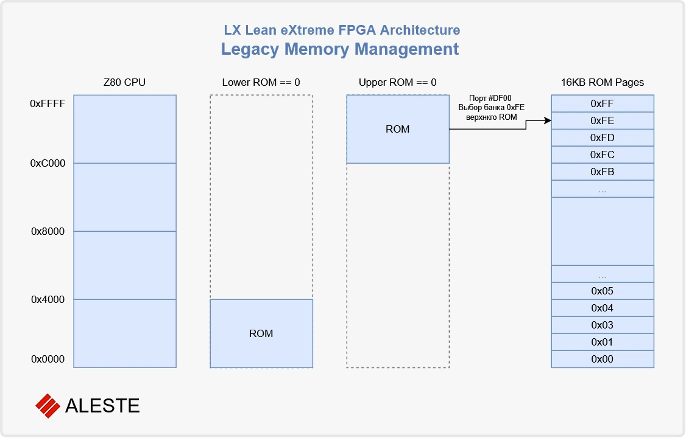

# LX Legacy: CPC 6128 and Aleste 520EX

## 0. How to read this document

This document has three layers:

1. **CPC 6128 — inside the case.** The Amstrad CPC 6128 canon: what was
   on the CPC board. LX **must** emulate it. This is the compatibility
   target.
2. **CPC 6128 — outside the case / late additions.** What was on the CPC
   board but is no longer relevant today, or what appeared as add‑on
   boards. LX **may** support it, but is not required to.
3. **Aleste 520EX — extended, not canon.** A 1990s extension built on
   discrete components. For LX it is at most an ideological inspiration.
   Full 520EX reproduction is **not recommended**.

### Labels used in this document

| Label | Meaning |
|---|---|
| **Mandatory** | Inside the CPC case. LX must emulate it. |
| **Recommended** | Inside the CPC case, desirable. (Currently unused.) |
| **Optional** | May be supported, may be omitted. |
| **Not recommended** | 520EX and its cost‑cutting compromises. Not canon. |

### Markers used in this document

| Marker | Meaning |
|---|---|
| **⚠ Spec:** | The old specification (v7, `legacy_Info_io.md`) differs from the RTL. **RTL is authoritative.** |
| **⚠ Outdated:** | The old document may be stale (bits, addresses, defaults may have changed). |
| **⚠ Carlos:** | Implemented in RTL by Carlos, but **not the LX design intent**. Acknowledged and documented; **not recommended** for LX. |

**RTL is authoritative.** Where this document and `gen_rtl` disagree, the
RTL wins. The document describes what exists; the labels describe what
LX *should* support.

---

## 0.1 Author's position (hww)

LX is a **CPC 6128 with a modern core**. The compatibility target is the
**Amstrad CPC 6128 canon**: what was *inside* the CPC case — the CPU,
the Gate Array, the CRTC, the PPI, the FDC, the ROM, the RAM banking,
the I/O conventions, and the PSG. That is **Mandatory** and must be
emulated.

What was **outside** the CPC case — third‑party expansions, cartridges,
external peripherals, Amstrad‑branded "standard" add‑ons — is **not**
part of the LX compatibility target. LX may ignore it.


**Aleste 520EX** is an *extended* platform (1990s, discrete components).
It is **not canon**. It contains many cost‑cutting compromises of the
era: spare bits in ports that could be used for anything, LEDs wired
into odd places, non‑standard printer, joysticks and mouse. These are
**not architectural decisions** — they are what the hardware happened
to do. They must **not** be treated as canon. For LX, 520EX is at most
an **ideological inspiration**, and **full 520EX reproduction is not
recommended** by the author of LX.

**Carlos** implemented 520EX features in the RTL — carefully and
completely. We acknowledge this work. It is documented here for
completeness. But it is **not the LX design intent**. Where RTL and LX
intent differ, the RTL is what exists, and the LX intent is what is
recommended. Both are documented side by side.

---

## 1. Amstrad CPC 6128 — inside the case

The CPC 6128 canon. All items in this section are **Mandatory** unless
marked otherwise.

### 1.1 Partial decoding rules

Components use partial address decoding. It is therefore possible to
send the same value to different components simultaneously by carefully
using custom I/O ports.

<!-- table: procedural -->
| Hardware device | R/W | b15 | b14 | b13 | b12 | b11 | b10 | b9 | b8 | b7 | b6 | b5 | b4 | b3 | b2 | b1 | b0 |
|---|---|---|---|---|---|---|---|---|---|---|---|---|---|---|---|---|---|
| Gate Array | W | 0 | 1 | - | - | - | - | - | - | - | - | - | - | - | - | - | - |
| PAL (RAM configuration) | W | 0 | * | - | - | - | - | - | - | - | - | - | - | - | - | - | - |
| CRTC | R/W | - | 0 | - | - | - | - | r1 | r0 | - | - | - | - | - | - | - | - |
| Upper ROM select | W | - | - | 0 | - | - | - | - | - | - | - | - | - | - | - | - | - |
| Printer Port | W | - | - | - | 0 | - | - | - | - | - | - | - | - | - | - | - | - |
| 8255 PPI | R/W | - | - | - | - | 0 | - | r1 | r0 | - | - | - | - | - | - | - | - |
| Expansion Peripherals | R/W | - | - | - | - | - | 0 | x | x | x | x | x | x | x | x | x | x |

Legend:

- `-` — bit ignored
- `0` — bit must be `0` for the device to respond
- `1` — bit must be `1` for the device to respond
- `r1`, `r0` — register selector bits
- `*` — bit 14 of the PAL port must be `1` on CPCs with CRTC 0/1/2.

**LX (hww):** Mandatory — needed for CPC compatibility.

### 1.2 Official I/O ports

<!-- table: procedural -->
| I/O | Decoded as | Port | R/W |
|---|---|---|---|
| `0x7FXX` | `%01xxxxxx xxxxxxxx` | Gate Array | W |
| `0xBCXX` | `%x0xxxx00 xxxxxxxx` | 6845 CRTC Index | W |
| `0xBDXX` | `%x0xxxx01 xxxxxxxx` | 6845 CRTC Data Out | W |
| `0xBEXX` | `%x0xxxx10 xxxxxxxx` | 6845 CRTC Status | R |
| `0xBFXX` | `%x0xxxx11 xxxxxxxx` | 6845 CRTC Data In | R |
| `0xDFXX` | `%xx0xxxxx xxxxxxxx` | Upper ROM Bank Number | W |
| `0xEFXX` | `%xxx0xxxx xxxxxxxx` | Printer Port | W |
| `0xF4XX` | `%xxxx0x00 xxxxxxxx` | 8255 PPI Port A (PSG Data) | RW |
| `0xF5XX` | `%xxxx0x01 xxxxxxxx` | 8255 PPI Port B | R |
| `0xF6XX` | `%xxxx0x10 xxxxxxxx` | 8255 PPI Port C | W |
| `0xF7XX` | `%xxxx0x11 xxxxxxxx` | 8255 PPI Control | W |
| `0xFA7E` | `%xxxxx0x0 0xxxxxxx` | Floppy Motor Control | W |
| `0xFB7E` | `%xxxxx0x1 0xxxxxx0` | 765 FDC Status | R |
| `0xFB7F` | `%xxxxx0x1 0xxxxxx1` | 765 FDC Data | RW |

**LX (hww):** Mandatory — these are the CPC I/O conventions.
Exception: `0xEFXX` printer port is **Optional**.

### 1.3 8255 PPI

The 8255 PPI is connected to the AY‑3‑8912 (PSG), the keyboard, the
cassette tape, the CRTC VSYNC signal, and the printer "busy" signal.

**Selection:** the PPI is active when **bit 11 of the I/O address is
`0`**.

**Recommended I/O addresses** (other bits set to `1` to avoid conflicts):


#### Port A

OS settings: I/O Mode 0, Output.


#### Port B

OS settings: I/O Mode 0, Input.


**Manufacturer table (power‑on, CPC/CPC+ only):**


#### Port C

OS settings: Upper half Mode 0 Output, lower half Mode 0 Output.


**PSG function select:**


**Programming examples:**

```asm
; Set bit 7 of Port C
LD B, &F7        ; 8255 Control port
LD A, %00001111  ; Bit set/reset function
OUT (C), A
RET
```

```asm
; Configure ports: A=input, B=output, C=input (all Mode 0)
LD B, &F7
LD A, %10011001
OUT (C), A
RET
```

**Reading from Port A:**

```asm
LD B, &F7        ; 8255 Control port
LD A, %10010010  ; Configuration
OUT (C), A
LD B, &F4        ; Port A
IN E, (C)        ; E = value
LD B, &F7
LD A, %10000010  ; Restore
OUT (C), A
RET
```

**Important notes:**

1. If a port is configured as input, its outputs are high‑impedance.
2. Manufacturer and refresh rate are **board‑set** and cannot be changed.
3. Bit 5 of Port B (`/EXP`) may be used by expansions.

**LX (hww):** Mandatory — PPI is the CPC I/O hub.
Exception: printer‑related bits are **Optional**.

### 1.4 Gate Array (port 7Fxx)


#### Register 0 — Palette Index


<!-- table: procedural -->
| Depth | Normal inks (CPC) | Secondary inks (Aleste) |
|---|---|---|
| 1 bit | 0..1 | 2..3 |
| 2 bit | 0..3 | 4..7 |
| 4 bit | 0..15 | N/A (uses 0..15) |

#### Register 1 — Palette Data

The number is converted by IC D62.

- With MAPPER set in EXTPORT, the number defines R, G, B with 2 bits
  per element; the ROM then reorders bits before the hardware.
- With MAPPER not set, the number is the CPC Gate Array colour value,
  looked up in IC D62 and converted to 2‑bit‑per‑element R, G, B.

> The CPC supports 3 intensities per colour (0%, 50%, 100%). Aleste
> supports 4 (0%, 33%, 66%, 100%).

#### Register 2 — Video Mode, ROM enable, LEDs


**CPC modes:**

<!-- table: procedural -->
| bit 1 | bit 0 | Mode |
|---|---|---|
| 0 | 0 | 160×200 (16 colours) |
| 0 | 1 | 320×200 (4 colours) |
| 1 | 0 | 640×200 (2 colours) |
| 1 | 1 | Unknown; on CPC this is 160×200 (4 colours) |

Aleste modes use the same encoding but can run at higher rates.

#### Register 3 — RAM banking

**Four I/O ports control the mapper:**


The mapper port decode uses bit 15 of the I/O address, as the Aleste
Gate Array does. Address bits 9 and 8 select the page. To avoid writing
to the Aleste Gate Array, data bits 7 and 6 must be `1`. The remaining
bits define the RAM block/configuration.



**LX (hww):** Mandatory — Gate Array is the core of CPC graphics and
banking.

> **⚠ Spec:** Old spec said `7Fxx` is decoded by full byte
> `A[15:8] == 0x7F`. RTL (`mmu_legacy.sv`) decodes by `~A[15]` only.
> **RTL is authoritative.**

> **⚠ Carlos:** RTL implements 520EX palette (D62 conversion, 4
> intensities, EXTPORT MAPPER bit). This is 520EX heritage, not the
> LX design intent. **Not recommended** for LX.

### 1.5 CRTC 6845


The CRTC registers are documented in the Amstrad CPC 6128 technical
manual; LX does not change their behaviour.

**LX (hww):** Mandatory — CRTC is the CPC video core.

### 1.6 Upper ROM Select (DFxx)

An 8‑bit register that selects a 16 KB bank at addresses `C000-FFFF`
when `upper_rom` (RMR bit 3) is `0`.

**CPC 6128 ROM banks:**


**LX (hww):** Mandatory — needed for CPC ROM switching.

> **⚠ Spec:** Old spec said `DFxx` writes the bank number directly.
> RTL (`mmu_legacy.sv`) recodes via D62 PROM: `7→2, 3→3, otherwise→1`.
> **RTL is authoritative.**

> **⚠ Carlos:** RTL applies the 520EX D62 recode. This is 520EX
> heritage. **Not recommended** for LX (but documented).

### 1.7 FDC 765

The floppy disk controller is a uPD765. It is accessed through the PPI
and the following ports:


**LX (hww):** Mandatory — FDC is the CPC disk interface.

### 1.8 RMR / MMR / CPC 128/512 memory map

#### RMR (Control Interrupt counter, ROM mapping, Graphics mode)


- `upper_rom` starts at `C000`.
- `lower_rom` starts at `0000`.
- `graphic_mode` selects the graphics mode.
- On Amstrad, writing to ROM writes to the RAM underneath.

#### MMR (RAM memory mapping)


**CPC 128 memory map:**

<!-- table: procedural -->
| Address | 0 | 1 | 2 | 3 | 4 | 5 | 6 | 7 |
|---|---|---|---|---|---|---|---|---|
| `C000-FFFF` | RAM_3 | RAM_7 | RAM_7 | RAM_7 | RAM_3 | RAM_3 | RAM_3 | RAM_3 |
| `8000-BFFF` | RAM_2 | RAM_2 | RAM_6 | RAM_2 | RAM_2 | RAM_2 | RAM_2 | RAM_2 |
| `4000-7FFF` | RAM_1 | RAM_1 | RAM_5 | RAM_3 | RAM_4 | RAM_5 | RAM_6 | RAM_7 |
| `0000-3FFF` | RAM_0 | RAM_0 | RAM_4 | RAM_0 | RAM_0 | RAM_0 | RAM_0 | RAM_0 |

**CPC 512 KB memory map:**

<!-- table: procedural -->
| Address | ccc=0 | ccc=1 | ccc=2 | ccc=3 | ccc=4 | ccc=5 | ccc=6 | ccc=7 |
|---|---|---|---|---|---|---|---|---|
| `0000-3FFF` | 0 | 0 | `bbb*4 + 0` | 0 | 0 | 0 | 0 | 0 |
| `4000-7FFF` | 1 | 1 | `bbb*4 + 1` | 3 | `bbb*4 + 0` | `bbb*4 + 1` | `bbb*4 + 2` | `bbb*4 + 3` |
| `8000-BFFF` | 2 | 2 | `bbb*4 + 2` | 2 | 2 | 2 | 2 | 2 |
| `C000-FFFF` | 3 | `bbb*4 + 3` | `bbb*4 + 3` | `bbb*4 + 3` | 3 | 3 | 3 | 3 |

**LX (hww):** Mandatory — RMR/MMR are the CPC memory model.

### 1.9 PSG AY‑3‑8912

The AY‑3‑8912 Programmable Sound Generator is on the CPC board,
connected through PPI Port A (data) and PPI Port C (BDIR/BC1).

The PSG is accessed via the PPI:

1. Write the register number to PPI Port C with `BDIR=1, BC1=1`.
2. Write/read data via PPI Port A with `BDIR=1, BC1=0` (write) or
   `BDIR=0, BC1=1` (read).

**LX (hww):** Mandatory — the PSG is the CPC sound core.

### 1.10 Cassette tape

The cassette tape interface is on the CPC board, connected through PPI
Port B (data) and Port C (motor control, write data).

**LX (hww):** Optional.

### 1.11 Printer port (EFXX)

The printer port is on the CPC board, connected through PPI Port B
(busy) and `EFXX` (data).

**LX (hww):** Optional.

### 1.12 Joysticks

The CPC joystick interface is on the CPC board, connected through PPI
Port B and the keyboard matrix.

**LX (hww):** Optional.

---

## 2. Aleste 520EX — extended (not canon)

Aleste 520EX is a 1990s extension of the CPC, built on discrete
components. It is **not canon** for LX. It contains cost‑cutting
compromises (spare bits in ports, LEDs in odd places, non‑standard
printer/joystick/mouse). These are **not architectural decisions**.

This section documents **only what is actually in the RTL** (`gen_rtl`,
`mmu_legacy.sv`), because that is what exists. Everything here is
**Not recommended** for LX.

### 2.1 MAPMOD / HIGHX / HIZ (EXTPORT FABF)

The 520EX adds an EXTPORT register at port `FABF`:


**LX (hww):** Not recommended.

> **⚠ Carlos:** RTL implements `mapmod_i` (from `FABF` D2) and the MSX
> mapper in `mmu_legacy.sv`. This is 520EX heritage, carefully preserved
> by Carlos. It is **not** the LX design intent.

### 2.2 EXTPORT (FABF) — bits 5‑4, 3, 2, 1, 0

See §2.1.

### 2.3 Aleste Gate Array (7Fxx, `~A[15]` decode)

In RTL (`mmu_legacy.sv`), the Aleste Gate Array is decoded by `~A[15]`
(not by full byte `A[15:8]==0x7F`), and `7Fxx` writes are forwarded to
the Wishbone bus.

**LX (hww):** Not recommended.

### 2.4 Upper ROM D62 recode (DFxx: 7→2, 3→3, else→1)

In RTL (`mmu_legacy.sv`), `DFxx` writes are recoded via the 520EX D62
PROM: `7→2, 3→3, otherwise→1`.

**LX (hww):** Not recommended.

### 2.5 Lower ROM at 400000

In RTL (`mmu_legacy.sv`), the lower ROM is mapped at physical address
`400000`.

**LX (hww):** Not recommended.

### 2.6 MSX mapper (mapper_reg[0:3])

In RTL (`mmu_legacy.sv`), when `mapmod_i = 1`, the legacy MMU uses an
MSX‑style mapper with four 6‑bit page registers.

**LX (hww):** Not recommended.

---

## 3. Author's recommendation for LX (summary)

<!-- table: procedural -->
| Element | CPC | 520EX | LX (hww) | Comment |
|---|---|---|---|---|
| Z80 CPU | yes | yes | **Mandatory** | Core CPU |
| Gate Array (7Fxx) | yes | yes (modified) | **Mandatory** | CPC graphics/banking |
| CRTC 6845 | yes | yes | **Mandatory** | CPC video core |
| PPI 8255 | yes | yes | **Mandatory** | CPC I/O hub |
| FDC 765 | yes | yes | **Mandatory** | CPC disk interface |
| ROM (BASIC/AMSDOS) | yes | yes | **Mandatory** | CPC firmware |
| RAM banking (RMR/MMR) | yes | yes (modified) | **Mandatory** | CPC memory model |
| PSG AY‑3‑8912 | yes | yes | **Mandatory** | CPC sound core |
| Cassette tape | yes | yes | **Optional** | Standard, not required |
| Printer port (EFXX) | yes | yes | **Optional** | Standard, not required |
| Joysticks | yes | yes | **Optional** | Standard, not required |
| 8253 Timer | no (add‑on) | yes | **Optional** | Not on CPC board |
| SIO/DART (FADC‑FADF) | no (add‑on) | yes | **Optional** | Not on CPC board |
| Amstrad Serial Interface | no (add‑on) | yes | **Optional** | Not on CPC board |
| MAPMOD / HIGHX / HIZ | no | yes | **Not recommended** | 520EX cost‑cutting |
| EXTPORT (FABF) | no | yes | **Not recommended** | 520EX cost‑cutting |
| Aleste Gate Array (`~A[15]`) | no | yes | **Not recommended** | 520EX decode |
| D62 recode (DFxx) | no | yes | **Not recommended** | 520EX PROM |
| Lower ROM at 400000 | no | yes | **Not recommended** | 520EX layout |
| MSX mapper | no | yes | **Not recommended** | 520EX mapper |

---

## 4. Spec vs RTL (RTL authoritative)

<!-- table: procedural -->
| # | Old spec said | RTL does (gen_rtl) | Status | Comment |
|---|---|---|---|---|
| 1 | `7Fxx` = `A[15:8]==0x7F`, internal Gate Array | `7Fxx` = `~A[15]`, forwarded to Wishbone bus | outdated | Palette outside legacy MMU |
| 2 | `DFxx` = direct bank number | `DFxx` = D62 recode (7→2, 3→3, else→1) | outdated | 520EX PROM |
| 3 | Lower ROM at `0000` (CPC) | Lower ROM at `400000` (520EX) | outdated | 520EX layout |
| 4 | No MAPMOD/MSX mapper | MAPMOD (`FABF` D2) + MSX mapper | outdated | 520EX feature |
| 5 | `reg_control` bit 0 = supervisor, bit 1 = native | Same: bit 0 = supervisor, bit 1 = native | matches | No change |
| 6 | MMIO formula: `FF0000 + (page<<7) + a[6:0]` | `{FF, 2'b00, page[6:0], a[6:0]}` = same | matches | No change |
| 7 | MMIO window `00–7F` (128 bytes) | `!cpu_a[7]` → `00–7F` | matches | No change |
| 8 | `mmio_userlock` default 0 | `reg_control = 0001_0011` (lock=1) | outdated | Safer default in RTL |
| 9 | `SUPER_SLOT` = `F9h` | `SLOT_SUPER_ADDR = 8'hFA` | outdated | Spec 7 was wrong |
| 10 | `CLOCK_CTRL` reset = `00000111` | `reg_clock = 0000_0010` | outdated | RTL divides by 4 |
| 11 | `SUPER_SLOT` reset = `00` | `reg_super_slot = 8'hFF` | outdated | All pages → slot 3 |
| 12 | `USER_SLOT` reset = `00` | `reg_user_slot = 8'h00` | matches | No change |

---

## 5. Open questions

1. **USART (`0xEEXX`/`0xEFXX`) vs Printer (`0xEFXX`) conflict.** The
   520EX uses `0xEFXX` for the 8251 USART (control/status), while the
   CPC uses `0xEFXX` for the printer port. How should LX resolve this?
   *TBD.*
2. **What of 520EX in RTL should be kept as legacy 520EX compatibility?**
   Carlos implemented 520EX features. Should LX keep any of them as a
   "520EX compatibility mode", or remove them entirely? *TBD.*
3. **`7Fxx` on Wishbone.** RTL forwards `7Fxx` to the bus; CPC treats
   it as an internal Gate Array. Is this intended for LX (palette as a
   separate device), or a 520EX artefact? *TBD.*
4. **D62 recode vs direct bank.** Should LX keep the D62 recode
   (520EX), or revert to direct `DFxx` bank numbers (CPC)? *TBD.*
5. **Lower ROM at 400000 vs 0000.** Should LX keep the 520EX layout, or
   restore the CPC layout? *TBD.*
6. **MSX mapper.** Should LX keep the MSX mapper (520EX), or remove it
   entirely? *TBD.*
7. **`SUPER_SLOT` at `FAh` vs `F9h`.** RTL uses `FAh`; spec 7 said `F9h`.
   Which is correct for LX? *TBD.*
8. **`mmio_userlock` default.** RTL defaults to `1` (locked); spec 7
   said `0` (unlocked). Which is correct for LX? *TBD.*
9. **`reg_clock` default.** RTL defaults to `2` (divide by 4); spec 7
   said `7`. Which is correct for LX? *TBD.*

---

*End of document.*
