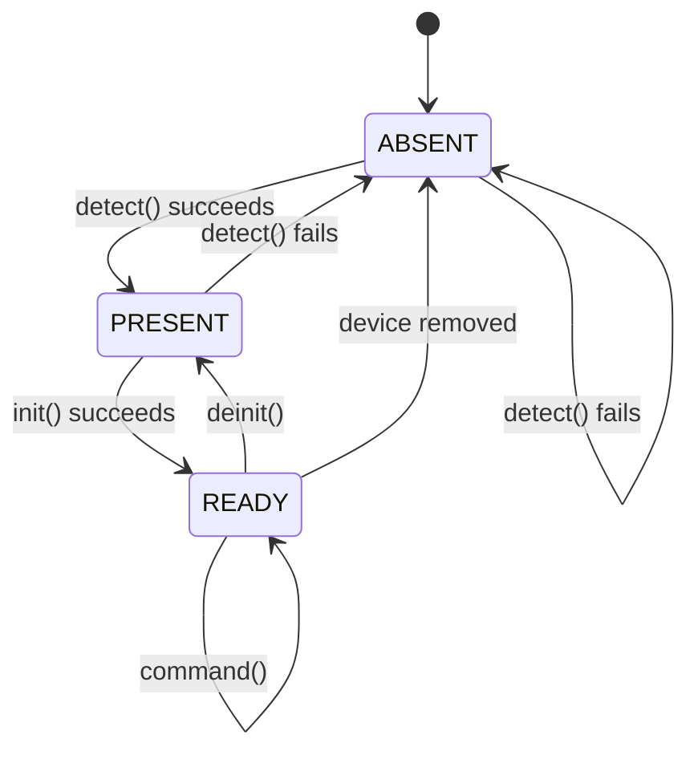

# LX BIOS: Driver Architecture Specification

| Version | Date       | Changes                                                                                                                                                                                                           | Author |
|---------|------------|-------------------------------------------------------------------------------------------------------------------------------------------------------------------------------------------------------------------|--------|
| 1.2     | 2026-11-05 | Converted to Markdown; merged duplicated sections; corrected the call-cost model, the state diagram and the hash example; fixed the `activate_driver` and AY shadow-register bugs; moved the audio example to MSX PSG ports; fixed command ranges, register preservation and nested context saving | hww    |
| 1.1     | 2026-01-01 | Simplified API, added memory context, fixed states                                                                                                                                                                | hww    |
| 1.0     | 2024-01-15 | Initial specification                                                                                                                                                                                             | hww    |

> **Units.** Timings are in Z80 **T-states** (clock periods) and are nominal minimums: wait states inserted by the hardware add to them. Port addresses in examples are illustrative; the audio example uses the MSX PSG ports.

## Contents

1. [Purpose and scope](#1-purpose-and-scope)
2. [Design principles](#2-design-principles)
3. [Driver kinds](#3-driver-kinds)
4. [Driver interface](#4-driver-interface)
5. [Driver states](#5-driver-states)
6. [Polymorphism: slot activation](#6-polymorphism-slot-activation)
7. [Command interface](#7-command-interface)
8. [Memory contexts](#8-memory-contexts)
9. [Dependencies](#9-dependencies)
10. [Performance budgets](#10-performance-budgets)
11. [Conventions: naming and files](#11-conventions-naming-and-files)
12. [Compliance and testing](#12-compliance-and-testing)
13. [Verification on hardware](#13-verification-on-hardware)
- [Appendix A: polymorphic video driver](#appendix-a-polymorphic-video-driver)
- [Appendix B: memory context wrapper](#appendix-b-memory-context-wrapper)
- [Appendix C: audio driver skeleton (AY-3-8910)](#appendix-c-audio-driver-skeleton-ay-3-8910)

---

## 1. Purpose and scope

This document defines the architecture, interfaces and requirements for device drivers in the Aleste BIOS. It is the reference for driver authors and system integrators.

It covers the driver architecture, interfaces and calling conventions, data structures, driver states, and the memory-context mechanism. It does **not** cover hardware-specific details, memory maps or port addresses, which belong to separate hardware specifications.

## 2. Design principles

### 2.1 Speed through predictability

On an 8-bit machine abstraction costs clock cycles. This architecture therefore rejects runtime indirection models that trade cycles for theoretical flexibility, and works from the constraints of the Z80 and of banked memory:

- **Every call matters.** At 4 MHz and 50 Hz a frame is 20 ms, which is 80,000 T-states. Tens of T-states saved per operation decide whether graphics can be dynamic or only static.
- **Memory is banked.** Remapping banks is expensive, so it is done as rarely as possible and as fast as possible when unavoidable.
- **Simplicity enables speed.** The fastest code is code that never runs.

Two techniques follow:

1. **Polymorphism by copying jump instructions** into a fixed slot, instead of calling through a pointer table.
2. **Lazy memory-context switching**, validated by a cheap hash comparison.

### 2.2 Cost model

All figures are from the Z80 instruction timings (T-states).

| Operation                 | T-states | Where it appears                       |
|---------------------------|---------:|----------------------------------------|
| `CALL nn`                 | 17       | caller invokes a slot entry            |
| `JP nn`                   | 10       | the entry in the slot or VTable        |
| `RET`                     | 10       | driver returns                         |
| `JP (HL)`                 | 4        | indirect jump, address already in HL   |
| `LD HL,(nn)`              | 16       | loading a pointer for indirect call    |
| `LDIR`                    | 21 per byte, 16 for the last | activating a driver |

What this means in practice:

- A function is normally called with `CALL` and ends with `RET`. Called through a slot, the only extra cost is the `JP` in the slot: **10 T-states**. A direct call costs `CALL` + `RET` = 27; a call through a slot costs `CALL` + `JP` + `RET` = 37.
- Calling through a pointer variable (`LD HL,(ptr)` + `JP (HL)`) costs 20 T-states and clobbers HL. The slot is twice as cheap and keeps every register free for arguments.
- Activating a driver copies its VTable once. Copying the 15-byte minimum VTable takes 14·21 + 16 = **310 T-states** (about 78 µs at 4 MHz). Copying a full 64-byte slot takes 63·21 + 16 = **1339 T-states** (about 335 µs).
- 1000 slot calls per frame spend 10,000 T-states (12.5% of the frame) on the `JP` overhead. Drivers with hot loops should expose a coarse operation (draw a line, fill a span) instead of being called per pixel.

### 2.3 The KISS rule

> It is better **not** to declare and implement a function, variable, constant or macro than to implement one without a clear, immediate purpose.

Before adding any element, ask: is it required by the hardware? Does it remove a proven bottleneck? Does it simplify the caller's API? Do not create abstraction layers "just in case", wrappers that only rename an existing call, or constants used only once.

## 3. Driver kinds

### 3.1 Singleton drivers

A singleton represents hardware that exists once and cannot be replaced: the MMU, the interrupt controller, the system timer.

- The VTable is fixed at build time and never changes.
- Applications call methods directly through the driver's own labels, for example `call __mmu_switch_bank`.
- The VTable is used by the system during boot (detection and initialization), not as a runtime polymorphism mechanism.
- Other drivers may depend on singletons.

### 3.2 Polymorphic drivers

A polymorphic driver gives several implementations one interface: video modes, filesystems (FAT12, TR-DOS), audio chips, console output.

- Applications **always** call the labels of the *polymorphic slot*, for example `call __video_draw_pixel`. They never know which implementation is active.
- Activation **copies** the chosen implementation's VTable into the slot (section 6). It is a copy, not a pointer assignment.
- All implementations of one interface share one VTable layout.
- A program written for one implementation therefore works with every other one.

### 3.3 Comparison

| Aspect              | Singleton                          | Polymorphic                              |
|---------------------|------------------------------------|------------------------------------------|
| Hardware            | one fixed device (MMU, CRTC)       | one interface, several implementations   |
| VTable in memory    | fixed                              | rewritten on each activation             |
| Called by the app   | through the driver's own labels    | through the slot labels                  |
| Switching           | not applicable                     | `CMD_SWITCH_DRIVER`                      |
| Call cost           | `CALL` + `JP` + `RET` = 37 T-states| 37 T-states, once activated              |

## 4. Driver interface

### 4.1 Mandatory methods

Every driver implements exactly five methods. They form the minimal VTable: **5 × 3 = 15 bytes**.

| Offset | Method       | Purpose                                                                                                                                       |
|-------:|--------------|-----------------------------------------------------------------------------------------------------------------------------------------------|
| 0      | `detect()`   | Checks that the device is physically present with minimal hardware verification. No resource allocation. Safe to call at any time (hot-plug). |
| 3      | `init()`     | Software initialization: memory, data structures, initial configuration. Does not necessarily power the device on. Idempotent.                |
| 6      | `deinit()`   | Releases everything `init()` acquired. Handles partial initialization. Does not change the device's power state.                              |
| 9      | `get_info()` | Returns a pointer to the immutable `DriverInfo` block in HL.                                                                                  |
| 12     | `command()`  | Single entry for all control operations: power, mode, configuration, driver switching. A command code goes in A.                              |

A minimal driver needs nothing else. Everything is done through `init()` and the universal `command()`.

### 4.2 Optional methods and fast access

Passing commands in the accumulator is too slow for hot operations such as drawing a sprite or printing a character. A driver that needs speed adds **optional methods**: extra `JP` entries at offsets 15, 18, … that enter the driver's internals directly.

```asm
__driver_vtable:
__driver_detect:    jp detect_impl      ; offset 0    mandatory
__driver_init:      jp init_impl        ; offset 3    mandatory
__driver_deinit:    jp deinit_impl      ; offset 6    mandatory
__driver_get_info:  jp get_info_impl    ; offset 9    mandatory
__driver_command:   jp command_impl     ; offset 12   mandatory
__driver_method_1:  jp method_1_impl    ; offset 15   optional
__driver_method_2:  jp method_2_impl    ; offset 18   optional
; ... up to 16 optional methods
__driver_vtable_end:
```

- The VTable length is `5 + n` entries, where *n* is the number of optional methods.
- The **slot is 64 bytes**, which holds 21 entries (5 mandatory + 16 optional). The size is chosen for alignment, so that addresses stay round and easy to remember. It is a capacity, not a cost: activation copies only `__driver_vtable_end - __driver_vtable` bytes.
- A simple driver (switch the mode, print text) copies 15 bytes. A complex driver copies more.
- Every entry that a driver does not implement points to the shared `_undefined_method` handler, which returns CF=1, A=`ERR_NOT_SUPPORTED`.

### 4.3 DriverInfo

```asm
DriverInfo:
    .name_ptr:      dw 0    ; pointer to ASCIIZ name
    .version_major: db 0
    .version_minor: db 0
    .flags:         dw 0    ; capability flags
    .device_id:     db 0    ; device type identifier
    .reserved:      db 0    ; alignment padding
```

Capability flags:

| Flag                    | Bit | Meaning                                  |
|-------------------------|----:|------------------------------------------|
| `DRV_FLAG_HOTPLUG`      | 0   | supports hot-plug detection              |
| `DRV_FLAG_POWER_CTRL`   | 1   | supports power-management commands       |
| `DRV_FLAG_HAS_IRQ`      | 2   | uses interrupt service routines          |
| `DRV_FLAG_POLYMORPHIC`  | 3   | several implementations available        |
| `DRV_FLAG_BANKED_MEM`   | 4   | needs a banked memory context            |
| `DRV_FLAG_STATIC`       | 5   | singleton: fixed VTable   |

> The prefix is `DRV_FLAG_` everywhere. Earlier drafts mixed `DRIVER_FLAG_*`, `DRV_FLAG_*` and `API_STATIC_BIT`.

### 4.4 Calling convention

Arguments and results are passed in registers as documented per method. The following rules apply to all methods.

- **Result:** success is CF=0 and A=0; failure is CF=1 and A=error code. Other registers may carry additional results.
- **Register preservation:** unless a method says otherwise, it may clobber AF, BC, DE and HL, and must preserve IX, IY and the alternate set (AF', BC', DE', HL').

```asm
    call __driver_method
    jr   c, .handle_error     ; one instruction to test the result
```

### 4.5 Error codes

| Code | Constant            | Meaning                          |
|-----:|---------------------|----------------------------------|
| 0x00 | `ERR_SUCCESS`       | completed successfully           |
| 0x01 | `ERR_NOT_SUPPORTED` | operation not supported          |
| 0x02 | `ERR_NO_DEVICE`     | target device not present        |
| 0x03 | `ERR_BAD_PARAMETER` | invalid parameter value          |
| 0x04 | `ERR_TIMEOUT`       | operation timed out              |
| 0x05 | `ERR_BUSY`          | device busy                      |
| 0x06 | `ERR_NO_MEMORY`     | insufficient memory              |
| 0x07 | `ERR_IO_ERROR`      | general I/O failure              |
| 0x08 | `ERR_WRONG_STATE`   | invalid in the current state     |
| 0x09 | `ERR_HARDWARE`      | hardware failure                 |
| 0x0A | `ERR_CONFIG`        | configuration error              |

## 5. Driver states

A driver is in exactly one of three states.

| State       | Meaning                                                                                              |
|-------------|------------------------------------------------------------------------------------------------------|
| **ABSENT**  | Device not detected. The driver may be loaded but cannot confirm the hardware.                       |
| **PRESENT** | Device verified by `detect()`, software resources not allocated. Not operational.                    |
| **READY**   | Fully initialized and operational. Power state (normal, suspended) is controlled by `command()`.     |



Methods valid in each state:

| State       | detect | init | deinit | command | get_info | Device methods |
|-------------|:------:|:----:|:------:|:-------:|:--------:|:--------------:|
| **ABSENT**  | yes    | no   | no     | no      | yes      | no             |
| **PRESENT** | yes    | yes  | yes¹   | yes²    | yes      | no             |
| **READY**   | yes³   | no   | yes    | yes     | yes      | yes            |

1. In PRESENT, `deinit()` is a successful no-op.
2. Only `POWER_ON`, `POWER_OFF` and `GET_STATUS`.
3. Hot-plug verification only; a successful `detect()` does not change the state.

> **Fix in 1.2.** Earlier drafts drew `PRESENT → ABSENT` on `deinit()`, but `deinit()` returns a driver to the post-`detect()` state, which is PRESENT. A driver leaves PRESENT for ABSENT when `detect()` fails.

## 6. Polymorphism: slot activation

### 6.1 Mechanism

Each polymorphic interface owns a **slot**: a fixed block of RAM that holds a VTable of `JP` instructions. Activation:

1. The system validates the new VTable (length ≤ slot size, entries are `JP` opcodes).
2. If the current driver is READY, its context is saved and its `deinit()` is called.
3. The new VTable is copied into the slot with `LDIR`.
4. The new driver's memory context is applied.
5. If the previous driver was READY, the system calls `init()` on the new one, so it ends up READY too. Otherwise the new driver starts in PRESENT or ABSENT as its `detect()` decides.
6. The system updates its internal references.

After step 3 the application's calls reach the new implementation with no further cost. Activation is the only place where polymorphism costs anything (section 2.2).

### 6.2 Reference implementation

```asm
; Activate a polymorphic driver.
; In:  HL = address of the new implementation's VTable
;      BC = its length in bytes (5 + n entries, times 3)
; Out: CF/A per section 4.4
__audio_activate_driver:
    ld   (current_driver), hl      ; remember the SOURCE (not the slot)
    ld   de, __audio_vtable        ; destination: the slot
    ldir
    xor  a                         ; CF=0, A=0
    ret
```

> **Bug fixed in 1.2.** The earlier template loaded `DE` with the slot address and then stored `DE` in `current_driver`, so `get_current_vtable` always returned the slot itself instead of the active implementation. The pointer to store is the *source* in HL.

### 6.3 Rules

- **The slot lives in memory that is never remapped** (the system window). Callers must be able to reach it whatever bank configuration is active.
- **The source VTable must be mapped while it is copied.** `CMD_SWITCH_DRIVER` maps the source's bank first if the source is banked.
- **Interrupt safety.** If an interrupt handler can call through the slot (`DRV_FLAG_HAS_IRQ`), the copy is wrapped in `di` / `ei`. About 1.3k T-states with interrupts off is the worst case (section 2.2).
- **Banked drivers.** If the implementation's code is in a bank other than the one mapped at call time, the VTable entries point to *context wrappers* (Appendix B), not to the implementation. The wrapper ensures the driver's memory context before jumping.

## 7. Command interface

`command()` takes a command code in A and command-specific parameters in other registers.

### 7.1 Standard commands

| Command            | Code | Parameters       | Description                  |
|--------------------|-----:|------------------|------------------------------|
| `CMD_POWER_ON`     | 0x01 | none             | enable device power          |
| `CMD_POWER_OFF`    | 0x02 | none             | disable device power         |
| `CMD_SUSPEND`      | 0x03 | none             | enter low-power suspend      |
| `CMD_RESUME`       | 0x04 | none             | resume from suspend          |
| `CMD_RESET`        | 0x05 | none             | hardware reset               |
| `CMD_GET_STATUS`   | 0x06 | none             | read device status           |
| `CMD_GET_CAPS`     | 0x07 | none             | read device capabilities     |
| `CMD_SET_CONFIG`   | 0x08 | HL = config_ptr  | apply configuration          |
| `CMD_GET_CONFIG`   | 0x09 | HL = buffer_ptr  | read configuration           |
| `CMD_SWITCH_DRIVER`| 0x10 | HL = vtable_ptr  | activate a new implementation|

### 7.2 Code ranges

| Range       | Use                                       |
|-------------|-------------------------------------------|
| 0x00–0x0F   | system commands, common to all drivers    |
| 0x10–0x1F   | driver-management commands                |
| 0x20–0xFF   | device-specific commands   |

### 7.3 Power-management sequence

```asm
    call __sd_detect          ; presence check
    jr   c, .no_device
    call __sd_init            ; software init
    jr   c, .init_failed

    ld   a, CMD_POWER_ON
    call __sd_command

    ld   hl, buffer           ; use the device
    ld   bc, sector_num
    call __sd_read_sector

    ld   a, CMD_SUSPEND       ; save power
    call __sd_command
    ; ... later
    ld   a, CMD_RESUME
    call __sd_command

    call __sd_deinit          ; clean shutdown
    ld   a, CMD_POWER_OFF
    call __sd_command
```

## 8. Memory contexts

### 8.1 Structure

A driver that needs a particular bank configuration defines an 8-byte `MemoryContext`:

```asm
MemoryContext:
    .hash:      db 0    ; hash of the bank configuration
    .slot_reg:  db 0    ; slot register value
    .bank_w0:   db 0    ; window 0 bank
    .bank_w1:   db 0    ; window 1 bank
    .bank_w2:   db 0    ; window 2 bank
    .bank_w3:   db 0    ; window 3 bank
    .flags:     db 0    ; context-specific flags
    .reserved:  db 0    ; padding
```

The hash covers every configuration byte:

```
hash = slot_reg ^ bank_w0 ^ bank_w1 ^ bank_w2 ^ bank_w3 ^ flags
```

Example: slot 1, banks 0x10, 0x20, 0x35 and 0x01, flags 0:

```
0x01 ^ 0x10 ^ 0x20 ^ 0x35 ^ 0x01 ^ 0x00 = 0x05
```

> **Fix in 1.2.** The earlier example gave the hash as 0xA5, but those values XOR to 0x00.

### 8.2 Switching protocol

Before driver code runs, the system makes sure the right context is active. The system keeps a pointer to the current context and its hash.

1. **Fast path.** Compare the hash of the current context with the driver's. If equal, continue immediately. This costs about 48 T-states including the `CALL` (`CALL` 17 + `LD A,(nn)` 13 + `CP (HL)` 7 + `RET Z` 11).
2. **Slow path.** Push the pointer to the current context on the stack, apply the driver's configuration (writes to the bank ports), update the current-context pointer and hash. This costs roughly 230 T-states: five port writes at about 24 T-states each, plus the cache update.
3. **Restore.** Pop the saved pointer and re-apply that context if its hash differs.

Saving on the stack makes nested driver calls safe: a video driver that calls the MMU driver does not overwrite its own saved context.

`ensure_memory_context` and `restore_previous_context` **preserve all registers, including AF**, so a driver's error result (CF, A) survives the restore.

### 8.3 Context cache

The cache holds four contexts of the same 8-byte layout (32 bytes in total):

```asm
context_tlb:
    ds 4 * 8              ; four MemoryContext entries
current_context:      dw 0   ; pointer to the active MemoryContext
current_context_hash: db 0
```

When all four entries are in use, the oldest is replaced (round-robin).

### 8.4 Note on the XOR hash

XOR is symmetric: two contexts that differ only by swapping the banks of two windows have the same hash, and the fast path would wrongly report a match. In practice two drivers rarely differ only by such a swap, but if they do, give them different `flags` values. A position-sensitive hash avoids the problem at almost no cost (`RLCA` + `XOR`, 8 T-states per byte):

```
h = 0
for b in (slot_reg, bank_w0, bank_w1, bank_w2, bank_w3, flags):
    h = rotl8(h) ^ b
```

For the example in 8.1 this gives 0xF6. Either definition works, as long as the whole system uses one.

## 9. Dependencies

A driver declares its dependencies as a null-terminated list of name strings, ended by an empty string:

```asm
DEPENDS_ON:
    db "MMU", 0     ; memory management unit
    db "PIC", 0     ; interrupt controller
    db 0            ; terminator
```

During initialization the system performs a topological analysis and ensures that all prerequisites are initialized first, that circular dependencies are detected and reported, and that a missing dependency blocks the driver's initialization with a clear error.

## 10. Performance budgets

| Operation              | Budget (T-states)                  |
|------------------------|------------------------------------|
| slot call overhead     | 10 (`JP`); full call 37            |
| `detect()`             | ≤ 1000                             |
| `command()`            | ≤ 2000                             |
| `init()` / `deinit()`  | no limit (one-time)                |
| context switch         | cached ≤ 50; uncached ≤ 250        |
| interrupt handler      | ≤ 200                              |

> Earlier drafts also stated "command execution ≤ 100 cycles for common operations", which contradicted the `command()` budget above. It is removed: a command's budget is the one in the table, and operations that must be faster belong in optional methods (section 4.2).

Memory (recommended): driver code ≤ 4096 bytes, driver data ≤ 1024 bytes, 8 bytes per `MemoryContext`, state ≤ 256 bytes.

## 11. Conventions: naming and files

### 11.1 Constant names

```
[DEVICE]_[TYPE]_[NAME]_[QUALIFIER]_[SUFFIX]
```

| Component   | Meaning           | Examples                              |
|-------------|-------------------|---------------------------------------|
| `DEVICE`    | hardware component| `MMU_`, `VIDEO_`, `AUDIO_`, `SYS_`    |
| `TYPE`      | kind of entity    | `PORT_` (I/O), `REG_` (MMIO), `CMD_`  |
| `NAME`      | element           | `CTRL`, `STATUS`, `DATA`, `MODE`      |
| `QUALIFIER` | modifier          | `SUPER`, `USER`, `NATIVE`, `ENABLE`   |
| `SUFFIX`    | value type        | `_BIT`, `_MASK`, `_SIZE`, `_BASE`     |

Examples: `MMU_PORT_CTRL_SUPER_BIT`, `VIDEO_CMD_SET_MODE`, `AUDIO_REG_VOLUME_A`.

### 11.2 Files and scope

The toolchain is z88dk (`z80asm`).

- **One file, one device.** A driver's VTable, data and code live in one `.asm` file.
- **`.inc` files are for declarations only:** `extern` declarations and numeric constants (`equ`). They must **not** contain `defc`, which causes redefinition errors when included twice.
- **`.asm` files are for definitions:** `defc` for linker symbols, plus the relevant `.inc` includes.
- **C interface layer.** A separate `.h` / `.c` pair marshals the C stack arguments into Z80 registers.

### 11.3 Directory layout

```
XiAlesteBIOS/
├── include/                 C headers
│   ├── bios/                BIOS subsystems (drivers.h, errors.h)
│   └── drivers/             public driver APIs (mmu.h, video.h)
├── inc/                     assembly headers
│   ├── bios/                drivers.inc (DRV_FLAG_*), errors.inc
│   ├── drivers/             extern labels (mmu.inc, video.inc)
│   └── hardware/            ports.inc, memory.inc
└── drivers/                 implementations
    ├── mmu/mmu.asm
    └── video/
        ├── video.asm        polymorphic slot
        └── video_mode0.asm  concrete implementation
```

### 11.4 Banked-memory macros

Port numbers belong to the hardware specification. The macros below show the intended use; the addresses are illustrative.

```asm
PORT_BANK_0       equ 0xFC    ; window 0 (0000-3FFF)
PORT_BANK_1       equ 0xFD    ; window 1 (4000-7FFF)
PORT_BANK_2       equ 0xFE    ; window 2 (8000-BFFF)
PORT_BANK_3       equ 0xFF    ; window 3 (C000-FFFF)
PORT_GLOBAL_CTRL  equ 0xF0    ; master control register

MACRO SWITCH_CODE_BANK bank   ; window 1, preserves other registers
    ld   a, bank
    out  (PORT_BANK_1), a
ENDM

MACRO SWITCH_DATA_BANK bank   ; window 2
    ld   a, bank
    out  (PORT_BANK_2), a
ENDM
```

## 12. Compliance and testing

All drivers must pass the Driver Compliance Test Suite, which validates API conformance and calling conventions, state-transition correctness, error-handling protocol, resource management (leak detection), performance budgets, and interoperability with system services.

Production drivers must also demonstrate 95%+ test coverage of all code paths, stress testing under resource exhaustion, fault-injection testing of error recovery, complete documentation of device-specific commands, and backward compatibility across minor versions.

## 13. Verification on hardware

The figures in this document are computed from the Z80 instruction timings. Before the budgets in section 10 are treated as guarantees, measure them on the target machine:

1. The cost of a slot call, with the wait states of the target's memory.
2. The fast and slow paths of the context switch (section 8.2).
3. The `LDIR` copy time of the VTables of real drivers.

---

## Appendix A: polymorphic video driver

Two implementations behind one slot. The application calls only `__video_*` labels.

```asm
; ---- video.asm: the polymorphic slot (64 bytes, in the system window) ----
    SECTION DRV_VTABLE
    ALIGN 64
__video_vtable:
__video_detect:     jp _undefined_method
__video_init:       jp _undefined_method
__video_deinit:     jp _undefined_method
__video_get_info:   jp _undefined_method
__video_command:    jp _undefined_method
__video_draw_pixel: jp _undefined_method
__video_draw_line:  jp _undefined_method
__video_vtable_end:

; ---- video_mono.asm: implementation 1 ----
__video_mono_vtable:
    jp mono_detect
    jp mono_init
    jp mono_deinit
    jp mono_get_info
    jp mono_command
    jp mono_draw_pixel
    jp mono_draw_line

; ---- video_color.asm: implementation 2 (same layout) ----
__video_color_vtable:
    jp color_detect
    jp color_init
    jp color_deinit
    jp color_get_info
    jp color_command
    jp color_draw_pixel
    jp color_draw_line

; ---- choosing an implementation ----
select_video:
    ld   a, (current_mode)
    cp   MODE_COLOR
    ld   hl, __video_color_vtable
    jr   z, .go
    ld   hl, __video_mono_vtable
.go:
    ld   a, CMD_SWITCH_DRIVER
    jp   __video_command           ; HL = new VTable
```

`ld hl, ...` does not change the flags, so the `jr z` still sees the result of `cp`. After the switch the application keeps calling `__video_draw_pixel` and the active mode decides what happens.

## Appendix B: memory context wrapper

A banked driver's VTable entries point at wrappers like this one.

```asm
; Driver context: sound code in window 1, samples in window 2.
snd_context:
    .hash:      db 0x05       ; 0x01 ^ 0x10 ^ 0x20 ^ 0x35 ^ 0x01
    .slot_reg:  db 0x01
    .bank_w0:   db 0x10       ; system
    .bank_w1:   db 0x20       ; driver code
    .bank_w2:   db 0x35       ; sample data
    .bank_w3:   db 0x01       ; system stack
    .flags:     db 0
    .reserved:  db 0

; Context wrapper: ensure the context, call the implementation, restore.
; Requires: ensure_memory_context and restore_previous_context preserve
;           all registers including AF (section 8.2).
play_sound_safe:
    push hl
    ld   hl, snd_context
    call ensure_memory_context
    pop  hl
    call play_sound_impl          ; result in CF / A
    jp   restore_previous_context ; tail jump; must keep AF intact
```

If the hash matches, `ensure_memory_context` does a compare and returns without touching the ports.

## Appendix C: audio driver skeleton (AY-3-8910)

An excerpt that shows the structure; the remaining methods follow the same pattern. The VTable follows the standard order (section 4.2): the five mandatory methods first, then the audio-specific ones.

```asm
; ---- audio.asm: polymorphic slot ----
    SECTION DRV_VTABLE
    ALIGN 64
    PUBLIC __audio_vtable
__audio_vtable:
__audio_detect:      jp _undefined_method   ; 0   mandatory
__audio_init:        jp _undefined_method   ; 3   mandatory
__audio_deinit:      jp _undefined_method   ; 6   mandatory
__audio_get_info:    jp _undefined_method   ; 9   mandatory
__audio_command:     jp _undefined_method   ; 12  mandatory
__audio_play_note:   jp _undefined_method   ; 15
__audio_stop:        jp _undefined_method   ; 18
__audio_set_volume:  jp _undefined_method   ; 21
; ... noise, envelope, tone, register access, chord, beep
__audio_vtable_end:

    SECTION DRV_DATA
DEPENDS_ON:  db 0                            ; no dependencies
_audio_info:
    dw   @name
    db   1, 0                                ; version 1.0
    dw   DRV_FLAG_POLYMORPHIC
    db   0                                   ; device_id
    db   0                                   ; reserved
@name: db "AY-3-8910 Audio Driver", 0

    SECTION DRV_DATA
current_driver: dw 0
```

The example targets the AY-3-8910 as it is wired in MSX computers. The chip appears to the Z80 as three I/O ports: `A0h` latches the register number, `A1h` writes data, `A2h` reads data (the range `A0h`–`A3h` is decoded for the PSG). For other hardware, change the three constants.

```asm
defc AY_REGISTER_PORT = 0xA0    ; write: select register
defc AY_DATA_PORT     = 0xA1    ; write: value
defc AY_READ_PORT     = 0xA2    ; read:  value
```

The implementation keeps a shadow copy of the 16 chip registers, so reads never touch the hardware.

```asm
; Write a chip register and update its shadow copy.
; In:  A = register number (0-15), E = value
; Out: A clobbered; BC, DE, HL preserved
ay_write_reg:
    push bc
    push hl
    ld   c, a                    ; C = register number
    ld   b, 0
    ld   hl, _ay_shadow_regs
    add  hl, bc                  ; HL = &shadow[reg]
    ld   (hl), e                 ; update the shadow
    ld   a, c
    out  (AY_REGISTER_PORT), a   ; select the register
    ld   a, e
    out  (AY_DATA_PORT), a       ; write the value
    pop  hl
    pop  bc
    ret

; Silence every channel.
_audio_ay8910_stop_all:
    ld   a, AY_REG_ENABLE
    ld   e, 0x3F                 ; bits 0-2: tones off, bits 3-5: noise off
    call ay_write_reg
    ld   b, 3
    ld   c, AY_REG_VOLUME_A
.loop:
    ld   a, c
    ld   e, 0
    call ay_write_reg
    inc  c
    djnz .loop
    xor  a                       ; CF=0, A=0
    ret
```

> **Bugs fixed in 1.2** (they were in the earlier template):
> - The register-write helper added the *value* instead of the register number to the shadow base address, because `C` was reused. `ay_write_reg` takes both as explicit arguments.
> - The caller loaded a frequency into A and then called the select routine, which used A as the register number. Select and write are now one routine.
> - "Disable all tones" wrote 0x38, which turns the *noise* off and leaves the tones on. Writing 0x3F turns off both.
