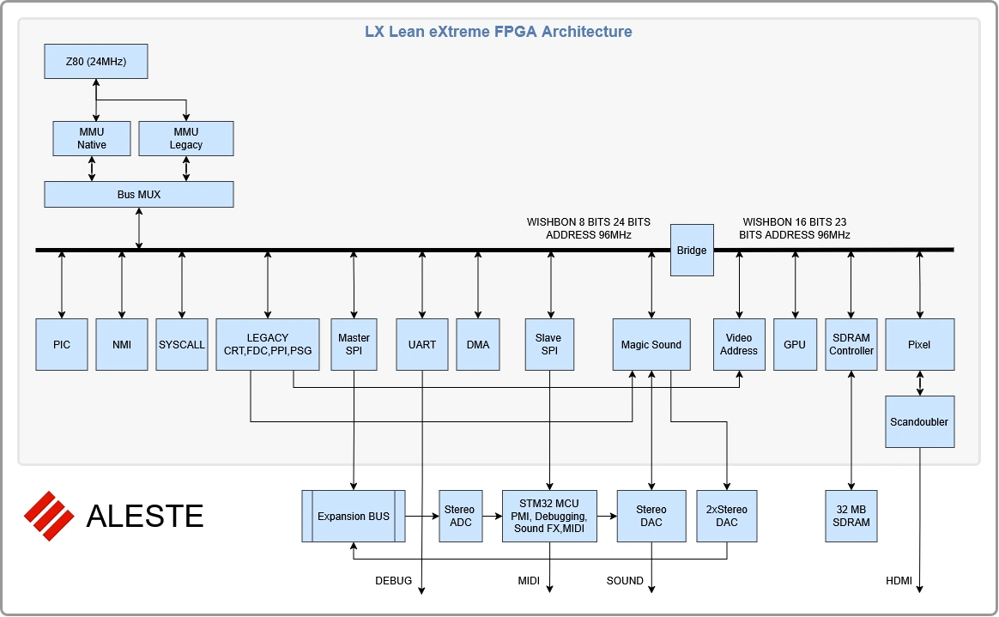
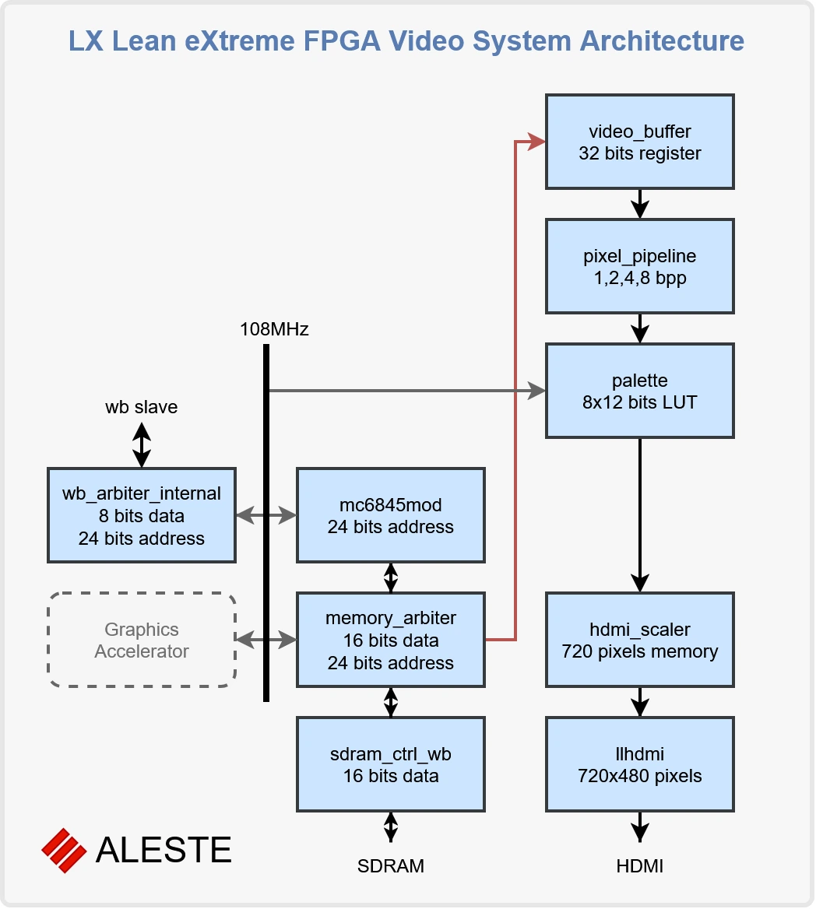

# Aleste LX — Architecture Overview

## Introduction

Aleste LX is an 8-bit computer platform built around the idea of combining the simplicity and accessibility of classic home computers with a more advanced and flexible system architecture.

The project explores how an 8-bit processor-based computer can benefit from modern hardware design techniques, including FPGA technology, structured system buses, memory management, hardware-assisted services, and a modular firmware architecture.

Rather than reproducing the limitations of an existing computer, Aleste LX aims to create a platform that preserves the spirit of classic 8-bit systems while introducing architectural capabilities that make software development more flexible and powerful.

The architecture is designed around a clear separation of responsibilities between the processor, hardware subsystems, firmware, drivers, and applications.

This document provides an overview of the platform's architecture and the principles behind its major components.

## 1. Platform Architecture

Aleste LX is built around a Z80-compatible processor and an FPGA-based hardware platform.

The FPGA implements the system's internal architecture, including memory management, system interconnects, video and audio subsystems, peripheral controllers, and other hardware services.

This approach makes it possible to introduce capabilities that would be difficult or impractical to implement using conventional discrete logic.

A central architectural principle is the distinction between the internal system and its external interfaces:

- **Internal architecture:** implemented inside the FPGA, where system components can communicate through high-performance internal buses.
- **External interfaces:** designed to minimise hardware complexity, connector count, and implementation cost while providing access to expansion devices.

The platform is intended to provide a coherent environment in which hardware resources can be accessed through well-defined software interfaces.

## 2. Processor and Memory Architecture

The processor retains the familiar 8-bit programming model while operating within a more extensive memory architecture.

Although the processor sees a limited logical address space, the underlying system supports an expanded physical address space through memory mapping.

The MMU (Memory Management Unit) controls the relationship between the processor's logical address space and physical memory.

This architecture provides:

- Extended memory capacity beyond the processor's native address space.
- Flexible mapping of memory regions.
- Support for different memory configurations.
- A foundation for protected execution environments.
- Access to the full physical memory space through system-level tools.

The distinction between logical and physical addresses is important both for software development and debugging. Development tools should be able to inspect the underlying memory independently of the currently mapped processor address space.

## 3. System Bus and Hardware Interconnect

The internal hardware architecture uses Wishbone as the primary system interconnect.

Wishbone provides a structured communication mechanism between the processor and other hardware components.

It allows different subsystems to access shared resources while maintaining a clear separation between bus interfaces and individual hardware implementations.

The architecture is intended to support:

- Processor access to system resources.
- Communication between hardware controllers.
- DMA-based data transfers.
- Access arbitration between multiple bus masters.
- Integration of additional hardware components.

The internal bus architecture is designed to accommodate the needs of video, audio, memory, and peripheral subsystems without requiring applications to understand their implementation details.

## 4. Execution Modes and System Protection

Aleste LX introduces a distinction between supervisor and user execution modes.

Supervisor mode provides privileged access to system resources and hardware functionality.

User mode provides a more restricted execution environment for applications.

This separation establishes the foundation for controlled access to hardware resources and system services.

It also makes it possible to develop operating-system-level functionality without requiring every application to manage hardware directly.

The architecture aims to preserve compatibility with classic 8-bit programming environments while providing a path towards more structured software execution.

## 5. BIOS and Driver Architecture

The BIOS is the software interface between applications and the hardware platform.

Its purpose is not simply to initialise the machine or provide a collection of low-level routines. It defines a structured environment through which software components access system functionality.

The BIOS architecture is based on a modular driver model.

Each driver exposes a declared interface consisting of a set of methods. The BIOS provides common entry points and dispatches requests to the appropriate driver implementation.

This approach establishes a contract between applications and hardware services.

The main architectural principles are:

- **Explicit interfaces:** drivers expose declared methods rather than requiring applications to manipulate hardware registers directly.
- **Stable contracts:** method definitions and error codes establish predictable communication between software components.
- **Modularity:** individual drivers can be developed and maintained independently.
- **Replaceable implementations:** hardware implementations can evolve without necessarily requiring changes to applications.
- **Testability:** driver implementations can be developed and tested in a virtual environment.

The result is a system in which applications depend on software interfaces rather than the internal organisation of individual hardware devices.

## 6. Inter-Process Communication

Inter-process communication (IPC) is an important part of the Aleste LX architecture.

Its purpose is to provide mechanisms through which independently developed software components can exchange information and request services.

Hardware-assisted IPC is particularly valuable on an 8-bit processor, where the CPU has limited processing resources and excessive polling or waiting can significantly reduce performance.

By providing appropriate hardware and firmware support, IPC can help applications and system components communicate more efficiently.

It also provides an architectural foundation for more advanced software environments in which applications do not need to implement every system function themselves.

## 7. Video and Graphics Architecture

The video subsystem is designed to support both traditional 8-bit graphics techniques and more flexible graphics modes.

The architecture includes multiple graphics configurations, with particular emphasis on linear framebuffer access and programmable palettes.

The main graphics concepts include:

- Linear graphics buffers.
- 4-bit-per-pixel and 8-bit-per-pixel modes.
- Programmable colour palettes.
- Advanced palette configurations, including MSX-compatible and YJK-related graphics capabilities.
- Support for double-buffered rendering.
- Hardware-assisted graphics operations as a possible extension of the architecture.

The linear framebuffer model provides a straightforward interface for software developers.

In particular, the 4-bit-per-pixel mode provides an efficient representation for 16-colour graphics, while 8-bit-per-pixel modes allow more flexible colour representation and palette-based effects.

The architecture also considers the use of pixel-level logical and arithmetic operations to support more advanced rendering techniques.

A graphics accelerator is considered an optional extension rather than a prerequisite for the basic platform.

## 8. Audio Architecture

The audio subsystem is intended to provide capabilities beyond those traditionally associated with simple 8-bit computers.

The architecture considers dedicated audio hardware and software interfaces that allow applications to access sound functionality through system services.

The goal is to provide a flexible environment for music, sound effects, and more advanced audio applications.

As with graphics, the intention is to separate application-level functionality from the internal implementation of the hardware.

This allows the audio subsystem and its drivers to evolve independently of the applications that use them.

## 9. External Peripherals and Data Transfers

External devices are treated as peripherals rather than as direct extensions of the processor's memory space.

This distinction is important for performance and architectural simplicity.

Instead of mapping every external device into the processor's address space and making individual memory accesses wait for serial transfers, the platform uses a peripheral-oriented model based on block transfers.

A typical transfer involves specifying the operation, the device address, and the amount of data to transfer.

The device can then prepare subsequent data while the current transfer is in progress.

Data movement can be handled through the processor or, where appropriate, through DMA.

This approach reduces unnecessary processor waiting and provides a more scalable model for external expansion devices.

## 10. Emulator and Development Environment

The Aleste LX architecture is intended to be supported by both physical hardware and a virtual platform.

The emulator is an important part of the development environment. It provides a way to develop and test firmware and applications without requiring the physical hardware to be available.

Ideally, the emulator represents the same software-visible architecture as the FPGA implementation, including:

- Processor behaviour.
- Memory mapping and MMU functionality.
- Hardware registers and peripheral interfaces.
- Video and audio subsystems.
- System-level services and interrupts.

The development environment also includes debugging facilities.

In particular, debugging support should extend beyond the processor's native registers to expose important system-level state, including memory mapping, execution modes, and the extended physical address space.

The objective is to make the virtual platform a useful development and debugging environment rather than merely a tool for running existing software.

## 11. Architectural Principles

The Aleste LX architecture is guided by several fundamental principles.

**Separation of concerns**

Applications, firmware, drivers, and hardware components have clearly defined responsibilities and interfaces.

**Hardware flexibility**

The FPGA provides a flexible environment for implementing advanced hardware functionality without the constraints of traditional discrete-component designs.

**Software independence**

Applications should depend on stable software interfaces rather than specific hardware implementations.

**Efficient resource utilisation**

The architecture should minimise unnecessary processor overhead and make appropriate use of hardware-assisted operations, DMA, and dedicated controllers.

**Compatibility and evolution**

The platform should preserve the accessibility of classic 8-bit computing while allowing new capabilities and software environments to develop independently.

**Development before hardware**

The emulator and software interfaces make it possible to develop and validate significant parts of the platform before the physical hardware is complete.

**CPU-Centric Architecture and Hardware Assistance**

A fundamental principle of Aleste LX is that **operations should be performed by the main processor whenever they can be implemented efficiently in software**.

The architecture does not aim to replace the CPU with a collection of specialised controllers or autonomous coprocessors. Instead, the CPU remains the primary execution engine, responsible for application logic, algorithms, and the overall control flow of programs.

Specialised hardware is introduced to assist the processor with operations that are difficult or inefficient to perform in software.

Such hardware does not necessarily implement complete high-level functions. Its purpose is to accelerate specific low-level operations and remove the bottlenecks that would otherwise limit the processor's performance.

The pixel combiner is an example of this approach. Rather than implementing an autonomous sprite engine that independently manages objects and renders them onto the screen, the hardware provides efficient pixel-level logical and arithmetic operations. The processor remains responsible for deciding what to draw, while the pixel combiner accelerates the operations required to produce the result.

This approach has several advantages:

- **Software remains in control.** Programmers retain flexibility and can implement new algorithms without depending on fixed-function hardware.
- **Hardware stays focused.** Specialised logic accelerates well-defined operations rather than duplicating application-level functionality.
- **Extensibility.** New software techniques can take advantage of existing hardware primitives without requiring new dedicated controllers.
- **Architectural simplicity.** The system avoids unnecessary complexity associated with autonomous coprocessors and their independent execution models.
- **Efficient use of FPGA resources.** Hardware is dedicated to operations where parallelism or specialised logic provides a meaningful performance advantage.

The resulting architecture combines the flexibility of software with the performance of specialised hardware assistance.

**The CPU defines what needs to be done; specialised hardware helps it do those things efficiently.**

## 12. Development Status and Future Evolution

Aleste LX is an evolving architectural project.

Its architecture describes both established design concepts and capabilities that may require further implementation and validation.

The presence of a capability in the architectural design does not necessarily mean that it is already available in the physical hardware or the emulator.

Individual subsystems may evolve independently, and some advanced capabilities may remain optional or be postponed.

The long-term objective is to maintain a consistent architecture across the hardware implementation, emulator, BIOS, drivers, and development tools.

This consistency is essential for creating a stable platform on which software developers can build applications without having to track every internal hardware change.

---

*Aleste LX combines the ideas of classic 8-bit computing with a more flexible hardware and software architecture, providing a foundation for the next generation of Aleste-compatible development.*
