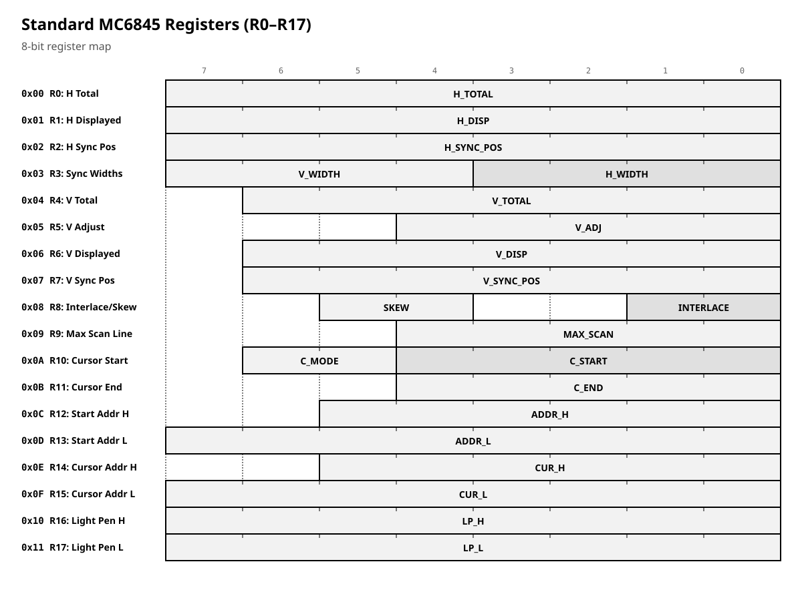
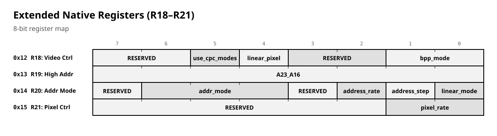
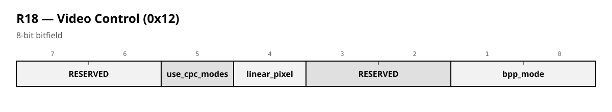
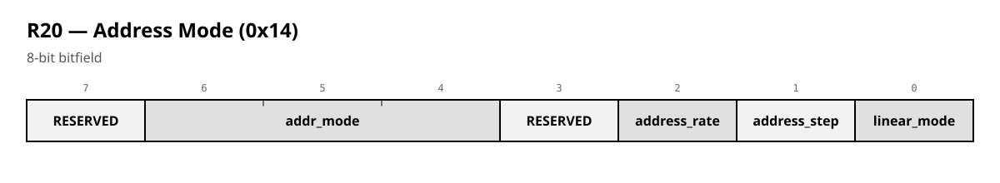
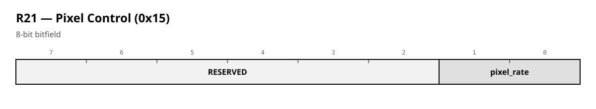

# 03 — CRT Controller with HDMI Timing Support

**Version:** Aleste LX project  
**Compatibility:** MC6845 (Motorola 6845 CRTC) — 100% compatible except light pen and vertical adjust

---

## 1. Overview

`mc6845mod` is a drop-in MC6845-compatible CRT controller extended with:

- **HDMI timing synchronization** — video timing is locked to a fixed HDMI pixel grid (720×480 logical, doubled rows).
- **Linear addressing** — continuous 24-bit address counter instead of the CPC row/column interleaving.
- **Burst pixel rates** — configurable pixel/byte strobe generation to match VRAM bandwidth for 1/2/4/8 bpp modes.
- **Extended address modes** — up to 128 KB linear address space via a 24-bit extended address bus.
- **CPC gate-array graphics pass-through** — pixel depth can be sourced from the CPC Gate Array instead of the internal bpp setting.

The module presents **two register maps** on the same Wishbone slave port:

| Mode | `cfg_legacy_i` | Address decode | Access |
|------|---------------|----------------|--------|
| **Native** | `0` | `wb_adr_i[0]` selects address/data register (A0) | Wishbone `wb_cs_i` |
| **Legacy (CPC)** | `1` | `wb_adr_i[8]` selects address/data register; `wb_tag_i[2]` must be set; address window `BCxx` | Byte writes/reads at `BC00`/`BC01` |

The CRTC register *contents* and semantics are identical in both modes. The difference is only in how the host CPU reaches the two physical registers (Address Register / Data Register).

> **Important:** In Legacy mode the module responds only when `wb_tag_i[2] == 1` and `wb_adr_i[14] == WB_ADDRESS[14]` (default `0xBC00`). This allows the same bus to carry other I/O.

---

## 2. Wishbone Interface

| Signal | Dir | Description |
|--------|-----|-------------|
| `wb_clk_i` | in | Wishbone clock (register interface domain) |
| `wb_rst_i` | in | Synchronous reset |
| `wb_cyc_i`, `wb_stb_i` | in | Wishbone cycle/strobe |
| `wb_adr_i[23:0]` | in | Address (bit 0 = data reg in native mode; bit 8 = data reg in legacy mode) |
| `wb_dat_i[7:0]` | in | Write data |
| `wb_dat_o[7:0]` | out | Read data |
| `wb_we_i` | in | Write enable |
| `wb_tag_i[2:0]` | in | `tag[2]` gates legacy chip-select |
| `wb_cs_i` | in | Native chip-select |
| `wb_ack_o` | out | Terminate acknowledge |
| `wb_grant_o` | out | `cyc && stb && (legacy_cs \|\| cs)` — module selected |

**Two-register access model (MC6845 standard):**

- Writing to the **Address Register** selects an internal register index `0x00–0x1F`.
- Writing/reading the **Data Register** accesses the selected register.

**Native:** Address Register (`wb_adr_i[0] == 0`), Data Register (`wb_adr_i[0] == 1`).
**Legacy (CPC):** Address Register (`wb_adr_i[8] == 0`, BC00), Data Register (`wb_adr_i[8] == 1`, BC01).

---

## 3. Register Map (both modes)

### 3.1 Standard MC6845 Registers (R0–R17)



### 3.2 Extended Registers (Native feature set)

These four registers exist in both modes' register space. "Legacy" here means only the bus access scheme, not register availability.



---

## 4. Register 18 — Video Control (`REG_VIDEO_CONTROL`, `0x12`)



**R18 — Video Control (0x12)**

| Field | Bits | Width | Description |
| --- | --- | --- | --- |
| **RESERVED** | [7:6] | 2 | Reserved |
| **use_cpc_modes** | [5:5] | 1 | 1=use CPC Gate Array bpp |
| **linear_pixel** | [4:4] | 1 | 0=CPC palette, 1=Linear RGB |
| **RESERVED** | [3:2] | 2 | Reserved |
| **bpp_mode** | [1:0] | 2 | 00=1bpp, 01=2bpp, 10=4bpp, 11=8bpp |


**Effective pixel depth output `cfg_bpp_o`:**

```
cfg_bpp_o = use_cpc_modes ? ~cfg_cpc_bpp_i : bpp_mode
```
`cfg_linear_pixel_o` = `linear_pixel`.

**Note on default:** the reset value is `0b0000_0000` in the current source. Program R18 explicitly at startup if you depend on CPC bpp source.

---

## 5. Register 19 — High Address (`REG_HIGH_ADDRESS`, `0x13`)

`A[23:16]` of `crtc_ext_addr_o`. Combined with the low 16 bits produced by the address generator (either linear counter or legacy CPC-encoded address).

---

## 6. Register 20 — Address Mode (`REG_ADDR_MODE`, `0x14`)



**R20 — Address Mode (0x14)**

| Field | Bits | Width | Description |
| --- | --- | --- | --- |
| **RESERVED** | [7:7] | 1 | Reserved |
| **addr_mode** | [6:4] | 3 | 000=CPC 16KB, 001=EX 32KB, 010=LX 32KB, 011=LX 64KB, 100=Linear |
| **RESERVED** | [3:3] | 1 | Reserved |
| **address_rate** | [2:2] | 1 | 1=two increments per char |
| **address_step** | [1:1] | 1 | 0=increment by 2, 1=increment by 4 |
| **linear_mode** | [0:0] | 1 | 0=CPC-style legacy, 1=linear counter |


**Reset defaults:**
- `STANDARD == "cpc"`: `0x00` (legacy CPC sequencing, 16 KB)
- `STANDARD == "lx"`: `0x04` (`addr_mode = 001` — EX 32 KB)
- `STANDARD` other: `0x00`

---

## 7. Register 21 — Pixel Control (`REG_PIXEL_CTRL`, `0x15`)



**R21 — Pixel Control (0x15)**

| Field | Bits | Width | Description |
| --- | --- | --- | --- |
| **RESERVED** | [7:2] | 6 | Reserved |
| **pixel_rate** | [1:0] | 2 | 00=2B, 01=4B, 10=8B, 11=16B per 16px |


`pixel_rate` drives `stb_byte_o` (byte load strobe) and, together with `bpp_mode`, the pixel strobe `stb_pixel_o` (see §9).

---

## 8. Address Generation

### 8.1 Legacy / CPC mode (`R20[0] = 0`)

Standard MC6845 row/column sequencing driven by `stb_char_o`:

- `crtc_ma_o[13:0]` increments by 1 per character; wraps to `crtc_row_start_addr` at end of line (`crtc_h_count == reg_h_total`).
- `crtc_row_start_addr` latches the MA value when `crtc_h_count == reg_h_displayed` **and** `crtc_pix_y == reg_max_scan`.
- `crtc_ra_o[4:0]` = raster row within character (`crtc_pix_y`).
- Extended address composition:

```
crtc_ext_addr_o = {reg_high_address[7:0],
                   crtc_ma_addr[13:12],   // A15:A14
                   crtc_ra_o[3:0],        // A13:A10
                   crtc_ma_addr[9:0],     // A9:A0
                   1'b0}                  // A0 always 0
```

This reproduces the CPC bit-layout of MA/RA on the 24-bit bus, with the high byte from R19 on top.

### 8.2 Linear mode (`R20[0] = 1`)

A separate 16-bit `linear_addr` counter:

- Reset to `{reg_start_addr_h, reg_start_addr_l}` at VSYNC (`start_v_trigger`).
- After VSYNC, `linear_incrementing` is armed on `stb_sync1_o` but only while `crtc_de_o && linear_mode`.
- Increments on `stb_sync1_o` (and additionally on `stb_sync2_o` if `R20[2]=1`) by `R20[1] ? 4 : 2`.
- Output: `crtc_ext_addr_o = {reg_high_address, linear_addr}`.

This gives a continuous, burst-friendly address stream for linear frame buffers.

---

## 9. Strobe Generation

### 9.1 Character strobe — `stb_char_o`

One pulse every 16 pixel clocks (LSB nibble `crtc_pix_x[3:0] == 0xF`). Used to advance horizontal character counter, MA, cursor RA, etc.

### 9.2 Sync strobes — `stb_sync1_o`, `stb_sync2_o`

**Sync Strobe Generation**

| Code | Strobe | Desc |
| --- | --- | --- |
| 0xF | stb_char_o | One pulse every 16 pixel clocks |
| 0x3 | stb_sync1_o | Pulse at pixel 4 within a character |
| 0xB | stb_sync2_o | Pulse at pixel 12 within a character |

**Примечания:**

- Строб генерируется, когда `pix_x[3:0]` совпадает со значением `code`.
- `stb_char_o` — один импульс каждые 16 пиксельных тактов.


### 9.3 Byte strobe — `stb_byte_o` (controlled by `R21[1:0]`)

| `pixel_rate` | Condition | Bytes per 16 px |
|--------------|-----------|-----------------|
| `00` | `crtc_pix_x[2:0] == 3'b011` | 2 |
| `01` | `crtc_pix_x[1:0] == 2'b11`  | 4 |
| `10` | `crtc_pix_x[0] == 1'b1`      | 8 |
| `11` | always                       | 16 |

### 9.4 Pixel strobe — `stb_pixel_o` (controlled by `{R21[1:0], bpp_mode}`)

**Pixel Strobe Generation**

| Vram | Bpp1 | Bpp2 | Bpp4 | Bpp8 |
| --- | --- | --- | --- | --- |
| 16 KB (00) | 16x | 8x | 4x | 2x |
| 32 KB (01) | off | 16x | 8x | 4x |
| 64 KB (10) | off | off | 16x | 8x |
| 128 KB (11) | off | off | off | 16x |


Unsupported combinations output `stb_pixel_o = 0` (pixel strobe disabled). This table encodes the VRAM-bandwidth budget: higher bpp needs fewer pixels per byte.

---

## 10. Sync Outputs and Timing

The module does **not** generate HDMI sync itself — it phase-locks its internal character counters to the HDMI pixel grid and exposes CRTC-domain syncs for interrupt generation.

| Output | Meaning |
|--------|---------|
| `crtc_de_o` | Skew-adjusted display enable (CRTC domain) |
| `crtc_hsync_o` | HSYNC: `reg_h_sync_pos ≤ crtc_h_count < reg_h_sync_pos + reg_h_sync_width` |
| `crtc_vsync_o` | VSYNC: `reg_v_sync_pos ≤ crtc_v_count < reg_v_sync_pos + reg_v_sync_width` |
| `crtc_cursor_o` | Skew-adjusted cursor pixel |
| `crtc_newline_o` | `hdmi_newline_i && !hdmi_y_i[0]` |
| `crtc_newframe_o` | `hdmi_newframe_i` |
| `crtc_halt_o` | `crtc_halt_frame \|\| crtc_halt_line` — set when a counter hits R0/R4 before the next start trigger |
| `hdmi_de_o` | `(hdmi_x_i < HDMI_H_VISIBLE) && (hdmi_y_i < HDMI_V_VISIBLE) && !hdmi_y_i[0]` |

**Vertical scaling:** HDMI is processed in *half-lines* — all vertical comparisons use `hdmi_y_i >> 1`, so the logical CRTC vertical resolution is `HDMI_V_VISIBLE / 2` (default 240 lines). `HDMI_V_TOTAL` is likewise in half-lines (525 → 262 real lines).

**Centering:** the start triggers are computed from the visible area:

```
start_h_pixel = HDML_H_ORIGIN - (reg_h_displayed * 16 / 2)
start_v_line  = HDML_V_ORIGIN - (reg_v_displayed * 16 / 2)
```
where
```
HDML_H_ORIGIN = 720/2 - 1 - 16 = 343
HDML_V_ORIGIN = 480/2 - 1       = 239
```

`start_h_trigger` fires when the HDMI X counter equals `start_h_pixel` and `hdmi_y_i[0] == 0` (even half-line). `start_v_trigger` fires on the matching even half-line at the same X.

**Skew (R8[5:4]):** delays `crtc_de_o` and `crtc_cursor_o` by 0–3 character clocks (delayed by `stb_char`).

---

## 11. Cursor Logic

| `R10[6:5]` (mode) | Blink source |
|-------------------|--------------|
| `00` | Always on |
| `01` | `hdmi_y_i[5]` |
| `10` | `hdmi_y_i[6]` |
| `11` | Off (blinking = 0) |

Cursor is active when:
- `crtc_ma_addr == {reg_cursor_addr_h, reg_cursor_addr_l}` (address match), **and**
- `reg_cursor_start ≤ crtc_pix_y ≤ reg_cursor_end` (raster window latched on `stb_char`), **and**
- blink condition, **and**
- `crtc_de`.

`crtc_cursor_raw` is then passed through the skew delay chain alongside `crtc_de`.

---

## 12. Hardware Parameters

| Parameter | Default | Purpose |
|-----------|---------|---------|
| `STANDARD` | `"cpc"` | `"cpc"` or `"lx"` — selects reset defaults |
| `WB_ADDRESS` | `16'h6844` | Legacy-mode address window base (only `[14]` is compared) |
| `HDMI_H_VISIBLE` | `720` | HDMI active width |
| `HDMI_V_VISIBLE` | `480` | HDMI active height (real lines) |
| `HDMI_H_TOTAL` | `1024` | HDMI total width |
| `HDMI_V_TOTAL` | `525` | HDMI total height (real lines) |
| `HDML_H_ORIGIN` | `343` | Derived horizontal origin |
| `HDML_V_ORIGIN` | `239` | Derived vertical origin |

Counter widths: `H_PIX_COUNTER_WIDTH = $clog2(HDMI_H_TOTAL)+1` (11 bits for 1024), `V_PIX_COUNTER_WIDTH = $clog2(HDMI_V_TOTAL)` (10 bits for 525).

---

## 13. What Is Legacy vs. Native — Programmer Summary

### ✅ Works identically in both modes (MC6845 core)
- R0–R17 read/write and behavior (except light pen / vertical adjust).
- Two-register access (`Address` / `Data`) — just a different bus bit selects the Data register.
- Character / raster sequencing, HSYNC/VSYNC generation from R0/R2/R3/R4/R6/R7/R9.
- Cursor address/start/end, skew, interlace bits.

### 🚀 Native-only features (registers R18–R21)
- **R18** — choose pixel depth from internal `bpp_mode` or CPC Gate Array; linear RGB flag.
- **R19** — high address byte for >64 KB address spaces.
- **R20** — linear addressing, step size (2/4), double-rate increments, and `cfg_addr_mode_o` hints.
- **R21** — burst byte rate selection feeding `stb_byte_o`, and pixel-rate gating of `stb_pixel_o`.

> These four registers exist in **both** modes' register space (the Wishbone write logic accepts them regardless of `cfg_legacy_i`). "Legacy" here means **only the bus access scheme**, not register availability. If you want strict MC6845 behavior on a CPC, simply never touch R18–R21 — their reset defaults (`R20=0x00` for `STANDARD="cpc"`) leave the core in classic mode.

### ⚠️ Default differences by `STANDARD`
- `"cpc"`: `R20 = 0x00` — legacy CPC address sequencing.
- `"lx"` : `R20 = 0x04` — `addr_mode = 001` (EX 32 KB) preset.
- Other : all extended registers `0x00`.

### ❌ Not implemented
- Light pen (R16/R17).
- Vertical adjust (R5).
- Interlace field generation (R8[1:0] latched but the half-line HDMI timing effectively runs in progressive mode).

---

## 14. Quick Programming Recipes

### Initialize for CPC-compatible operation
1. Write Address Register = `0x00`, Data = `0x3F` (R0=63)
2. … set R1–R15 per CPC defaults (or leave reset values if `STANDARD="cpc"`)
3. Do **not** touch R18–R21 → legacy CPC addressing preserved.
4. Set Start Address (R12/R13), enable cursor (R10/R11).

### Enable linear 32-bit-word addressing (native LX)
1. R19 = `A23:A16` of frame buffer.
2. R20 = `0b0000_0101` → `linear_mode=1`, `address_step=1` (×4), `addr_mode=001`.
3. R21 = `0b01` → 4 bytes per 16 px burst.
4. R18 = `0b0010_0000` → `bpp_mode=00` (1 bpp) if standalone, or `0b0010_0001` (2 bpp), etc.

### Switch bpp at runtime without touching bus width
- Keep `R18[5]=1` (`use_cpc_modes`) and toggle `cfg_cpc_bpp_i` from the CPC Gate Array; `cfg_bpp_o` follows `~cfg_cpc_bpp_i`.

### Interrupt timing
- Use `crtc_hsync_o` / `crtc_vsync_o` (free-running in the pixel clock domain) or `crtc_newline_o` / `crtc_newframe_o` (HDMI-aligned) as interrupt sources.
- `crtc_halt_o` signals that a programmed total was reached before the HDMI anchor — useful for detecting misconfiguration (R0/R4 too small for the fixed pixel grid).

---

## 15. Clock Domains

| Domain | Signals | Notes |
|--------|---------|-------|
| `wb_clk_i` | Wishbone bus, register file | All R0–R21 live here |
| `pix_clk_i` | All CRTC counters, strobes, sync generation, address generation, cursor | Reads registers directly (single clock in typical LX integration: `wb_clk_i == pix_clk_i`) |

If `wb_clk_i ≠ pix_clk_i` in your integration, the register file must be CDC-synchronized externally; the current RTL assumes a common clock for the register values consumed in the pixel domain.

