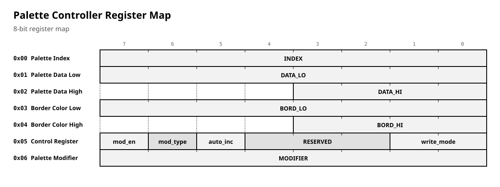
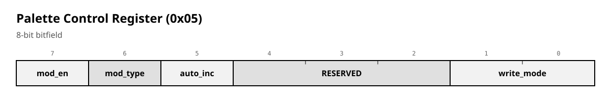

# 05 — Video Palette Module

## Overview

Advanced color palette controller with full CPC legacy compatibility and extended modern color modes. Implements a unified palette architecture with hardware-accelerated color manipulation.

## Address Map

### Legacy CPC Mode (TAG=11)

- **0xBC00**: Gate Array registers (when D7=0)
  - D7-D6=00: Palette index (5-bit: 16 colors + border)
  - D7-D6=01: Palette data (CPC color conversion)
  - D7-D6=10: Border color (CPC color conversion)

### Native Mode Register Map

The following register map shows the unified native mode interface:

<!-- table: generated -->

**Palette Controller Register Map**

| Code | Name | Description |
| --- | --- | --- |
| — | Palette Index | — |
| — | Palette Data Low | — |
| — | Palette Data High | — |
| — | Border Color Low | — |
| — | Border Color High | — |
| — | Control Register | — |
| — | Palette Modifier | — |

## Control Register Details

The Control Register (0x05) configures the palette behavior:

<!-- table: generated -->

**Palette Control Register (0x05)**

| Поле | Биты | Ширина | Описание |
| --- | --- | --- | --- |
| **mod_en** | [7:7] | 1 | 1=Включить модификацию индекса |
| **mod_type** | [6:6] | 1 | 0=OR, 1=XOR |
| **auto_inc** | [5:5] | 1 | 1=Авто-инкремент индекса |
| **RESERVED** | [4:2] | 3 | Резерв (должно быть 0) |
| **write_mode** | [1:0] | 2 | 00=12-bit, 01=CPC, 10=MSX, 11=YJK |

## Color Modes

The palette supports multiple color conversion modes:

<!-- table: generated -->

**Color Modes**

| Code | Mode | Bits | Desc |
| --- | --- | --- | --- |
| 0 | 12-bit Native | 12-bit | Direct RGB, bypasses conversion |
| 1 | CPC Legacy | 5-bit | 16 colors + border, hardware LUT conversion |
| 2 | MSX | 8-bit | MSX2+ compatible, perceptual mapping |
| 3 | YJK | YJK | Advanced color space for graphic arts |

### CPC Legacy Mode

- 16 colors + border color via hardware register mapping
- Accurate CPC color conversion using distributed ROM LUT
- 5-bit palette index (bit4 selects border vs palette)
- Write-only access in legacy mode, reads return 0

### 12-bit Native Mode

- Direct 12-bit color from pixel data
- High/low byte write with auto-increment after high byte
- Bypasses color conversion for maximum flexibility

### MSX Mode

- MSX2+ compatible 8-bit color conversion
- Hardware-optimized distributed LUT conversion
- Perceptual color mapping for optimal quality

### YJK Mode

- Advanced MSX2+ YJK color space conversion
- Specialized for graphic arts and photo applications
- Maintains full MSX software compatibility

## Palette Modification Features

### Index Modification

- **OR mode**: Force palette bank selection
- **XOR mode**: Palette animation and bank switching
- Applied to pixel index before palette lookup
- Enables dynamic palette effects without data movement

### Auto-increment Behavior

- **CPC/EX modes**: Manual index management
- **MSX/YJK modes**: Increments after data write
- **12-bit mode**: Increments after high byte write
- Reads never affect index

## Border Handling

- Dedicated 12-bit border color register
- Separate from main palette RAM
- CPC legacy: border uses same color conversion as palette
- Native modes: direct 12-bit color assignment
- Pixel generator provides border detection signal

## Color Conversion

### CPC Color LUT

- Hardware-accurate conversion using distributed ROM
- Preserves exact CPC color behavior including hardware quirks
- Multiple register values map to same colors (hardware behavior)

### MSX/YJK Conversion

- Hardware-optimized distributed LUT implementation
- MSX mode: Standard 8-bit to 12-bit RGB conversion
- YJK mode: Advanced color space conversion for graphic arts
- Single-cycle operation with registered outputs

## Integration Points

- **Input**: 8-bit pixel indices from pixel pipeline
- **Input**: Border detection signal from CRT controller
- **Output**: 12-bit RGB to scan converter/HDMI
- **Control**: Mode selection via control register
- **Bus**: Wishbone-compatible interface with legacy support

## Performance Characteristics

- Single-cycle color lookup in all modes
- Pipeline-friendly design with registered outputs
- Zero-wait state register access
- Distributed LUT for minimal combinatorial delay

## Resource Usage (FPGA)

- 256×12-bit palette RAM (3,072 bits)
- Distributed ROMs for color conversion
- Minimal combinational logic for mode selection
- Register-based control path

## Design Philosophy

- **Accuracy**: Hardware-perfect CPC legacy compatibility
- **Quality**: High-quality color conversion for modern modes  
- **Performance**: Single-cycle operation with pipeline support
- **Flexibility**: Software-controlled mode switching
- **Efficiency**: Minimal FPGA resources through distributed LUT

## Key Improvements

- **Logical Register Order**: Color data (palette + border) grouped together, followed by control registers
- **Enhanced Color Modes**: Added YJK mode for advanced graphics applications
- **Unified Architecture**: Single module handles all color conversion needs
- **Legacy Compatibility**: Full CPC gate array emulation while providing modern features