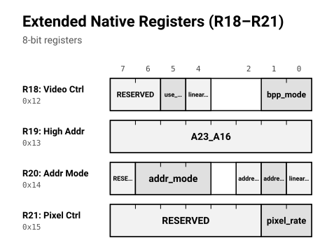
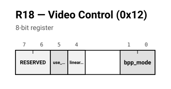
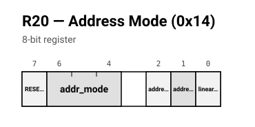
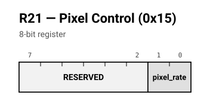
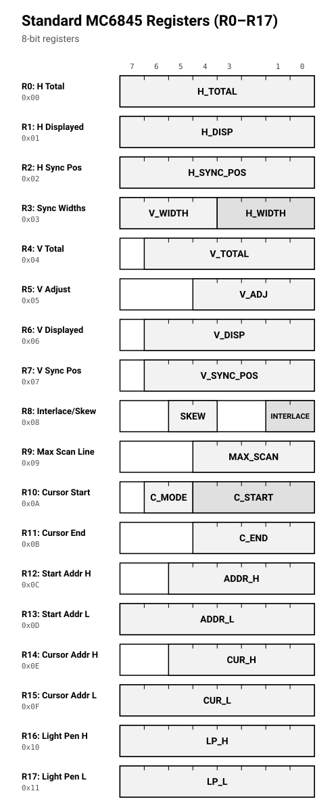
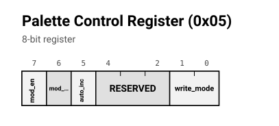
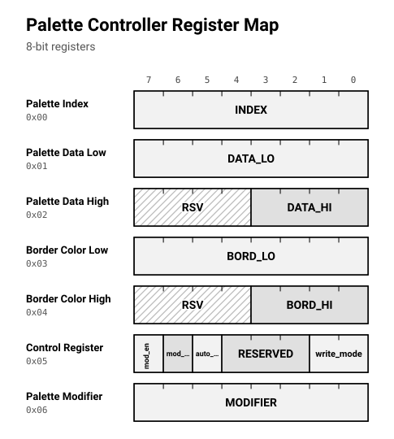

# LX-GPU — описание архитектуры

## Extended Native Registers (R18–R21)

*Figure 8 — Extended Native Registers (R18–R21)*

**Table 8 — Extended Native Registers (R18–R21)**

| Offset | Name | Description |
| --- | --- | --- |
| `0x12` | **R18: Video Ctrl** | — |
| `0x13` | **R19: High Addr** | — |
| `0x14` | **R20: Addr Mode** | — |
| `0x15` | **R21: Pixel Ctrl** | — |

**R18: Video Ctrl** (`0x12`)

| Field | Bits | Width | Description |
| --- | --- | --- | --- |
| **RESERVED** | [7:6] | 2 | Reserved |
| **use_cpc_modes** | [5] | 1 | 1=use CPC Gate Array bpp |
| **linear_pixel** | [4] | 1 | 0=CPC palette, 1=Linear RGB |
| **bpp_mode** | [1:0] | 2 | 00=1bpp, 01=2bpp, 10=4bpp, 11=8bpp |

**R19: High Addr** (`0x13`)

| Field | Bits | Width | Description |
| --- | --- | --- | --- |
| **A23_A16** | [7:0] | 8 | High address byte |

**R20: Addr Mode** (`0x14`)

| Field | Bits | Width | Description |
| --- | --- | --- | --- |
| **RESERVED** | [7] | 1 | Reserved |
| **addr_mode** | [6:4] | 3 | 000=CPC 16KB, 001=EX 32KB, 010=LX 32KB, 011=LX 64KB, 100=Linear |
| **address_rate** | [2] | 1 | 1=two increments per char |
| **address_step** | [1] | 1 | 0=increment by 2, 1=increment by 4 |
| **linear_mode** | [0] | 1 | 0=CPC-style legacy, 1=linear counter |

**R21: Pixel Ctrl** (`0x15`)

| Field | Bits | Width | Description |
| --- | --- | --- | --- |
| **RESERVED** | [7:2] | 6 | Reserved |
| **pixel_rate** | [1:0] | 2 | 00=2B, 01=4B, 10=8B, 11=16B per 16px |

[Таблица](gen/crtc_ext_regmap.md)

## R18 — Video Control (0x12)

*Figure 9 — R18 — Video Control (0x12)*

**Table 9 — R18 — Video Control (0x12)**

| Field | Bits | Width | Description |
| --- | --- | --- | --- |
| **RESERVED** | [7:6] | 2 | Reserved |
| **use_cpc_modes** | [5] | 1 | 1=use CPC Gate Array bpp |
| **linear_pixel** | [4] | 1 | 0=CPC palette, 1=Linear RGB |
| **bpp_mode** | [1:0] | 2 | 00=1bpp, 01=2bpp, 10=4bpp, 11=8bpp |

[Таблица](gen/crtc_r18.md)

## R20 — Address Mode (0x14)

*Figure 10 — R20 — Address Mode (0x14)*

**Table 10 — R20 — Address Mode (0x14)**

| Field | Bits | Width | Description |
| --- | --- | --- | --- |
| **RESERVED** | [7] | 1 | Reserved |
| **addr_mode** | [6:4] | 3 | 000=CPC 16KB, 001=EX 32KB, 010=LX 32KB, 011=LX 64KB, 100=Linear |
| **address_rate** | [2] | 1 | 1=two increments per char |
| **address_step** | [1] | 1 | 0=increment by 2, 1=increment by 4 |
| **linear_mode** | [0] | 1 | 0=CPC-style legacy, 1=linear counter |

[Таблица](gen/crtc_r20.md)

## R21 — Pixel Control (0x15)

*Figure 11 — R21 — Pixel Control (0x15)*

**Table 11 — R21 — Pixel Control (0x15)**

| Field | Bits | Width | Description |
| --- | --- | --- | --- |
| **RESERVED** | [7:2] | 6 | Reserved |
| **pixel_rate** | [1:0] | 2 | 00=2B, 01=4B, 10=8B, 11=16B per 16px |

[Таблица](gen/crtc_r21.md)

## Standard MC6845 Registers (R0–R17)

*Figure 12 — Standard MC6845 Registers (R0–R17)*

**Table 12 — Standard MC6845 Registers (R0–R17)**

| Offset | Name | Description |
| --- | --- | --- |
| `0x00` | **R0: H Total** | — |
| `0x01` | **R1: H Displayed** | — |
| `0x02` | **R2: H Sync Pos** | — |
| `0x03` | **R3: Sync Widths** | — |
| `0x04` | **R4: V Total** | — |
| `0x05` | **R5: V Adjust** | — |
| `0x06` | **R6: V Displayed** | — |
| `0x07` | **R7: V Sync Pos** | — |
| `0x08` | **R8: Interlace/Skew** | — |
| `0x09` | **R9: Max Scan Line** | — |
| `0x0A` | **R10: Cursor Start** | — |
| `0x0B` | **R11: Cursor End** | — |
| `0x0C` | **R12: Start Addr H** | — |
| `0x0D` | **R13: Start Addr L** | — |
| `0x0E` | **R14: Cursor Addr H** | — |
| `0x0F` | **R15: Cursor Addr L** | — |
| `0x10` | **R16: Light Pen H** | — |
| `0x11` | **R17: Light Pen L** | — |

**R0: H Total** (`0x00`)

| Field | Bits | Width | Description |
| --- | --- | --- | --- |
| **H_TOTAL** | [7:0] | 8 | Characters per line - 1 |

**R1: H Displayed** (`0x01`)

| Field | Bits | Width | Description |
| --- | --- | --- | --- |
| **H_DISP** | [7:0] | 8 | Visible characters per line |

**R2: H Sync Pos** (`0x02`)

| Field | Bits | Width | Description |
| --- | --- | --- | --- |
| **H_SYNC_POS** | [7:0] | 8 | Character position of HSYNC start |

**R3: Sync Widths** (`0x03`)

| Field | Bits | Width | Description |
| --- | --- | --- | --- |
| **V_WIDTH** | [7:4] | 4 | Vertical sync width |
| **H_WIDTH** | [3:0] | 4 | Horizontal sync width |

**R4: V Total** (`0x04`)

| Field | Bits | Width | Description |
| --- | --- | --- | --- |
| **V_TOTAL** | [6:0] | 7 | Rows per frame - 1 |

**R5: V Adjust** (`0x05`)

| Field | Bits | Width | Description |
| --- | --- | --- | --- |
| **V_ADJ** | [4:0] | 5 | Not implemented (legacy-compatible) |

**R6: V Displayed** (`0x06`)

| Field | Bits | Width | Description |
| --- | --- | --- | --- |
| **V_DISP** | [6:0] | 7 | Visible rows |

**R7: V Sync Pos** (`0x07`)

| Field | Bits | Width | Description |
| --- | --- | --- | --- |
| **V_SYNC_POS** | [6:0] | 7 | Row of VSYNC start |

**R8: Interlace/Skew** (`0x08`)

| Field | Bits | Width | Description |
| --- | --- | --- | --- |
| **SKEW** | [5:4] | 2 | Skew 0-3 char delays |
| **INTERLACE** | [1:0] | 2 | Interlace mode |

**R9: Max Scan Line** (`0x09`)

| Field | Bits | Width | Description |
| --- | --- | --- | --- |
| **MAX_SCAN** | [4:0] | 5 | Raster rows per character - 1 |

**R10: Cursor Start** (`0x0A`)

| Field | Bits | Width | Description |
| --- | --- | --- | --- |
| **C_MODE** | [6:5] | 2 | Blink mode |
| **C_START** | [4:0] | 5 | Cursor start scanline |

**R11: Cursor End** (`0x0B`)

| Field | Bits | Width | Description |
| --- | --- | --- | --- |
| **C_END** | [4:0] | 5 | Cursor bottom scanline |

**R12: Start Addr H** (`0x0C`)

| Field | Bits | Width | Description |
| --- | --- | --- | --- |
| **ADDR_H** | [5:0] | 6 | Bits A15:A10 of start address |

**R13: Start Addr L** (`0x0D`)

| Field | Bits | Width | Description |
| --- | --- | --- | --- |
| **ADDR_L** | [7:0] | 8 | Bits A9:A2 of start address |

**R14: Cursor Addr H** (`0x0E`)

| Field | Bits | Width | Description |
| --- | --- | --- | --- |
| **CUR_H** | [5:0] | 6 | High cursor address |

**R15: Cursor Addr L** (`0x0F`)

| Field | Bits | Width | Description |
| --- | --- | --- | --- |
| **CUR_L** | [7:0] | 8 | Low cursor address |

**R16: Light Pen H** (`0x10`)

| Field | Bits | Width | Description |
| --- | --- | --- | --- |
| **LP_H** | [7:0] | 8 | Not implemented |

**R17: Light Pen L** (`0x11`)

| Field | Bits | Width | Description |
| --- | --- | --- | --- |
| **LP_L** | [7:0] | 8 | Not implemented |

[Таблица](gen/crtc_std_regmap.md)

## Pixel Strobe Generation

[Таблица](gen/crtc_table_pixel.md)

## Sync Strobe Generation

[Таблица](gen/crtc_table_sync.md)

## Palette Control Register (0x05)

*Figure 13 — Palette Control Register (0x05)*

**Table 13 — Palette Control Register (0x05)**

| Field | Bits | Width | Description |
| --- | --- | --- | --- |
| **mod_en** | [7] | 1 | 1=Включить модификацию индекса |
| **mod_type** | [6] | 1 | 0=OR, 1=XOR |
| **auto_inc** | [5] | 1 | 1=Авто-инкремент индекса |
| **RESERVED** | [4:2] | 3 | Резерв (должно быть 0) |
| **write_mode** | [1:0] | 2 | 00=12-bit, 01=CPC, 10=MSX, 11=YJK |

[Таблица](gen/palette_control.md)

## Color Modes

[Таблица](gen/palette_modes.md)

## Palette Controller Register Map

*Figure 14 — Palette Controller Register Map*

**Table 14 — Palette Controller Register Map**

| Offset | Name | Description |
| --- | --- | --- |
| `0x00` | **Palette Index** | — |
| `0x01` | **Palette Data Low** | — |
| `0x02` | **Palette Data High** | — |
| `0x03` | **Border Color Low** | — |
| `0x04` | **Border Color High** | — |
| `0x05` | **Control Register** | — |
| `0x06` | **Palette Modifier** | — |

**Palette Index** (`0x00`)

| Field | Bits | Width | Description |
| --- | --- | --- | --- |
| **INDEX** | [7:0] | 8 | Индекс цвета (0-255) |

**Palette Data Low** (`0x01`)

| Field | Bits | Width | Description |
| --- | --- | --- | --- |
| **DATA_LO** | [7:0] | 8 | Младшие 8 бит цвета |

**Palette Data High** (`0x02`)

| Field | Bits | Width | Description |
| --- | --- | --- | --- |
| **RSV** | [7:4] | 4 | Reserved |
| **DATA_HI** | [3:0] | 4 | Старшие 4 бита (только 12-bit) |

**Border Color Low** (`0x03`)

| Field | Bits | Width | Description |
| --- | --- | --- | --- |
| **BORD_LO** | [7:0] | 8 | Младшие 8 бит цвета бордюра |

**Border Color High** (`0x04`)

| Field | Bits | Width | Description |
| --- | --- | --- | --- |
| **RSV** | [7:4] | 4 | Reserved |
| **BORD_HI** | [3:0] | 4 | Старшие 4 бита бордюра |

**Control Register** (`0x05`)

| Field | Bits | Width | Description |
| --- | --- | --- | --- |
| **mod_en** | [7] | 1 | 1=Включить модификацию индекса |
| **mod_type** | [6] | 1 | 0=OR, 1=XOR |
| **auto_inc** | [5] | 1 | 1=Авто-инкремент индекса |
| **RESERVED** | [4:2] | 3 | Резерв (должно быть 0) |
| **write_mode** | [1:0] | 2 | 00=12-bit, 01=CPC, 10=MSX, 11=YJK |

**Palette Modifier** (`0x06`)

| Field | Bits | Width | Description |
| --- | --- | --- | --- |
| **MODIFIER** | [7:0] | 8 | Значение для OR/XOR модификации |

[Таблица](gen/palette_regmap.md)
