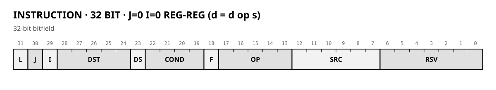
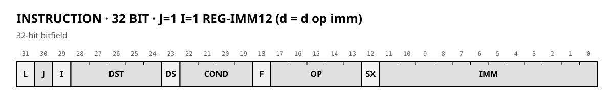
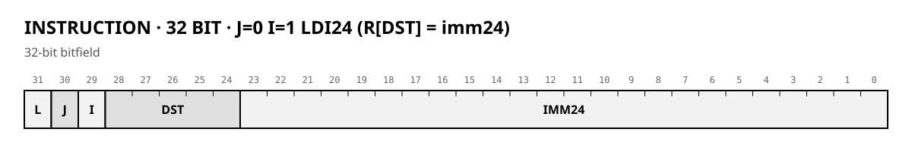
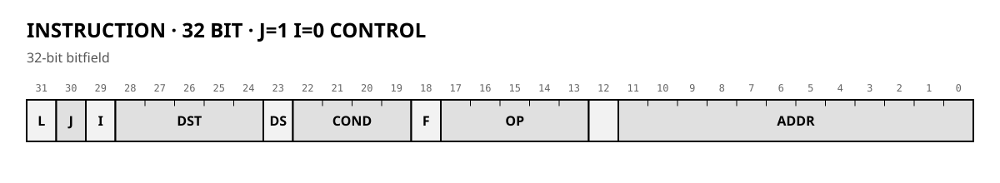

# Graphics coprocessor for Z80: architecture

*Source for the documentation generator. YAML declarations in `spec/` produce SVG and MD tables; `[include]` inserts them here. Numbers are approximate; details are refined on the simulator.*

## 1. Principles

1. **Simplicity over peak speed.** The bottleneck is memory, so the core can be simple.
2. **Programmable core, not a hardwired state machine.** Microcode lives in BRAM; a new algorithm means new microcode, not new logic.
3. **Only the hot path goes into hardware:** word buffers, pixel packing, address computation inside ports.
4. **Screen coordinates inside, addresses outside are invisible.** The CPU says "draw at (x, y)"; the port turns a pixel index into a word address.
5. **Pixel formats: 1, 4, 8, 16 bpp; pass-through modes LO8/HI8/16.**
6. **No hardware scrolling.** Replaced by fast block copying.
7. **One instruction format, four classes** (`J`, `I`): reg-reg, reg-imm12, LDI24, control.
8. **Flags Z, N, C, V.** ARM-style conditions. `CMP`/`TST` always write flags; others by `F=1`.
9. **`SHADOW` — return address + flags**; `CALL` writes it, `RET` uses PC only, `JMPR` for indirect return.
10. **`LOOP` register** — count + target, `L` bit drives it.
11. **Ports stall the sequencer in hardware**; the model does not simulate cycle counts (mathematical model, execution order identical).
12. **Three channels: SRC, DST, STM.** `STM` is read-only (microcode loader).

## 2. Overall picture


*Domain boundary: command and register logic in the 8-bit domain; the core, word buffers, and video controller on 16-bit memory. They meet at the core's registers.*

GPU → Wishbone → VideoMemoryArbiter. The arbiter is out of scope; raster scan has top priority.

## 3. Microinstruction (32 bit)



**INSTRUCTION · 32 BIT · J=0 I=0 REG-REG (d = d op s)**

| Field | Bits | Width | Description |
| --- | --- | --- | --- |
| **L** | [31:31] | 1 | Loop flag |
| **J** | [30:30] | 1 | = 0 |
| **I** | [29:29] | 1 | = 0 |
| **DST** | [28:24] | 5 | Destination operand, low 5 bits |
| **DS** | [23:23] | 1 | DST bank: 0 = R0..R31, 1 = special operand |
| **COND** | [22:19] | 4 | Condition; false = no register write, no port access |
| **F** | [18:18] | 1 | 1 = update flags |
| **OP** | [17:13] | 5 | ALU operation |
| **SRC** | [12:7] | 6 | Second operand {S, n[4:0]} |
| **RSV** | [6:0] | 7 | Reserved, must be 0 |




**INSTRUCTION · 32 BIT · J=1 I=1 REG-IMM12 (d = d op imm)**

| Field | Bits | Width | Description |
| --- | --- | --- | --- |
| **L** | [31:31] | 1 | Loop flag |
| **J** | [30:30] | 1 | = 1 |
| **I** | [29:29] | 1 | = 1 |
| **DST** | [28:24] | 5 | Destination operand, low 5 bits |
| **DS** | [23:23] | 1 | DST bank |
| **COND** | [22:19] | 4 | Condition |
| **F** | [18:18] | 1 | Update flags |
| **OP** | [17:13] | 5 | ALU operation |
| **SX** | [12:12] | 1 | 1 = sign-extend IMM, 0 = zero-extend |
| **IMM** | [11:0] | 12 | 12-bit immediate, operand B |




**INSTRUCTION · 32 BIT · J=0 I=1 LDI24 (R[DST] = imm24)**

| Field | Bits | Width | Description |
| --- | --- | --- | --- |
| **L** | [31:31] | 1 | Loop flag |
| **J** | [30:30] | 1 | = 0 |
| **I** | [29:29] | 1 | = 1 |
| **DST** | [28:24] | 5 | R0..R31 only |
| **IMM24** | [23:0] | 24 | 24-bit constant; unconditional, flags untouched |




**INSTRUCTION · 32 BIT · J=1 I=0 CONTROL**

| Field | Bits | Width | Description |
| --- | --- | --- | --- |
| **L** | [31:31] | 1 | Loop flag |
| **J** | [30:30] | 1 | = 1 |
| **I** | [29:29] | 1 | = 0 |
| **DST** | [28:24] | 5 | Unused |
| **DS** | [23:23] | 1 | Unused |
| **COND** | [22:19] | 4 | Condition |
| **F** | [18:18] | 1 | Unused |
| **OP** | [17:13] | 5 | Control operation |
| **REG** | [12:7] | 6 | Operand for JMPR (any operand, including special) |
| **ADDR** | [11:0] | 12 | Target address (JMP/CALL), halt code (HALT), IRQ code (IRQ) |


**Classes (J, I):**

| J | I | Class | Layout of low bits |
|---|---|---|---|
| 0 | 0 | reg-reg | `SRC[5:0]` in [12:7], `RSV[6:0]` in [6:0] |
| 1 | 1 | reg-imm12 | `SX` in [12], `IMM[11:0]` in [11:0] |
| 0 | 1 | LDI24 | `IMM24[23:0]` in [23:0]; only R0..R31; no COND/F; unconditional |
| 1 | 0 | control | `REG[5:0]` in [12:7], `ADDR[11:0]` in [11:0]; `OP` = CTRL |

**Execution order.** One instruction per cycle (model). ALU reads A/B/C at start, writes at end. Flags from the previous instruction.

**Condition and flags.** Z, N, C, V from the previous flag-writing instruction. `COND` selects; false = no register write, no port access.

**COND (4 bits, ARM-style)**

| Code | Name | Description |
| --- | --- | --- |
| 0 | AL | Always |
| 1 | EQ | Z=1 |
| 2 | NE | Z=0 |
| 3 | CS | C=1 (unsigned >=) |
| 4 | CC | C=0 (unsigned <) |
| 5 | MI | N=1 |
| 6 | PL | N=0 |
| 7 | VS | V=1 |
| 8 | VC | V=0 |
| 9 | HI | C=1 and Z=0 |
| 10 | LS | C=0 or Z=1 |
| 11 | GE | N=V |
| 12 | LT | N!=V |
| 13 | GT | Z=0 and N=V |
| 14 | LE | Z=1 or N!=V |
| 15 | reserved | - |

**Notes:**

- Decoded into a register during the operand-read phase from flags of the previous instruction.


## 4. ALU

**ALU OP (5 bits)**

| Code | Name | Description | Flags |
| --- | --- | --- | --- |
| 0 | MOV | d = s | Z N |
| 1 | AND | d = d & s | Z N |
| 2 | OR | d = d | s | Z N |
| 3 | XOR | d = d ^ s (NOT = XOR with -1) | Z N |
| 4 | ANDN | d = d & ~s | Z N |
| 5 | ADD | d = d + s | Z N C V |
| 6 | SUB | d = d - s; C = not borrow | Z N C V |
| 7 | CMP | SUB, result discarded, flags always written | Z N C V |
| 8 | TST | AND, result discarded, flags always written | Z N |
| 9 | ROR | 24-bit rotate right by s[4:0] mod 24 | Z N |
| 10 | SHR | ROR with zero fill | Z N |
| 11 | SAR | ROR with bit 23 fill | Z N |
| 12 | MUL | d = (d x s)[23:0], signed, multi-cycle (DSP) | Z N |
| 13 | MULH | d = (d x s)[35:12], multi-cycle | Z N |
| 14..31 | reserved | - | - |

**Notes:**

- Writing to ZERO discards the result. NOP = MOV ZERO, ZERO.
- Flags are written only if F=1 (CMP/TST always).


**Notes:**
- Writing to ZERO discards the result. NOP = MOV ZERO, ZERO.
- Flags are written only if F=1 (CMP/TST always).
- `ROR`/`SHR`/`SAR` do not update C.
- `MUL`/`MULH` are multi-cycle in RTL (DSP); 1 cycle in the model.

## 5. Control

**CTRL OP (J=1, I=0)**

| Code | Name | Description |
| --- | --- | --- |
| 0 | NOP | Nothing |
| 1 | JMP | PC = ADDR |
| 2 | CALL | SHADOW[11:0] = PC+1, SHADOW[15:12] = flags; PC = ADDR |
| 3 | RET | PC = SHADOW[11:0]; flags not restored |
| 4 | JMPR | PC = operand[REG][11:0] (any operand, including special) |
| 5 | HALT | ADDR=0 -> IDLE; ADDR!=0 -> ERROR(code) |
| 6 | IRQ | Raise IRQ, code = ADDR |
| 7..31 | reserved | - |

**Notes:**

- Only CALL writes SHADOW. Nested calls: save SHADOW to a register first.
- L bit: after the word, if count > 1 then count--, PC = loop target; else fall through. Runs even if COND is false. L is allowed with any class, including control words.


**Notes:**
- `CALL` writes SHADOW. Nested calls: save SHADOW to a register first.
- `L` bit: after the word, if count > 1 then count--, PC = loop target; else fall through. Runs even if COND is false. `L` with control words is forbidden.

## 6. Operand map

**Operand map ({S, n[4:0]}; S=0 -> R0..R31)**

| Code | Name | Read | Write |
| --- | --- | --- | --- |
| 32 | ZERO | 0 | Ignored |
| 33 | FLAGS | [3:0] = V C N Z | Same |
| 34 | SHADOW | [11:0] PC, [15:12] flags | [11:0] PC |
| 35 | LOOP | [23:12] count, [11:0] target | Same |
| 36 | BUSY_SRC | 1 if SRC port busy | - |
| 37 | BUSY_DST | 1 if DST port busy | - |
| 38 | BUSY_STM | 1 if STM port busy | - |
| 39 | SRC.IDX | Pixel index | Set index, start prefetch |
| 40 | SRC.PIX | Unpacked pixel (fmt applied); IDX += STEP | Pack pixel (fmt applied) |
| 41 | SRC.W16 | Raw 16-bit word (fmt not applied); IDX += 1 word | Write raw word |
| 42 | SRC.STEP | Signed step | Same |
| 43 | SRC.MODE | fmt | Set format |
| 44 | SRC.PAGE | Page | set_page; writeback |
| 45 | DST.IDX | Pixel index | Set index, start prefetch |
| 46 | DST.PIX | Unpacked pixel (fmt applied); no IDX change | Pack pixel (fmt applied), set dirty; IDX += STEP |
| 47 | DST.W16 | Raw 16-bit word (fmt not applied) | Write raw word, set dirty |
| 48 | DST.STEP | Signed step | Same |
| 49 | DST.MODE | fmt | Set format |
| 50 | DST.PAGE | Page | set_page; writeback |
| 51 | STM.PTR | Stream pointer | Same |
| 52 | STM.W16 | Raw 16-bit word at PTR (fmt not applied); PTR += 1 word | - |
| 53 | STM.W24 | Two words: w0[15:0], w1[7:0] -> [23:16]; PTR += 2 words | - |
| 54 | STM.STEP | Signed step | Same |
| 55 | STM.MODE | fmt | Set format |
| 56 | STM.PAGE | Page | set_page |
| 57 | FLUSH | 0 | Any value: flush all dirty words |
| 58 | STM.PIX | Unpacked pixel (fmt applied); PTR += STEP | - |

**Notes:**

- Operands that are not readable or not writable are rejected by the assembler.
- Source advances on read, destination on write. Transparency: write the old pixel back.
- STM is read-only.
- W16 accesses a raw word (fmt not applied); PIX accesses a pixel (fmt applied). Both go through the same channel buffer.
- JMPR reads any operand via the operand mux; special operands are allowed.


**Notes:**
- Ports that are not readable/writable are rejected by the assembler.
- Source advances on read, destination on write. Transparency: write the old pixel back.
- `STM` is read-only.

## 7. Register file

**Register file · R0–R31 (24 bit)**

| Index | Name | Description | Group |
| --- | --- | --- | --- |
| R0 | DX | Destination X | destination |
| R1 | DY | Destination Y | destination |
| R2 | DW | Destination width | destination |
| R3 | DH | Destination height | destination |
| R4 | SX | Source X | source |
| R5 | SY | Source Y | source |
| R6 | SW | Source width | source |
| R7 | SH | Source height | source |
| R8 | DSTRIDE | Destination row stride | memory |
| R9 | SSTRIDE | Source row stride | memory |
| R10 | DBASE | Destination base address | memory |
| R11 | SBASE | Source base address | memory |
| R12 | FG | Foreground colour | pixel |
| R13 | BG | Background colour | pixel |
| R14 | MODE | Pixel formats and combine operation | pixel |
| R15 | CX0 | Clip window left | clipping |
| R16 | CY0 | Clip window top | clipping |
| R17 | CX1 | Clip window right | clipping |
| R18 | CY1 | Clip window bottom | clipping |
| R19 | SDX | Source delta X (12.12) | increment |
| R20 | SDY | Source delta Y (12.12) | increment |
| R21 | DDX | Destination delta X (12.12) | increment |
| R22 | DDY | Destination delta Y (12.12) | increment |
| R23 | T0 | Temporary register | temporary |
| R24 | T1 | Temporary register | temporary |
| R25 | T2 | Temporary register | temporary |
| R26 | T3 | Temporary register | temporary |
| R27 | T4 | Temporary register | temporary |
| R28 | T5 | Temporary register | temporary |
| R29 | T6 | Temporary register | temporary |
| R30 | T7 | Temporary register | temporary |
| R31 | T8 | Temporary register | temporary |

**Notes:**

- SDX, SDY, DDX, DDY are a microcode convention (affine mode, 12.12), not a hardware feature.


`SDX`, `SDY`, `DDX`, `DDY` are a microcode convention (affine mode, 12.12), not a hardware feature.

## 8. Pixel formats and channel mode

**CHANNEL FORMAT (fmt, 3 bits)**

| Fmt | Name | Description |
| --- | --- | --- |
| 0 | 1 bpp | 16 pixels per word; SOURCE ONLY, unpacked to 4/8 bpp colours; writes forbidden |
| 1 | reserved | - |
| 2 | 4 bpp | 4 pixels per word; pos 0 = high nibble |
| 3 | 8 bpp | 2 pixels per word; pos 0 = high byte |
| 4 | 16 bpp | 1 pixel per word |
| 5 | PASS_LO8 | Low byte |
| 6 | PASS_HI8 | High byte |
| 7 | PASS16 | Whole word |


`MODE` is set via `MOV x.MODE, R`; read via `MOV R, x.MODE`. No `COP` bit.

## 9. Loader and packets

BRAM 0–31 holds the loader; writing there → `HALT 1`.

**Packet format:** sequence of blocks, each starts with a 16-bit header `{kind[15:12], arg[11:0]}`:

**Loader packet headers**

| Code | Name | Arg | Description |
| --- | --- | --- | --- |
| 0 | END | - | End, IDLE |
| 1 | ENDI | IRQ code | End with interrupt |
| 2 | CODE | word count | Load microcode: start address, then 2 packet words per instruction |
| 3 | RUN | entry point | Start microprogram |
| 4 | JUMP | - | Next 2 words = new stream pointer |

**Notes:**

- End of task: MOV FLUSH, ZERO ; MOV IRQ, Rcode ; HALT 0.


`CODE`: 32-bit microinstruction = 2 words. `RUN`: entry point. `JUMP`: new `STM.PTR`.

End of a task:
```
MOV FLUSH, ZERO     ; flush all dirty words
MOV IRQ, Rcode      ; optional: raise IRQ with code
HALT 0              ; IDLE
```

## 10. System commands

| Command | Single function | What it does not do |
|---|---|---|
| `JMP`, `CALL`, `RET`, `JMPR` | control flow | |
| `LDI24` | load 24-bit constant into R0..R31 | does not touch flags |
| `FLUSH` (via MOV) | make memory coherent | does not interrupt CPU |
| `IRQ` | raise an event | does not flush memory, does not stop the core |
| `HALT X` | `X=0` → IDLE; `X!=0` → ERROR(code) | does not interrupt CPU |

`ERROR` is cleared only by a new `START` (or `reset()`).

## 11. Reference loops

**Solid fill:**
```
; setup: DST.PAGE, DST.MODE, DST.STEP, DST.IDX, LOOP=(N<<12)|PIX
PIX:  MOV DST.PIX, FG      ; write pixel; IDX += STEP; L=1
```

**Sprite copy:**
```
PIX:  MOV T0, SRC.PIX      ; read source pixel
      MOV DST.PIX, T0      ; write destination pixel; IDX += STEP
```

**Affine mode** — source sampled per pixel:
```
      LDI24 T0, sidx
      MOV SRC.IDX, T0
      MOV T0, SRC.PIX
      LDI24 T1, didx
      MOV DST.IDX, T1
      MOV DST.PIX, T0
```

## 12. Clipping and affine mode

Clipping registers (`CX0`, `CY0`, `CX1`, `CY1`) and affine increments (`SDX`, `SDY`, `DDX`, `DDY`) are specified. **Microcode is not written yet** — it is a microcode convention, not a hardware feature.

## 13. Deliberately not done

- Hardware scrolling and page flip.
- Color × color LUT.
- 2 and 3 bpp formats (`fmt=1`, reserved).
- Third source (replaced by two passes through a hidden page).
- Fast whole-word fill (solved in software).
- Palette (not part of the processor).
- Combiner (`COMB`) — removed; logic via ALU.
- `SKIP_IF_Z` — removed; transparency via `COND Z` + `MASK` on write.
- `LDSP`/`LDDP`/`STDP` — replaced by `SRC.PIX`/`DST.PIX`/`STM.W16`.
- `FAULT` — removed (`HALT X` with `X != 0`).
- Saturation, `MIN`, `MAX` — removed from ALU.
- `SETMASK` / pixel mask / bit-plane layers — removed. Layers and partial updates are done by microcode.

## 14. Open questions

1. **`WAIT_FLAG`** — removed; ports stall in hardware.
2. **Exact microinstruction packing** — 32 bits, `MicroWord::pack/unpack`.
3. **`FLUSH`** — via `MOV FLUSH, ZERO`.
4. **Hardware detectors for `HALT 1`** — open.
5. **`kind` 4 bits** — sufficient.
6. **32 bits vs 36** — chosen: 32 bits.
7. **Affine mode** — `SDX`/`SDY` (12.12), microcode not written.
8. **Clipping** — `CX0..CY1`, microcode not written.
9. **Blending** — shift-based (`SHR`/`ADD`), not a dedicated command.
10. **Integration with `machine.cpp`** — `gpu_mmio` (page 3), `set_line(5)`, `tick(t)` — in progress.
11. **`PAGE`** — 8 bits; low 16 bits of `base` optional (FPGA: 8 bits, simulator: 24 bits).
12. **`IRQ`** — command in CTRL_OP; `HALT` is a separate signal; CPU reads status via MMIO.
