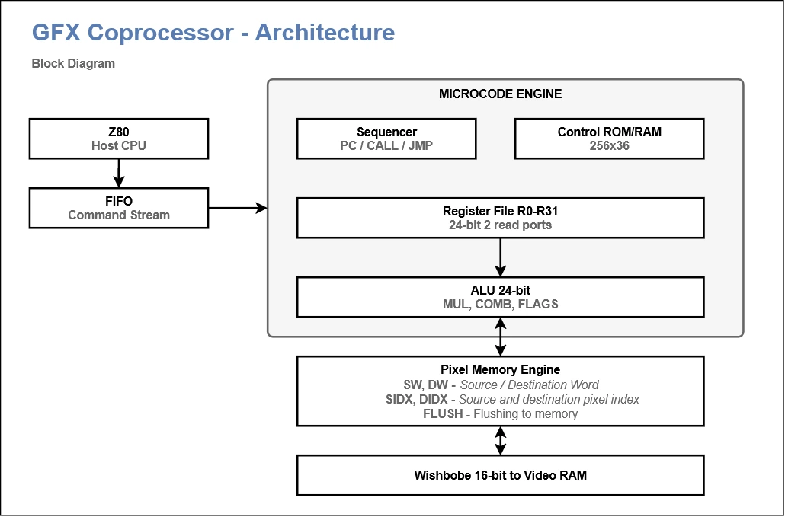
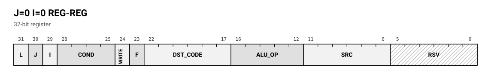
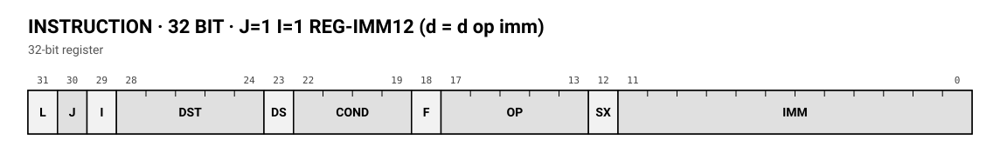
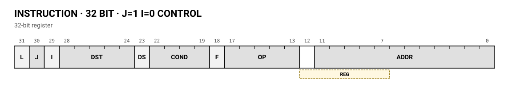
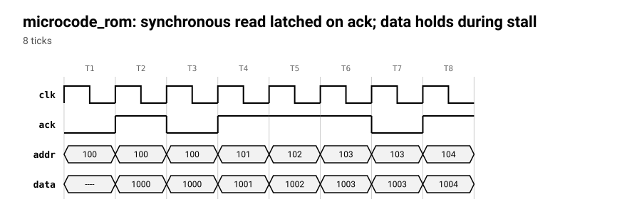
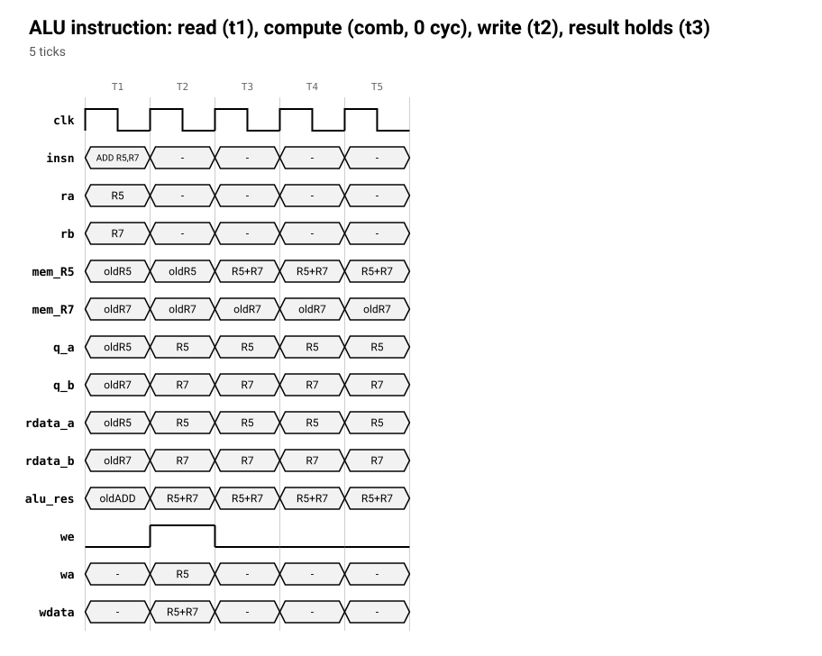

# Graphics coprocessor for Z80: architecture

*Source for the documentation generator. YAML declarations in `spec/` produce SVG and MD tables. Numbers are approximate; details are refined on the simulator.*

## 1. Principles

1. **Simplicity over peak speed.** The bottleneck is memory, so the core can be simple.
2. **Programmable core, not a hardwired state machine.** Microcode lives in BRAM; a new algorithm means new microcode, not new logic.
3. **Only the hot path goes into hardware:** word buffers, pixel packing, address computation inside ports.
4. **Screen coordinates inside, addresses outside are invisible.** The CPU says "draw at (x, y)"; the port turns a pixel index into a word address.
5. **Pixel formats: 1, 2, 4, 8, 16 bpp; pass-through modes LO8/HI8/16.**
6. **No hardware scrolling.** Replaced by fast block copying.
7. **One instruction format, four classes** (`J`, `I`): reg-reg, reg-imm12, LDI24, control.
8. **Flags Z, N, C, V.** ARM-style conditions. `CMP`/`TST` always write flags; others by `F=1`.
9. **`SHADOW` — return address + flags**; `CALL` writes it, `RET` uses PC only, `JMPR` for indirect return.
10. **`LOOP` register** — count + target, `L` bit drives it.
11. **Ports stall the sequencer in hardware**; the model does not simulate cycle counts.
12. **Three channels: SRC, DST, STM.** `STM` is read-only (microcode loader).

## 2. Overall picture



*Domain boundary: command and register logic in the 8-bit domain; the core, word buffers, and video controller on 16-bit memory. They meet at the core's registers.*

GPU → Wishbone → VideoMemoryArbiter. The arbiter is out of scope; raster scan has top priority.

## 3. Microinstruction (32 bit)

The microinstruction is a fixed 32-bit word. The pair (J, I) selects one of four formats: REG-REG, REG-IMM12, LDI24, CONTROL.



*Figure 7 — INSTRUCTION · 32 BIT · J=0 I=0 REG-REG (d = d op s)*

**Table 12 — INSTRUCTION · 32 BIT · J=0 I=0 REG-REG (d = d op s)**

| Field | Bits | Width | Description |
| --- | --- | --- | --- |
| <a id="L"></a>**L** | [31] | 1 | Loop flag |
| <a id="J"></a>**J** | [30] | 1 | = 0 |
| <a id="I"></a>**I** | [29] | 1 | = 0 |
| <a id="DST"></a>**DST** | [28:24] | 5 | Destination operand, low 5 bits |
| <a id="DS"></a>**DS** | [23] | 1 | DST bank: 0 = R0..R31, 1 = special operand |
| <a id="COND"></a>**COND** | [22:19] | 4 | Condition; false = no register write, no port access [`conditions`](gen/conditions.md) |
| <a id="F"></a>**F** | [18] | 1 | 1 = update flags |
| <a id="OP"></a>**OP** | [17:13] | 5 | ALU operation [`alu_ops`](gen/alu_ops.md) |
| <a id="SRC"></a>**SRC** | [12:7] | 6 | Second operand {S, n[4:0]} [`operand_map`](gen/operand_map.md) |
| <a id="RSV"></a>**RSV** | [6:0] | 7 | Reserved, must be 0 |




*Figure 8 — INSTRUCTION · 32 BIT · J=1 I=1 REG-IMM12 (d = d op imm)*

**Table 13 — INSTRUCTION · 32 BIT · J=1 I=1 REG-IMM12 (d = d op imm)**

| Field | Bits | Width | Description |
| --- | --- | --- | --- |
| <a id="L"></a>**L** | [31] | 1 | Loop flag |
| <a id="J"></a>**J** | [30] | 1 | = 1 |
| <a id="I"></a>**I** | [29] | 1 | = 1 |
| <a id="DST"></a>**DST** | [28:24] | 5 | Destination operand, low 5 bits |
| <a id="DS"></a>**DS** | [23] | 1 | DST bank |
| <a id="COND"></a>**COND** | [22:19] | 4 | Condition [`conditions`](gen/conditions.md) |
| <a id="F"></a>**F** | [18] | 1 | Update flags |
| <a id="OP"></a>**OP** | [17:13] | 5 | ALU operation [`alu_ops`](gen/alu_ops.md) |
| <a id="SX"></a>**SX** | [12] | 1 | 1 = sign-extend IMM, 0 = zero-extend |
| <a id="IMM"></a>**IMM** | [11:0] | 12 | 12-bit immediate, operand B |


![INSTRUCTION · 32 BIT · J=0 I=1 LDI24 (R[DST] = imm24)](gen/insn_ldi24.svg)

*Figure 9 — INSTRUCTION · 32 BIT · J=0 I=1 LDI24 (R[DST] = imm24)*

**Table 14 — INSTRUCTION · 32 BIT · J=0 I=1 LDI24 (R[DST] = imm24)**

| Field | Bits | Width | Description |
| --- | --- | --- | --- |
| <a id="L"></a>**L** | [31] | 1 | Loop flag |
| <a id="J"></a>**J** | [30] | 1 | = 0 |
| <a id="I"></a>**I** | [29] | 1 | = 1 |
| <a id="DST"></a>**DST** | [28:24] | 5 | R0..R31 only |
| <a id="IMM24"></a>**IMM24** | [23:0] | 24 | 24-bit constant; unconditional, flags untouched |




*Figure 10 — INSTRUCTION · 32 BIT · J=1 I=0 CONTROL*

**Table 15 — INSTRUCTION · 32 BIT · J=1 I=0 CONTROL**

| Field | Bits | Width | Description |
| --- | --- | --- | --- |
| <a id="L"></a>**L** | [31] | 1 | Loop flag |
| <a id="J"></a>**J** | [30] | 1 | = 1 |
| <a id="I"></a>**I** | [29] | 1 | = 0 |
| <a id="DST"></a>**DST** | [28:24] | 5 | Unused |
| <a id="DS"></a>**DS** | [23] | 1 | Unused |
| <a id="COND"></a>**COND** | [22:19] | 4 | Condition [`conditions`](gen/conditions.md) |
| <a id="F"></a>**F** | [18] | 1 | Unused |
| <a id="OP"></a>**OP** | [17:13] | 5 | Control operation [`ctrl_ops`](gen/ctrl_ops.md) |
| <a id="REG"></a>**REG** | [12:7] | 6 | Operand for JMPR (any operand, including special) |
| <a id="ADDR"></a>**ADDR** | [11:0] | 12 | Target address (JMP/CALL), halt code (HALT), IRQ code (IRQ) |


**Classes (J, I):**

| J | I | Class | Layout of low bits |
|---|---|---|---|
| 0 | 0 | reg-reg | `SRC[5:0]` in [12:7], `RSV[6:0]` in [6:0] |
| 1 | 1 | reg-imm12 | `SX` in [12], `IMM[11:0]` in [11:0] |
| 0 | 1 | LDI24 | `IMM24[23:0]` in [23:0]; only R0..R31; no COND/F; unconditional |
| 1 | 0 | control | `REG[5:0]` in [12:7], `ADDR[11:0]` in [11:0]; `OP` = CTRL |

**Field overlap in control words.** Bits [11:7] belong to both `ADDR[11:0]` and `REG[5:0]`. This is intentional: for `JMPR` the target register is encoded in the same position as `SRC` in reg-reg words, while `ADDR` supplies the immediate target for `JMP`/`CALL`. The two interpretations are mutually exclusive per opcode; the assembler rejects combinations that would need both.

**Execution order.** One instruction per cycle (model). The ALU reads its two operands A and B at the start of the cycle and writes the result at the end. Flags come from the previous instruction.

**Condition and flags.** Z, N, C, V from the previous flag-writing instruction. `COND` selects; false = no register write, no port access.

**Table 16 — COND (4 bits, ARM-style)**

| Value | Name | Description |
| --- | --- | --- |
| 0 | <a id="AL"></a>**AL** | Always |
| 1 | <a id="EQ"></a>**EQ** | Z=1 |
| 2 | <a id="NE"></a>**NE** | Z=0 |
| 3 | <a id="CS"></a>**CS** | C=1 (unsigned >=) |
| 4 | <a id="CC"></a>**CC** | C=0 (unsigned <) |
| 5 | <a id="MI"></a>**MI** | N=1 |
| 6 | <a id="PL"></a>**PL** | N=0 |
| 7 | <a id="VS"></a>**VS** | V=1 |
| 8 | <a id="VC"></a>**VC** | V=0 |
| 9 | <a id="HI"></a>**HI** | C=1 and Z=0 |
| 10 | <a id="LS"></a>**LS** | C=0 or Z=1 |
| 11 | <a id="GE"></a>**GE** | N=V |
| 12 | <a id="LT"></a>**LT** | N!=V |
| 13 | <a id="GT"></a>**GT** | Z=0 and N=V |
| 14 | <a id="LE"></a>**LE** | Z=1 or N!=V |
| 15 | <a id="NV"></a>**NV** | Never (default=false) |


ROM is synchronous: `data_r <= mem[addr]` latches on `ack`, so the instruction is available one cycle after `addr`. The `pc` is stable during the whole cycle, and the `ack` from the previous instruction gates the read.



*Figure 11 — microcode_rom: synchronous read latched on ack; data holds during stall*


## 4. ALU

The ALU implements 18 operations: logic (MOV/MVN/AND/BIC/OR/ORN/XOR/XNOR), arithmetic (ADD/ADC/SUB/SBC), shift (ROR/SHR/SAR), and other (MUL/TST/CMP). The operation is selected by `op[4:0]`.

**Table 17 — ALU OP (5 bits, class = op[4:3], fn = op[2:1], flag = op[0])**

| Value | Name | Description |
| --- | --- | --- |
| 0 | <a id="MOV"></a>**MOV** | cls=00, fn=00, inv=0: d = s |
| 1 | <a id="MVN"></a>**MVN** | cls=00, fn=00, inv=1: d = ~s |
| 2 | <a id="AND"></a>**AND** | cls=00, fn=01, inv=0: d = d & s |
| 3 | <a id="BIC"></a>**BIC** | cls=00, fn=01, inv=1: d = d & ~s |
| 4 | <a id="OR"></a>**OR** | cls=00, fn=10, inv=0: d = d \| s |
| 5 | <a id="ORN"></a>**ORN** | cls=00, fn=10, inv=1: d = d \| ~s |
| 6 | <a id="XOR"></a>**XOR** | cls=00, fn=11, inv=0: d = d ^ s |
| 7 | <a id="XNOR"></a>**XNOR** | cls=00, fn=11, inv=1: d = d ^ ~s |
| 8 | <a id="ADD"></a>**ADD** | cls=01, fn=00, cin=0: d = d + s |
| 9 | <a id="ADC"></a>**ADC** | cls=01, fn=00, cin=C: d = d + s + C |
| 10 | <a id="SUB"></a>**SUB** | cls=01, fn=01, cin=1: d = d - s; C = not borrow |
| 11 | <a id="SBC"></a>**SBC** | cls=01, fn=01, cin=C: d = d - s - (1-C) |
| 12 | <a id="ROR"></a>**ROR** | cls=10, fn=00: 16-bit rotate right by s[3:0] |
| 13 | <a id="reserved"></a>**reserved** | cls=10, fn=00, op[0]=1 — reserved |
| 14 | <a id="SHR"></a>**SHR** | cls=10, fn=01: ROR with zero fill |
| 15 | <a id="reserved"></a>**reserved** | cls=10, fn=01, op[0]=1 — reserved |
| 16 | <a id="SAR"></a>**SAR** | cls=10, fn=10: ROR with bit 15 fill (arithmetic) |
| 17 | <a id="reserved"></a>**reserved** | cls=10, fn=10, op[0]=1 — reserved |
| 18..23 | <a id="reserved"></a>**reserved** | cls=10, fn=11 and others — reserved |
| 24 | <a id="MUL"></a>**MUL** | cls=11, fn=00: d = (d * s)[15:0] signed; high 16 to MHI |
| 25..27 | <a id="reserved"></a>**reserved** | cls=11, fn=00, op[0]=1 or fn=01 — reserved |
| 28 | <a id="TST"></a>**TST** | cls=11, fn=10: d & s, result discarded, flags written |
| 29 | <a id="reserved"></a>**reserved** | cls=11, fn=10, op[0]=1 — reserved |
| 30 | <a id="CMP"></a>**CMP** | cls=11, fn=11: d - s, result discarded, flags written |
| 31 | <a id="reserved"></a>**reserved** | cls=11, fn=11, op[0]=1 — reserved |

**Notes:**

- Writing to ZERO discards the result. NOP = MOV ZERO, ZERO.


**Notes:**
- Writing to ZERO discards the result. NOP = MOV ZERO, ZERO.
- Flags are written only if F=1 (CMP/TST always).
- `ROR`/`SHR`/`SAR` do not update C.
- `MUL` is multi-cycle in RTL (DSP); 1 cycle in the model.
- **`MUL` width.** RTL (`alu.sv`) computes `a_signed * b_signed` over 16×16 → 32 bits (low 16 to result, high 16 to MHI). The model agrees.
- **`SHR`/`SAR` with shift ≥ 16.** RTL uses a 4-stage barrel shifter over `b[3:0]` (mod 16). Shift counts ≥ 16 wrap to `b[3:0]`. This behaviour is normative.

An ALU instruction takes two cycles from "instruction available" to "result in register". In cycle 1 the register file reads `q_a`/`q_b`; in cycle 2 the writeback writes `mem[wa] <= wdata`. The ALU itself is combinational (0 cycles), so `pc` advances every cycle; only the register write is delayed by one cycle. `MUL` additionally registers `mhi` on the next `posedge clk`.



*Figure 12 — ALU instruction: read (t1), compute (comb, 0 cyc), write (t2), result holds (t3)*


## 5. Control

Control-class instructions (J=1, I=0) implement NOP, JMP, CALL, RET, JMPR, HALT, IRQ, and FLUSH. They are all selected by `reg_op` (CTRL op).

**Table 18 — CTRL OP (J=1, I=0)**

| Value | Name | Description |
| --- | --- | --- |
| 0 | <a id="NOP"></a>**NOP** | Nothing |
| 1 | <a id="JMP"></a>**JMP** | PC = ADDR |
| 2 | <a id="CALL"></a>**CALL** | SHADOW[15:12] = flags, SHADOW[11:0] = PC+1; PC = ADDR |
| 3 | <a id="RET"></a>**RET** | PC = SHADOW[11:0]; flags not restored |
| 4 | <a id="JMPR"></a>**JMPR** | PC = operand[REG][11:0] |
| 5 | <a id="HALT"></a>**HALT** | ADDR=0 -> IDLE; ADDR!=0 -> ERROR(code) |
| 6 | <a id="IRQ"></a>**IRQ** | Raise IRQ, code = ADDR |
| 7 | <a id="FLUSH"></a>**FLUSH** | Flush cache channel imm12[1:0] |


**Notes:**
- `CALL` writes `SHADOW = {v, c, n, z, pc+1}`. Nested calls: save SHADOW to a register first.
- **`L` bit and control words.** `L` is forbidden on control-class words (the assembler rejects it). It is allowed on all data-processing classes (reg-reg, reg-imm12, LDI24). After the word, if count > 1 then count--, PC = loop target; else fall through. The loop update runs even if `COND` is false.
- `STM` is read-only.

## 6. Operand map

The 6-bit operand field selects 64 slots: R0..R31 (general-purpose), 32..39 (system), 40..43 (DATA), 44..47 (reserved), 48..63 (pixel engine channels).

**Table 19 — Operand map (6 bits, 0..63)**

| Code | Name | Read | Write |
| --- | --- | --- | --- |
| 0..31 | <a id="R0..R31"></a>**R0..R31** | 16-bit value | 16-bit value |
| 32 | <a id="ZERO"></a>**ZERO** | 0 | Ignored |
| 33 | <a id="FLAGS"></a>**FLAGS** | [3:0] = V C N Z | [3:0] |
| 34 | <a id="SHADOW"></a>**SHADOW** | [15:12] flags, [11:0] PC+1 | [11:0] PC |
| 35 | <a id="LOOP_CNT"></a>**LOOP_CNT** | Loop counter | Loop counter |
| 36 | <a id="LOOP_TGT"></a>**LOOP_TGT** | Loop target | Loop target |
| 37 | <a id="BUSY"></a>**BUSY** | {wb_cyc, flush_done, access_done, hit} | - |
| 38 | <a id="MHI"></a>**MHI** | Upper 16 bits of MUL | - |
| 39 | <a id="reserved"></a>**reserved** | 0 | - |
| 40..43 | <a id="DATA_0..3_"></a>**DATA[0..3]** | pixel_out from channel ch | pixel_in to channel ch |
| 44..47 | <a id="reserved"></a>**reserved** | 0 | - |
| 48..63 | <a id="CH_ch___IDX_IDXH_STEP_MODE_PAGE_"></a>**CH[ch]_{IDX,IDXH,STEP,MODE_PAGE}** | - | Write-only channel register |


**Notes:**
- Ports that are not readable/writable are rejected by the assembler.
- Source advances on read, destination on write. Transparency: write the old pixel back.
- `STM` is read-only.

## 7. Register file

The register file holds 32 general-purpose registers R0..R31. R0 is a normal register (not hardwired to zero); the ZERO operand (`32`) provides the constant 0.

**Table 20 — Register file · R0–R31 (16 bit)**

| Value | Name | Description |
| --- | --- | --- |
| 0 | <a id="R0"></a>**R0** | General-purpose (NOT hardwired to zero; use ZERO=32 for constant 0) |
| 1 | <a id="R1"></a>**R1** | General-purpose |
| 2 | <a id="R2"></a>**R2** | General-purpose |
| 3 | <a id="R3"></a>**R3** | General-purpose |
| 4 | <a id="R4"></a>**R4** | General-purpose |
| 5 | <a id="R5"></a>**R5** | General-purpose |
| 6 | <a id="R6"></a>**R6** | General-purpose |
| 7 | <a id="R7"></a>**R7** | General-purpose |
| 8 | <a id="R8"></a>**R8** | General-purpose |
| 9 | <a id="R9"></a>**R9** | General-purpose |
| 10 | <a id="R10"></a>**R10** | General-purpose |
| 11 | <a id="R11"></a>**R11** | General-purpose |
| 12 | <a id="R12"></a>**R12** | General-purpose |
| 13 | <a id="R13"></a>**R13** | General-purpose |
| 14 | <a id="R14"></a>**R14** | General-purpose |
| 15 | <a id="R15"></a>**R15** | General-purpose |
| 16 | <a id="R16"></a>**R16** | General-purpose |
| 17 | <a id="R17"></a>**R17** | General-purpose |
| 18 | <a id="R18"></a>**R18** | General-purpose |
| 19 | <a id="R19"></a>**R19** | General-purpose |
| 20 | <a id="R20"></a>**R20** | General-purpose |
| 21 | <a id="R21"></a>**R21** | General-purpose |
| 22 | <a id="R22"></a>**R22** | General-purpose |
| 23 | <a id="R23"></a>**R23** | General-purpose |
| 24 | <a id="R24"></a>**R24** | General-purpose |
| 25 | <a id="R25"></a>**R25** | General-purpose |
| 26 | <a id="R26"></a>**R26** | General-purpose |
| 27 | <a id="R27"></a>**R27** | General-purpose |
| 28 | <a id="R28"></a>**R28** | General-purpose |
| 29 | <a id="R29"></a>**R29** | General-purpose |
| 30 | <a id="R30"></a>**R30** | General-purpose |
| 31 | <a id="R31"></a>**R31** | General-purpose |


`SDX`, `SDY`, `DDX`, `DDY` are a microcode convention (affine mode, 12.12), not a hardware feature.

## 8. Pixel formats and channel mode

The channel format (`MODE`) selects how many pixels per 16-bit word: 1 bpp (16 px), 2 bpp (8), 4 bpp (4), 8 bpp (2), 16 bpp (1). Pass-through modes LO8/HI8/16 bypass packing.

**Table 21 — CHANNEL FORMAT (fmt, 3 bits)**

| Value | Name | Description |
| --- | --- | --- |
| 0 | <a id="1_bpp"></a>**1 bpp** | 16 pixels per word (k=4); SOURCE ONLY, writes forbidden |
| 1 | <a id="2_bpp"></a>**2 bpp** | 8 pixels per word (k=3) |
| 2 | <a id="4_bpp"></a>**4 bpp** | 4 pixels per word (k=2); pos 0 = high nibble |
| 3 | <a id="8_bpp"></a>**8 bpp** | 2 pixels per word (k=1); pos 0 = high byte |
| 4 | <a id="16_bpp"></a>**16 bpp** | 1 pixel per word (k=0) |
| 5 | <a id="PASS_LO8"></a>**PASS_LO8** | Low byte pass-through |
| 6 | <a id="PASS_HI8"></a>**PASS_HI8** | High byte pass-through |
| 7 | <a id="PASS16"></a>**PASS16** | Whole word pass-through |


`MODE` is set via `MOV x.MODE, R`; read via `MOV R, x.MODE`.

## 9. Loader and packets

BRAM 0–31 holds the loader; writing there → `HALT 1`. Each packet starts with a 16-bit header `{kind[15:12], arg[11:0]}`.

**Table 22 — Loader packet headers**

| Value | Name | Description |
| --- | --- | --- |
| 0 | <a id="END"></a>**END** | End, IDLE (arg: -) |
| 1 | <a id="ENDI"></a>**ENDI** | End with interrupt (arg: IRQ code) |
| 2 | <a id="CODE"></a>**CODE** | Load microcode: start address, then 2 packet words per instruction (arg: word count) |
| 3 | <a id="RUN"></a>**RUN** | Start microprogram (arg: entry point) |
| 4 | <a id="JUMP"></a>**JUMP** | Next 2 words = new stream pointer (arg: -) |

**Notes:**

- В combined_code.txt loader отсутствует (есть только bootloader.hex для microcode_rom). Если loader реализован вне combined_code.txt — сверить с ним.


`CODE`: 32-bit microinstruction = 2 words. `RUN`: entry point. `JUMP`: new `STM.PTR`.

End of a task:

```
MOV FLUSH, ZERO     ; flush all dirty words
MOV IRQ, Rcode      ; optional: raise IRQ with code
HALT 0              ; IDLE
```

## 10. System commands

| Command | Single function | What it does not do |
|---|---|---|
| `JMP`, `CALL`, `RET`, `JMPR` | control flow | |
| `LDI24` | load 24-bit constant into R0..R31 | does not touch flags |
| `FLUSH` (via MOV) | make memory coherent | does not interrupt CPU |
| `IRQ` | raise an event | does not flush memory, does not stop the core |
| `HALT X` | `X=0` → IDLE; `X!=0` → ERROR(code) | does not interrupt CPU |

`ERROR` is cleared only by a new `START` (or `reset()`).

## 11. Reference loops

**Solid fill:**

```
; setup: DST.PAGE, DST.MODE, DST.STEP, DST.IDX, LOOP=(N<<12)|PIX
PIX:  MOV DST.PIX, FG      ; write pixel; IDX += STEP; L=1
```

**Sprite copy:**

```
PIX:  MOV T0, SRC.PIX      ; read source pixel
      MOV DST.PIX, T0      ; write destination pixel; IDX += STEP
```

**Affine mode** — source sampled per pixel:

```
      LDI24 T0, sidx
      MOV SRC.IDX, T0
      MOV T0, SRC.PIX
      LDI24 T1, didx
      MOV DST.IDX, T1
      MOV DST.PIX, T0
```

## 12. Clipping and affine mode

Clipping registers (`CX0`, `CY0`, `CX1`, `CY1`) and affine increments (`SDX`, `SDY`, `DDX`, `DDY`) are specified. **Microcode is not written yet** — it is a microcode convention, not a hardware feature.

## 13. Deliberately not done

- Hardware scrolling and page flip.
- Color × color LUT.
- 3 bpp format (`fmt=1` is used for 2 bpp; 3 bpp is not defined).
- Third source (replaced by two passes through a hidden page).
- Fast whole-word fill (solved in software).
- Palette (not part of the processor).
- Combiner (`COMB`) — removed; logic via ALU.
- `SKIP_IF_Z` — removed; transparency via `COND Z` + `MASK` on write.
- `LDSP`/`LDDP`/`STDP` — replaced by `SRC.PIX`/`DST.PIX`/`STM.W16`.
- `FAULT` — removed (`HALT X` with `X != 0`).
- Saturation, `MIN`, `MAX` — removed from ALU.
- `SETMASK` / pixel mask / bit-plane layers — removed.

## 14. Open questions

1. **`WAIT_FLAG`** — removed; ports stall in hardware.
2. **Exact microinstruction packing** — 32 bits, `MicroWord::pack/unpack`.
3. **`FLUSH`** — via `MOV FLUSH, ZERO`.
4. **Hardware detectors for `HALT 1`** — open.
5. **`kind` 4 bits** — sufficient.
6. **32 bits vs 36** — chosen: 32 bits.
7. **Affine mode** — `SDX`/`SDY` (12.12), microcode not written.
8. **Clipping** — `CX0..CY1`, microcode not written.
9. **Blending** — shift-based (`SHR`/`ADD`), not a dedicated command.
10. **Integration with `machine.cpp`** — `gpu_mmio` (page 3), `set_line(5)`, `tick(t)` — in progress.
11. **`PAGE`** — 8 bits; low 16 bits of `base` optional (FPGA: 8 bits, simulator: 24 bits).
12. **`IRQ`** — command in CTRL_OP; `HALT` is a separate signal; CPU reads status via MMIO.
