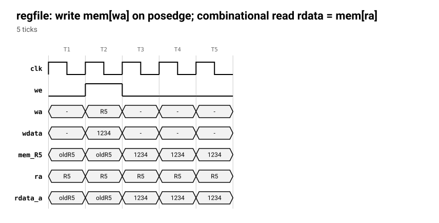

# Register Map

There are 64 operand slots (6 bits) in total. Slots 0..31 are general-purpose registers (R0..R31), 32..39 are system registers, 40..43 are DATA[0..3], 44..47 are reserved, 48..63 are pixel engine channels.

## General-Purpose Registers

Registers R0..R31 serve as source and destination in most instructions. R0 is a normal register; the constant zero comes from the ZERO operand (`32`).

**Table 5 — Register file · R0–R31 (16 bit)**

| Value | Name | Description |
| --- | --- | --- |
| 0 | **R0** | General-purpose (NOT hardwired to zero; use ZERO=32 for constant 0) |
| 1 | **R1** | General-purpose |
| 2 | **R2** | General-purpose |
| 3 | **R3** | General-purpose |
| 4 | **R4** | General-purpose |
| 5 | **R5** | General-purpose |
| 6 | **R6** | General-purpose |
| 7 | **R7** | General-purpose |
| 8 | **R8** | General-purpose |
| 9 | **R9** | General-purpose |
| 10 | **R10** | General-purpose |
| 11 | **R11** | General-purpose |
| 12 | **R12** | General-purpose |
| 13 | **R13** | General-purpose |
| 14 | **R14** | General-purpose |
| 15 | **R15** | General-purpose |
| 16 | **R16** | General-purpose |
| 17 | **R17** | General-purpose |
| 18 | **R18** | General-purpose |
| 19 | **R19** | General-purpose |
| 20 | **R20** | General-purpose |
| 21 | **R21** | General-purpose |
| 22 | **R22** | General-purpose |
| 23 | **R23** | General-purpose |
| 24 | **R24** | General-purpose |
| 25 | **R25** | General-purpose |
| 26 | **R26** | General-purpose |
| 27 | **R27** | General-purpose |
| 28 | **R28** | General-purpose |
| 29 | **R29** | General-purpose |
| 30 | **R30** | General-purpose |
| 31 | **R31** | General-purpose |

*Fig. 5. GPRs (6-bit operand field).*

A read takes one cycle (`q_a <= mem[ra]` on `posedge clk`), a write takes one cycle (`mem[wa] <= wdata`). Read-after-write in the same cycle is covered by bypass: `rdata_a = wdata_r` when `we && (wa == ra)`, so the new value is visible without waiting for the write to land.

*Figure 2 — regfile: write mem_R5 (t2), read q_a (t2), bypass (t1, same-cycle)*

## System Registers

System registers (32..38, 39 reserved) are available as a source in any instruction, and as a destination only in `MOV`. They provide access to flags, CALL/RET shadow, loop counter, and cache status.

**Table 6 — System Registers (32..38, 39 reserved)**

| Value | Name | Description |
| --- | --- | --- |
| 32 | **ZERO** | Constant zero |
| 33 | **FLAGS** | Flags V, C, N, Z (see flags_bitfield) |
| 34 | **SHADOW** | CALL/RET return address and flags (see shadow_bitfield) |
| 35 | **LOOP_CNT** | Loop counter |
| 36 | **LOOP_TGT** | Loop target |
| 37 | **BUSY** | Busy flags (see busy_bitfield) |
| 38 | **MHI** | Upper 16 bits of MUL |
| 39 | **reserved** | - |

*Fig. 6. System registers.*

## Pixel Engine Channels

Channels (48..63) are 4 sets of 4 registers each: IDX, IDXH, STEP, MODE_PAGE. They are write-only via `MOV`.

**Table 7 — Pixel Engine Channels (48..63)**

| Value | Name | Description |
| --- | --- | --- |
| 48 | **CH0_IDX** | Pixel index |
| 49 | **CH0_IDXH** | Upper 3 bits of index |
| 50 | **CH0_STEP** | Step (12.4) |
| 51 | **CH0_MODE_PAGE** | MODE and PAGE |
| 52 | **CH1_IDX** | Pixel index |
| 53 | **CH1_IDXH** | Upper 3 bits of index |
| 54 | **CH1_STEP** | Step (12.4) |
| 55 | **CH1_MODE_PAGE** | MODE and PAGE |
| 56 | **CH2_IDX** | Pixel index |
| 57 | **CH2_IDXH** | Upper 3 bits of index |
| 58 | **CH2_STEP** | Step (12.4) |
| 59 | **CH2_MODE_PAGE** | MODE and PAGE |
| 60 | **CH3_IDX** | Pixel index |
| 61 | **CH3_IDXH** | Upper 3 bits of index |
| 62 | **CH3_STEP** | Step (12.4) |
| 63 | **CH3_MODE_PAGE** | MODE and PAGE |

*Fig. 7. Pixel engine channels.*

## DATA[0..3]

DATA[0..3] (40..43) are pixel engine temporary registers. Reading triggers a pixel read operation; writing triggers a pixel write operation.

**Table 8 — DATA[0..3] (40..43)**

| Value | Name | Description |
| --- | --- | --- |
| 40 | **DATA0** | Pixel engine temporary register |
| 41 | **DATA1** | Pixel engine temporary register |
| 42 | **DATA2** | Pixel engine temporary register |
| 43 | **DATA3** | Pixel engine temporary register |

*Fig. 8. DATA registers.*

