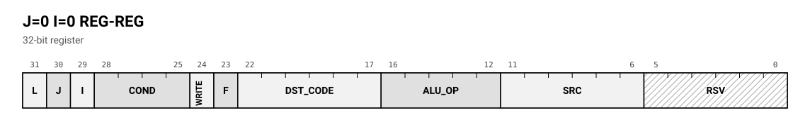
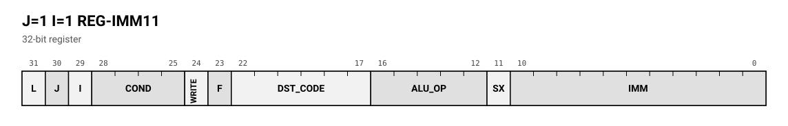
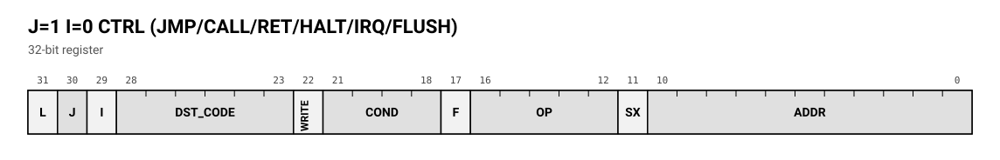
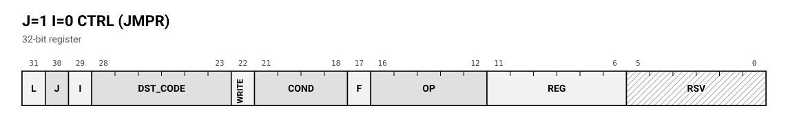

# Instruction Set Architecture (ISA)

Instructions are 32-bit, fixed-format. The instruction class is determined by field (J, I). Within a class, field `REG_OP` (ALU / CTRL op) determines the operation.

## Instruction Format

The format is fixed; all fields have strict positions. This simplifies decoding: all fields are available combinationally from `insn`.

*Figure 5 — J=0 I=0 REG-REG*

**Table 8 — J=0 I=0 REG-REG**

| Field | Bits | Width | Description |
| --- | --- | --- | --- |
| **L** | [31] | 1 | Loop flag |
| **J** | [30] | 1 | = 0 |
| **I** | [29] | 1 | = 0 |
| **DST_CODE** | [28:23] | 6 | Destination operand (6 bits) [`operand_map`](gen/operand_map.md) |
| **WRITE** | [22] | 1 | 1 = write result; 0 = do not write (flags still update if F=1) |
| **COND** | [21:18] | 4 | Condition [`conditions`](gen/conditions.md) |
| **F** | [17] | 1 | 1 = update flags |
| **OP** | [16:12] | 5 | ALU operation [`alu_ops`](gen/alu_ops.md) |
| **SRC** | [11:6] | 6 | Second operand (6 bits) [`operand_map`](gen/operand_map.md) |
| **RSV** | [5:0] | 6 | Reserved, must be 0 |

*Figure 6 — J=1 I=1 REG-IMM11*

**Table 9 — J=1 I=1 REG-IMM11**

| Field | Bits | Width | Description |
| --- | --- | --- | --- |
| **L** | [31] | 1 | Loop flag |
| **J** | [30] | 1 | = 1 |
| **I** | [29] | 1 | = 1 |
| **DST_CODE** | [28:23] | 6 | Destination operand (6 bits) [`operand_map`](gen/operand_map.md) |
| **WRITE** | [22] | 1 | 1 = write result; 0 = do not write |
| **COND** | [21:18] | 4 | Condition [`conditions`](gen/conditions.md) |
| **F** | [17] | 1 | Update flags |
| **OP** | [16:12] | 5 | ALU operation [`alu_ops`](gen/alu_ops.md) |
| **SX** | [11] | 1 | 1 = sign-extend IMM11, 0 = zero-extend |
| **IMM** | [10:0] | 11 | 11-bit immediate, operand B |

*Figure 7 — J=1 I=0 CTRL (JMP/CALL/RET/HALT/IRQ/FLUSH)*

**Table 10 — J=1 I=0 CTRL (JMP/CALL/RET/HALT/IRQ/FLUSH)**

| Field | Bits | Width | Description |
| --- | --- | --- | --- |
| **L** | [31] | 1 | Loop flag |
| **J** | [30] | 1 | = 1 |
| **I** | [29] | 1 | = 0 |
| **DST_CODE** | [28:23] | 6 | Unused for non-JMPR CTRL [`operand_map`](gen/operand_map.md) |
| **WRITE** | [22] | 1 | Unused for CTRL |
| **COND** | [21:18] | 4 | Condition [`conditions`](gen/conditions.md) |
| **F** | [17] | 1 | Unused for CTRL (must be 0) |
| **OP** | [16:12] | 5 | Control operation [`ctrl_ops`](gen/ctrl_ops.md) |
| **SX** | [11] | 1 | Unused in CTRL |
| **ADDR** | [10:0] | 11 | Target address (JMP/CALL), halt/IRQ code, channel (FLUSH) |

*Figure 8 — J=1 I=0 CTRL (JMPR)*

**Table 11 — J=1 I=0 CTRL (JMPR)**

| Field | Bits | Width | Description |
| --- | --- | --- | --- |
| **L** | [31] | 1 | Loop flag |
| **J** | [30] | 1 | = 1 |
| **I** | [29] | 1 | = 0 |
| **DST_CODE** | [28:23] | 6 | Source register for target address [`operand_map`](gen/operand_map.md) |
| **WRITE** | [22] | 1 | Unused |
| **COND** | [21:18] | 4 | Condition [`conditions`](gen/conditions.md) |
| **F** | [17] | 1 | Unused |
| **OP** | [16:12] | 5 | = JMPR [`ctrl_ops`](gen/ctrl_ops.md) |
| **REG** | [11:6] | 6 | Source operand code (0..63) [`operand_map`](gen/operand_map.md) |
| **RSV** | [5:0] | 6 | Unused |

*Fig. 9. Instruction format.*

## ALU Instructions

ALU instructions (class `00` and `01`) perform logical and arithmetic operations. The result is written to `DST` if `nowrite = 0`. Flags (`Z`, `N`, `C`, `V`) are updated according to `F` and the opcode.

**Table 12 — ALU OP (5 bits, class = op[4:3], fn = op[2:1], flag = op[0])**

| Value | Name | Description |
| --- | --- | --- |
| 0 | **MOV** | cls=00, fn=00, inv=0: d = s |
| 1 | **MVN** | cls=00, fn=00, inv=1: d = ~s |
| 2 | **AND** | cls=00, fn=01, inv=0: d = d & s |
| 3 | **BIC** | cls=00, fn=01, inv=1: d = d & ~s |
| 4 | **OR** | cls=00, fn=10, inv=0: d = d \| s |
| 5 | **ORN** | cls=00, fn=10, inv=1: d = d \| ~s |
| 6 | **XOR** | cls=00, fn=11, inv=0: d = d ^ s |
| 7 | **XNOR** | cls=00, fn=11, inv=1: d = d ^ ~s |
| 8 | **ADD** | cls=01, fn=00, sub=0, cin_sel=0: d = d + s |
| 10 | **ADC** | cls=01, fn=01, sub=0, cin_sel=1: d = d + s + C |
| 13 | **SUB** | cls=01, fn=10, sub=1, cin_sel=0: d = d - s; C = not borrow |
| 15 | **SBC** | cls=01, fn=11, sub=1, cin_sel=1: d = d - s - (1-C) |
| 16 | **ROR** | cls=10, fn=00: 16-bit rotate right by s[3:0] |
| 18 | **SHR** | cls=10, fn=01: logical shift right |
| 20 | **SAR** | cls=10, fn=10: arithmetic shift right |
| 24 | **MUL** | cls=11, fn=00: d = (d * s)[15:0] signed; high 16 to MHI |
| 28 | **TST** | cls=11, fn=10: d & s, result discarded, flags written |
| 30 | **CMP** | cls=11, fn=11: d - s, result discarded, flags written |

**Notes:**

- Writing to ZERO discards the result. NOP = MOV ZERO, ZERO.
- TST/CMP are encoded in the assembler with WRITE=0; dedicated opcodes 28/30 are equivalent to AND/SUB with WRITE=0.

*Fig. 10. ALU opcode map.*

## CTRL Instructions

CTRL instructions (class `10`) control execution flow. `JMP`, `CALL`, `RET`, `JMPR` change `PC`. `HALT` stops the processor. `IRQ` sets the interrupt flag. `FLUSH` starts a background cache flush.

**Table 13 — CTRL OP (J=1, I=0)**

| Value | Name | Description |
| --- | --- | --- |
| 0 | **NOP** | Nothing |
| 1 | **JMP** | PC = ADDR (11 bits) |
| 2 | **CALL** | SHADOW[15:12] = flags, SHADOW[11:0] = PC+1; PC = ADDR |
| 3 | **RET** | PC = SHADOW[11:0]; flags not restored |
| 4 | **JMPR** | PC = operand[DST_CODE][11:0] |
| 5 | **HALT** | ADDR=0 -> IDLE; ADDR!=0 -> ERROR(code) |
| 6 | **IRQ** | Raise IRQ, code = ADDR |
| 7 | **FLUSH** | Flush cache channel ADDR[1:0] |

*Fig. 11. CTRL opcode map.*

## Conditions

Conditions (`COND`) determine whether an instruction executes. If the condition is false, the instruction does not change state (except `PC`).

**Table 14 — COND (4 bits, ARM-style)**

| Value | Name | Description |
| --- | --- | --- |
| 0 | **AL** | Always |
| 1 | **EQ** | Z=1 |
| 2 | **NE** | Z=0 |
| 3 | **CS** | C=1 (unsigned >=) |
| 4 | **CC** | C=0 (unsigned <) |
| 5 | **MI** | N=1 |
| 6 | **PL** | N=0 |
| 7 | **VS** | V=1 |
| 8 | **VC** | V=0 |
| 9 | **HI** | C=1 and Z=0 |
| 10 | **LS** | C=0 or Z=1 |
| 11 | **GE** | N=V |
| 12 | **LT** | N!=V |
| 13 | **GT** | Z=0 and N=V |
| 14 | **LE** | Z=1 or N!=V |
| 15 | **NV** | Never (default=false) |

*Fig. 12. Condition code map.*
