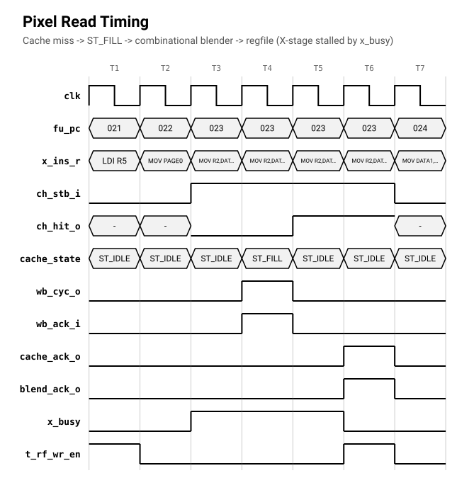
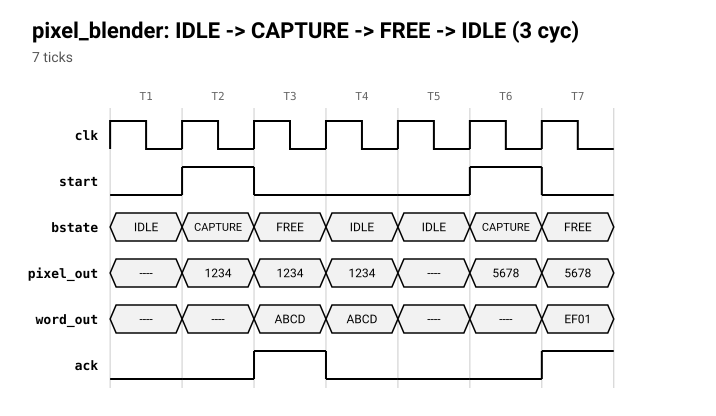

# Pixel Engine

The pixel engine (`pixel_engine`) holds a pixel index (19 bits: 15 integer, 4 fractional) and a step (19 bits). The index defines the word (integer part) and position (fractional part). The format (`MODE`) defines how many pixels per word.

## Formats

Five formats are supported: 1, 2, 4, 8, and 16 bpp, plus three pass-through modes (LO8/HI8/16). The format defines `k` (shift) and `mask` (position mask). Each format has its own pixels-per-word count.

**Table 1 — CHANNEL FORMAT (fmt, 3 bits)**

| Value | Name | Description |
| --- | --- | --- |
| 0 | **16 bpp** | 1 pixel per word (k=0) |
| 1 | **8 bpp** | 2 pixels per word (k=1); pos 0 = low byte (even address) |
| 2 | **4 bpp** | 4 pixels per word (k=2); pos 0 = low nibble |
| 3 | **2 bpp** | 8 pixels per word (k=3); SOURCE ONLY, writes forbidden |
| 4 | **1 bpp** | 16 pixels per word (k=4); SOURCE ONLY, writes forbidden |
| 5 | **LO8** | Pass-through low byte [7:0] (k=0, word step) |
| 6 | **HI8** | Pass-through high byte [15:8] (k=0, word step) |
| 7 | **RESERVED** | Reserved, writes forbidden |

*Fig. 13. Pixel format modes.*

## Index and Step

The index (`idx_stored`) is 19 bits. The upper 15 bits are the word, the lower 4 bits are the position. The step (`step_stored`) is 19 bits, added to the index after each read. Increment occurs on `pb_ack` (from the blender), not on `gc_access_done`.

## Pixel Path

The pixel path goes through several stages, from index to destination register.

**Table 2 — Pixel Path Stages**

| Stage | Signal | Description |
| --- | --- | --- |
| 1 | **idx_stored** | 19-bit index (15 integer, 4 fractional) |
| 2 | **word_out** | 15-bit word (integer part) |
| 3 | **gc_rdata** | 16-bit data from cache |
| 4 | **pb_pixel_out** | 16-bit pixel from blender |
| 5 | **wdata** | Written to destination register |

## Timing

The timing diagram below shows a single pixel read operation.

*Figure 1 — Pixel Read Timing*

The blender is a 3-state FSM: `B_IDLE → B_CAPTURE → B_FREE → B_IDLE`. `start` captures the inputs, `B_CAPTURE` computes `pixel_out` / `word_out`, and `B_FREE` asserts `ack` for one cycle. Total latency from `start` to `ack` is 3 cycles.

*Figure 2 — pixel_blender: combinational read; RMW write FSM (IDLE -> RMW_READ -> RMW_WRITE)*

*Fig. 14. Pixel read timing.*