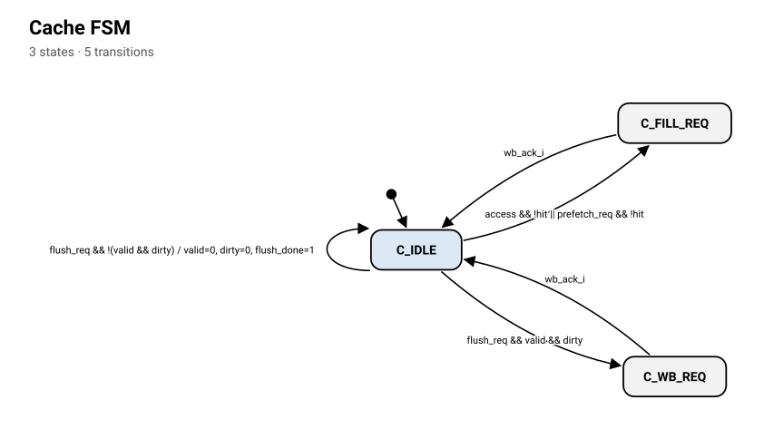

# GPU Cache

The cache (`ch_cache`, instance `u_cache`) is 4-channel, one per pixel engine channel. Each channel stores TAG (15 bits), DATA (16 bits), PAGE (8 bits), VALID, DIRTY, plus a pending page-change flag and its target page.

## Structure

Each channel consists of per-channel arrays (TAG, DATA, PAGE) and the bits VALID, DIRTY, PEND, plus `pend_page` (the page value waiting to be applied). The address is 24-bit: `{PAGE[7:0], WORD[14:0], 1'b0}`. A page write is deferred: if the new page differs from the current one, `PEND` is set and the change is applied only when the entry is clean or invalid.

## FSM

The cache has three states: `ST_IDLE`, `ST_FILL`, `ST_WRITEBACK`. A combinational `flush_noop_c` handles the case when the requested channel is not dirty or not valid (no writeback needed): it invalidates the channel and drives `flush_done_c` without a Wishbone cycle.

**Table 1 — Cache FSM**

| State | Output | Description |
| --- | --- | --- |
| **C_IDLE** (initial) | — | Waiting for access / prefetch / flush |
| **C_FILL_REQ** | — | Read miss: wb_cyc=1 until wb_ack_i |
| **C_WB_REQ** | — | Writeback of dirty channel: wb_cyc=1 until wb_ack_i |

| From | To | Condition | Action |
| --- | --- | --- | --- |
| C_IDLE | C_FILL_REQ | access && !hit \|\| prefetch_req && !hit | — |
| C_FILL_REQ | C_IDLE | wb_ack_i | — |
| C_IDLE | C_WB_REQ | flush_req && valid && dirty | — |
| C_WB_REQ | C_IDLE | wb_ack_i | — |
| C_IDLE | C_IDLE | flush_req && !(valid && dirty) | valid=0, dirty=0, flush_done=1 |

**Notes:**

- C_IDLE -> C_IDLE is flush_noop: flush requested but channel invalid or clean, no WB needed.
- gc is a 4-channel single-word buffer, not a classic cache. Writing N consecutive words requires FLUSH after each word.

## `ack`

`ack_o` is a one-cycle strobe. It is asserted **only on a hit** (`ack_r <= ch_stb_i && hit && !ack_r`). It does not stick: it clears on the next cycle regardless of `ch_stb_i`.

A cache hit produces `ack_o` one cycle after `ch_stb_i`. A cache miss does **not** assert `ack_o`: the FSM goes `ST_IDLE → ST_FILL → ST_IDLE`, performs the Wishbone read, and becomes valid; the requester must hold/re-issue `ch_stb_i` to get the hit ack. The consumer-side `access_done` in `ch_top` is `blend_ack` from the blender, not this `ack_o`. A flush of a clean or invalid channel (`flush_noop_c`) completes in one cycle without a Wishbone cycle.

