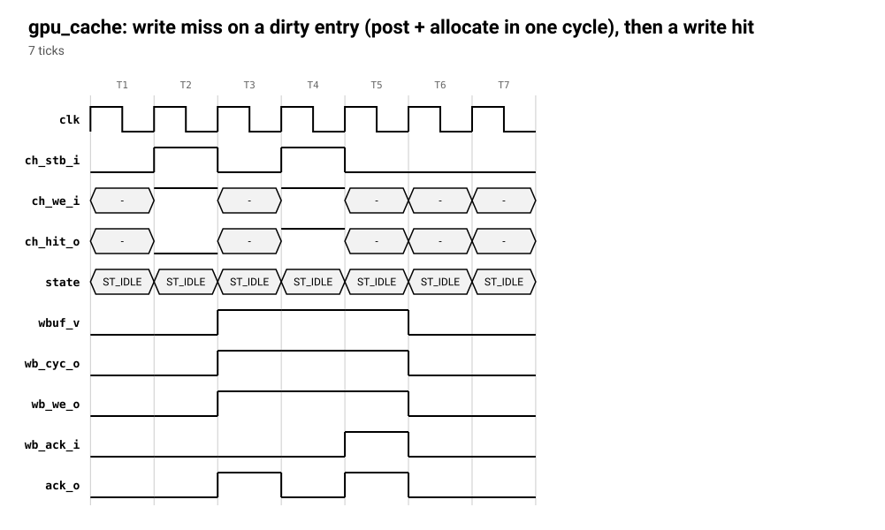

# GPU Cache

The cache (`ch_cache`, instance `u_cache`) is 4-channel, one word per pixel engine channel, plus a one-word **posted write buffer** shared by the four channels. It is write-back: a pixel write never reads memory first, and a dirty word leaves the entry through the write buffer without stopping the channel.

## Structure

Each channel keeps:

| State | Width | Meaning |
|---|---|---|
| TAG | 15 | word address inside the page |
| DATA | 16 | the word |
| PAGE | 8 | current page |
| VALID | 1 | the entry holds TAG |
| FULL | 1 | all 16 bits of DATA are valid (filled from memory, or completely written) |
| DMASK | 4 | dirty nibbles (bit *n* = bits 4n+3..4n were written) |
| PEND, PEND_PAGE | 1 + 8 | deferred page change |

The write buffer holds WBUF_V, WBUF_PAGE (8), WBUF_WORD (15), WBUF_DAT (16) and WBUF_SEL (2, byte enables). The address is 24-bit: `{PAGE[7:0], WORD[14:0], 1'b0}`. An entry is dirty when `VALID && DMASK != 0`.

## Writes: no read before a write

A write comes from the blender as the pixel shifted into place plus a bit mask of the bits it replaces (`ch_msk_i`).

- **Write hit** (same TAG, no pending page change): the pixel is merged into DATA with the mask, and DMASK gains the written nibbles. If all four nibbles are now dirty, FULL is set.
- **Write miss on a clean entry:** the entry is taken at once, in the same cycle: TAG = address, DATA = pixel, DMASK = written nibbles, FULL = all four written. There is no fill.
- **Write miss on a dirty entry:** the old word goes to the write buffer and the new word is taken, both in the same cycle, if the buffer is free. Otherwise the access waits until it drains.

## Reads

- A read needs a FULL entry.
- **Read of a partly written entry** (same TAG, not FULL): the cache fills the word from memory and keeps the dirty nibbles on top (*merge fill*). The entry becomes FULL and stays dirty.
- **Read miss:** a dirty entry is first posted to the write buffer, then the word is filled.

## Write-back

- **Byte enables.** If the entry is FULL, both bytes are written (`sel = 11`). Otherwise only the bytes with a dirty nibble are written, and the memory masks the others (SDRAM DQM). So 16 bpp and 8 bpp writes never read memory.
- **Lazy fill.** An entry that is not FULL and has a *half-written byte* (one nibble of a byte dirty: a single 4 bpp pixel of a pair) is filled first (merge fill), then written back. This is the only case in which a write costs a read. A 4 bpp span drawn left to right writes both nibbles of each byte and never reads.
- **Posted.** A dirty entry evicted by a miss or by a page change goes to the write buffer, and the cache carries on at once. The buffer drains to memory on its own.
- **Ordering.** Reads from memory (fills) wait until the buffer is empty, so a read always sees the latest posted write, from any channel.

## Page register

A page write is deferred while the entry is dirty: PEND is set and PEND_PAGE holds the new page. The change is applied once the old word has been written back; the entry is then invalidated.

Writing the page the channel already has cancels a pending change: A → B → A with no access in between stays on A.

## FLUSH

- **Dirty channel:** FLUSH writes the entry back directly (`ST_WRITEBACK`, not through the buffer) and acks when memory has acknowledged. If the entry needs a lazy fill, that comes first.
- **Clean or invalid channel:** FLUSH just invalidates it (`flush_noop_c`), with no Wishbone cycle.
- Either way, FLUSH waits until the write buffer is empty. **After FLUSH, everything written so far is in memory.**

## FSM

The cache has three states: `ST_IDLE`, `ST_FILL`, `ST_WRITEBACK`. Hits, write allocation, posting to the buffer and page changes all happen in `ST_IDLE`; only reads from memory and the blocking FLUSH write leave it.

**Table 1 — Cache FSM**

| State | Output | Description |
| --- | --- | --- |
| **ST_IDLE** (initial) | — | Hits, write misses (allocate), posting to the write buffer, page changes, clean flushes |
| **ST_FILL** | — | Read one word from memory (read miss, merge fill or lazy fill); waits until the write buffer is empty |
| **ST_WRITEBACK** | — | FLUSH of a dirty channel: blocking write, not through the write buffer |

| From | To | Condition | Action |
| --- | --- | --- | --- |
| ST_IDLE | ST_IDLE | write miss, entry clean | allocate: TAG, DATA = pixel, DMASK = written nibbles; ack |
| ST_IDLE | ST_IDLE | write miss, entry dirty, buffer free | post old word to the buffer and allocate, same cycle; ack |
| ST_IDLE | ST_IDLE | page change pending, entry dirty, buffer free | post old word to the buffer |
| ST_IDLE | ST_IDLE | page change pending, entry clean | apply the new page, invalidate |
| ST_IDLE | ST_FILL | read miss or read of a partial entry, buffer empty | — |
| ST_IDLE | ST_FILL | dirty entry with a half-written byte must be evicted | lazy fill of its own word |
| ST_FILL | ST_IDLE | wb_ack_i && buffer empty | DATA = memory word with dirty nibbles kept; FULL = 1 |
| ST_IDLE | ST_WRITEBACK | FLUSH && dirty && buffer empty | — |
| ST_WRITEBACK | ST_IDLE | wb_ack_i | DMASK = 0, invalidate, flush_ack |
| ST_IDLE | ST_IDLE | FLUSH && !dirty && buffer empty | invalidate, flush_ack (flush_noop) |

**Notes:**

- The posted write buffer (one word, shared by the four channels) drains to memory on its own, in any state. While it is busy, Wishbone carries its write; ST_FILL and ST_WRITEBACK wait for it.
- Order of priority in ST_IDLE: pending page change, then FLUSH, then the channel access.
- The cache is a 4-channel single-word buffer, not a classic cache. Consecutive words can be written without FLUSH: each eviction goes to the write buffer.

## Wishbone

The cache drives `wb_cyc_o`, `wb_stb_o`, `wb_we_o`, `wb_adr_o`, `wb_dat_o` and `wb_sel_o[1:0]` (byte enables of a write, `[0]` = bits 7..0; reads use `sel = 11`). `wb_sel_o` is exposed by `ch_top`, `gpu_top` and `gpu_fpga` (`wbm_sel_o`). While the write buffer is valid, the bus carries its write.

## `ack`

`ack_o` is a one-cycle strobe. It is asserted on a hit and on a write miss that allocates the entry (`ack_r <= ch_stb_i && (hit || issue_alloc) && !ack_r`). It does not stick: it clears on the next cycle regardless of `ch_stb_i`.

A hit produces `ack_o` one cycle after `ch_stb_i`. A read miss does **not** assert `ack_o`: the FSM goes `ST_IDLE → ST_FILL → ST_IDLE`, performs the Wishbone read, and the entry becomes valid; the requester holds `ch_stb_i` to get the hit ack. The consumer-side `access_done` in `ch_top` is `blend_ack` from the blender.

## Cost in practice

On the Aleste LX memory path (simulation, then measured on the MiSTer):

| | Before (RMW, blocking write-back) | Now |
|---|---|---|
| Fill 16 bpp, per word | 0.45 µs | 0.16 µs |
| Fill 8 bpp | 3.7 Mpix/s | 10.7 Mpix/s |
| SDRAM reads during a fill | one per word | none |
