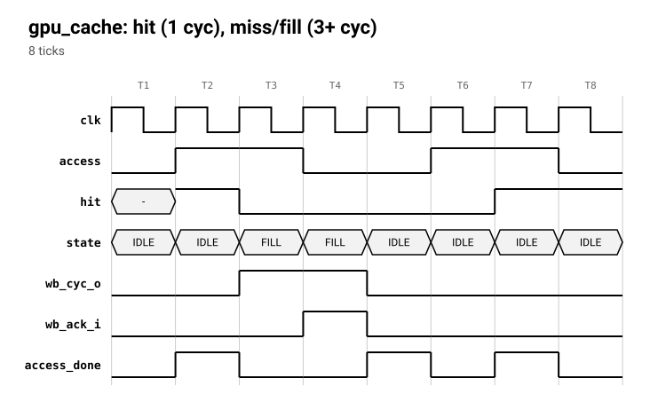

# GPU Cache

The cache (`gpu_cache`) is 4-channel, one per pixel engine channel. Each channel stores TAG (15 bits), DATA (16 bits), PAGE (8 bits), VALID, DIRTY.

## Structure

Each channel consists of EBR (TAG, DATA, PAGE) and two bits (VALID, DIRTY). The address is 24-bit: `{PAGE[7:0], WORD[14:0], 1'b0}`.

## FSM

The cache has three states: `C_IDLE`, `C_FILL_REQ`, `C_WB_REQ`. A `flush_noop` transition handles the case when the requested channel is not dirty or not valid (no writeback needed).

*Figure 1 — Cache FSM*

**Table 1 — Cache FSM**

| State | Output | Description |
| --- | --- | --- |
| **C_IDLE** (initial) | — | Waiting for access / prefetch / flush |
| **C_FILL_REQ** | — | Read miss: wb_cyc=1 until wb_ack_i |
| **C_WB_REQ** | — | Writeback of dirty channel: wb_cyc=1 until wb_ack_i |

| From | To | Condition | Action |
| --- | --- | --- | --- |
| C_IDLE | C_FILL_REQ | access && !hit \|\| prefetch_req && !hit | — |
| C_FILL_REQ | C_IDLE | wb_ack_i | — |
| C_IDLE | C_WB_REQ | flush_req && valid && dirty | — |
| C_WB_REQ | C_IDLE | wb_ack_i | — |
| C_IDLE | C_IDLE | flush_req && !(valid && dirty) | valid=0, dirty=0, flush_done=1 |

**Notes:**

- C_IDLE -> C_IDLE is flush_noop: flush requested but channel invalid or clean, no WB needed.
- gc is a 4-channel single-word buffer, not a classic cache. Writing N consecutive words requires FLUSH after each word.

## `ack`

`access_done` is a one-cycle strobe. It is asserted when data is ready (hit or fill complete). It does not stick: it clears on the next cycle regardless of `access`.

A cache hit produces `access_done` one cycle after `access`. A cache miss goes `C_IDLE → C_FILL_REQ → C_IDLE`: one cycle to enter the fill state, one or more cycles waiting for `wb_ack_i`, and one cycle for `access_done` to register — at least 3 cycles total. A flush of a clean or invalid channel (`flush_noop`) completes in one cycle without a Wishbone cycle.

*Figure 2 — gpu_cache: hit (1 cyc), miss/fill (3+ cyc)*
