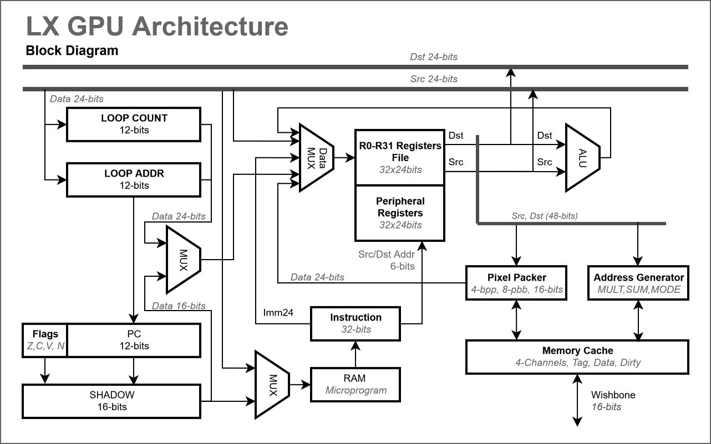
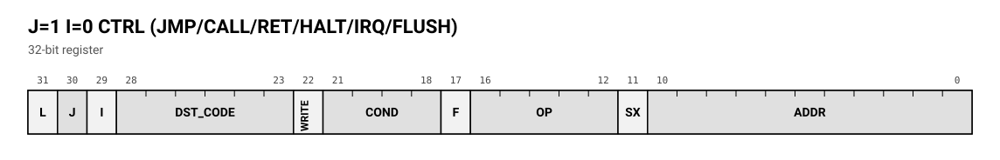

# FPGA Top Overview

LX-GPU is a 16-bit-data processor (32-bit instructions) with a pixel engine, a cache, and a Wishbone interface for external memory. The core is a 3-stage pipeline F → D → X; it stalls in X while a device has not acknowledged, and in D while an X-stage hazard resolves.

## Block Diagram

The processor consists of several interconnected blocks: `core_fetch` (PC, hardware loop, SHADOW), `core_rom`, `core_regfile`, `core_alu` + `core_cond` (X-stage execute), and `ch_top` (containing `ch_addr_gen`, `ch_blender`, `ch_cache`). Decode and writeback live in the X stage of `gpu_top`; there are no separate Decode / Writeback modules. The architecture is modular: blocks know nothing about each other, only the protocol.

*Fig. 1. LX-GPU block diagram.*

## Execution Protocol

The pipeline advances when `adv = ~halted & ~x_busy & ~fu_hold`. An X-stage instruction that issues a device request (`ch_data_req`, `rom_req`, `ch_flush_req`) holds `x_busy` until the device acknowledges (`x_dev_ack`); `pc`, the IR, the regfile outputs and `x_ins_r` all hold. One device per instruction. The cache `ack_o` is a one-cycle hit strobe; on a miss the cache fills in the background and the requester must hold/re-issue. The consumer-side data ack in `ch_top` is `blend_ack` from the blender, not the cache `ack_o`.

## Registers and Operands

Processor registers are split into four groups: general (R0..R31), system (32..41, with 42..43 reserved), DATA[0..3] (44..47), and pixel engine channels (48..63). The register map is shown below.

**Table 1 — Register file · R0–R31 (16 bit)**

| Value | Name | Description |
| --- | --- | --- |
| 0 | **R0** | General-purpose (NOT hardwired to zero; use ZERO=32 for constant 0) |
| 1 | **R1** | General-purpose |
| 2 | **R2** | General-purpose |
| 3 | **R3** | General-purpose |
| 4 | **R4** | General-purpose |
| 5 | **R5** | General-purpose |
| 6 | **R6** | General-purpose |
| 7 | **R7** | General-purpose |
| 8 | **R8** | General-purpose |
| 9 | **R9** | General-purpose |
| 10 | **R10** | General-purpose |
| 11 | **R11** | General-purpose |
| 12 | **R12** | General-purpose |
| 13 | **R13** | General-purpose |
| 14 | **R14** | General-purpose |
| 15 | **R15** | General-purpose |
| 16 | **R16** | General-purpose |
| 17 | **R17** | General-purpose |
| 18 | **R18** | General-purpose |
| 19 | **R19** | General-purpose |
| 20 | **R20** | General-purpose |
| 21 | **R21** | General-purpose |
| 22 | **R22** | General-purpose |
| 23 | **R23** | General-purpose |
| 24 | **R24** | General-purpose |
| 25 | **R25** | General-purpose |
| 26 | **R26** | General-purpose |
| 27 | **R27** | General-purpose |
| 28 | **R28** | General-purpose |
| 29 | **R29** | General-purpose |
| 30 | **R30** | General-purpose |
| 31 | **R31** | General-purpose |

*Fig. 2. General-purpose registers.*

**Table 2 — System Registers (32..38, 39 reserved)**

| Value | Name | Description |
| --- | --- | --- |
| 32 | **ZERO** | Constant zero |
| 33 | **FLAGS** | Flags V, C, N, Z (see flags_bitfield) |
| 34 | **SHADOW** | CALL/RET return address and flags (see shadow_bitfield) |
| 35 | **LOOP_CNT** | Loop counter |
| 36 | **LOOP_TGT** | Loop target |
| 37 | **BUSY** | Busy flags (see busy_bitfield) |
| 38 | **MHI** | Upper 16 bits of MUL |
| 39 | **reserved** | - |

*Fig. 3. System registers.*

## Instruction Format

All instructions are 32-bit. Fields are fixed: `L[31]`, class `[30:29]`, `COND[28:25]`, `WRITE[24]`, `F[23]`, `DST[22:17]`, `ALU_OP[16:12]`, `SRC[11:6]`, `SX`/`IMM11[10:0]`, `ADDR[11:0]`, `IMM16[15:0]`. See the ISA section for details.

*Figure 1 — J=1 I=0 CONTROL (R=0: JMP/CALL/RET/HALT/IRQ/FLUSH)*

**Table 3 — J=1 I=0 CONTROL (R=0: JMP/CALL/RET/HALT/IRQ/FLUSH)**

| Field | Bits | Width | Description |
| --- | --- | --- | --- |
| **L** | [31] | 1 | Loop flag |
| **J** | [30] | 1 | = 1 |
| **I** | [29] | 1 | = 0 |
| **COND** | [28:25] | 4 | Condition [`conditions`](gen/conditions.md) |
| **WRITE** | [24] | 1 | Unused for CTRL, must be 0 |
| **F** | [23] | 1 | Unused for CTRL (must be 0) |
| **DST_CODE** | [22:17] | 6 | Unused for CTRL [`operand_map`](gen/operand_map.md) |
| **R** | [16] | 1 | Jump/Call: 0 = by immediate, 1 = by source register |
| **CTRL_OP** | [15:12] | 4 | Control operation [`ctrl_ops`](gen/ctrl_ops.md) |
| **ADDR** | [11:0] | 12 | Target address (JMP/CALL), halt/IRQ code, channel (FLUSH) |

*Fig. 4. Instruction format.*