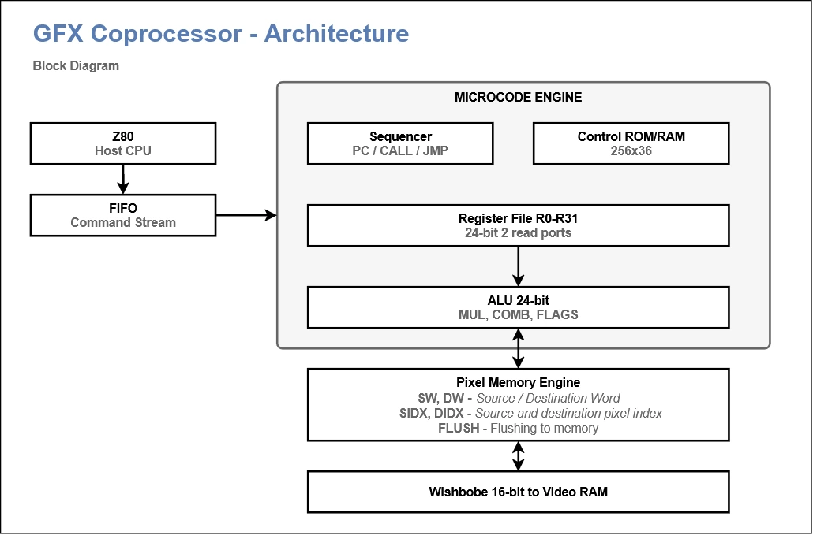
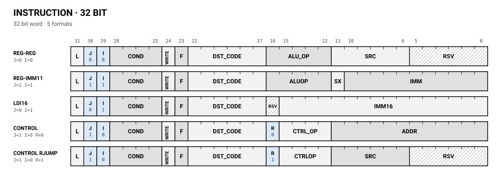

# LX-GPU: как программист заставляет графический сопроцессор работать

## Введение: зачем вообще нужен отдельный чип для рисования

Внутри Aleste LX стоит процессор Z80 который умеет складывать числа, проверять условия, прыгать по адресам. Всё бы хорошо, но есть одна проблема: рисовать графику на экране силами одного Z80 — это как пытаться нарисовать картину, считая каждую песчинку вручную. На экране 320×200 пикселей, и если каждый пиксель — это один байт, то на один кадр нужно перебрать 64 тысячи байт. А кадров в секунду хочется хотя бы 30. Z80 на 16 МГц просто не успевает: он будет только и делать, что перекладывать байты в видеопамять, и на игровую логику у него не останется ни времени, ни сил.

Именно поэтому в Aleste LX есть **LX-GPU** — отдельный маленький процессор, который специально обучен рисовать. Он не заменяет Z80, а работает рядом с ним. Z80 говорит: «нарисуй вот эти сто спрайтов вот в этих координатах», а GPU сам разбирается, как это сделать быстро и правильно.

Главная идея в том, что **GPU — это не жёсткая микросхема, которая умеет только одну операцию**. Это полноценный программируемый процессор со своим набором инструкций, своей памятью для программ и своей логикой. Просто этот процессор заточен под одну задачу — работать с пикселями. И именно программист решает, что этот процессор будет делать в каждый момент: рисовать спрайты, заливать фон, поворачивать картинку или делать что-то ещё, чего мы пока не придумали.

---

## Часть 1. Что умеет сам GPU: ядро и его инструкции

### 1.1. Ядро — это маленький, но настоящий процессор

Внутри LX-GPU есть вычислительное ядро. Оно 16-битное, то есть за одну операцию работает с числами от 0 до 65535 (или от −32768 до 32767, если число знаковое). У ядра есть:

- **32 регистра общего назначения** (R0…R31) — это как 32 кармана, в каждом из которых можно держать одно 16-битное число. Например, в R5 можно положить координату X, в R6 — координату Y, в R7 — адрес текстуры спрайта.
- **Арифметико-логическое устройство (АЛУ)** — это та часть, которая реально считает. Оно умеет складывать, вычитать, умножать, делать логические операции (И, ИЛИ, исключающее ИЛИ), сдвигать биты вправо.
- **Флаги** — четыре бита, которые запоминают результат последней операции: был ли результат нулевым (Z), был ли он отрицательным (N), был ли перенос (C), было ли переполнение (V). Флаги нужны, чтобы ядро могло принимать решения: «если результат не ноль — прыгнуть туда-то».
- **Счётчик цикла** — специальный регистр, который позволяет одной инструкцией повторить блок кода заданное число раз, не тратя такты на декремент и условный переход.



### 1.2. Одна инструкция — 32 бита, четыре формата

Каждая инструкция GPU — это ровно 32 бита, то есть одно 32-битное слово. Формат фиксированный: биты на своих местах, и это сильно упрощает декодирование.



*Figure 1 — INSTRUCTION · 32 BIT*


Два бита в начале слова (J и I) говорят, к какому из четырёх классов относится инструкция:

1. **REG-REG** (J=0, I=0) — операция между двумя регистрами. Например, «сложи R3 и R7, результат положи в R5». В слове есть поле ALU_OP (какая именно операция), поле DST_CODE (куда писать), поле SRC (откуда брать второй операнд), а также поля COND (при каком условии выполнять), WRITE (писать ли результат) и F (обновлять ли флаги).
2. **REG-IMM11** (J=1, I=1) — операция между регистром и маленькой константой. Вместо второго регистра в слове стоит 11-битное число (от −1024 до 1023 или от 0 до 2047, в зависимости от бита SX — знаковое или беззнаковое расширение). Например, «прибавь к R2 число 100».
3. **LDI16** (J=0, I=1) — загрузка 16-битной константы в регистр. Поле IMM16 содержит само число, поле DST_CODE — куда его положить. Это самая простая и самая частая инструкция: «положи в R4 число 0x0400».
4. **CONTROL** (J=1, I=0) — управляющие инструкции: прыжки (JMP), вызовы подпрограмм (CALL), возвраты (RET), остановка (HALT), прерывание (IRQ), сброс кэша (FLUSH). У них вместо ALU_OP стоит CTRL_OP, а вместо второго операнда — 12-битный адрес (ADDR) или номер регистра (если R=1, это косвенный прыжок JMPR).

### 1.3. Флаги и условия — как ядро принимает решения

После каждой инструкции, у которой стоит бит F=1, ядро обновляет флаги Z, N, C, V. А в каждой инструкции есть поле COND — 4 бита, которые говорят: «выполняй эту инструкцию только если условие истинно». Условия стандартные, как в процессорах ARM: «если равно», «если не равно», «если больше», «если меньше», «если перенос» и так далее. Если условие ложно, инструкция не делает ничего — не пишет в регистр, не трогает порты, не обновляет флаги. Это позволяет писать компактный код без лишних переходов.

Например, чтобы проверить, равен ли пиксель нулю (то есть прозрачный ли он), можно сделать так: `OR R2, R2` (это обновит флаг Z, если R2 равен нулю), а следующей инструкцией — `JMP.EQ skip` (прыгнуть, если Z=1). Именно так и работает классический код проверки прозрачности.

### 1.4. Циклы: одна инструкция вместо десяти

Обычный цикл на ассемблере выглядит так: «уменьши счётчик, проверь, не ноль ли он, если не ноль — прыгни назад». Это три инструкции на каждую итерацию, и каждая тратит такт. В LX-GPU есть бит L (loop) в каждой инструкции. Если поставить L=1, то после выполнения инструкции ядро само уменьшит счётчик цикла (LOOP_CNT) и, если он ещё не ноль, прыгнет на адрес, записанный в LOOP_TGT. То есть весь цикл — это одна инструкция с префиксом L. Это огромная экономия тактов, и именно поэтому в примере с заливкой экрана цикл занимает ровно одну строку кода.

Важно: бит L запрещён на управляющих инструкциях (CONTROL), потому что там цикл не имеет смысла. Ассемблер это проверяет.

### 1.5. Умножение и старшие биты

У АЛУ есть операция MUL. Она умножает два 16-битных числа и даёт 32-битный результат. Младшие 16 бит результата пишутся в регистр назначения, а старшие 16 бит — в специальный системный регистр MHI. Это нужно для работы с фиксированной точкой: например, при масштабировании спрайта координаты хранятся как 16 бит целой части и 16 бит дробной, и умножение позволяет перемножать такие числа, сохраняя точность.

### 1.6. Сдвиги и как получить сдвиг влево

В системе команд LX-GPU есть только сдвиги **вправо**: ROR (поворот вправо), SHR (логический сдвиг вправо) и SAR (арифметический сдвиг вправо). Отдельного опкода для сдвига влево (SHL/ROL) нет — но это не проблема, потому что сдвиг влево легко получается из имеющихся операций.

- **ROR** — это циклический поворот. Поворот вправо на 15 эквивалентен повороту влево на 1, поворот вправо на 8 — обмену байтами. То есть ROR с нужным числом даёт полноценный поворот влево.
- **SHR** — логический сдвиг вправо. Если нужно логическое умножение на степень двойки (сдвиг влево без переноса), его можно получить через ROR с последующей маской или через повторное `ADD R, R` (сложение числа с самим собой — это сдвиг влево на 1).
- **SAR** — арифметический сдвиг вправо, для знаковых чисел.

Сдвиги работают с числом от 0 до 15. Если попытаться сдвинуть на 16 или больше, число «завернётся» по модулю 16 — то есть сдвиг на 16 будет равен сдвигу на 0, сдвиг на 17 — сдвигу на 1 и так далее. Это нормативное поведение, и его нужно учитывать при написании микрокода. Кроме того, эти сдвиги не обновляют флаг переноса C — в отличие от многих других процессоров.

---

## Часть 2. Пиксельные каналы: как GPU работает с памятью, не зная, сколько бит в пикселе

### 2.1. Проблема: пиксели бывают разной «толщины»

В графике пиксель может занимать разное количество бит. В режиме 1 bpp (чёрно-белый) один пиксель — это один бит, и в одном 16-битном слове помещается 16 пикселей. В режиме 2 bpp — 8 пикселей на слово. В 4 bpp — 4 пикселя. В 8 bpp — 2 пикселя. В 16 bpp — 1 пиксель на слово. Если бы программист на GPU должен был сам вычислять, в каком бите какого слова лежит нужный пиксель, это была бы очень утомительная и медленная работа: сдвиги, маски, проверки. И самое главное — один и тот же алгоритм (например, рисование спрайта) пришлось бы писать отдельно для каждого формата.

LX-GPU решает эту проблему элегантно: **программист работает не с адресами и битами, а с порядковым номером пикселя на экране**. Этот номер называется индексом. Ядро говорит: «прочитай пиксель номер 12345» или «запиши пиксель номер 54321». А специальный аппаратный блок — **пиксельный канал** — сам переводит этот номер в адрес слова в памяти и в позицию внутри слова, сам распаковывает или упаковывает биты и сам сдвигает указатель на нужный шаг.

### 2.2. Как устроен канал

Канал — это набор из четырёх регистров (на самом деле это один регистр MODE_PAGE и три регистра IDX, IDXH, STEP, но для программиста это выглядит как четыре порта):

![CHANNEL MODE_PAGE (11 bits: MODE[2:0] + PAGE[7:0])](gen/channel_mode_page.svg)

*Figure 2 — CHANNEL MODE_PAGE (11 bits: MODE[2:0] + PAGE[7:0])*


- **MODE_PAGE** — здесь хранятся два параметра: формат пикселя (MODE) и номер страницы памяти (PAGE). Формат говорит, сколько бит на пиксель (1, 2, 4, 8 или 16 bpp), а страница — это старшие 8 бит 24-битного адреса. Вся память разбита на 256 страниц по 128 КБ, и страница выбирается этим регистром.
- **IDX и IDXH** — это 19-битный индекс пикселя. Младшие 15 бит (IDX) — это номер слова в странице, а младшие 4 бита (IDXH) — это позиция пикселя внутри слова. Вместе они образуют полный номер пикселя.
- **STEP** — это шаг, на который индекс увеличивается после каждого чтения или записи. Шаг тоже 19-битный, то есть может быть дробным. Например, если шаг равен 1, мы идём по пикселям подряд. Если шаг равен 2, мы пропускаем каждый второй пиксель (это нужно для масштабирования). Если шаг отрицательный, мы идём назад (это нужно для отражения).

Когда ядро читает из порта DATA (это специальный порт, который связан с каналом), канал берёт текущий индекс, переводит его в адрес слова, проверяет, есть ли это слово в кэше канала (об этом ниже), распаковывает нужный пиксель и отдаёт его ядру. После этого индекс автоматически увеличивается на STEP. Когда ядро пишет в порт DATA, происходит обратное: канал упаковывает пиксель в слово, пишет его в кэш (и в память, если кэш грязный), и снова увеличивает индекс.

### 2.3. Кэш: почему канал почти не трогает общую память

У каждого канала есть свой кэш. Он хранит **тег** (адрес слова), **данные** (16-битное слово), **номер страницы** и два служебных бита — **valid** (данные валидны) и **dirty** (данные изменены и ещё не записаны в память).

Как это работает. Когда канал обращается к пикселю, он сначала переводит индекс пикселя в адрес слова. Потом сравнивает этот адрес с тегом, который лежит в кэше. Если тег совпадает — это **hit**: слово уже в кэше, канал берёт его оттуда, не трогая общую память. Если тег не совпадает — это **miss** (или **false**): канал загружает нужное слово из памяти в кэш, заменяя старое содержимое (при этом, если старое слово было dirty, оно сначала записывается обратно в память), и только потом работает с пикселем.

Это описание чтения. Запись устроена проще: слово из памяти перед записью не читается. Канал сразу занимает запись кэша и запоминает, какие полубайты слова изменены; старое dirty-слово уходит в общий буфер записи и записывается в память в фоне, канал при этом не ждёт. Подробности — в разделе GPU Cache.

Зачем это нужно. Представьте, что мы рисуем спрайт в режиме 8 bpp. В одном слове — два пикселя. Когда мы читаем первый пиксель, канал загружает слово из памяти в кэш и распаковывает из него нужный байт. Когда мы читаем второй пиксель, он оказывается в том же самом слове, тег совпадает — hit, и канал берёт его прямо из кэша. А поскольку мы идём по строке подряд, почти каждый второй пиксель попадает в кэш. В режиме 4 bpp в кэш попадают уже 4 пикселя из 4, в режиме 2 bpp — 8 из 8, в режиме 1 bpp — 16 из 16. То есть чем меньше бит на пиксель, тем реже канал лезет в общую память.

**FLUSH нужен не после каждого слова, а только в конце всей операции.** Когда мы рисуем линию или спрайт, мы идём по пикселям, и тег кэша меняется по мере продвижения. В конце операции может оказаться, что последний (или предпоследний) пиксель остался в кэше, но ещё не записан в память — он dirty. Если мы просто закончим работу, этот пиксель потеряется. Поэтому в конце функции рисования делается **один FLUSH** для конкретного канала — он записывает все dirty-слова из кэша в память и сбрасывает флаг dirty. Именно так и написано в примерах: `FLUSH 2` в конце рисования спрайта, `FLUSH 1` в конце заливки. Один FLUSH на всю операцию, а не на каждое слово.

### 2.4. Какие каналы бывают и что они делают

В LX-GPU есть **четыре канала**: CH0, CH1, CH2, CH3. У них **нет фиксированного назначения** — это универсальные потоки доступа к памяти, и программист сам решает, что каждый из них будет делать. Единственное соглашение касается CH0: после операции START этот канал автоматически настраивается на чтение 16-битных слов из той ячейки памяти, которую указал Z80. Через него загрузчик читает и загружает саму программу в ROM. Но как только программа запущена, она может перенастроить CH0 на что угодно.

Как обычно используют каналы (это пример, а не жёсткое правило):

- **CH0** — поток данных о спрайтах: координаты, цвета, повороты, масштабы. Программа читает этот поток слово за словом и разбирает параметры.
- **CH1** — входной графический поток: изображения спрайтов, текстуры.
- **CH2** — буфер, в который рендерится экран.
- **CH3** — что угодно: стенсил-буфер, клиппинг-буфер, буфер деформации (откуда берутся смещения координат на экране), второй источник для операции над двумя источниками с получением одного результата, и так далее.

Но никто не заставляет делать именно так. Можно, например, координаты и адреса захардкодить прямо в микропрограмме, а все четыре канала пустить на смешивание четырёх слоёв или на обработку звуковых сэмплов. Можно использовать один и тот же канал и для чтения, и для записи, если нужно сделать прозрачность (прочитать старый пиксель, проверить, не нулевой ли он, и записать новый). Всё определяется тем, как программа настраивает регистры канала и в каком порядке читает и пишет DATA. Никаких жёстких ролей — только четыре быстрых умных потока и полная свобода для программиста.

### 2.5. Почему это удобно

Самое главное преимущество такой схемы: **один и тот же алгоритм работает с любым форматом пикселей**. Программист пишет цикл, который читает пиксель из одного канала (например, CH1), что-то с ним делает и пишет в другой канал (например, CH2). И этот цикл будет одинаково работать и для 1 bpp, и для 16 bpp. Всю работу по распаковке, упаковке, маскированию и кэшированию берёт на себя аппаратура канала. Ядро вообще не знает, сколько бит в пикселе — оно просто говорит «пиксель номер N» и получает или записывает значение.

Именно поэтому в документации сказано: «Экранные координаты внутри, адреса снаружи невидимы. CPU говорит "рисуй в (x, y)"; порт превращает индекс пикселя в адрес слова».

---

## Часть 3. Как Z80 запускает GPU: пакеты, загрузчик и регистры

### 3.1. Два процессора, одна память

Z80 и LX-GPU работают с одной и той же оперативной памятью. Это важно: GPU не имеет своей отдельной видеопамяти. Он читает и пишет в общую память, а специальный арбитр шины решает, кто в данный момент получает доступ. Высший приоритет у видеоконтроллера развёртки (чтобы картинка на экране не рвалась), а Z80 и GPU делят оставшееся время. Благодаря тому, что у GPU есть кэш на каналах, он обращается к памяти не так часто, и Z80 почти не чувствует конкуренции.

### 3.2. Пакет — это просто размер и адрес

Чтобы GPU что-то сделал, Z80 должен подготовить в памяти **пакет**. Пакет устроен предельно просто: это **ровно два 16-битных слова**, и больше в нём ничего нет.

- **Первое слово** — размер: сколько 16-битных слов микрокода нужно загрузить.
- **Второе слово** — адрес: куда во внутреннюю память GPU (ROM) положить этот микрокод и с какого адреса потом начать его выполнение.

Сразу за этими двумя словами в памяти идёт сам микрокод — те самые 32-битные инструкции, разбитые на пары 16-битных слов (сначала младшее, потом старшее). Загрузчик читает первое слово, узнаёт размер, читает второе слово, узнаёт адрес, а дальше просто перекачивает нужное число слов из памяти в ROM и прыгает на указанный адрес. Никаких типов пакетов, никаких kind, никаких END/CODE/RUN — только «сколько» и «куда».

Если нужно просто запустить уже загруженный микрокод, не перекачивая его заново, достаточно положить в первое слово ноль (размер = 0). Загрузчик увидит, что копировать нечего, и сразу сделает переход на адрес из второго слова.

### 3.3. Загрузчик — это микропрограмма, которая всегда сидит в ROM

Внутри GPU есть ROM на 4096 слов (то есть 4096 32-битных инструкций). Слова с 0 по 31 занимает **загрузчик** — специальная микропрограмма, которая умеет читать пакеты из памяти и загружать микрокод в ROM. Загрузчик защищён: если программа попытается записать в ROM по адресу 0–31, GPU остановится с ошибкой HALT 1. Это сделано для того, чтобы испорченный пакет не мог уничтожить загрузчик.

Когда Z80 хочет запустить GPU, он делает следующее:

1. **Кладёт пакет в память.** Например, по адресу 0x940000. Пакет содержит два слова заголовка и, если нужно, микрокод.
2. **Записывает адрес пакета в регистры GPU.** У GPU есть регистры на стороне хоста: стартовый адрес (24 бита), регистр COMMAND (0x03) и регистр STATUS (0x04).
3. **Поднимает бит start.** Это можно сделать через регистр COMMAND. По этому сигналу железо само настраивает CH0 на адрес пакета: PAGE = address[23:16], IDX = address[15:1] (индекс слова в странице), MODE = 16 bpp (одно слово = один пиксель), STEP = +1. И запускает загрузчик с ROM-адреса 0.

Дальше загрузчик читает слова пакета через `MOV Rn, DATA0` (DATA0 — это порт канала CH0). Каждое чтение автоматически продвигает указатель на следующее слово. Первое слово даёт размер, второе — адрес. Загрузчик пишет адрес в ROMA, а затем в цикле перекачивает инструкции: читает младшее слово, пишет его в ROML, читает старшее, пишет в ROMH. Запись в ROMH сохраняет 32-битное слово в ROM и увеличивает ROMA. Когда все слова перекачаны, загрузчик делает JMP на адрес из второго слова и передаёт управление микропрограмме.

### 3.4. Что ещё нужно знать про пакеты

Пакет не содержит никакой служебной информации, кроме размера и адреса. Нет контрольных сумм, нет проверки границ, нет релокации. Хост отвечает за то, чтобы размер был корректным, адрес не залезал на слова 0–31 (там живёт загрузчик) и не выходил за пределы ROM. Если попытаться записать микрокод на адрес меньше 32, аппаратура заблокирует запись и остановит GPU с ошибкой — это единственная встроенная защита.

### 3.5. Как микропрограмма завершает работу

Микропрограмма, запущенная загрузчиком, должна сама завершиться следующей последовательностью:

```
FLUSH 0xF     ; записать обратно все грязные слова (бит i маски = канал i)
IRQ   code    ; опционально: поднять прерывание с кодом
HALT  0       ; уйти в IDLE
```

Важно: FLUSH должен идти **до** IRQ и HALT. Если грязное слово не записано обратно, оно теряется, когда хост читает память. Это одна из типичных ошибок. При этом FLUSH делается **один раз в конце всей операции** для каждого канала, который писал в память, — а не после каждого слова. В примерах это видно: `FLUSH 2` в конце рисования спрайта (канал CH2 — приёмник), `FLUSH 1` в конце заливки (канал CH1). Если микропрограмма писала в несколько каналов, в конце делается FLUSH для каждого из них, например `FLUSH 0xF` — сбросить все четыре канала.

---

## Часть 4. От теории к практике: как выглядит реальная программа

### 4.1. Пример 1: заливка экрана одним цветом

Допустим, Z80 хочет залить 256 байт значением 0x5A по адресу 0x800000 в режиме 8 bpp. Вот микропрограмма для GPU (файл fill.asm):

```asm
.org 0x20                        ; адрес в ROM (0..31 заняты загрузчиком)

        ; 1. Настраиваем канал 1 (куда пишем)
        LDI     R5, #0x0180      ; старший байт 01 = режим 8 bpp, младший 80 = страница 80h
        MOV     PAGE1, R5        ; записываем режим и страницу в канал 1
        LDI     R5, #1
        MOV     STEP1, R5        ; шаг = +1 пиксель после каждой записи
        MOV     IDXH1, #0        ; старшая часть индекса = 0
        MOV     IDX1, #0         ; начинаем с начала страницы

        ; 2. Готовим цвет и аппаратный цикл
        LDI     R2, #0x005A      ; чем заливаем (байт 5Ah)
        LDI     R1, #256         ; сколько пикселей залить
        LDI     R3, #0x002B      ; адрес инструкции fill_loop
        MOV     LOOP_TGT, R3     ; цель цикла
        MOV     LOOP_CNT, R1     ; счётчик повторений

        ; 3. Сам цикл из ОДНОЙ инструкции!
fill_loop:
        L MOV   DATA1, R2        ; пишем байт в канал 1, указатель сам сдвигается,
                                 ; а префикс L сам крутит цикл 256 раз

        ; 4. Завершение
        FLUSH   1                ; сбрасываем кэш канала 1 в память
        HALT                     ; останавливаемся
```

Обратите внимание: весь цикл заливки — это одна строка `L MOV DATA1, R2`. Никаких декрементов счётчика и условных переходов внутри цикла нет — это делает аппаратный счётчик цикла по флагу L.

### 4.2. Пример 2: рисование спрайта 16×16 с прозрачностью

Теперь более сложный пример. Есть спрайт 16×16 пикселей, лежащий по адресу 0x0400, и экран 320×200 с базой 0x0800. Нужно нарисовать спрайт в координатах (100, 100), причём пиксели со значением 0 считать прозрачными (color key).

```asm
.org 0x20
        ; --- Канал 0: источник (спрайт 16x16 по адресу 0x0400) ---
        LDI     R5, #0x0100      ; FMT=1 (8bpp), PAGE=0
        MOV     PAGE0, R5
        LDI     R5, #1           ; STEP0 = 1 пиксель
        MOV     STEP0, R5
        MOV     IDXH0, #0
        LDI     R4, #0x0400      ; IDX0 = 0x0400
        MOV     IDX0, R4

        ; --- Канал 1: экран 320x200 (база 0x0800) ---
        LDI     R5, #0x0100      ; FMT=1 (8bpp), PAGE=0
        MOV     PAGE1, R5
        LDI     R5, #1           ; STEP1 = 1 пиксель
        MOV     STEP1, R5
        MOV     IDXH1, #0

        ; --- Настройка координат и аппаратного цикла ---
        LDI     R3, #0x8564      ; (X=100, Y=100) -> 0x0800 + 100*320 + 100
        LDI     R6, #320         ; ширина экрана
        LDI     R1, #16          ; внешний счётчик: 16 строк
        LDI     R0, #16          ; ширина спрайта: 16 пикселей
        LDI     R4, #0x0034      ; адрес col_loop
        MOV     LOOP_TGT, R4

row_loop:
        MOV     R7, R3           ; R7 = текущий адрес пикселя в строке
        MOV     LOOP_CNT, R0     ; запуск аппаратного цикла на 16 пикселей

col_loop:
        MOV     R2, DATA0        ; читаем пиксель спрайта
        OR      R2, R2           ; проверяем на прозрачность (0)
        JMP.EQ  skip_pixel       ; если 0 — пропускаем запись
        MOV     IDX1, R7         ; ставим адрес приёмника
        MOV     DATA1, R2        ; пишем непрозрачный пиксель
skip_pixel:
      L ADD     R7, #1           ; конец тела цикла (L-префикс!) -> возврат на 0x034

        ADD     R3, R6           ; следующая строка экрана (R3 += 320)
        SUB     R1, #1           ; уменьшаем счётчик строк
        JMP.NE  row_loop         ; повторяем 16 строк

        FLUSH   2                ; сброс кэша канала 2 (приёмник) в RAM
        HALT
```

Здесь видно несколько важных моментов:

- **Никакой ручной арифметики адресов.** Ни DATA0 (откуда читаем), ни ROMA (куда пишем) не нужно вручную прибавлять в цикле — оба порта сами двигаются вперёд при обращении.
- **Самозащита.** Если в заголовке пакета указать адрес R1 меньше 32 (попытаться перезаписать загрузчик), аппаратура мгновенно заблокирует запись в ROMH и остановит GPU с ошибкой.
- **Прозрачность через color key.** Пиксель со значением 0 не записывается, и на экране остаётся старый цвет. Это классический приём, который работает без всякого альфа-смешивания.

### 4.3. Пример 3: масштабирование и поворот спрайта

Вся геометрия выполняется на ядре в 32-битной арифметике с фиксированной точкой (16 бит целой части + 16 бит дробной). Это выглядит так:

1. **Математика на ядре (ADD / ADC / MUL):**
   - Складываем дробные части координат: `ADD R_frac, R_step_frac !f`.
   - Складываем целые части с учётом переноса: `ADC R_int, R_step_int`.
   - Вычисляем сквозной пиксельный индекс в кадре: целую координату Y умножаем на ширину экрана и прибавляем X (`MUL` + `ADD`).
2. **Аппаратная магия в канале (IDX → DATA):**
   - Программа просто кладёт готовый порядковый номер пикселя в регистр канала (`MOV IDX0, R_index` для CH0, `MOV IDX1, R_index` для CH1 и так далее) и читает/пишет цвет (`MOV R_pix, DATA0` для CH0, `MOV R_pix, DATA1` для CH1 и так далее).
   - Дальше алгоритм вообще не заботится, сколько бит на пиксель в этом буфере — 1, 2, 4, 8 или 16.
   - Адресный генератор канала сам переводит номер пикселя в адрес 16-битного слова в RAM и вычисляет битовую маску нужного пикселя внутри этого слова.
   - Если это слово уже лежит в кэше канала (а при последовательном проходе по строке так происходит почти всегда), канал даже не лезет в общую память — он мгновенно распаковывает или вклеивает пиксель прямо в кэше.

Именно поэтому один и тот же код поворота или масштабирования работает с текстурой любой битности без единого изменения в алгоритме: программа занимается исключительно геометрией и цветом, а битовую упаковку, маскирование и кэширование берёт на себя аппаратура канала.

### 4.4. Трюк «данные как код»: LDI + RET

Есть ещё один изящный приём, который позволяет обойтись вообще без парсинга структур. Идея в том, что инструкция LDI16 имеет 16-битную константу в младших битах и опкод в старших. Если Z80 будет менять только младшие 16 бит, а старшие оставит неизменными, то он сможет «обновлять» параметры спрайта, просто записывая новые числа в память.

Выглядит это так. Z80 формирует в памяти для каждого спрайта крошечный блок из нескольких инструкций LDI, завершённый командой RET:

```asm
sprite_0:
    LDI R0, #120        ; X = 120 (Z80 меняет только младшие 16 бит этого слова)
    LDI R1, #85         ; Y = 85
    LDI R2, #0x0400     ; адрес графики спрайта
    RET                 ; возврат в основной цикл отрисовки
```

В каждом кадре Z80 не трогает старшие слова с опкодами — он просто обновляет младшие 16-битные половинки с координатами и отправляет весь буфер одним пакетом во внутреннюю память GPU (ROM). Основная программа делает `CALL sprite_0` → регистры мгновенно заряжаются нужными параметрами по одному такту на значение → `RET` возвращает управление в блиттер, который тут же рисует спрайт, а затем вызывает `CALL sprite_1` и так далее.

Что это даёт:
- **Никакого парсинга и распаковки структур** — данные сами «загружают себя» в нужные регистры на максимальной скорости конвейера.
- **Полная разгрузка внешней шины и каналов** — CH0 не занят чтением списка объектов и освобождается для текстур или масок, а обращений к общей RAM за параметрами нет вообще.

Разумеется, для огромных списков объектов удобнее классический потоковый канал, но для динамичных спрайтовых сцен этот трюк работает практически бесплатно и даёт ощутимый прирост скорости.

---

## Часть 5. Почему пакетная обработка — спасение для восьмибитного процессора

Когда проектируют графический ускоритель для восьмибитного компьютера, возникает соблазн пойти по классическому «библиотечному» пути: сделать набор функций — «нарисуй спрайт», «проведи линию», «выведи букву» — и вызывать их с Z80. На практике для Z80 такой подход становится бутылочным горлышком.

Представьте динамичную игру или интерфейс, где в каждом кадре нужно вывести сотню спрайтов, шрифт и несколько примитивов. Если Z80 вынужден дёргать GPU на каждый отдельный объект, он начинает тратить драгоценное время не на игровую логику, а на обслуживающий «шум»:

- подготовить аргументы;
- сохранить свой контекст и регистры;
- загрузить параметры в порты ускорителя;
- дождаться завершения мелкой операции и восстановить контекст;
- и повторить этот цикл сотни раз за секунду.

Для восьмибитного процессора постоянное переключение контекста и мелкие синхронизации на каждый примитив — это колоссальные накладные расходы, которые съедают весь выигрыш от аппаратного ускорения.

**Решение LX-GPU: пакетная обработка.** В LX-GPU заложена принципиально иная модель взаимодействия — разделение на поток программ и поток данных:

1. **Z80 работает как диспетчер задач, а не как «нянька» для каждого пикселя.** Вместо сотен мелких вызовов Z80 в течение кадра спокойно формирует в общей памяти единый список объектов (дисплей-лист): координаты, размеры, адреса текстур, углы поворота.
2. **Один запуск вместо сотни.** Когда список готов, Z80 всего один раз за кадр (или 2–3 раза на разные фазы — фон, спрайты, интерфейс) отдаёт GPU адрес этого пакета и нажимает «Старт».
3. **Никакого переключения контекста.** Дальше микропрограмма внутри LX-GPU сама в плотном аппаратном цикле пробегает по всему списку данных, настраивает каналы и отрисовывает все 100 объектов за один проход — без единого прерывания Z80 и без возвратов управления между спрайтами.

**Свобода выбора: скорость или качество.** Эта модель даёт разработчику ещё одно важное преимущество — гибкий размен производительности на сложность и качество картинки:

- Можно держать компактную постоянную библиотеку из 3–5 основных микропрограмм внутри 4096 слов ROM и просто скармливать им списки данных в каждом кадре.
- А можно под конкретную сцену загрузить специализированный микрокод: если в сцене много простых тайлов — запустить максимально быстрый, «развёрнутый» цикл копирования; если нужно нарисовать красивый интерфейс или векторную сцену — загрузить микропрограмму, которая рисует линии со сглаживанием (антиалиасингом), плавными градиентами или аффинными искажениями. Да, такой алгоритм выполнит больше вычислений на каждый пиксель и будет работать медленнее простого блиттера, но архитектура позволяет реализовать его чисто программно без единого изменения в железе.

В итоге Z80 полностью освобождается от графической рутины и делает то, для чего он создан — ведёт игровую логику, физику и звук, — пока GPU пакетами перемалывает графику.

---

## Часть 6. Как выглядит идеальный игровой кадр на LX-GPU

На самом деле наиболее эффективный сценарий работы для этого GPU — ровно тот же проверенный пайплайн, который использовался при программной эмуляции игр MSX на Aleste:

1. **Два экранных буфера (Double Buffering).** Пока видеоконтроллер развёртки спокойно показывает на экране готовый первый буфер, LX-GPU в фоне рисует следующий кадр во второй буфер, а в начале нового кадра они просто меняются ролями.
2. **Полная сборка кадра с нуля.** В каждом кадре микропрограмма сначала быстрым потоком заполняет весь экран тайлами (фоном), а затем поверх накладывает спрайты и объекты. За счёт высокой скорости блочного копирования и 16-битной шины с кэшем пересобрать весь экран заново оказывается проще, быстрее и чище, чем возиться с восстановлением фона под каждым движущимся спрайтом.

**Цена эффектов: от «бесплатных» до сложных.** В этой модели наглядно видна философия баланса между скоростью и сложностью:

- **Тайловый фон и обычные спрайты** — базовый, самый быстрый режим: каналы сами шагают по памяти и пакуют пиксели, ядро работает на пиковой пропускной способности шины.
- **Целочисленное масштабирование (2×, 3×, 4×)** — практически бесплатно: нам не нужна сложная дробная математика. Достаточно просто повторить запись пикселя нужное число раз или задать соответствующий целочисленный шаг (STEP), и картинка увеличивается без потери скорости.
- **Дробное масштабирование и повороты (аффинные преобразования)** — платим тактами ядра: здесь уже приходится на каждый выходной пиксель складывать дробные координаты с фиксированной точкой (ADD / ADC), умножать координату на ширину текстуры (MUL) и вручную подставлять новый адрес в канал (IDX). Производительность на пиксель снижается пропорционально объёму вычислений.
- **Клиппинг (обрезка по краям экрана или окна)** — платим дополнительными проверками: аппаратного ограничителя координат в каналах нет, поэтому если объект частично выходит за границы буфера, микрокод должен сам проверять попадание координат в рабочую область (либо заранее обрезать прямоугольник спрайта перед запуском цикла отрисовки, чтобы не тратить проверки на каждый пиксель).

---

## Часть 7. Зачем 16-мегагерцовому Z80 понадобился LX-GPU

Часто спрашивают: а зачем вообще Z80 понадобился отдельный программируемый графический сопроцессор? Ответ упирается в две вещи.

1. **256 цветов на точку (8 bpp) — непосильная ноша для чистого Z80.** Основным рабочим режимом платформы задумывался честный 256-цветный режим (1 байт = 1 пиксель). Для экрана 320×200 это 64 КБ на каждый кадр. Даже на 16 МГц Z80 физически не способен в одиночку перерисовывать такие объёмы, накладывать прозрачные спрайты и при этом вести игровую логику и звук. 16-битный сопроцессор с кэшем и автоматическим шагом по пикселям здесь не роскошь, а единственная возможность «прокормить» 256-цветную графику с комфортным FPS.
2. **Свобода вместо рельсов — но с честной ценой в ресурсах.** Самый главный краеугольный камень проекта — это ретро-дух и честный инженерный компромисс. Мы не хотели превращать компьютер в современную консоль и забивать всю ПЛИС гигантским 3D-ускорителем, теряя ощущение 8-битной машины. Вместо этого мы сознательно ужали ядро до минимума (~3% кристалла), поставив жёсткое ограничение по аппаратной сложности, но отдав всю вычислительную свободу программисту:
   - **Никаких зашитых рамок:** вместо фиксированного числа аппаратных спрайтов — открытая программируемая машина, где эффект ограничен только вашей фантазией и бюджетом тактов на кадр.
   - **Настоящий дух ретро-программирования:** как и в золотую эпоху 8/16-бит, здесь снова нужно считать такты, придумывать хитрые алгоритмы, разменивать качество на скорость и выжимать из скромного железа то, на что оно, казалось бы, не способно.

---

## Часть 8. LX-GPU против классического MSX VDP: смена парадигмы

В классическом видеопроцессоре MSX (VDP) всё устроено жёстко:

- У него есть своя изолированная видеопамять (VRAM), где в строго отведённых местах лежат таблицы спрайтов, паттернов и цветов.
- Аппаратный автомат сам лезет в эти таблицы, жёстко по шаблону интерпретирует байты и выводит спрайты на экран (не больше 4 или 8 на строку, фиксированного размера 8×8 или 16×16).
- Процессор Z80 вынужден в каждый кадр проталкивать новые координаты и номера спрайтов в эту закрытую видеопамять через медленные порты ввода-вывода.

В LX-GPU всё устроено иначе:

1. **Таблицы лежат в обычной общей памяти.** Никакой закрытой VRAM и медленной пересылки через порты. Z80 меняет координаты, цвета, размеры и номера спрайтов прямо у себя в обычной оперативной памяти — ровно так же, как с любыми переменными программы.
2. **Спрайты рисуются программно, но силами самого LX-GPU.** Z80 просто кладёт в память список объектов и даёт короткую команду «Сделай». Дальше микропрограмма внутри LX-GPU сама читает этот список, берёт графику и отрисовывает её в кадровый буфер.
3. **Осознанный компромисс в пользу свободы и компактности.** Возможно, в синтетическом пике такой программный блиттинг чуть уступает жёсткой аппаратной молотилке на однотипных мелких спрайтах. Но взамен программист получает полную свободу:
   - Спрайты любого размера (хоть на пол-экрана) и без ограничений на количество штук на одной строке.
   - Повороты, масштабирование, полупрозрачность, деформация — всё это просто новые алгоритмы в микрокоде, а не ограничения кремния.
   - И при всём этом сам процессор занимает крошечный объём ресурсов FPGA (~3% кристалла).

---

## Заключение

LX-GPU — это не «ещё один видеочип», а маленький программируемый процессор, который делает ровно то, что ему скажет микрокод. Z80 готовит пакет (два слова: размер и адрес), кладёт микрокод в память, дёргает START — и дальше GPU сам разбирается с каналами, кэшем, пикселями и геометрией. Программист на Z80 полностью освобождается от графической рутины и занимается тем, для чего создан восьмибитный процессор: логикой, физикой и звуком. А вся мощь и вся свобода графики — в микрокоде, который можно менять под каждую задачу.

Именно поэтому LX-GPU — простой снаружи, но невероятно гибкая внутри.