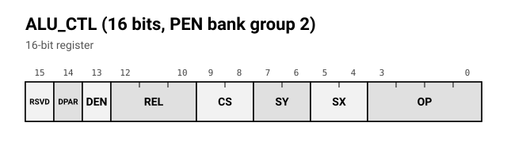

## Channels V2

# GPU Register Reorganization & Pixel Combiner Specification (v2)

## 0. Changes from v1

- **Primary target is 8bpp.** The 16-color (4bpp) path already runs at 10 Mpix/s (fill without read) and is not being redesigned. Everything needed only for 16bpp / sub-byte saturation moves to *Future extension*.
- **`ALU_CTL` OP table rebuilt:** base set = PASS, AND, OR, XOR, ANDN, ADD, ADDS, SUBS, **MSK** (restored). SUB, MIN, MAX, NOT, AVG, HALF are reserved (table in §4.3).
- **AVG/HALF removed from the base set** and replaced by `SHR_X`/`SHR_Y` (shift an operand right by 1 before the ALU) — cheaper and more expressive (table in §3).
- **`NORM` bit removed.** Normalization as a separate mode is unnecessary: A arrives from the processor already 8-bit, D unpacking is the packer's job. The only gap — saturation on sub-byte formats — is closed by an explicit caveat (§4.4).
- **KEY is an arbitrary register**, not a "0 = key" convention (table in §2, Bank 3).
- **Slot `43`** is spare; candidate for unbanked B for gradients if profiling demands it (table in §2).
- **`SHR_X`/`SHR_Y` live in the mode register**, not in `ALU_CTL` (which is dense, and the semantics differ: ALU = operation, mode = operand preparation).
- **Component-wise processing (RGB565/332, H-mask) is not in hardware.** An 8-bit word is one field; ranges inside it are a program convention; component-wise ops are assembled by the program from masks/shifts. There are no component-wise modes (format table in §1).

## 1. Overview & Architecture

This specification defines a banked register reorganization and a single-cycle pixel ALU/combiner for a 16-bit GPU on an 8-bit platform (Z-80). The primary target mode is **8bpp**.

### Hybrid Rendering Model

- **Orchestrator (processor):** conductor and data dispatcher — computes per-scanline start coordinates and step, extracts parameters from the stream, writes pixels to `DATA` (already 8-bit), triggering the channel operation (operand map in §2).
- **Channel:** multi-stage. (a) address generation from X/Y and per-scanline increment; (b) packer/unpacker (pixel read/write, pack/unpack); (c) pixel ALU/combiner (single-cycle, 8-bit values); (d) write gating.
- **Separation:** the channel knows format and addresses; the ALU knows no format and works on values; the processor normalizes data in software when needed.

### Design Constraints

- Single-cycle combinational ALU, no microcode, no multi-cycle stalls.
- No multipliers/DSP. Weighted alpha blending is out of scope; approximation via ADD + right shift (`SHR_X`/`SHR_Y`) or screen-door.
- 1bpp/2bpp write paths remain disabled, as now. Pixel formats:

**Table 1 — CHANNEL FORMAT (fmt, 3 bits; 8bpp is primary)**

| Value | Name | Description |
| --- | --- | --- |
| 0 | <a id="16_bpp"></a>**16 bpp** | 1 pixel per word (k=0) |
| 1 | <a id="8_bpp"></a>**8 bpp** | 2 pixels per word (k=1); pos 0 = low byte (even address) — PRIMARY |
| 2 | <a id="4_bpp"></a>**4 bpp** | 4 pixels per word (k=2); pos 0 = low nibble |
| 3 | <a id="2_bpp"></a>**2 bpp** | 8 pixels per word (k=3); SOURCE ONLY, writes forbidden |
| 4 | <a id="1_bpp"></a>**1 bpp** | 16 pixels per word (k=4); SOURCE ONLY, writes forbidden |
| 5 | <a id="RESERVED"></a>**RESERVED** | Reserved, writes forbidden |
| 6 | <a id="RESERVED"></a>**RESERVED** | Reserved, writes forbidden |
| 7 | <a id="RESERVED"></a>**RESERVED** | Reserved, writes forbidden |


- 16bpp and component-wise processing are future extensions, not in the base set.

## 2. Register Map & Banking

### Unbanked Registers

- `38..41`: ROM (`ROML`, `ROMH`, `ROMA`, …) — **unchanged**. (Exact composition to be reconciled in `architecture.yaml`; see §8.)
- `42`: `BANK` — global active bank selector, **read/write**.
- `43`: spare / unassigned. Candidate: unbanked `B` for gradients if profiling demands it.
- `44..47`: `DATA` (`A`; a write triggers pixel processing) — **moved here from 40..43**.

Top-level operand map:

**Table 2 — Operand map (6 bits, 0..63)**

| Code | Name | Read | Write |
| --- | --- | --- | --- |
| 42 | <a id="BANK"></a>**BANK** | [2:0] active bank | [2:0] bank select (global, all channels) |
| 43 | <a id="SPARE"></a>**SPARE** | - | reserved |
| 44..47 | <a id="DATA_0..3_"></a>**DATA[0..3]** | pixel_out from channel ch | pixel_in to channel ch (triggers pixel op); operand[1..0] = channel |
| 48..63 | <a id="BANK_WINDOW"></a>**BANK_WINDOW** | - | write-only banked register; group=dst[3:2], channel=dst[1:0], bank=BANK |

**Notes:**

- 38..41 are ROM (ROML/ROMH/ROMA + spare), unchanged by this map; see architecture.yaml.
- BANK write takes effect on the next instruction (X-stage decode, in-order, no hold).


### Banked Registers (`48..63`)

`dst[5:4] == 2'b11` (`48..63`) → banked: group `dst[3:2]`, channel `dst[1:0]`, bank from global `BANK`.

**Bank 0 `POS`** — per scanline:

**Table 3 — Bank 0 POS — position (per scanline)**

| Code | Name | Read | Write |
| --- | --- | --- | --- |
| 48..51 | <a id="XI_0..3_"></a>**XI[0..3]** | - | channel X integer part |
| 52..55 | <a id="YI_0..3_"></a>**YI[0..3]** | - | channel Y integer part |
| 56..59 | <a id="XF_0..3_"></a>**XF[0..3]** | - | channel X fractional part |
| 60..63 | <a id="YF_0..3_"></a>**YF[0..3]** | - | channel Y fractional part |


**Bank 1 `STEP`** — per primitive:

**Table 4 — Bank 1 STEP — deltas (per primitive)**

| Code | Name | Read | Write |
| --- | --- | --- | --- |
| 48..51 | <a id="DXI_0..3_"></a>**DXI[0..3]** | - | pixel delta X integer part |
| 52..55 | <a id="DYI_0..3_"></a>**DYI[0..3]** | - | pixel delta Y integer part |
| 56..59 | <a id="DXF_0..3_"></a>**DXF[0..3]** | - | pixel delta X fractional part |
| 60..63 | <a id="DYF_0..3_"></a>**DYF[0..3]** | - | pixel delta Y fractional part |


**Bank 2 `CLIP`** — per window:

**Table 5 — Bank 2 CLIP — clipping bounds (per window)**

| Code | Name | Read | Write |
| --- | --- | --- | --- |
| 48..51 | <a id="XMIN_0..3_"></a>**XMIN[0..3]** | - | clip X min |
| 52..55 | <a id="YMIN_0..3_"></a>**YMIN[0..3]** | - | clip Y min |
| 56..59 | <a id="XMAX_0..3_"></a>**XMAX[0..3]** | - | clip X max |
| 60..63 | <a id="YMAX_0..3_"></a>**YMAX[0..3]** | - | clip Y max |


**Bank 3 `PEN`** — per primitive:

**Table 6 — Bank 3 PEN — pen & ALU (per primitive)**

| Code | Name | Read | Write |
| --- | --- | --- | --- |
| 48..51 | <a id="B_0..3_"></a>**B[0..3]** | - | pen constant (fill color / mask) |
| 52..55 | <a id="KEY_0..3_"></a>**KEY[0..3]** | - | color-key / comparison reference (arbitrary, 0 is legal) |
| 56..59 | <a id="ALU_CTL_0..3_"></a>**ALU_CTL[0..3]** | - | pixel ALU control (see alu_ctl_bitfield) |
| 60..63 | <a id="RESERVED"></a>**RESERVED** | - | reserved |


**Bank 4 `SURF`** — per surface:

**Table 7 — Bank 4 SURF — surface (per surface)**

| Code | Name | Read | Write |
| --- | --- | --- | --- |
| 48..51 | <a id="MODE_PAGE_0..3_"></a>**MODE_PAGE[0..3]** | - | channel mode + page (see mode_bitfield) |
| 52..55 | <a id="PITCH_0..3_"></a>**PITCH[0..3]** | - | surface pitch in pixels |
| 56..59 | <a id="RESERVED"></a>**RESERVED** | - | reserved |
| 60..63 | <a id="RESERVED"></a>**RESERVED** | - | reserved |


### Decoding & Access

- A write to `BANK` takes effect on the **next instruction** (X-stage decode, in-order, no hold).
- `BANK` is global — configuring several channels within one bank needs no bank switches.
- `BANK` is read/write. All other banked registers are write-only (as `IDX` is now; `IDX`/`IDXH` remain in bank 0 at `48`/`52`).

### Memory Map (unchanged)

![Memory Map (24-bit physical address = {PAGE[7:0], WORD[14:0], 1'b0})](gen/v2_memory_map.svg)

**Table 8 — Memory Map (24-bit physical address = {PAGE[7:0], WORD[14:0], 1'b0})**

| Range | Name | Size | Access | Purpose |
| --- | --- | --- | --- | --- |
| `0x000000`–`0x01FFFF` | <a id="PAGE_0x00"></a>**PAGE 0x00** | 128 KiB | rw | Page 0 (128 KB) |
| `0x020000`–`0xFDFFFF` | <a id="..."></a>**...** | 16128 KiB | rw | Pages 1..254 (each 128 KB) |
| `0xFE0000`–`0xFFFFFF` | <a id="PAGE_0xFF"></a>**PAGE 0xFF** | 128 KiB | rw | Page 255 (last 128 KB) |

**Notes:**

- In RTL addr24 = {page[7:0], word[14:0], 1'b0}. Address space is 16 MB, divided into 256 pages of 128 KB each.


## 3. Mode Bits (per channel)

Mode is written via `SURF.MODE_PAGE`:


**Table 9 — Channel MODE (per channel; word written via SURF.MODE_PAGE)**

| Field | Bits | Width | Description |
| --- | --- | --- | --- |
| <a id="RSVD"></a>**RSVD** | [15] | 1 | reserved (0) |
| <a id="SHR_Y"></a>**SHR_Y** | [14] | 1 | shift operand Y right by 1 before ALU |
| <a id="SHR_X"></a>**SHR_X** | [13] | 1 | shift operand X right by 1 before ALU |
| <a id="CLIP_ON"></a>**CLIP_ON** | [12] | 1 | clipping enabled against CLIP bank |
| <a id="WO"></a>**WO** | [11] | 1 | write-without-read |
| <a id="FMT"></a>**FMT** | [10:8] | 3 | pixel format (see channel_format) |
| <a id="PAGE"></a>**PAGE** | [7:0] | 8 | page number (8 bits) |

**Notes:**

- Reset 0 => FMT=16bpp, PAGE=0, WO=0, CLIP_ON=0, SHR_X=0, SHR_Y=0.


- `WO` — write-without-read (when OP/condition do not require reading D).
- `CLIP_ON` — clipping against the CLIP bank.
- `SHR_X` — shift operand X right by 1 before the ALU (0 = off).
- `SHR_Y` — shift operand Y right by 1 before the ALU (0 = off).
- `FMT`/`PAGE` — pixel format and page, as before.

`SHR_X`/`SHR_Y` default to 0, so ADD/ADDS/SUBS work on full values and saturation is not broken. They are enabled when the program assembles blending (HALF, approximate AVG, half-sum with mask). **There is no `NORM` bit** (see §0 and §4.4).

## 4. Pixel ALU & Combiner (`ALU_CTL`)

`ALU_CTL` is a 16-bit register in bank 3 (`PEN`), group 2. Reset `0x0000` = `OP=PASS`, `SX=A`, `REL=always`, `DEN=0` → post-reset behavior is identical to the current implementation.

### 4.1 Fields



**Table 10 — ALU_CTL (16 bits, PEN bank group 2)**

| Field | Bits | Width | Description |
| --- | --- | --- | --- |
| <a id="RSVD"></a>**RSVD** | [15] | 1 | reserved (0) |
| <a id="DPAR"></a>**DPAR** | [14] | 1 | screen-door parity vs (X_int^Y_int)[0] |
| <a id="DEN"></a>**DEN** | [13] | 1 | screen-door gating enable |
| <a id="REL"></a>**REL** | [12:10] | 3 | 0=always,1===,2=!=,3=<,4=>=,5=>,6=<=,7=never (unsigned) |
| <a id="CS"></a>**CS** | [9:8] | 2 | compare pair: 0=A?K, 1=D?K, 2=A?D, 3=D?B |
| <a id="SY"></a>**SY** | [7:6] | 2 | Y source: 0=A, 1=B, 2=D, 3=K |
| <a id="SX"></a>**SX** | [5:4] | 2 | X source: 0=A, 1=B, 2=D, 3=K |
| <a id="OP"></a>**OP** | [3:0] | 4 | ALU operation (see pixel_alu_ops) |

**Notes:**

- Reset 0x0000 => OP=PASS, SX=A, SY=A, REL=always, DEN=0: copy-A default.


### 4.2 Operands

All operands are **8-bit values** (W=8 in the primary mode), masked to W:

- **A:** pixel from the processor (a write to `DATA` triggers it); arrives already 8-bit.
- **B:** constant/color/mask from bank 3 (`PEN`, group 0).
- **D:** unpacked pixel from memory (unpacking is the channel packer's job).
- **K:** key/reference from bank 3 (`PEN`, group 1). **Arbitrary**; 0 is a legal value.

`SHR_X`/`SHR_Y` (mode) are applied to the selected X/Y **before** the ALU.

### 4.3 Core ALU Operations

Base set = PASS, AND, OR, XOR, ANDN, ADD, ADDS, SUBS, MSK. Slots `9..15` are reserved (SUB, MIN, MAX, NOT, AVG, HALF — future / on demand).

**Table 11 — Pixel ALU OP (4 bits)**

| Value | Name | Description |
| --- | --- | --- |
| 0 | <a id="PASS"></a>**PASS** | R = X |
| 1 | <a id="AND"></a>**AND** | R = X & Y |
| 2 | <a id="OR"></a>**OR** | R = X \| Y |
| 3 | <a id="XOR"></a>**XOR** | R = X ^ Y (NOT via XOR with 0xFF) |
| 4 | <a id="ANDN"></a>**ANDN** | R = X & ~Y |
| 5 | <a id="ADD"></a>**ADD** | R = (X + Y) mod 2^8 |
| 6 | <a id="ADDS"></a>**ADDS** | R = sat_8(X + Y); 8bpp only (see note) |
| 7 | <a id="SUBS"></a>**SUBS** | R = sat_8(X - Y); 8bpp only (see note) |
| 8 | <a id="MSK"></a>**MSK** | R = (X & B) \| (Y & ~B); third operand B from PEN |
| 9..15 | <a id="RESERVED"></a>**RESERVED** | SUB, MIN, MAX, NOT, AVG, HALF — future |

**Notes:**

- ADDS/SUBS saturate to 255/0 for 8bpp. For 1/2/4bpp they behave as ADD/SUB mod 2^W (no saturation).


### 4.4 Saturation and Sub-byte Formats (explicit caveat)

- **`ADDS`/`SUBS` are defined for the 8-bit value** (saturate to 255/0). This is the primary mode.
- For 1/2/4bpp, `ADDS`/`SUBS` **do not saturate** — they behave as `ADD`/`SUB` mod 2^W. This is stated explicitly to avoid silent misbehavior.
- A programmer who needs saturation on mono/4bpp normalizes the value **on the processor** (as before: multiply/shift, convert back), or uses the future left-shift extension (§6).
- **No `NORM` bit is introduced.** Reason: A arrives 8-bit from the processor; D is unpacked by the packer; the only gap is saturation, closed by this caveat.

### 4.5 Write Gating & Progression

1. `REL` on the `CS` pair.
2. If `DEN=1`, require `(X_int ^ Y_int)[0] == DPAR`.
3. If clipping (`CLIP_ON`) passes and (1)(2) hold, write `R=OP(X,Y)`; otherwise leave memory untouched.
4. **Coordinates always advance by STEP**, regardless of whether the write committed.

### 4.6 Hardware Notes

- **When D is needed:** `SX==D`, `SY==D`, `CS` uses D (1,2,3), or RMW for sub-byte packing.
- **Shared arithmetic:** one 8/9-bit adder-subtractor for ADD/ADDS/SUBS and comparisons; `==` via XOR + reduction; two 8-bit 4:1 muxes for X/Y; `SHR_X`/`SHR_Y` are one 2:1 mux per operand (raw/shifted). No DSP.
- **`WO`:** for 8bpp without reading D — write without RMW, one cache access. For 1/2/4bpp a read of the containing word is always required.
- 1bpp/2bpp write protection is preserved. LO8/HI8 (W=8) work.

## 5. Example: Rectangle Fill (8bpp)

```asm
LDI BANK,4 ; LDI MODE_PAGE0,fmt|page ; LDI PITCH0,320    ; surface (once per frame)
LDI BANK,3 ; LDI B0,color ; LDI ALU_CTL0,ROP_FILL        ; pen (once per rectangle)
LDI BANK,1 ; LDI DXI0,1                                  ; step
LDI BANK,0                                               ; POS stays selected

row:     MOV XI0,R_x0 ; MOV YI0,R_y ; LDI LOOP_CNT,w
         MOV DATA0,ZERO     ; triggers write; A ignored when OP=PASS, SX=B
         ADD R_y,#1 ; JMP row
```

Overhead: ~6–8 instructions per primitive, 4–5 per scanline; pixel rate 1/cycle at 8bpp without reading D.

## 6. Future Extension (not in the base set)

- **Left-shift normalization** (1bpp→0/0x80, etc.): a 3-bit shift field per operand (0..7) in a separate extension register, not in the 16-bit `ALU_CTL`. Only after profiling.
- **16bpp** (RGB565) and component-wise AVG/HALF with an H-mask — if needed; the H-mask is a program constant (in B/KEY), not a register field.
- **SUB, MIN, MAX, NOT, AVG, HALF** — reserved codes `9..15` in the OP table (§4.3).
- **Slot `43`** — unbanked B for gradients/raster bars if profiling shows that `LDI BANK,3` per scanline is expensive.

## 7. Migration & Cleanup Checklist

- Re-encode channel and top-level tests where opcodes `48..63` shifted (`IDX`/`IDXH` stay at `48`/`52` in bank 0; `STEP` and `MODE_PAGE` moved).
- Leave the bootloader untouched (`DATA0`, `ROMA`, `ROML`, `ROMH`).
- Reconcile `sysregs` and `operand_map` in `architecture.yaml` with this specification; the current file has `sysregs` diverging from `operand_map` and uses a flat `48..63` map.
- Record in `architecture.yaml`: `BANK` (42) R/W; `43` spare; mode per §3; `ALU_CTL` per §4.1; OP base 0..8, `9..15` reserved per §4.3; `ADDS`/`SUBS` 8bpp only (explicit).

## 8. Open Questions (next step)

1. **Slot 43:** leave spare or assign unbanked B? Decide after profiling gradients.
2. **Left-shift normalization:** needed at all if the processor can do it in software? Decide after measuring real 8bpp programs.
3. **16bpp:** deferred; on return, decide the layout (RGB565/RGB332) and whether component-wise saturation is needed.
4. **MHI (upper 16 bits of MUL):** the old `architecture.yaml` puts it at 41, while v2 assigns `38..41` to ROM. Must be resolved before finalizing `architecture.yaml` (not a `channels_v2.yaml` concern).
5. **DATA move 40..43 → 44..47:** confirm that the old 40..43 are freed for ROM/MHI, and that the bootloader (which uses `DATA0`) is updated or is unaffected.
