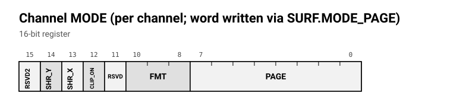

## Channels V2

# GPU Register Reorganization & Pixel Combiner Specification (v2.1)

## 0. Summary

Proposal to add, on top of the existing channel (address -> cache -> packer/unpacker -> blender):

1. a **2D position generator** (X/Y in 16.16, per-pixel step, pitch, clip rectangle);
2. a **pixel ALU / combiner** that turns "processor writes a pixel" into a complete
   read-modify-write with conditional write;
3. a **banked register window** (`BANK`) so the channel can have ~20 registers without new operand codes.

Everything below the channel (`pixel_engine`, `gpu_cache`, `pixel_blender` packing, `fmt_pkg`)
is reused unchanged. The processor can still use a channel exactly as before (index + `DATA`
read / write, software blending).

Changes with respect to the first draft:

- **Primary target is 8bpp.** The ALU datapath is nevertheless 16 bits wide and its width **W follows
  FMT** (the existing `fmt_pkg` pixel mask), so 16bpp and the reset default keep working (§5.2).
- **Base OP set:** PASS, AND, OR, XOR, ANDN, ADD, ADDS, SUBS, MSK. MIN / MAX / NOT are not needed
  as opcodes: they are obtained from `REL` gating and `XOR` (recipes in §5.7).
- **No AVG / HALF opcodes.** `SHR_X` / `SHR_Y` (mode bits) halve an operand before the ALU.
- **`ADDS` saturates to `2^W - 1`, `SUBS` to `0`, for every W.** No sub-byte caveat, no `NORM` bit (§5.4).
- **`WO` is removed.** Whether D must be read is derived from `ALU_CTL` (§5.6); a manual bit can only be wrong.
- **KEY is an arbitrary register** (0 is a legal key).
- **Page size corrected to 64 KB** (§2, memory map): `{PAGE[7:0], WORD[14:0], 1'b0}` addresses 64 KB per page.
- **Address generation is specified** (§3), including the compatibility mode `PITCH = 0`.
- **Open questions 4 and 5 of the first draft are resolved** by the RTL (§8).

## 1. Overview & Architecture

### Division of work

- **Orchestrator (processor):** computes the start position of each scanline, loads pen / mode registers,
  and writes pixels to `DATA`. A write to `DATA` is the **only event** that starts a pixel operation;
  everything else is configuration. Moving to the next scanline stays in software
  (write `XI`, `YI` again): it costs 2-3 instructions and needs no hardware.
- **Channel:**
  (a) position generator: X/Y -> pixel index, step after every access, clipping;
  (b) existing packer / unpacker (pixel <-> word, page, cache);
  (c) pixel ALU: one combinational stage over unpacked pixel values;
  (d) write gating.
- **Pixel values, not bits:** at the ALU input and output a pixel is one integer of W bits
  (W = 16, 8, 4, 2 or 1 by FMT). Packing it into the word is the packer's job, as before.
  The ALU knows **W only**, not colour layout; component-wise colour maths is out of scope (§6).

### Design constraints

- ALU: one combinational stage, no microcode, **no multiplier**. Weighted alpha blending is out of scope;
  use `ADD` + `SHR_X/SHR_Y` (x1/2, x1/4 via two ops) or screen-door gating.
- Address generator: one multiplier `YI x PITCH` shared by all channels, or the shift-add option of §8.
- Writes to 1bpp / 2bpp remain forbidden, as now.

### Pixel formats

**Table 1 — CHANNEL FORMAT (fmt, 3 bits); W = operand width of the pixel ALU**

| Value | Name | Description |
| --- | --- | --- |
| 0 | <a id="16_bpp"></a>**16 bpp** | W=16, 1 pixel per word (k=0); reset default |
| 1 | <a id="8_bpp"></a>**8 bpp** | W=8, 2 pixels per word (k=1); pos 0 = low byte (even address) - PRIMARY |
| 2 | <a id="4_bpp"></a>**4 bpp** | W=4, 4 pixels per word (k=2); pos 0 = low nibble |
| 3 | <a id="2_bpp"></a>**2 bpp** | W=2, 8 pixels per word (k=3); SOURCE ONLY, writes forbidden |
| 4 | <a id="1_bpp"></a>**1 bpp** | W=1, 16 pixels per word (k=4); SOURCE ONLY, writes forbidden |
| 5 | <a id="LO8"></a>**LO8** | W=8, 1 pixel per word in the LOW byte (k=0), high byte preserved on write |
| 6 | <a id="HI8"></a>**HI8** | W=8, 1 pixel per word in the HIGH byte (k=0), low byte preserved on write |
| 7 | <a id="RESERVED"></a>**RESERVED** | Reserved, writes forbidden |


## 2. Register Map & Banking

### Unbanked registers (unchanged unless noted)

**Table 2 — Operand map (6 bits, 0..63)**

| Code | Name | Read | Write |
| --- | --- | --- | --- |
| 0..31 | <a id="R0..R31"></a>**R0..R31** | 16-bit value | 16-bit value |
| 32 | <a id="ZERO"></a>**ZERO** | 0 | Ignored |
| 33 | <a id="FLAGS"></a>**FLAGS** | [3:0] = V C N Z | [3:0] |
| 34 | <a id="BUSY"></a>**BUSY** | {wb_cyc, flush_done, access_done, hit} | - |
| 35 | <a id="SHADOW"></a>**SHADOW** | [15:12] flags, [11:0] PC+1 | [11:0] PC |
| 36 | <a id="LOOP_CNT"></a>**LOOP_CNT** | Loop counter | Loop counter |
| 37 | <a id="LOOP_TGT"></a>**LOOP_TGT** | Loop target | Loop target |
| 38 | <a id="ROML"></a>**ROML** | Lower 16 bits of ROM word | Lower 16 bits of ROM word |
| 39 | <a id="ROMH"></a>**ROMH** | Upper 16 bits of ROM word (ROMA++) | Upper 16 bits of ROM word, commit, ROMA++ |
| 40 | <a id="ROMA"></a>**ROMA** | - | ROM access address |
| 41 | <a id="MHI"></a>**MHI** | Upper 16 bits of MUL | - |
| 42 | <a id="BANK"></a>**BANK** | [2:0] active bank | [2:0] bank select (global, all channels) |
| 43 | <a id="SPARE"></a>**SPARE** | 0 | reserved |
| 44..47 | <a id="DATA_0..3_"></a>**DATA[0..3]** | D: unpacked pixel (KEY if clipped); then pos += step | A: pixel in, starts pixel operation; then pos += step; operand[1..0] = channel |
| 48..63 | <a id="BANK_WINDOW"></a>**BANK_WINDOW** | - | write-only banked register; group = dst[3:2], channel = dst[1:0], bank = BANK |

**Notes:**

- BANK write takes effect on the next instruction (X-stage decode, in-order, no hold).
- Banks 5..7 are reserved: writes to the window are ignored, no error.
- RTL reference: 38 ROML, 39 ROMH, 40 ROMA, 41 MHI, 44..47 DATA (top.sv).


- `BANK` is **global** (one for the whole GPU): configuring several channels in the same bank needs no switches.
- A write to `BANK` takes effect with the **next instruction** (decoded in X, in-order, no hold).
- Banks 5..7 are reserved: writes to the banked window are ignored, no error.
- The bootloader uses only `DATA0`, `ROMA`, `ROML`, `ROMH` and is unaffected.

### Banked window `48..63`

`dst[5:4] == 2'b11` -> banked register: **group** = `dst[3:2]`, **channel** = `dst[1:0]`, **bank** = `BANK`.
All banked registers are **write-only** (as `IDX` is today). Register widths: position and step
integer parts are 16-bit two's complement, fractions 16-bit unsigned; all others 16-bit.

**Bank 0 `POS`** - changes per scanline (selected during rendering):

**Table 3 — Bank 0 POS - position (per scanline). 16.16 two's complement integer / unsigned fraction**

| Code | Name | Read | Write |
| --- | --- | --- | --- |
| 48..51 | <a id="XI_0..3_"></a>**XI[0..3]** | - | X integer part (signed). With PITCH=0: pixel index [15:0] (old IDX) |
| 52..55 | <a id="YI_0..3_"></a>**YI[0..3]** | - | Y integer part (signed). With PITCH=0: bits [2:0] = pixel index [18:16] (old IDXH) |
| 56..59 | <a id="XF_0..3_"></a>**XF[0..3]** | - | X fractional part |
| 60..63 | <a id="YF_0..3_"></a>**YF[0..3]** | - | Y fractional part |


**Bank 1 `STEP`** - per primitive. After **every** access (read or write of `DATA`) `pos += step`:

**Table 4 — Bank 1 STEP - added to position after every DATA access (per primitive)**

| Code | Name | Read | Write |
| --- | --- | --- | --- |
| 48..51 | <a id="DXI_0..3_"></a>**DXI[0..3]** | - | step X integer part (signed) |
| 52..55 | <a id="DYI_0..3_"></a>**DYI[0..3]** | - | step Y integer part (signed) |
| 56..59 | <a id="DXF_0..3_"></a>**DXF[0..3]** | - | step X fractional part |
| 60..63 | <a id="DYF_0..3_"></a>**DYF[0..3]** | - | step Y fractional part |

**Notes:**

- Old STEP (12.4) maps to DXI = STEP >> 4, DXF = (STEP & 15) << 12, DYI = DYF = 0.


**Bank 2 `CLIP`** - per window:

**Table 5 — Bank 2 CLIP - inclusive signed clip rectangle on integer position (per window)**

| Code | Name | Read | Write |
| --- | --- | --- | --- |
| 48..51 | <a id="XMIN_0..3_"></a>**XMIN[0..3]** | - | clip X min (inclusive) |
| 52..55 | <a id="YMIN_0..3_"></a>**YMIN[0..3]** | - | clip Y min (inclusive) |
| 56..59 | <a id="XMAX_0..3_"></a>**XMAX[0..3]** | - | clip X max (inclusive) |
| 60..63 | <a id="YMAX_0..3_"></a>**YMAX[0..3]** | - | clip Y max (inclusive) |

**Notes:**

- Active only when MODE.CLIP_ON = 1. Clipped write: no cache access, no overflow error, position still advances. Clipped read returns KEY.


**Bank 3 `PEN`** - per primitive:

**Table 6 — Bank 3 PEN - pen & ALU (per primitive)**

| Code | Name | Read | Write |
| --- | --- | --- | --- |
| 48..51 | <a id="B_0..3_"></a>**B[0..3]** | - | pen constant: fill colour / mask for MSK / compare reference (low W bits) |
| 52..55 | <a id="KEY_0..3_"></a>**KEY[0..3]** | - | colour key / compare reference (arbitrary, 0 is legal); also the value returned by a clipped read |
| 56..59 | <a id="ALU_CTL_0..3_"></a>**ALU_CTL[0..3]** | - | pixel ALU control (see v2_alu_ctl_bitfield) |
| 60..63 | <a id="RESERVED"></a>**RESERVED** | - | reserved |


**Bank 4 `SURF`** - per surface:

**Table 7 — Bank 4 SURF - surface (per surface)**

| Code | Name | Read | Write |
| --- | --- | --- | --- |
| 48..51 | <a id="MODE_PAGE_0..3_"></a>**MODE_PAGE[0..3]** | - | channel mode + page (see v2_mode_bitfield) |
| 52..55 | <a id="PITCH_0..3_"></a>**PITCH[0..3]** | - | surface pitch in pixels. 0 = linear mode: pixel_index = {YI[2:0], XI}. Else pixel_index = YI*PITCH + XI |
| 56..59 | <a id="RESERVED"></a>**RESERVED** | - | reserved |
| 60..63 | <a id="RESERVED"></a>**RESERVED** | - | reserved |


### Reset values

All banked registers reset to 0, `BANK = 0`. This gives: `PITCH = 0` (linear mode, §3), `STEP = 0`,
`MODE_PAGE = 0` (16bpp, page 0, clipping off), `ALU_CTL = 0` (PASS A, always write).

### Memory map

![Memory Map (24-bit physical address = {PAGE[7:0], WORD[14:0], 1'b0}); 64 KB per page](gen/v2_memory_map.svg)

**Table 8 — Memory Map (24-bit physical address = {PAGE[7:0], WORD[14:0], 1'b0}); 64 KB per page**

| Range | Name | Size | Access | Purpose |
| --- | --- | --- | --- | --- |
| `0x000000`–`0x00FFFF` | <a id="PAGE_0x00"></a>**PAGE 0x00** | 64 KiB | rw | Page 0 (64 KB) |
| `0x010000`–`0xFEFFFF` | <a id="..."></a>**...** | 16256 KiB | rw | Pages 1..254 (each 64 KB) |
| `0xFF0000`–`0xFFFFFF` | <a id="PAGE_0xFF"></a>**PAGE 0xFF** | 64 KiB | rw | Page 255 (last 64 KB) |

**Notes:**

- 8 + 15 + 1 = 24 bits: 256 pages x 32768 words x 2 bytes = 16 MB. The previous text (128 KB per page) contradicted the formula.


## 3. Position, Address Generation, Clipping

### 3.1 Position and step

`pos = {XI.XF, YI.YF}` (two 16.16 numbers). After each `DATA` access: `X += {DXI,DXF}`, `Y += {DYI,DYF}`
(32-bit adds, the carry from fraction into integer is part of the add). Integer parts used below are the
**pre-advance** values (floor, because the numbers are two's complement).

### 3.2 Pixel index

```
PITCH != 0 :  pixel_index = YI * PITCH + XI                  (2D mode)
PITCH == 0 :  pixel_index = {YI[2:0], XI[15:0]}              (linear mode, 19 bits)
```

Linear mode is the compatibility mode: `XI` is the old `IDX`, `YI[2:0]` is the old `IDXH`, and the old
`STEP` (12.4) maps to `DXI = STEP >> 4`, `DXF = (STEP & 15) << 12`. In linear mode the carry out of `XI`
must propagate into `YI[2:0]` as the old 19-bit index did, and `DYI/DYF` must be 0.

The index feeds the **existing** path: `reg_idx = {pixel_index, 4'b0} >>> k`, then word / frac / page logic exactly as today.

### 3.3 Clipping

With `CLIP_ON = 1` a pixel is **inside** when (signed, inclusive):
`XMIN <= XI <= XMAX` and `YMIN <= YI <= YMAX`.

- **Write outside:** memory untouched, no cache access, **no page-overflow error**; position still advances.
- **Read outside:** returns `KEY`, so out-of-window texels read as "transparent".
- Clipping is evaluated **before** the page-overflow check; with `CLIP_ON = 0` the old
  overflow error (halt code 2) applies as today.
- The page-overflow check applies to the final index. A surface larger than one page needs the open question 7.

### 3.4 DATA access semantics

| Access | Effect |
|---|---|
| write `DATA[ch]` | start pixel operation (§5) with `A = wdata` (low W bits); then `pos += step` |
| read `DATA[ch]` | returns D (unpacked, zero-extended to 16 bits) or `KEY` if clipped; then `pos += step` |

A `DATA` access after a position register write may need a few cycles for the address to be ready;
the existing X-stage busy mechanism covers it, software sees no new rule.

## 4. Mode (per channel)

Written via `SURF.MODE_PAGE`:



**Table 9 — Channel MODE (per channel; word written via SURF.MODE_PAGE)**

| Field | Bits | Width | Description |
| --- | --- | --- | --- |
| <a id="RSVD2"></a>**RSVD2** | [15] | 1 | reserved (0) |
| <a id="SHR_Y"></a>**SHR_Y** | [14] | 1 | operand Y >> 1 (logical) before the ALU; not applied to B or to REL operands |
| <a id="SHR_X"></a>**SHR_X** | [13] | 1 | operand X >> 1 (logical) before the ALU; not applied to B or to REL operands |
| <a id="CLIP_ON"></a>**CLIP_ON** | [12] | 1 | clip against the CLIP bank |
| <a id="RSVD"></a>**RSVD** | [11] | 1 | reserved (0); was WO. Whether D is read is derived from ALU_CTL |
| <a id="FMT"></a>**FMT** | [10:8] | 3 | pixel format (see v2_channel_format) |
| <a id="PAGE"></a>**PAGE** | [7:0] | 8 | page number (8 bits), 64 KB per page |

**Notes:**

- Reset 0 => FMT=16bpp, PAGE=0, CLIP_ON=0, SHR_X=0, SHR_Y=0.


- `CLIP_ON` - clip against the CLIP bank (§3.3).
- `SHR_X` / `SHR_Y` - logical shift right by 1 of operand X / Y **after selection, before the ALU**. They apply only to the X / Y
  operands, not to `B` in `MSK` and not to the operands of the `REL` comparison. Default 0.
- `FMT` / `PAGE` - as before.

`MODE` holds operand preparation, `ALU_CTL` holds the operation: the split keeps `ALU_CTL` dense.

## 5. Pixel ALU & Combiner (`ALU_CTL`)

`ALU_CTL` is a 16-bit register in bank 3 (`PEN`), group 2. Reset `0x0000` = `OP=PASS`, `SX=A`,
`REL=always`, `DEN=0`: post-reset behaviour is identical to the current implementation.

### 5.1 Fields


**Table 10 — ALU_CTL (16 bits, PEN bank group 2)**

| Field | Bits | Width | Description |
| --- | --- | --- | --- |
| <a id="RSVD"></a>**RSVD** | [15] | 1 | reserved (0) |
| <a id="DPAR"></a>**DPAR** | [14] | 1 | screen-door parity: write only if (XI^YI)[0] == DPAR (pre-advance integer parts) |
| <a id="DEN"></a>**DEN** | [13] | 1 | screen-door gating enable |
| <a id="REL"></a>**REL** | [12:10] | 3 | write condition on CS pair, unsigned: 0=always, 1===, 2=!=, 3=<, 4=>=, 5=>, 6=<=, 7=never |
| <a id="CS"></a>**CS** | [9:8] | 2 | compare pair (first ? second): 0=A?K, 1=D?K, 2=A?D, 3=D?B |
| <a id="SY"></a>**SY** | [7:6] | 2 | Y source: 0=A, 1=B, 2=D, 3=K |
| <a id="SX"></a>**SX** | [5:4] | 2 | X source: 0=A, 1=B, 2=D, 3=K |
| <a id="OP"></a>**OP** | [3:0] | 4 | ALU operation (see v2_pixel_alu_ops) |

**Notes:**

- Reset 0x0000 => OP=PASS, SX=A, REL=always, DEN=0: copy-A default.
- NEED_D = (SX==D) | (SY==D) | (REL in 1..6 & CS != 0). If 0 and W=16: one cache access, no RMW.
- All operands are unsigned W-bit values (W by FMT: 16/8/4/2/1; LO8/HI8 = 8); datapath 16 bits wide, bits above W forced to 0.


### 5.2 Operands and width

All operands are **unsigned W-bit values**, W by FMT: 16bpp -> 16, 8bpp / LO8 / HI8 -> 8, 4bpp -> 4,
2bpp -> 2, 1bpp -> 1 (the same mask the packer already uses). The datapath is 16 bits wide; bits above W
are forced to 0 on entry and on the result. This is what keeps the reset default (16bpp, PASS A) bit-exact.

- **A** - written by the processor (low W bits of the 16-bit register). Triggers the operation.
- **B** - pen constant: bank 3 group 0.
- **D** - destination pixel read from memory and unpacked by the packer.
- **K** - key / reference: bank 3 group 1, **arbitrary**, 0 is legal.

### 5.3 Operations

**Table 11 — Pixel ALU OP (4 bits), W-bit unsigned**

| Value | Name | Description |
| --- | --- | --- |
| 0 | <a id="PASS"></a>**PASS** | R = X |
| 1 | <a id="AND"></a>**AND** | R = X & Y |
| 2 | <a id="OR"></a>**OR** | R = X \| Y |
| 3 | <a id="XOR"></a>**XOR** | R = X ^ Y (NOT = XOR with B = all ones) |
| 4 | <a id="ANDN"></a>**ANDN** | R = X & ~Y |
| 5 | <a id="ADD"></a>**ADD** | R = (X + Y) mod 2^W |
| 6 | <a id="ADDS"></a>**ADDS** | R = min(X + Y, 2^W - 1) |
| 7 | <a id="SUBS"></a>**SUBS** | R = max(X - Y, 0) |
| 8 | <a id="MSK"></a>**MSK** | R = (X & B) \| (Y & ~B); third operand B from PEN (not shifted by SHR) |
| 9..15 | <a id="RESERVED"></a>**RESERVED** | SUB (mod 2^W) etc. MIN/MAX come from REL gating, NOT from XOR |


### 5.4 Saturation

`ADDS` clamps to `2^W - 1`, `SUBS` clamps to 0, at every W. Implementation: the carry is taken from bit W
of the adder (a 5:1 selection); `SUBS` uses the borrow. No separate normalisation step is needed, and
no sub-byte special case exists.

### 5.5 Write gating and progression

1. Evaluate `REL` on the `CS` pair (first operand compared against the second; unsigned).
2. If `DEN = 1` also require `(XI ^ YI)[0] == DPAR` (pre-advance integer parts).
3. If clipping (`CLIP_ON`) passes and 1 and 2 hold, write `R = OP(X, Y)`; otherwise memory is not touched.
4. **The position always advances by STEP**, whether or not the write was committed.

### 5.6 When D is read

```
NEED_D = (SX == D) | (SY == D) | (REL in {==, !=, <, >=, >, <=} & CS != 0)
```

(`REL = always / never` makes `CS` irrelevant; `CS = 0` compares A with K and needs no D.)

- `NEED_D = 0` and W = 16: a plain word write, **one cache access, no RMW**.
- W < 16: the containing word must be read to preserve neighbouring pixels (current behaviour). Removing
  this needs lane write-enables in the cache (§7).

### 5.7 Recipes

| Effect | OP | SX | SY | CS | REL | Notes |
|---|---|---|---|---|---|---|
| Copy | PASS | A | - | - | always | reset value |
| Fill | PASS | B | - | - | always | A only triggers |
| Colour-key sprite | PASS | A | - | A?K | `!=` | transparent where A == K |
| Draw under (behind existing) | PASS | A | - | D?K | `==` | only over background == K |
| Silhouette / flash | PASS | B | - | A?K | `!=` | |
| XOR cursor | XOR | A | D | - | always | |
| Invert | XOR | D | B | - | always | B = all ones |
| Mask sprite | MSK | A | D | - | always | B = mask |
| Additive glow | ADDS | D | A | - | always | |
| Darken by palette step | SUBS | D | B | - | always | |
| Half-bright | PASS | D | - | - | always | `SHR_X = 1` |
| ~50 % blend (approx.) | ADD | A | D | - | always | `SHR_X = SHR_Y = 1`, error <= 1 |
| Screen-door transparency | PASS | A | - | - | always | `DEN = 1` |
| Lighten (max) / priority | PASS | A | - | A?D | `>=` | write A only if A >= D |
| Darken (min) | PASS | A | - | A?D | `<=` | |
| Stencil | PASS | A | - | D?B | `==` | write only where D == B |

`SHR` operations treat the 8-bit word as one field (grayscale / palette ramp). For RGB332 / RGB565 they leak bits
between components; component-wise results are the program's job (masks and shifts).

### 5.8 Hardware notes

- One W-bit adder / subtractor serves ADD, ADDS, SUBS and the `<`, `>=`, `>`, `<=` comparisons; `==` is XOR + reduce.
- Two 4:1 muxes (X, Y), one 2:1 mux per operand for `SHR`, one 8:1 mux for `REL`. No DSP.
- 1bpp / 2bpp write protection preserved. LO8 / HI8 (W = 8) work through the same path.

## 6. Example: Rectangle Fill (8bpp)

```asm
LDI BANK,4 ; LDI MODE_PAGE0,fmt|page ; LDI PITCH0,320    ; surface   (once per frame)
LDI BANK,3 ; LDI B0,color ; LDI ALU_CTL0,FILL            ; pen       (once per rectangle; FILL = SX=B)
LDI BANK,1 ; LDI DXI0,1                                  ; step X = 1, step Y = 0
LDI BANK,0                                               ; POS stays selected
LDI LOOP_TGT,pix

row:  MOV XI0,R_x0 ; MOV YI0,R_y ; LDI LOOP_CNT,w
pix:  MOV DATA0,ZERO         ; L-bit set; repeats w times; A ignored (SX=B)
      ADD R_y,#1             ; next scanline in software
      SUB.F R_h,#1 ; JMP.NE row
```

Per primitive about 8 instructions; per scanline about 6.

## 7. Performance Notes

- A single-instruction `L` loop costs **one bubble per iteration** (fetch unit redirects in D), so the loop
  runs at most **one pixel per two clocks**; unrolling approaches one per clock.
- The current blender needs a read phase and a write phase for each partial-word write (about 4-5 clocks including
  registered acknowledges; confirm in simulation). Throughput is set by this sequence, not by the ALU.
- **Suggested follow-up (not part of the base set):** lane write-enables in the cache (nibble / byte) and a
  one-cycle read-modify-write on a cache hit when the cache read is combinational. That removes the RMW FSM
  for W < 16 when D is not needed, and gives one-cycle ALU + write on hits.
- Cache write-miss still reads the word (write-allocate); consecutive pixels in the same word hit.

## 8. Open Questions

1. **Slot 43:** keep spare. An unbanked `B` is not workable: one code cannot address four channels.
2. **Left-shift normalisation** for sub-byte data: decide after measuring real programs.
3. **16bpp component-wise ops** (RGB565 AVG / HALF with an H mask): later, mask as a program constant in B / KEY.
4. **MHI:** resolved - the RTL keeps `ROML=38, ROMH=39, ROMA=40, MHI=41`. Only `architecture.yaml` is stale.
5. **DATA 40..43 -> 44..47:** resolved - the RTL (`top.sv`) and the bootloader already use `44..47`.
6. **Address multiplier:** a 16x16 multiplier (one DSP) or **shift-add pitch**: `PITCH = {en2, s2[4:0], s1[4:0]}` giving
   `Y*PITCH = (Y << s1) + (Y << s2)`, which covers 320 (256+64), 640 (512+128), 384, 768, 1024, ... with two barrel
   shifters and no DSP. Decide by target FPGA.
7. **Surfaces larger than one 64 KB page** (320x240x8bpp = 75 KB): carry the high bits of the linear index into `PAGE`
   (page becomes a base), or keep the overflow error.
8. **Storage of per-channel state** (about 270 bits per channel): flip-flops for all four channels, or BRAM with a
   slower channel switch? Copy loops switch channel on every pixel.
9. **Read outside clip** returns `KEY`; confirm this is the wanted convention.

## 9. Migration & Cleanup Checklist

- Re-encode channel and top-level tests: `48..63` change meaning (`IDX`/`IDXH` become `XI`/`YI` at `48`/`52` in bank 0
  with `PITCH = 0`; `STEP` and `MODE_PAGE` moved to banks 1 and 4).
- Add `BANK`, position generator, clip and `ALU_CTL` tests; keep every existing test unmodified in linear mode.
- `architecture.yaml`: fix `sysregs` / `data_regs` (stale vs `operand_map` and RTL), pages are 64 KB, FMT 5 / 6 are
  LO8 / HI8 (implemented and tested), record `BANK` (42) R/W, `43` spare, mode per §4, `ALU_CTL` per §5.1.
- Bootloader unchanged.