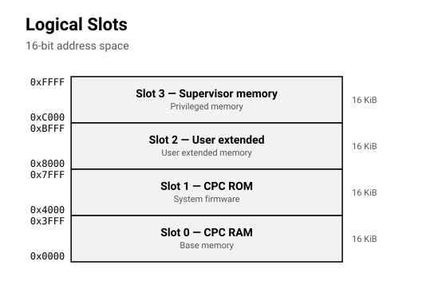

# LX I/O: Native and Legacy I/O Map

## 0. How to read this document

This document describes **what** is in the LX I/O space and **how** it
behaves: the port map, the MMIO page organization, the legacy device
sub-registers, and the invariants.

**Addresses and bus widths are not in this document.** They are in
`lx_rtl_reference.md` — the single source of addresses.

### Markers

| Marker | Meaning |
|---|---|
| **✔ By design** | An intentional RTL decision. |
| **⚠ Spec:** | The old specification differs from the RTL. RTL is authoritative. |
| **⚠ Outdated:** | The old document may be stale. |

### Labels

| Label | Meaning |
|---|---|
| **Mandatory** | Required for LX. |
| **Optional** | May be implemented, may be omitted. |

---

## 1. Memory organization

### 1.1 Slots

The Z80 has a 16-bit logical address space (64 KB), divided into four
16 KB slots:



**Table 1 — Logical Slots**

| Range | Name | Size | Purpose |
| --- | --- | --- | --- |
| `0x0000`–`0x3FFF` | <a id="Slot_0___CPC_RAM"></a>**Slot 0 — CPC RAM** | 16 KiB | Base memory |
| `0x4000`–`0x7FFF` | <a id="Slot_1___CPC_ROM"></a>**Slot 1 — CPC ROM** | 16 KiB | System firmware |
| `0x8000`–`0xBFFF` | <a id="Slot_2___User_extended"></a>**Slot 2 — User extended** | 16 KiB | User extended memory |
| `0xC000`–`0xFFFF` | <a id="Slot_3___Supervisor_memory"></a>**Slot 3 — Supervisor memory** | 16 KiB | Privileged memory |


Each slot maps to a 16 KB page in the 24-bit physical space via an 8-bit
bank register. The physical address is formed as `{slot, bank, offset}`.

### 1.2 MMIO regions

The top of the 24-bit physical space is reserved for memory-mapped I/O.
It is divided into two regions:

**Table 2 — MMIO Regions**

| Value | Name | Description |
| --- | --- | --- |
| 0 | <a id="MMIO_LO"></a>**MMIO_LO** | New LX devices (bank-switched) |
| 1 | <a id="MMIO_HI"></a>**MMIO_HI** | Legacy CPC devices (fixed addresses) |


**✔ By design (RTL):** the MMIO regions and their page organization
match `mmu_native.sv`. Physical addresses are in
`lx_rtl_reference.md` §1 and §4.

> **⚠ Spec:** Old `lx_io.md` used a base of `FC0000` for new devices.
> **This was rejected.** The RTL uses the `FF` range for MMIO. See
> `lx_rtl_reference.md`.

---

## 2. Native mode I/O

In Native mode, the Z80 I/O port space is divided as follows:

**Table 3 — Native Mode Port Map**

| Value | Name | Description |
| --- | --- | --- |
| 0..127 | <a id="MMIO_window"></a>**MMIO window** | 128 bytes: access to MMIO_LO |
| 128..223 | <a id="External_I_O"></a>**External I/O** | 96 bytes: forwarded to Wishbone |
| 224..255 | <a id="MMU_registers"></a>**MMU registers** | 32 bytes: MMU control |


**✔ By design (RTL):** `addr_is_mmio_space = !cpu_a[7]` → `00–7F`;
`addr_is_mmu_space = cpu_a[7] && cpu_a[6] && cpu_a[5]` → `E0–FF`;
`80–DF` falls through to external I/O.

### 2.1 MMIO window (`00–7F`)

A 128-byte window into MMIO_LO. The physical address is formed as:

```
physical_address = MMIO_LO_base + (MMIO_PAGE << 7) + A[6:0]
```

where `MMIO_PAGE` is a 7-bit register (values 0–127) set via port `F1h`.

**✔ By design (RTL):** `m_wb_adr_o = {8'hFF, 2'b00, reg_mmio_page[6:0], cpu_a[6:0]}`.

> **⚠ Spec:** Old `lx_io.md` proposed a **192-byte** window at `00–BF`.
> The author wanted a larger window because 128 bytes is too small, but
> a comparison like `a[7:0] <= 0xBF` could cause combinatorial
> explosion. The RTL kept the simpler `00–7F` window. **RTL is
> authoritative.** The 192-byte window remains an open desire, not a
> current fact. See §7.

### 2.2 External I/O (`80–DF`)

Ports `80–DF` are forwarded to the Wishbone bus. This is how the CPU
reaches devices that are not in the MMIO window.

### 2.3 MMU registers (`E0–FF`)

The MMU control and mapper registers. They are **CPU-only** (not
forwarded to Wishbone).

**Table 4 — MMU Registers (Ports E0–FF)**

| Offset | Name | Description |
| --- | --- | --- |
| `0xE0` | <a id="MMU_EXT"></a>**MMU_EXT** | Extended mapper access (16 registers, save/restore) |
| `0xF0` | <a id="GLOBAL_CTRL"></a>**GLOBAL_CTRL** | Mode control: bit 0 = supervisor, bit 1 = native, bit 2 = trap hook, bit 4 = mmio_userlock |
| `0xF1` | <a id="MMIO_PAGE"></a>**MMIO_PAGE** | 7-bit MMIO page (0–127) |
| `0xF2` | <a id="SYSCALL"></a>**SYSCALL** | Supervisor entry (write-only) |
| `0xF3` | <a id="CLOCK_CTRL"></a>**CLOCK_CTRL** | CPU clock divider (Supervisor only) |
| `0xFA` | <a id="SUPER_SLOT"></a>**SUPER_SLOT** | Supervisor slot select (4 × 2-bit page fields) |
| `0xFB` | <a id="USER_SLOT"></a>**USER_SLOT** | User slot select (4 × 2-bit page fields) |
| `0xFC` | <a id="BANK_0"></a>**BANK_0** | Bank register for current slot, page 0 |
| `0xFD` | <a id="BANK_1"></a>**BANK_1** | Bank register for current slot, page 1 |
| `0xFE` | <a id="BANK_2"></a>**BANK_2** | Bank register for current slot, page 2 |
| `0xFF` | <a id="BANK_3"></a>**BANK_3** | Bank register for current slot, page 3 |


**✔ By design (RTL):** the port map matches `mmu_native.sv`. Physical
addresses are in `lx_rtl_reference.md` §3.

> **⚠ Spec:** Old spec (v7) placed `SUPER_SLOT` at `F9h`. RTL uses
> `FAh`. **RTL is authoritative.** See `lx_rtl_reference.md`.

> **⚠ Spec:** Old spec (v7) placed `MMU_EXT` at `FF0080–FF00BF` (via
> MMIO window). RTL uses `E0–EF` (direct CPU ports). **RTL is
> authoritative.** See `lx_rtl_reference.md`.

> **⚠ Spec:** Old spec (v7) said `mmio_userlock` default is `0`. RTL
> resets to `1` (locked). **RTL is authoritative.** See `lx_mmu.md` §7.

> **⚠ Spec:** Old spec (v7) said `CLOCK_CTRL` reset is `7`. RTL resets
> to `2`. **RTL is authoritative.** See `lx_mmu.md` §7.

---

## 3. Legacy mode I/O — by design

Legacy mode is a CPC 6128 compatibility environment. It does **not** give
CPC software direct access to modern LX hardware. This is intentional.

### 3.1 What Legacy software CAN do

**Table 5 — Legacy Software CAN**

| Value | Name | Description |
| --- | --- | --- |
| 0 | <a id="Native_CPC_ports"></a>**Native CPC ports** | 7Fxx, BCXX, BDXX, DFXX, F4XX–F7XX, FA7E, FB7E, FB7F |
| 1 | <a id="Enter_Supervisor"></a>**Enter Supervisor** | SYSCALL (in Legacy, the syscall port is F2xx) |
| 2 | <a id="IPC_mailbox"></a>**IPC mailbox** | via the Supervisor |


### 3.2 What Legacy software CANNOT do

**Table 6 — Legacy Software CANNOT**

| Value | Name | Description |
| --- | --- | --- |
| 0 | <a id="Direct_MMIO_LO_access"></a>**Direct MMIO_LO access** | No D0XX/D300 window |
| 1 | <a id="Direct_access_to_PIC__Timer__RTC__Blitter__Sound"></a>**Direct access to PIC, Timer, RTC, Blitter, Sound** | Not mapped in Legacy |
| 2 | <a id="Any_modern_LX_device"></a>**Any modern LX device** | Only via syscall |


**✔ By design (RTL):** `mmu_legacy.sv` implements only `7Fxx`, `DFxx`,
and `FFxxxx` external I/O. There is no `D0XX`/`D300` window, and no
`FC01xx` legacy placement.

> **⚠ Spec:** Old `lx_io.md` proposed a `D0XX`/`D300` window to let CPC
> software reach MMIO_LO. **This was rejected by design.** The RTL does
> not implement it, and must not implement it. Legacy software reaches
> modern hardware only through the Supervisor (syscall + IPC).

> **⚠ Spec:** Old `lx_io.md` placed legacy devices at `FC0100`/`FC0110`/…
> **This was rejected.** Legacy devices live at their native CPC ports.

### 3.3 Syscall entry (Legacy)

In Legacy mode, the syscall port is `F2xx`. Writing the function code
enters the Supervisor. This is the only way for Legacy software to
request modern functionality.

**✔ By design (RTL):** `is_syscall_trigger_cs = (SYSCALL_ADDR == (reg_ctrl_native_mode ? cpu_a[7:0] : cpu_a[15:8]))`
— in Legacy (`native=0`), the syscall address is `F2xx`.

### 3.4 IPC mailbox (Legacy)

The IPC mailbox is a modern device; Legacy software cannot reach it
directly. It is accessible **via the Supervisor**.

---

## 4. MMIO_LO page map

MMIO_LO is organized as **128 pages × 128 bytes**.

### 4.1 Page assignments

**Table 7 — MMIO_LO Page Map**

| Value | Name | Description |
| --- | --- | --- |
| 0 | <a id="Page_0"></a>**Page 0** | (verify against RTL) |
| 2 | <a id="Page_2"></a>**Page 2** | Legacy emulation |
| 4 | <a id="Page_4"></a>**Page 4** | (verify against RTL) |
| 6 | <a id="Page_6"></a>**Page 6** | Blitter (1 channel, 8-bit, copy/fill/transparent) |
| 8 | <a id="Page_8"></a>**Page 8** | Sound chip |


**✔ By design (RTL):** page assignments are **logical**; physical
addresses (`MMIO_LO_base + page << 7`) are in
`lx_rtl_reference.md` §4.

> **⚠ Spec:** Old `lx_io.md` used a `FC0000` base and different page
> assignments. **This was rejected.** RTL uses the `FF` range. See
> `lx_rtl_reference.md`.

---

## 5. Legacy device sub-registers (by RTL)

**Table 8 — Legacy Device Sub-registers**

| Value | Name | Description |
| --- | --- | --- |
| 0 | <a id="Gate_Array"></a>**Gate Array** | CPC 7Fxx (D7/D6), RTL implemented, LX Mandatory |
| 1 | <a id="CRTC_6845"></a>**CRTC 6845** | CPC BCXX/BDXX, RTL implemented, LX Mandatory |
| 2 | <a id="PPI_8255"></a>**PPI 8255** | CPC F4XX–F7XX, RTL implemented, LX Mandatory |
| 3 | <a id="FDC_765"></a>**FDC 765** | CPC FA7E/FB7E/FB7F, RTL implemented, LX Mandatory |
| 4 | <a id="Upper_ROM_Select"></a>**Upper ROM Select** | CPC DFXX, RTL implemented, LX Mandatory |
| 5 | <a id="Printer_port"></a>**Printer port** | CPC EFXX (via PPI), Optional |
| 6 | <a id="Cassette_tape"></a>**Cassette tape** | CPC (via PPI), Optional |
| 7 | <a id="Joysticks"></a>**Joysticks** | CPC (via PPI/keyboard), Optional |
| 8 | <a id="SIO_DART"></a>**SIO/DART** | CPC FADC–FADF, RTL not implemented, Optional |
| 9 | <a id="8253_Timer"></a>**8253 Timer** | CPC FBDC–FBDF, RTL not implemented, Optional |


**Note:** SIO/DART and 8253 Timer are **Optional**. They were not on
the CPC 6128 board. They are not implemented in RTL, and this is **by
design, not a gap**.

**Note:** Printer port, cassette tape, and joysticks are **Optional**.
They were on the CPC 6128 board, but a modern 8-bit computer does not
need them.

### 5.1 Gate Array (`7Fxx`)

**Table 9 — Gate Array Register Select (7Fxx)**

| Value | Name | Description |
| --- | --- | --- |
| 0..0 | <a id="R0"></a>**R0** | Palette index (D7=0, D6=0) |
| 1..1 | <a id="R1"></a>**R1** | Palette data (D7=0, D6=1) |
| 2..2 | <a id="R2"></a>**R2** | Mode, ROM enable, LEDs (D7=1, D6=0) |
| 3..3 | <a id="R3"></a>**R3** | RAM banking (D7=1, D6=1) |


**✔ By design (RTL):** `is_7fxx_cs = ~cpu_a[15]` — Gate Array is decoded
by `A15` alone, and `7Fxx` writes are forwarded to the Wishbone bus
(palette handled outside the legacy MMU).

> **⚠ Spec:** Old spec said `7Fxx` is decoded by full byte
> `A[15:8] == 0x7F`. **RTL is authoritative.** See §7.

### 5.2 CRTC 6845 (`BCXX`/`BDXX`)

**Table 10 — CRTC 6845 Ports**

| Value | Name | Description |
| --- | --- | --- |
| 0..0 | <a id="BCXX"></a>**BCXX** | Index register (W) |
| 1..1 | <a id="BDXX"></a>**BDXX** | Data register (W) |
| 2..2 | <a id="BEXX"></a>**BEXX** | Status register (R) |
| 3..3 | <a id="BFXX"></a>**BFXX** | Data register (R) |


### 5.3 PPI 8255 (`F4XX`–`F7XX`)

**Table 11 — PPI 8255 Ports**

| Value | Name | Description |
| --- | --- | --- |
| 0..0 | <a id="F4XX"></a>**F4XX** | Port A (PSG data), RW |
| 1..1 | <a id="F5XX"></a>**F5XX** | Port B (Vsync, PrnBusy, Tape), R |
| 2..2 | <a id="F6XX"></a>**F6XX** | Port C (KeybRow, Tape, PSG Control), W |
| 3..3 | <a id="F7XX"></a>**F7XX** | Control register, W |


### 5.4 FDC 765 (`FA7E`/`FB7E`/`FB7F`)

**Table 12 — FDC 765 Ports**

| Value | Name | Description |
| --- | --- | --- |
| 0..0 | <a id="FA7E"></a>**FA7E** | Floppy motor control (W) |
| 1..1 | <a id="FB7E"></a>**FB7E** | FDC status register (R) |
| 2..2 | <a id="FB7F"></a>**FB7F** | FDC data register (R/W) |


### 5.5 Upper ROM Select (`DFXX`)

An 8-bit register that selects a 16 KB bank at `C000–FFFF` when
`upper_rom` (RMR bit 3) is `0`.

**✔ By design (RTL):** `is_dfxx_cs = (cpu_a[15:8] == 8'hDF)`, and the
value is recoded via the 520EX D62 PROM (`7→2, 3→3, otherwise→1`).

> **⚠ Spec:** Old spec said `DFxx` writes the bank number directly.
> **RTL is authoritative** for what exists, but the D62 recode is 520EX
> heritage, not the LX design intent. See §7.

---

## 6. Summary (invariants)

1. **All peripherals live in slot 3** (Supervisor memory).
2. **All devices fit in the 24-bit Wishbone space.**
3. **DMA / blitter have fast access to peripherals via Wishbone.**
4. **Legacy has no direct MMIO.** Only syscall and IPC (via Supervisor).
5. **RTL is authoritative.** Addresses are in `lx_rtl_reference.md`.

---

## 7. Open questions

1. **MMIO window size.** Spec wanted 192 bytes (`00–BF`); RTL has 128
   bytes (`00–7F`) because a larger window risked combinatorial
   explosion. Should LX revisit this? *TBD.*
2. **`SUPER_SLOT`: `F9h` vs `FAh`.** RTL uses `FAh`. *TBD whether to
   update the spec.*
3. **MMU_EXT location.** Spec (v7) placed it at `FF0080–FF00BF` (via
   MMIO window); RTL uses `E0–EF` (direct CPU ports). *TBD whether to
   update the spec.*
4. **`mmio_userlock` default.** RTL resets to `1` (locked); spec (v7)
   said `0`. *TBD whether to update the spec.*
5. **`CLOCK_CTRL` reset.** RTL resets to `2`; spec (v7) said `7`. *TBD
   whether to update the spec.*
6. **`D0XX`/`D300` Legacy window.** Rejected by design. *TBD whether to
   revisit.*
7. **`FC01xx` legacy placement.** Rejected by design. *TBD whether to
   revisit.*
8. **`7Fxx` on Wishbone.** RTL forwards `7Fxx` to the bus. *TBD whether
   intended for LX.*
9. **D62 recode vs direct bank.** *TBD whether to keep.*

---

*End of document.*
