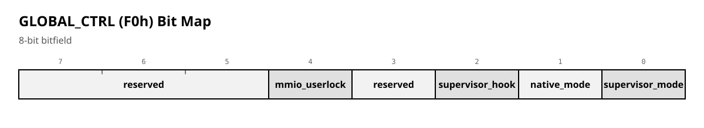

# LX Mode Switching Mechanisms

**Status:** reference. Aligned with the accepted decision to **retain `OUT (F2h)` and reject `RST 6`**. RTL (`gen_rtl`) remains authoritative for behaviour; this document records the rationale.

---

## 0. How to read this document

Four mode-switching mechanisms of LX:

1. **Software switching** — write to `GLOBAL_CTRL`.
2. **Hardware trap** — M1 at `0038h` / `0066h`.
3. **Syscall** — write to `F2h` (Native) / `F2xxh` (Legacy).
4. **Exit from Supervisor** — write 0 to bit 0 of `GLOBAL_CTRL`, then `RET`.

### Markers

| Marker | Meaning |
|---|---|
| **✔ By design** | An intentional decision. |
| **⚠ Rejected:** | An alternative that was considered and rejected; the rationale is recorded here. |

---

## 5.1 Software mode switching

**Port:** `GLOBAL_CTRL` = `F0h` in Native mode.

### 5.1.1 `GLOBAL_CTRL` bit map



**✔ By design:** `reg_ctrl_super_in = din[0]`, `reg_ctrl_native_mode = reg_control[1]`, `reg_ctrl_trap_enabled = reg_control[2]`, `reg_ctrl_interrupt_hold = reg_control[3]`, `reg_ctrl_user_lock = reg_control[4]`.

### 5.1.2 Bit descriptions

**GLOBAL_CTRL (F0h) Bit Map**

| Поле | Биты | Ширина | Описание |
| --- | --- | --- | --- |
| **reserved** | [7:5] | 3 | Must be 0. |
| **mmio_userlock** | [4:4] | 1 | 0 = unlocked, 1 = locked. Blocks all MMU ports (E0–FF) in User mode, preventing unauthorised access. Only Supervisor can change this bit. |
| **reserved** | [3:3] | 1 | Must be 0. |
| **supervisor_hook** | [2:2] | 1 | 0 = disabled, 1 = enabled. Enables hardware entry into Supervisor mode on M1 at 0038h (IM 1) or 0066h (NMI). Allows the kernel to intercept interrupt handling. |
| **native_mode** | [1:1] | 1 | 0 = Legacy (CPC 6128 compatibility), 1 = Native (modern LX address space). Ignored in Supervisor mode (Native mechanism is always used). |
| **supervisor_mode** | [0:0] | 1 | 0 = User, 1 = Supervisor. In Supervisor mode, all system registers are accessible. In User mode, access is restricted. |


> **✔ By design:** `mmio_userlock` blocks **all MMU ports** (`E0–FF`), not only the mode bits. Only `F2` (syscall) is reachable, because syscall is handled in a separate path (`is_syscall_access`, not `is_mmu_access`).

> **✔ By design:** bit 3 (`interrupt_hold`) blocks the INT line to the CPU while set. It is set on `OUT (F2h)` entry and on arming the exit (`OUT (F0h)` with supervisor=0), and released either by the kernel (one write once the stack has been switched) or automatically on the M1 that performs the exit. It lives in the MMU, not in the PIC, because the MMU sees both events. Interrupts stay pending in the PIC and are delivered as soon as the hold is released.

### 5.1.3 Constants

```asm
; GLOBAL_CTRL constants
GCTRL_SUPERVISOR  equ 0b00000001
GCTRL_NATIVE      equ 0b00000010
GCTRL_HOOK        equ 0b00000100
GCTRL_INT_HOLD    equ 0b00001000
GCTRL_USER_LOCK   equ 0b00010000
```

### 5.1.4 Examples

```asm
; ===== Supervisor mode (kernel) =====

; Init: Native + Supervisor + Hook enabled
LD A, GCTRL_SUPERVISOR | GCTRL_NATIVE | GCTRL_HOOK  ; 00000111b
OUT (F0h), A

; Prepare to start a user process:
; 1. Clear Supervisor, keep Native, enable Lock
LD A, GCTRL_NATIVE | GCTRL_USER_LOCK  ; 00010010b
OUT (F0h), A     ; User mode, switching blocked

; For interrupt handling in a user process:
LD A, GCTRL_NATIVE | GCTRL_HOOK | GCTRL_USER_LOCK  ; 00010110b
OUT (F0h), A

; Return to full Supervisor mode (unlock + supervisor)
LD A, GCTRL_SUPERVISOR | GCTRL_NATIVE | GCTRL_HOOK  ; 00000111b
OUT (F0h), A
```

### 5.1.5 Hardware logic for `mmio_userlock` and `interrupt_hold`

**✔ By design:**

```systemverilog
wire port_access_grant = supervisor_mode || !reg_ctrl_user_lock;
wire is_mmu_access = is_io_access && addr_is_mmu_space &&
                     reg_ctrl_native_mode && port_access_grant;

// Interrupt hold (MMU gates the INT line to the CPU)
wire int_hold = reg_ctrl_interrupt_hold;
// int_to_cpu = int_from_pic && !int_hold;   (interrupts stay pending in the PIC)
```

When `mmio_userlock = 1` and the CPU is in User mode, `port_access_grant = 0`, and all MMU ports (`E0–FF`) are blocked. Only `F2` (syscall) is reachable, because syscall is handled in a separate path (`is_syscall_access`, not `is_mmu_access`).

### 5.1.6 Practical scenarios

```asm
; Scenario 1: safe user process
    LD A, GCTRL_NATIVE | GCTRL_USER_LOCK
    OUT (F0h), A     ; start with protection

; User tries to cheat:
    LD A, GCTRL_SUPERVISOR | GCTRL_NATIVE
    OUT (F0h), A     ; ignored! still in User mode

; Scenario 2: trusted syscall
    OUT (F2h), A     ; enters Supervisor; interrupt_hold is set by hardware
                     ; kernel handles the call
                     ; returns with Lock set

; Scenario 3: interrupt handling
; User Lock set, Hook enabled
; Interrupt arrives -> automatic transition to Supervisor
```

**Advantages of `mmio_userlock`:**

1. Protection against accidental changes.
2. Attack prevention.
3. Determinism.
4. Simple implementation.

---

## 5.2 Hardware trap to Supervisor mode

**Trigger condition:**

```
trap_trigger = (supervisor_hook == 1) ∧
               (M1_cycle_active) ∧
               (address_bus == 0038h ∨ address_bus == 0066h)
```

**✔ By design:**

```systemverilog
wire trap_condition = m1_detected & reg_ctrl_trap_enabled &
                      (cpu_a == 16'h0038 || cpu_a == 16'h0066);
```

### 5.2.1 Why `0038h` and `0066h`

1. **`0038h`** — standard Z80 IM 1 interrupt vector.
2. **`0066h`** — NMI vector.
3. Standard Z80 addresses; no extra addresses reserved.
4. Interrupts are already a protected mechanism (EI/DI).

**Note:** the trap works only when `supervisor_hook = 1`.

---

## 5.3 Syscall

### 5.3.1 Purpose

Syscall gives user programs access to kernel functions while preserving security, performance, reliability, and compatibility.

### 5.3.2 Mechanism choice — `OUT (F2h)` retained; `RST 6` rejected

| Option | Pros | Cons | Decision |
|---|---|---|---|
| **`RST 6` (`0030h`)** | Clean unconditional entry; CPU pushes return address; standard Z80 | Entry is cheap but **exit is not**; only the M1-synchronized exit protocol exists; MSX-style immediates after `RST` live in User memory and must be fetched across a mode switch | **Rejected** — see below |
| **CALL to fixed address** | Predictable | Requires reserved address, complex protection | Rejected (conflicts with Legacy memory) |
| **NMI (RST 66h)** | Always works | Catastrophic events, complex nesting | Rejected (breaks NMI semantics) |
| **`OUT` to `F2h`** | Atomic; works under DI; minimal hardware; exit uses the same `GLOBAL_CTRL` + M1 protocol as every other Supervisor exit | Theoretical arbitrary-call risk | **Retained** |

> **⚠ Rejected: `RST 6` for syscall.**
>
> `RST 6` was considered and **rejected**. The reason is not entry — the fetch from `0030h` enters Supervisor cleanly. The reason is **exit**. The only way out of Supervisor is the hardware exit protocol: write `supervisor_mode = 0` to `GLOBAL_CTRL`, then the mode switches on the **next M1 cycle**. An `RST`-based syscall would still have to use that exact exit path. So `RST` buys a cheaper entry but does not remove the exit cost; the round trip is not cheaper than `OUT (F2h)`.
>
> In addition, the MSX `RST 6` convention reads immediate bytes placed after the `RST`; those immediates are in **User** memory. Once the trap has fired we are in Supervisor, so reading them would require either switching back to User or saving/restoring the User map — cost and complexity added to **every** call.
>
> Finally, the role of `RET` is to **read the return address from the stack**. That does not require `RST`; the `OUT` path uses the ordinary `RET` and the same M1-synchronized exit. `RETN`/`RETI` are **not** used.
>
> **Result:** `OUT (F2h)` (Native) / `OUT (F2xxh)` (Legacy) is the retained syscall mechanism. The earlier switch to `RST 6` is reverted.

### 5.3.3 Implementation

**Syscall ports:**

- **Native mode:** `F2h`
- **Legacy mode:** `F2xxh` (decoded by `cpu_a[15:8] == 0xF2`)

**✔ By design:**

```systemverilog
wire is_syscall_trigger_cs =
    (SYSCALL_ADDR == (reg_ctrl_native_mode ? cpu_a[7:0] : cpu_a[15:8]));
wire is_syscall_access = is_io_access && is_syscall_trigger_cs;
wire is_syscall_trigger = is_syscall_access && is_write;
```

`SYSCALL_ADDR = 8'hF2`.

**Why `F2`:**

1. It is in the MMU/control port range (`F0–FF`), already reserved for LX system use.
2. It does not conflict with typical peripherals.
3. It works in both Native and Legacy modes with a single logical port.

### 5.3.4 Calling convention

**Arguments are passed in registers (not through the port):**

```asm
; BEFORE syscall:
LD A, function_code    ; function code (required)
LD BC, argument1       ; 1st argument
LD DE, argument2       ; 2nd argument
LD HL, argument3       ; 3rd argument
CALL syscall_wrapper   ; invoke the wrapper

; AFTER syscall:
; A  = return code (0 = success, otherwise error)
; HL = additional result (if needed)
; Other registers are preserved
```

**Register preservation:**

- **Preserved by the kernel:** BC, DE, HL, IX, IY, AF', BC', DE', HL'
- **May change:** A (return code), HL (additional result on success)
- **FLAGS:** set according to the result

### 5.3.5 Syscall wrapper

```asm
syscall_wrapper:
    ; This wrapper MUST always be used to invoke a syscall
    OUT (F2h), A    ; 1. Pass the function code + enter Supervisor
                    ;    (hardware also sets interrupt_hold)
    RET             ; 2. Execution returns here after handling
```

**Why a wrapper:**

1. **Single entry point** — simplifies debugging and tracing.
2. **Guaranteed `RET`** — ensures correct return.
3. **Extension point** — can add logging, checks.
4. **Mode abstraction** — one implementation for Native/Legacy.

**WRONG (direct call):**

```asm
OUT (F2h), A  ; Danger: the next instruction depends on the implementation
```

**RIGHT (through the wrapper):**

```asm
CALL syscall_wrapper  ; guaranteed behaviour
```

### 5.3.6 Supervisor syscall handler

**Location:** fixed address in Supervisor memory (`0038h`, the IM 1 vector, where the trap lands).

**Handler structure:**

```asm
Syscall_Dispatcher:
    ; Entry conditions:
    ; - Mode: Supervisor
    ; - A: function code (from port F2)
    ; - BC, DE, HL: arguments (from user registers)
    ; - Return PC: saved on the stack (by CALL in the wrapper)

    PUSH BC
    PUSH DE
    PUSH HL
    PUSH IX
    PUSH IY
    EX AF, AF'
    EXX
    PUSH AF
    PUSH BC
    PUSH DE
    PUSH HL

    CP SYS_OPEN
    JP Z, Syscall_OpenFile
    CP SYS_READ
    JP Z, Syscall_ReadFile
    CP SYS_WRITE
    JP Z, Syscall_WriteFile
    ; ... other functions

    LD A, ERR_UNKNOWN_FUNCTION
    JR syscall_return

Syscall_WriteFile:
    ; BC = file_handle
    ; DE = data_size
    ; HL = data_buffer
    LD A, 0  ; success
    ; JR syscall_return

syscall_return:
    POP HL
    POP DE
    POP BC
    POP AF
    EXX
    EX AF, AF'
    POP IY
    POP IX
    POP HL
    POP DE
    POP BC

    ; A contains the return code
    PUSH AF          ; save the return code
    LD A, 00000000b  ; supervisor=0 (prepare exit); hardware sets interrupt_hold
    OUT (F0h), A     ; set the exit flag (EXIT_PENDING) and interrupt_hold
    POP AF           ; restore the return code
    ; No EI needed: the hold is released automatically on the M1 of RET
    RET              ; ordinary RET: its M1 completes the switch to User,
                     ; then RET reads the return address from the User stack
```

> **✔ By design:** the exit is synchronized with the **next M1 cycle** (`supervisor_exit_pending && m1_detected`). `RET` is used, not `RETN`/`RETI`. The hardware releases `interrupt_hold` on that M1, so pending interrupts in the PIC can be delivered after the switch. See §5.4.

---

### Syscall flow across the user and supervisor maps

| Step | Address | USER map (contents) | SUPERVISOR map (contents) | Map executed from |
|:---:|---|---|---|---|
| 1 | `0x8000` | `CALL syscall_wrapper` | — | user |
| 2 | `0x8100` | `syscall_wrapper: OUT (F2h), A` | — | user |
| 3 | `0x8101` | `RET` (unreachable) | `Syscall_Dispatcher: PUSH BC` | supervisor (switched by `OUT`) |
| 4 | `0x8102…` | — | `…` (dispatcher body) | supervisor |
| 5 | `0x8100` | — | `syscall_return: OUT (F0h), A` | supervisor |
| 6 | `0x8101` | — | `POP AF` | supervisor |
| 7 | `0x8102` | — | `RET` (M1 releases interrupt_hold) | supervisor → user |
| 8 | `0x8103` | — | — | user (return address from user stack) |

**The key idea the table shows:**

- The addresses `0x8100`, `0x8101`, etc. exist **in both maps**.
- In the user map, `0x8100` holds the stub (`OUT (F2h),A`), and `0x8101` holds a `RET` that is never executed.
- In the supervisor map, `0x8101` (the next address after `OUT`) already holds the dispatcher.
- The switch back is done by `OUT (F0h),A` with a deferred effect, and the actual map switch happens on `RET`; the same M1 releases `interrupt_hold`.

*Addresses are illustrative.*

### 5.3.7 Security

**Myth:** "OUT to a port can be called from anywhere — that is a vulnerability."

**Reality:** it is a **feature**, not a bug:

1. User code already executes arbitrarily.
2. All dangerous operations are protected (MMU ports, interrupt control).
3. The syscall handler validates parameters.
4. Alternatives are worse (`RST`/`CALL` require reserved memory and add exit-protocol cost — see §5.3.2).
5. Analogues in modern systems: x86 SYSCALL/INT, ARM SVC.

**Additional protections:**

- Validate all syscall parameters.
- Check resource access rights.
- Restrict syscalls in critical sections.
- Audit syscall usage.

---

## 5.4 Exit from Supervisor mode

### 5.4.1 Multi-step exit process

**Problem:** cannot switch instantly out of Supervisor because:

1. The current instruction must complete.
2. The switch must be atomic.
3. Interrupts must remain possible.

**Solution:** a multi-step exit synchronized to the M1 cycle.

**Sequence:**

```asm
; 1. INITIATE EXIT (in kernel code)
LD A, 00000000b  ; supervisor=0 (other bits as needed); hardware sets interrupt_hold
OUT (F0h), A     ; set EXIT_PENDING and interrupt_hold
; Hardware: EXIT_SUPERVISOR_PENDING = 1, INT_HOLD = 1

; 2. NEXT INSTRUCTION
RET              ; executes in Supervisor mode; its M1 is the switch point
; Important: this MUST be an instruction whose M1 the hardware can use
; to complete the exit. RET is the ordinary choice.

; 3. SYNCHRONIZATION (hardware)
; Wait for the next M1 cycle

; 4. SWITCH (hardware, on M1)
; supervisor_mode = 0
; Banks switch to user
; interrupt_hold = 0
; PC points to the return address in User mode

; 5. EXECUTION IN USER MODE
; RET reads the return address from the stack in the User map
```

**✔ By design:**

```systemverilog
// Exit request
if (cpu_write_stb &&
    cpu_address_reg == CONTROL_REG_ADDR[4:0] &&
    !cpu_write_data_reg[0]) begin
    supervisor_exit_pending <= 1'b1;
    reg_ctrl_interrupt_hold  <= 1'b1;   // set hold while exiting
end

// Synchronization with M1
if (supervisor_exit_pending && m1_detected) begin
    supervisor_mode_reg     <= 1'b0;
    supervisor_exit_pending <= 1'b0;
    reg_ctrl_interrupt_hold <= 1'b0;    // release hold on the switch M1
end
```

> **⚠ Rejected: `RETN` for exit.** `RETN`/`RETI` are **not** used. The exit is synchronized with the next M1 cycle, and `RET` is the ordinary instruction that provides that M1 and then reads the return address from the stack. `RETN`'s `IFF2→IFF1` copy is unnecessary and was one of the reasons `RST`-based syscalls were rejected (§5.3.2).

### 5.4.2 Why this sequence

1. **`RET` in Supervisor** — the return stack is restored correctly.
2. **M1 synchronization** — natural switch point in the Z80 instruction cycle.
3. **Atomicity** — an interrupt cannot slip between setting the flag and switching.
4. **Predictability** — always the same behaviour.

### 5.4.3 Interrupts during exit

**Scenario:** `EXIT_PENDING` set, but an interrupt arrives before M1.

**Behaviour:**

1. The interrupt is handled normally (in Supervisor mode).
2. After handling, the exit continues.
3. **No race condition.**

While `interrupt_hold` is set (between `OUT (F0h)` and the M1 of `RET`), INT is gated at the MMU. The interrupt stays pending in the PIC and is delivered after the hold is released.

---

## 5.5 Practical examples

### 5.5.1 Full syscall cycle

**User program:**

```asm
    ; Open file
    LD A, SYS_OPEN
    LD BC, filename_ptr
    LD DE, access_mode
    LD HL, 0
    CALL syscall_wrapper
    OR A
    JR NZ, error
    LD (file_handle), BC

    ; Read file
    LD A, SYS_READ
    LD BC, (file_handle)
    LD DE, buffer_size
    LD HL, buffer_ptr
    CALL syscall_wrapper
    OR A
    JR NZ, error

    ; Close file
    LD A, SYS_CLOSE
    LD BC, (file_handle)
    CALL syscall_wrapper
```

**Syscall wrapper:**

```asm
syscall_wrapper:
    OUT (F2h), A    ; Native mode
    RET

syscall_wrapper_legacy:
    OUT (F200h), A  ; Legacy mode
    RET
```

### 5.5.2 Kernel interrupt handler

```asm
Interrupt_Handler_38h:
    ; Automatically in Supervisor mode
    PUSH AF
    PUSH BC
    PUSH DE
    PUSH HL

    IN A, (INTERRUPT_STATUS)

    ; Handle...

    POP HL
    POP DE
    POP BC
    POP AF
    EI
    RETI
```

---

## 5.6 Recommendations

### 5.6.1 For kernel developers

1. Always use the standard calling convention.
2. Validate syscall parameters carefully.
3. Save and restore all registers.
4. Use ordinary `RET` for syscall return (not `RETN`/`RETI`).
5. Do not issue `EI` in the syscall exit path: `interrupt_hold` is released by hardware on the `RET` M1.

### 5.6.2 For application developers

1. Always use the provided `syscall_wrapper`.
2. Check return codes.
3. Do not assume register preservation (except as documented).
4. Be aware of the mode (Native/Legacy).

### 5.6.3 For driver developers

1. Trap handlers must be minimal.
2. Use syscall for complex operations.
3. Be aware of interrupt nesting.

---

## 5.7 FAQ

**Q: Why not use `RST 6` for syscall?**
**A:** `RST` gives a clean entry but does not solve the exit. The only exit is the `GLOBAL_CTRL` + next-M1 protocol, which `RST`-based syscalls would still have to use. MSX-style immediates after the `RST` also live in User memory and must be fetched across a mode switch. `RST 6` was considered, adopted briefly, and then **reverted** in favour of `OUT (F2h)`.

**Q: Why is `RETN` not used?**
**A:** The exit is synchronized with the next M1 cycle, and ordinary `RET` provides that M1 and then reads the return address from the stack in the User map. `RETN`'s `IFF2→IFF1` copy is unnecessary. `RETN` was rejected together with `RST`.

**Q: What if the user calls `OUT (F2h)` not through the wrapper?**
**A:** That violates the contract. The kernel can detect it (by checking PC) and return an error.

**Q: How is syscall reentrancy handled?**
**A:** The kernel must handle reentrant calls correctly. Use indivisible operations.

**Q: Can syscall be called from an interrupt?**
**A:** Yes, but carefully. The kernel must handle nested calls.

**Q: What happens if a syscall occurs during exit from Supervisor?**
**A:** The syscall has priority, is handled, then the exit continues.

**Q: Why is `interrupt_hold` in the MMU and not in the PIC?**
**A:** The MMU sees both events that need to set and clear it — the `OUT (F2h)` entry and the `RET` exit. Putting it in the PIC would require the PIC to decode port writes and track the exit M1, duplicating MMU logic. Interrupts stay pending in the PIC and are delivered when the hold is released.

---

*End of document.*
