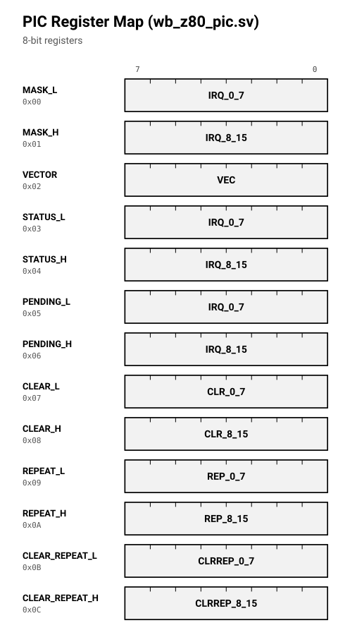

# LX PIC Controller

## 0. How to read this document

This document describes the **PIC** (interrupt controller): its
registers, bits, priority and INT generation. It does **not** contain
the address; the address is in `lx_rtl_reference.md` §2.

### Markers

| Marker | Meaning |
|---|---|
| **✔ By design** | An intentional RTL decision. |
| **⚠ Spec:** | The old specification differs from the RTL. RTL is authoritative. |
| **⚠ Outdated:** | The old document may be stale. |

---

## 1. Purpose

The PIC collects interrupt requests from **16 IRQ lines**, latches them,
applies a mask, and asserts `INT` to the Z80 when at least one enabled
line is pending.

**✔ By design (RTL):** `wb_z80_pic.sv` implements 16 IRQ lines,
edge-sensitive, with a priority encoder (bit 15 highest, bit 0 lowest).

> **⚠ Spec:** Old `lx_pic_controller.md` described a **hierarchical**
> controller (Master PIC + peripheral controllers, "who interrupted" vs
> "what happened"). The RTL is **flat**: 16 lines, one priority encoder.
> **RTL is authoritative.** The hierarchical description is an idea,
> not a current fact.

---

## 2. Registers

The PIC has **8 registers**, 8 bits each, at offsets `0x0`–`0x8` from
the base address.

**Table 1 — PIC Register Map (wb_z80_pic.sv)**

| Offset | Name | Description |
| --- | --- | --- |
| `0x00` | **MASK_L** | — |
| `0x01` | **MASK_H** | — |
| `0x02` | **VECTOR** | — |
| `0x03` | **STATUS_L** | — |
| `0x04` | **STATUS_H** | — |
| `0x05` | **PENDING_L** | — |
| `0x06` | **PENDING_H** | — |
| `0x07` | **CLEAR_L** | — |
| `0x08` | **CLEAR_H** | — |
| `0x09` | **REPEAT_L** | — |
| `0x0A` | **REPEAT_H** | — |
| `0x0B` | **CLEAR_REPEAT_L** | — |
| `0x0C` | **CLEAR_REPEAT_H** | — |

**MASK_L** (`0x00`)

| Field | Bits | Width | Description |
| --- | --- | --- | --- |
| **IRQ_0_7** | [7:0] | 8 | Mask, lines 0–7 (1 = enabled) |

**MASK_H** (`0x01`)

| Field | Bits | Width | Description |
| --- | --- | --- | --- |
| **IRQ_8_15** | [7:0] | 8 | Mask, lines 8–15 (1 = enabled) |

**VECTOR** (`0x02`)

| Field | Bits | Width | Description |
| --- | --- | --- | --- |
| **VEC** | [7:0] | 8 | Base vector for IM 2 (reset = 0xFF, RST 38h) |

**STATUS_L** (`0x03`)

| Field | Bits | Width | Description |
| --- | --- | --- | --- |
| **IRQ_0_7** | [7:0] | 8 | Status, lines 0–7 (pending & mask) |

**STATUS_H** (`0x04`)

| Field | Bits | Width | Description |
| --- | --- | --- | --- |
| **IRQ_8_15** | [7:0] | 8 | Status, lines 8–15 (pending & mask) |

**PENDING_L** (`0x05`)

| Field | Bits | Width | Description |
| --- | --- | --- | --- |
| **IRQ_0_7** | [7:0] | 8 | Pending, lines 0–7 (unmasked) |

**PENDING_H** (`0x06`)

| Field | Bits | Width | Description |
| --- | --- | --- | --- |
| **IRQ_8_15** | [7:0] | 8 | Pending, lines 8–15 (unmasked) |

**CLEAR_L** (`0x07`)

| Field | Bits | Width | Description |
| --- | --- | --- | --- |
| **CLR_0_7** | [7:0] | 8 | Clear pending, lines 0–7 (write 1 = clear; set-dominant vs. new edge) |

**CLEAR_H** (`0x08`)

| Field | Bits | Width | Description |
| --- | --- | --- | --- |
| **CLR_8_15** | [7:0] | 8 | Clear pending, lines 8–15 (write 1 = clear; set-dominant vs. new edge) |

**REPEAT_L** (`0x09`)

| Field | Bits | Width | Description |
| --- | --- | --- | --- |
| **REP_0_7** | [7:0] | 8 | Overrun flag, lines 0–7: a second request arrived while Pending=1 |

**REPEAT_H** (`0x0A`)

| Field | Bits | Width | Description |
| --- | --- | --- | --- |
| **REP_8_15** | [7:0] | 8 | Overrun flag, lines 8–15: a second request arrived while Pending=1 |

**CLEAR_REPEAT_L** (`0x0B`)

| Field | Bits | Width | Description |
| --- | --- | --- | --- |
| **CLRREP_0_7** | [7:0] | 8 | Clear Repeat, lines 0–7 (write 1 = clear; set-dominant vs. new overrun) |

**CLEAR_REPEAT_H** (`0x0C`)

| Field | Bits | Width | Description |
| --- | --- | --- | --- |
| **CLRREP_8_15** | [7:0] | 8 | Clear Repeat, lines 8–15 (write 1 = clear; set-dominant vs. new overrun) |

**✔ By design (RTL):** the register layout matches `wb_z80_pic.sv`.

> **⚠ Spec:** Old `lx_pic_controller.md` described 16-bit registers and
> a different address. The RTL uses **8-bit registers** (low/high
> pairs). **RTL is authoritative.**

---

## 3. IRQ handling

### 3.1 Edge-sensitive latching

Each IRQ line is **edge-sensitive**: a rising edge (`irq_i & ~irq_i_prev`)
sets the corresponding bit in `PENDING`.

**✔ By design (RTL):** `irq_edge = irq_i & ~irq_i_prev`.

### 3.2 Priority

When multiple lines are pending and enabled, the **highest-numbered line
wins**: bit 15 has the highest priority, bit 0 the lowest.

**✔ By design (RTL):** priority encoder is a `casez` on `active_irqs`,
with bit 15 first.

### 3.3 INT generation

`INT` is asserted while any enabled line is pending, and is deasserted
when the CPU acknowledges (`int_ack_i`).

**✔ By design (RTL):** `int_req_o <= 1` when `any_irq`, `int_req_o <= 0`
when `int_ack_i`.

### 3.4. Repeat / overrun flag (NEW)

Each IRQ line carries a second state bit, `REPEAT`. It records that a
second (or further) request arrived on the same line while `PENDING` was
already asserted and had not yet been serviced. `REPEAT` is a boolean
overrun flag, not an event counter.

**✔ By design (RTL):** per line:

- new request, `PENDING = 0` → `PENDING = 1`
- new request, `PENDING = 1` → `REPEAT = 1`
- acknowledge, `REPEAT = 1` → `PENDING` stays `1`, `REPEAT = 0`
- acknowledge, `REPEAT = 0` → `PENDING = 0`
- simultaneous acknowledge and new request → **set-dominant**
  (the new request is never lost)

`REPEAT` is exposed at `REPEAT_L`/`REPEAT_H` (`0x9`/`0xA`) and cleared by
writing 1 to `CLEAR_REPEAT_L`/`CLEAR_REPEAT_H` (`0xB`/`0xC`). Masking a
line blocks delivery to the CPU but does **not** clear `PENDING` or
`REPEAT`.

This implements the PIC side of the `Pending`/`Repeat` contract from
`Alesta LX Hardware System Timer` Rev 5 §11.

### 3.5. Acknowledge vs. software clear (NEW)

Two ways to retire a request are supported:

- **`int_ack_i`** — CPU acknowledge; applies the `Pending`/`Repeat`
  contract above (used in IM 2 / vectored flows).
- **`CLEAR_L`/`CLEAR_H`** — software writes 1 to the bit; clears
  `PENDING` directly (used in the IM 1 "read status, then clear" flow).

Both are set-dominant against a request arriving in the same cycle, so no
request is ever lost. If the platform does not drive `int_ack_i`, tie it
to `0` and use `CLEAR_*` exclusively; `INT` then drops when software
clears `PENDING`.

## 4. Interrupt vector (IM 2)

The `VECTOR` register holds the base vector for IM 2 mode. Reset value is
`0xFF` (RST 38h).

**✔ By design (RTL):** `irq_vector` is a single 8-bit register,
default `0xFF` (RST 38h).

> **⚠ Spec:** an earlier RTL revision generated `int_vec_o = VECTOR +
> 2 * top_priority_line` in hardware. The current `LX PIC Controller`
> contract is that **the PIC does not generate the vector
> automatically**: the CPU reads `PENDING`/`REPEAT` (and `VECTOR`) and
> the kernel dispatches. If a platform still needs the hardware
> auto-vector, it must be re-added as an explicit, documented extension
> (`int_vec_o`), not assumed.

---

## 5. Relation to other documents

- **Address:** `lx_rtl_reference.md` §2.
- **MMU / privileges:** `lx_mmu.md`.
- **Trap to Supervisor:** `lx_mmu.md` §5.2 (the PIC is one of the
  sources; the trap mechanism itself is in the MMU).

---

## 6. Status

- **Reference.** Registers, bits and priority are as in the RTL
  (`wb_z80_pic.sv`).
- **Address** is in `lx_rtl_reference.md`.
- **⚠ Spec:** the old hierarchical description and the 16-bit registers
  do not match the RTL. RTL is authoritative.

---

*End of document.*