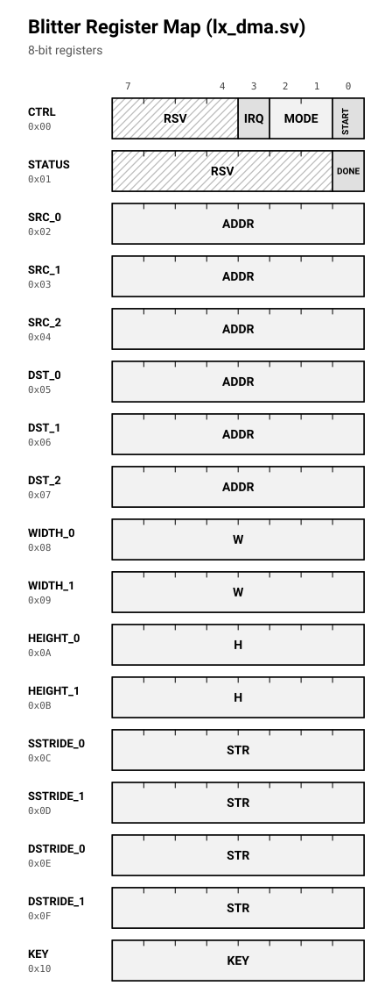

# Blitter (`lx_dma.sv`)

## 1.1 Purpose

The blitter copies and fills **2D rectangles** (width, height, source
and destination strides), byte by byte, through the second bus master.
It supports **copy**, **fill** and **copy with transparent colour**.

**✔ By design (RTL):** the blitter yields the bus for one cycle after
each byte (`gap`), so the sound chip (which shares the second master)
does not run out of samples during a long copy.

## 1.2 Registers

The blitter has **17 registers**, 8 bits each, at offsets `0x00`–`0x10`
from the base address.

*Figure 1 — Blitter Register Map (lx_dma.sv)*

**Table 1 — Blitter Register Map (lx_dma.sv)**

| Offset | Name | Description |
| --- | --- | --- |
| `0x00` | **CTRL** | — |
| `0x01` | **STATUS** | — |
| `0x02` | **SRC_0** | — |
| `0x03` | **SRC_1** | — |
| `0x04` | **SRC_2** | — |
| `0x05` | **DST_0** | — |
| `0x06` | **DST_1** | — |
| `0x07` | **DST_2** | — |
| `0x08` | **WIDTH_0** | — |
| `0x09` | **WIDTH_1** | — |
| `0x0A` | **HEIGHT_0** | — |
| `0x0B` | **HEIGHT_1** | — |
| `0x0C` | **SSTRIDE_0** | — |
| `0x0D` | **SSTRIDE_1** | — |
| `0x0E` | **DSTRIDE_0** | — |
| `0x0F` | **DSTRIDE_1** | — |
| `0x10` | **KEY** | — |

**CTRL** (`0x00`)

| Field | Bits | Width | Description |
| --- | --- | --- | --- |
| **RSV** | [7:4] | 4 | Reserved |
| **IRQ** | [3] | 1 | IRQ on done |
| **MODE** | [2:1] | 2 | 0=copy, 1=fill, 2=copy+transp |
| **START** | [0] | 1 | Start transfer |

**STATUS** (`0x01`)

| Field | Bits | Width | Description |
| --- | --- | --- | --- |
| **RSV** | [7:1] | 7 | Reserved |
| **DONE** | [0] | 1 | Done pending (W 1 = clear) |

**SRC_0** (`0x02`)

| Field | Bits | Width | Description |
| --- | --- | --- | --- |
| **ADDR** | [7:0] | 8 | Physical source [7:0] |

**SRC_1** (`0x03`)

| Field | Bits | Width | Description |
| --- | --- | --- | --- |
| **ADDR** | [7:0] | 8 | Physical source [15:8] |

**SRC_2** (`0x04`)

| Field | Bits | Width | Description |
| --- | --- | --- | --- |
| **ADDR** | [7:0] | 8 | Physical source [23:16] |

**DST_0** (`0x05`)

| Field | Bits | Width | Description |
| --- | --- | --- | --- |
| **ADDR** | [7:0] | 8 | Physical dest [7:0] |

**DST_1** (`0x06`)

| Field | Bits | Width | Description |
| --- | --- | --- | --- |
| **ADDR** | [7:0] | 8 | Physical dest [15:8] |

**DST_2** (`0x07`)

| Field | Bits | Width | Description |
| --- | --- | --- | --- |
| **ADDR** | [7:0] | 8 | Physical dest [23:16] |

**WIDTH_0** (`0x08`)

| Field | Bits | Width | Description |
| --- | --- | --- | --- |
| **W** | [7:0] | 8 | Bytes per line [7:0] |

**WIDTH_1** (`0x09`)

| Field | Bits | Width | Description |
| --- | --- | --- | --- |
| **W** | [7:0] | 8 | Bytes per line [15:8] |

**HEIGHT_0** (`0x0A`)

| Field | Bits | Width | Description |
| --- | --- | --- | --- |
| **H** | [7:0] | 8 | Lines [7:0] |

**HEIGHT_1** (`0x0B`)

| Field | Bits | Width | Description |
| --- | --- | --- | --- |
| **H** | [7:0] | 8 | Lines [15:8] |

**SSTRIDE_0** (`0x0C`)

| Field | Bits | Width | Description |
| --- | --- | --- | --- |
| **STR** | [7:0] | 8 | Source stride (signed) [7:0] |

**SSTRIDE_1** (`0x0D`)

| Field | Bits | Width | Description |
| --- | --- | --- | --- |
| **STR** | [7:0] | 8 | Source stride (signed) [15:8] |

**DSTRIDE_0** (`0x0E`)

| Field | Bits | Width | Description |
| --- | --- | --- | --- |
| **STR** | [7:0] | 8 | Dest stride (signed) [7:0] |

**DSTRIDE_1** (`0x0F`)

| Field | Bits | Width | Description |
| --- | --- | --- | --- |
| **STR** | [7:0] | 8 | Dest stride (signed) [15:8] |

**KEY** (`0x10`)

| Field | Bits | Width | Description |
| --- | --- | --- | --- |
| **KEY** | [7:0] | 8 | Fill byte / transparent color |

**✔ By design (RTL):** the register layout matches `lx_dma.sv`.

## 1.3 Modes

**Table 2 — Blitter Modes (CTRL[2:1])**

| Value | Name | Description |
| --- | --- | --- |
| 0 | **Copy** | Read from SRC, write to DST |
| 1 | **Fill** | Write KEY to DST |
| 2 | **Copy with transparent** | Read from SRC; if byte == KEY, skip the write |

## 1.4 Interrupt

`irq_o = done` — the blitter asserts an interrupt when a transfer
completes and `CTRL[3]` (IRQ on done) was set.

**✔ By design (RTL):** `irq_o = done`.

## 1.5 Bus behaviour

The blitter asserts `dma_cyc_o` and `dma_we_o` for each byte, then
deasserts for one cycle (`gap`) so that the sound chip can use the bus.

**✔ By design (RTL):** `dma_cyc_o = ((st == T_RD) || (st == T_WR)) && !gap`.

## 1.6 Physical addresses

The blitter uses **physical** 24-bit addresses. In LX mode, the memory
the CPU sees at `C00000–C0FFFF` is at `410000–41FFFF`.

**✔ By design (RTL):** comment in `lx_dma.sv`.

*End of document.*
