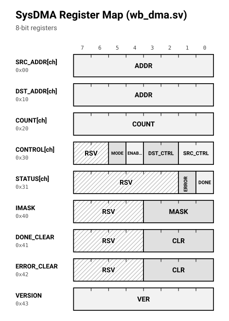

## 2. SysDMA (`wb_dma.sv`)

### 2.1 Purpose

SysDMA is a **4-channel** DMA controller with **DRQ/DACK** handshake,
**16-bit** data path, and **demand** / **block** modes. It is on the
**memory / video side** of the 16→8 bridge.

> **⚠ Spec:** Old `lx_dma.md` described SysDMA with 4 channels,
> 16-bit data, DRQ/DACK. That description matches `wb_dma.sv`, but the
> **address** and the **width** in the old document were not consistent
> with the RTL. **RTL is authoritative.**

### 2.2 Registers

SysDMA has per-channel registers and common registers. The layout is in
`wb_dma.sv`; the exact byte offsets are `TBD: verify against RTL`.

*Figure 1 — SysDMA Register Map (wb_dma.sv)*

**Table 1 — SysDMA Register Map (wb_dma.sv)**

| Offset | Name | Description |
| --- | --- | --- |
| `0x00` | **SRC_ADDR[ch]** | — |
| `0x10` | **DST_ADDR[ch]** | — |
| `0x20` | **COUNT[ch]** | — |
| `0x30` | **CONTROL[ch]** | — |
| `0x31` | **STATUS[ch]** | — |
| `0x40` | **IMASK** | — |
| `0x41` | **DONE_CLEAR** | — |
| `0x42` | **ERROR_CLEAR** | — |
| `0x43` | **VERSION** | — |

**SRC_ADDR[ch]** (`0x00`)

| Field | Bits | Width | Description |
| --- | --- | --- | --- |
| **ADDR** | [7:0] | 8 | Source address (24 bits) |

**DST_ADDR[ch]** (`0x10`)

| Field | Bits | Width | Description |
| --- | --- | --- | --- |
| **ADDR** | [7:0] | 8 | Destination address (24 bits) |

**COUNT[ch]** (`0x20`)

| Field | Bits | Width | Description |
| --- | --- | --- | --- |
| **COUNT** | [7:0] | 8 | Transfer count (24 bits) |

**CONTROL[ch]** (`0x30`)

| Field | Bits | Width | Description |
| --- | --- | --- | --- |
| **RSV** | [7:6] | 2 | Reserved |
| **MODE** | [5] | 1 | 0=Demand, 1=Block |
| **ENABLE** | [4] | 1 | Enable channel |
| **DST_CTRL** | [3:2] | 2 | Dest control |
| **SRC_CTRL** | [1:0] | 2 | Source control |

**STATUS[ch]** (`0x31`)

| Field | Bits | Width | Description |
| --- | --- | --- | --- |
| **RSV** | [7:2] | 6 | Reserved |
| **ERROR** | [1] | 1 | Transfer error |
| **DONE** | [0] | 1 | Transfer done |

**IMASK** (`0x40`)

| Field | Bits | Width | Description |
| --- | --- | --- | --- |
| **RSV** | [7:4] | 4 | Reserved |
| **MASK** | [3:0] | 4 | Interrupt mask per channel |

**DONE_CLEAR** (`0x41`)

| Field | Bits | Width | Description |
| --- | --- | --- | --- |
| **RSV** | [7:4] | 4 | Reserved |
| **CLR** | [3:0] | 4 | Clear DONE flags |

**ERROR_CLEAR** (`0x42`)

| Field | Bits | Width | Description |
| --- | --- | --- | --- |
| **RSV** | [7:4] | 4 | Reserved |
| **CLR** | [3:0] | 4 | Clear ERROR flags |

**VERSION** (`0x43`)

| Field | Bits | Width | Description |
| --- | --- | --- | --- |
| **VER** | [7:0] | 8 | Version / features |

**✔ By design (RTL):** `wb_dma.sv` implements these registers.

### 2.3 Modes

**Table 2 — SysDMA Transfer Modes**

| Value | Name | Description |
| --- | --- | --- |
| 0 | **Demand** | Transfer driven by DRQ/DACK handshake |
| 1 | **Block** | Transfer entire block without handshake |

### 2.4 Arbitration

Fixed priority: channel 0 > channel 1 > channel 2 > channel 3.

**✔ By design (RTL):** `for (i = 0; i < CHANNELS; i++)` in `wb_dma.sv`.

### 2.5 Bus width

SysDMA uses a **16-bit** data path. It is on the memory / video side of
the bridge.

**✔ By design (RTL):** `DATA_WIDTH = 16` in `wb_dma.sv`.

---

## 3. Which DMA is used where

| Device | Location | Width | Use |
|---|---|---|---|
| Blitter (`lx_dma.sv`) | CPU side (after bridge) | 8-bit | Rectangle copy/fill, transparent copy |
| SysDMA (`wb_dma.sv`) | Memory/video side (before bridge) | 16-bit | Block transfers, DRQ/DACK peripherals |

**✔ By design:** the two DMAs are on **different sides** of the 16→8
bridge. They are not alternatives; they serve different parts of the
system.

> **⚠ Spec:** Old `lx_dma.md` treated them as one device. They are
> **two**. **RTL is authoritative.**

---

## 4. Relation to other documents

- **Addresses:** `lx_rtl_reference.md` §2.
- **Bus widths:** `lx_rtl_reference.md` §6.
- **MMU / privileges:** `lx_mmu.md`.
- **Legacy:** `lx_io.md` §3.

---

## 5. Status

- **Reference.** Registers, bits and modes are as in the RTL
  (`lx_dma.sv`, `wb_dma.sv`).
- **Addresses** are in `lx_rtl_reference.md`.
- **⚠ Spec:** the old `lx_dma.md` treated the two DMAs as one and did
  not match the RTL. RTL is authoritative.

---

*End of document.*