# Alex — Aleste LX Expansion Bus

## Preliminary Hardware Architecture Specification

## 1. Design Philosophy

Alex (Aleste LX eXpansion) is a modular expansion interface for the Aleste LX computer. It is a computer expansion bus, not a synthesizer or modular-synthesizer interface.

The goal is a compact, inexpensive and versatile slot that avoids the drawbacks of retro slots with 50–60 contacts: large board area, fragility and 5 V only.

The architecture follows five principles:

1. Digital communication and control are handled by the host FPGA. The Z80 treats the slots as peripheral devices through I/O ports; nothing is mapped into memory, because reads from such a window would block the CPU.
2. Audio is transferred digitally between the host and the modules.
3. Analog generation and processing are performed locally on the modules.
4. Analog power (±12 V) is supplied by the host. Analog signals and control voltages stay inside each module, and modules carry no DC/DC converters.
5. Every interface is a hardware block, not a software-emulated one.

The design avoids unnecessary hardware, complex connectors and expensive centralized analog circuitry.

## 2. System Architecture

Alex consists of three subsystems.

### 2.1 Digital Control Plane

Communication and control between the host FPGA and the modules:

- SPI: one independent controller per slot, fed by SysDMA (see section 5).
- I²C: one hardware byte-level controller behind a four-slot multiplexer (see section 6).
- Interrupt `INT_N` and the data-ready request `GPIO0_DREQ_N`.
- A per-slot module reset `PERIPH_RST_N`. There is no global `RESET_N`: the host resets all four slots itself.
- Module presence detection `DETECT_N`.
- One more general-purpose signal, `GPIO1`.

The registers are reached through I/O ports ([`alex_io`](gen/alex_io.md)).

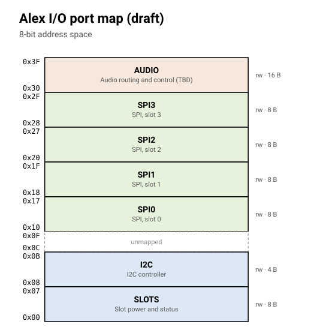

**Table 1 — Alex I/O port map (draft)**

| Range | Name | Size | Access | Purpose |
| --- | --- | --- | --- | --- |
| `0x00`–`0x07` | **SLOTS** | 8 B | rw | Slot power and status |
| `0x08`–`0x0B` | **I2C** | 4 B | rw | I2C controller |
| `0x10`–`0x17` | **SPI0** | 8 B | rw | SPI, slot 0 |
| `0x18`–`0x1F` | **SPI1** | 8 B | rw | SPI, slot 1 |
| `0x20`–`0x27` | **SPI2** | 8 B | rw | SPI, slot 2 |
| `0x28`–`0x2F` | **SPI3** | 8 B | rw | SPI, slot 3 |
| `0x30`–`0x3F` | **AUDIO** | 16 B | rw | Audio routing and control (TBD) |

### 2.2 Digital Audio Plane

Synchronous multichannel audio between the host FPGA and the modules (see section 7). The host FPGA handles stream distribution and collection, channel routing, digital mixing and DMA between the audio interfaces and system memory.

### 2.3 Local Analog Subsystem

A module may contain its own analog circuitry: filters, oscillators, effects, instrumentation, ADCs and DACs. A module generates its own control voltages, for example with a multichannel DAC controlled over SPI. The host does not generate control voltages.

## 3. Physical Interface

Each slot is a PCIe x1 edge connector with 36 contacts. All 4 slots are electrically identical. A module is a 1.6 mm board with gold fingers and a chamfer, installed vertically. The fallback is a 1.27 mm pin/socket header, 2×18, which carries the same pinout but has no physical key, so it needs orientation marking and protection against reversed insertion.

The PCIe key between positions 11 and 12 divides the slot into two zones:

- **Zone 1 (positions 1–11, 22 contacts):** power, management and control signals and the reserve. The analog block (positions 1–3) sits at one end, followed by digital power, I²C and control, with the SPI handshake lines next to the key.
- **Zone 2 (positions 12–18, 14 contacts):** the fast digital path only (SPI_SCK, SPI_MOSI, SPI_MISO and audio), with signals alternating with DGND.

The placement was designed by function, independently of PCIe. The placement rules are listed in **Table 2 — Connector zones and placement rules**

| Pos. | Zone | Contents |
| --- | --- | --- |
| 1-3 | **Analog block** | +12 V (B2) opposite -12 V (A2), AGND on both sides (B1, B3, A1, A3) |
| 4-6 | **Digital power** | +3.3 V (B5, A4, A5), DGND (B4, A6), reserve (B6) |
| 7-9 | **Management** | I2C (B7, A7), DETECT_N (B8), PERIPH_RST_N (A8), INT_N (B9), GPIO1 (A9) |
| 10-11 | **SPI handshake** | DREQ_N (B10), CS_N (B11), reserve (A10, A11), next to the key |
| 12-18 | **Fast path** | SCK, MOSI, MISO, BCLK, FS, MCLK, DOUT, DIN with six DGND; every clock line sits between DGND contacts |

**Notes:**

- The analog block and the fast path are at opposite ends of the connector, with the key between them.
- Each clock line (BCLK, FS, MCLK) is opposite a DGND contact on the other face of the module.
- SPI_SCK opposite SPI_MOSI is the only exception; without MCLK zone 2 becomes a perfect signal/ground checkerboard.
- The +/-12 V rails are a symmetric pair, one contact each, enough for the planning current.
.

**Table 3 — Connector zones and placement rules**

| Pos. | Zone | Contents |
| --- | --- | --- |
| 1-3 | **Analog block** | +12 V (B2) opposite -12 V (A2), AGND on both sides (B1, B3, A1, A3) |
| 4-6 | **Digital power** | +3.3 V (B5, A4, A5), DGND (B4, A6), reserve (B6) |
| 7-9 | **Management** | I2C (B7, A7), DETECT_N (B8), PERIPH_RST_N (A8), INT_N (B9), GPIO1 (A9) |
| 10-11 | **SPI handshake** | DREQ_N (B10), CS_N (B11), reserve (A10, A11), next to the key |
| 12-18 | **Fast path** | SCK, MOSI, MISO, BCLK, FS, MCLK, DOUT, DIN with six DGND; every clock line sits between DGND contacts |

**Notes:**

- The analog block and the fast path are at opposite ends of the connector, with the key between them.
- Each clock line (BCLK, FS, MCLK) is opposite a DGND contact on the other face of the module.
- SPI_SCK opposite SPI_MOSI is the only exception; without MCLK zone 2 becomes a perfect signal/ground checkerboard.
- The +/-12 V rails are a symmetric pair, one contact each, enough for the planning current.

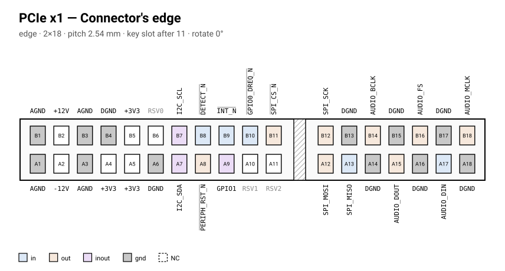

**Table 4 — PCIe x1 — Connector's edge**

*edge, 2 row(s) × 18, pitch 2.54 mm, numbering rowwise, pin 1 at top-left, key slot after position 11, drawn rotated 0°*

| Pin | Signal | Dir | Group | Description |
| --- | --- | --- | --- | --- |
| B1 | **AGND** | gnd | ground_analog | — |
| B2 | **+12V** | pwr | power_analog | Analog supply +12 V |
| B3 | **AGND** | gnd | ground_analog | — |
| B4 | **DGND** | gnd | ground_digital | — |
| B5 | **+3V3** | pwr | power_digital | Digital supply +3.3 V |
| B6 | **RSV0** | NC | reserve | Reserved |
| B7 | **I2C_SCL** | inout | i2c | — |
| B8 | **DETECT_N** | in | control | Module present (tied to DGND on the module) |
| B9 | **INT_N** | in | control | Module interrupt request |
| B10 | **GPIO0_DREQ_N** | in | gpio | Module ready for data exchange |
| B11 | **SPI_CS_N** | out | spi | Module chip select |
| B12 | **SPI_SCK** | out | spi | — |
| B13 | **DGND** | gnd | ground_digital | — |
| B14 | **AUDIO_BCLK** | out | audio | 24.576 MHz bit clock |
| B15 | **DGND** | gnd | ground_digital | — |
| B16 | **AUDIO_FS** | out | audio | Frame sync, 48 kHz |
| B17 | **DGND** | gnd | ground_digital | — |
| B18 | **AUDIO_MCLK** | out | audio | 12.288 MHz master clock |
| A1 | **AGND** | gnd | ground_analog | — |
| A2 | **-12V** | pwr | power_analog | Analog supply -12 V |
| A3 | **AGND** | gnd | ground_analog | — |
| A4 | **+3V3** | pwr | power_digital | — |
| A5 | **+3V3** | pwr | power_digital | — |
| A6 | **DGND** | gnd | ground_digital | — |
| A7 | **I2C_SDA** | inout | i2c | — |
| A8 | **PERIPH_RST_N** | out | control | Module reset, one per slot |
| A9 | **GPIO1** | inout | gpio | Module specific |
| A10 | **RSV1** | NC | reserve | Reserved |
| A11 | **RSV2** | NC | reserve | Reserved |
| A12 | **SPI_MOSI** | out | spi | — |
| A13 | **SPI_MISO** | in | spi | — |
| A14 | **DGND** | gnd | ground_digital | — |
| A15 | **AUDIO_DOUT** | out | audio | Audio, host to module |
| A16 | **DGND** | gnd | ground_digital | — |
| A17 | **AUDIO_DIN** | in | audio | Audio, module to host |
| A18 | **DGND** | gnd | ground_digital | — |

The contact budget is given in **Table 5 — Connector contact budget**

| Name | Value | Description |
| --- | --- | --- |
| **+12 V** | 1 | B2 |
| **-12 V** | 1 | A2 |
| **AGND** | 4 | B1, B3, A1, A3 (around the +/-12 V pair) |
| **+3.3 V** | 3 | B5, A4, A5 |
| **DGND** | 8 | B4, A6 (zone 1); B13, B15, B17, A14, A16, A18 (zone 2) |
| **Signals** | 16 | SPI 4, I2C 2, control 3, GPIO 2, audio 5 |
| **Reserve** | 3 | B6, A10, A11 |

**Notes:**

- 36 contacts in total.
- If MCLK turns out to be unnecessary, B18 can become DGND.
- Position numbering and the key location are quoted from memory; verify against the connector datasheet.
. Three contacts (B6, A10, A11) are left in reserve; they can later become extra grounds or be used for extensions.

**Table 6 — Connector contact budget**

| Name | Value | Description |
| --- | --- | --- |
| **+12 V** | 1 | B2 |
| **-12 V** | 1 | A2 |
| **AGND** | 4 | B1, B3, A1, A3 (around the +/-12 V pair) |
| **+3.3 V** | 3 | B5, A4, A5 |
| **DGND** | 8 | B4, A6 (zone 1); B13, B15, B17, A14, A16, A18 (zone 2) |
| **Signals** | 16 | SPI 4, I2C 2, control 3, GPIO 2, audio 5 |
| **Reserve** | 3 | B6, A10, A11 |

**Notes:**

- 36 contacts in total.
- If MCLK turns out to be unnecessary, B18 can become DGND.
- Position numbering and the key location are quoted from memory; verify against the connector datasheet.

### 3.1 Inserting a Foreign Module or a PCIe Card

The slot shares only the mechanical form of a PCIe x1 connector. The pinout does not reuse PCIe pin functions, and inserting a real PCIe card is not supported: it may trip the slot protection and must not be attempted on purpose. Protection against faulty or foreign modules relies on host rules:

- +3.3 V is enabled in hardware only while `DETECT_N` is active (a logical AND with the FPGA enable);
- until the ID EEPROM has been read, all host outputs stay Hi-Z and ±12 V stays off;
- current-limiting switches are hardware and do not depend on software.

The position numbering and the key location must be verified against the datasheet of the selected connector.

### 3.2 Electrical and Mechanical Protection

Signals carry TVS arrays and 22–33 Ω series resistors. With an edge connector the mating sequence is provided by the module itself: ground fingers are longer and `DETECT_N` is shorter than the rest.

## 4. Power Distribution

### 4.1 Digital Power

The host supplies +3.3 V on three contacts of each slot. Planning figure: 300 mA per slot (an estimate, not a calculation).

### 4.2 Analog Power

The host supplies +12 V and −12 V on one contact each, with four AGND contacts around the pair. Planning figure: 50 mA per slot on each rail (an estimate, not a calculation).

The ±12 V rails are generated on the motherboard by one boost and one inverting converter; modules carry no DC/DC. Modules are encouraged to add local LDOs on their analog rails. The ±12 V stage can be made optional (DNP) so that a board without analog modules costs less. Any additional voltages are generated locally on the module.

### 4.3 Grounding

DGND and AGND contacts are separate, and every fast line has a DGND contact beside it. DGND and AGND are joined only on the motherboard; a module must not join them, to avoid ground loops. Separate ground contacts do not imply galvanic isolation.

### 4.4 Protection and Power Sequencing

Each slot has current limiting, short-circuit protection and overcurrent detection. +12 V uses a current-limiting switch with an FPGA enable input, and −12 V uses a PTC fuse and is enabled together with +12 V. Protection must not depend only on the FPGA or on software.

+3.3 V is enabled in hardware only while `DETECT_N` is low. The slot is then powered up in order: first +3.3 V alone with the module held in reset, then a read of the ID EEPROM over I²C, and only after a successful check are ±12 V applied.

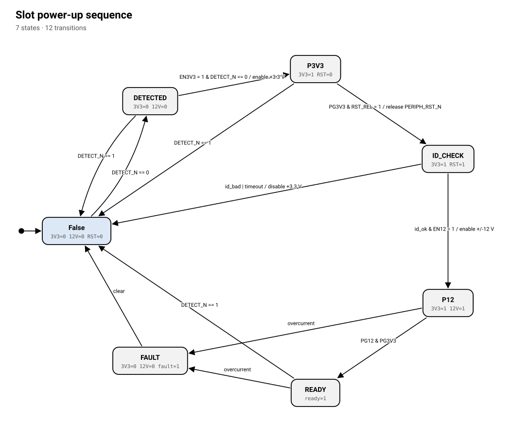

**Table 7 — Slot power-up sequence**

| State | Output | Description |
| --- | --- | --- |
| **False** (initial) | 3V3=0 12V=0 RST=0 | Slot unpowered, host outputs Hi-Z |
| **DETECTED** | 3V3=0 12V=0 | Module detected |
| **P3V3** | 3V3=1 RST=0 | +3.3 V applied, module held in reset |
| **ID_CHECK** | 3V3=1 RST=1 | Reading the ID EEPROM over I2C |
| **P12** | 3V3=1 12V=1 | +/-12 V applied |
| **READY** | ready=1 | Slot ready, signals active |
| **FAULT** | 3V3=0 12V=0 fault=1 | Hardware protection tripped |

| From | To | Condition | Action |
| --- | --- | --- | --- |
| False | DETECTED | DETECT_N == 0 | — |
| DETECTED | P3V3 | EN3V3 = 1 & DETECT_N == 0 | enable +3.3 V |
| DETECTED | False | DETECT_N == 1 | — |
| P3V3 | ID_CHECK | PG3V3 & RST_REL = 1 | release PERIPH_RST_N |
| P3V3 | False | DETECT_N == 1 | — |
| ID_CHECK | P12 | id_ok & EN12 = 1 | enable +/-12 V |
| ID_CHECK | False | id_bad \| timeout | disable +3.3 V |
| P12 | READY | PG12 & PG3V3 | — |
| P12 | FAULT | overcurrent | — |
| READY | FAULT | overcurrent | — |
| READY | False | DETECT_N == 1 | — |
| FAULT | False | clear | — |

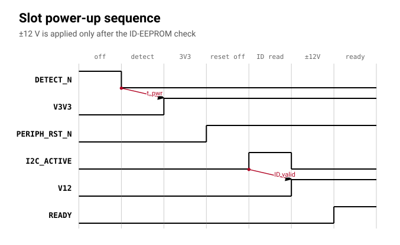

`[`ID_CHECK`](gen/slot_power.md#ID_CHECK)` is the only state in which the module has +3.3 V but not yet ±12 V. `[`EN12`](gen/slot_ctrl.md#EN12)` takes effect only after the identifier has been verified. When protection trips, the slot enters `[`FAULT`](gen/slot_power.md#FAULT)`, and the fault is cleared by writing `[`FAULT`](gen/slot_stat.md#FAULT)`.

**Table 8 — Slot control registers**

| Offset | Name | Access | Description |
| --- | --- | --- | --- |
| `0x00` | **SLOT0_CTRL** | rw | Slot 0 control |
| `0x01` | **SLOT1_CTRL** | rw | Slot 1 control |
| `0x02` | **SLOT2_CTRL** | rw | Slot 2 control |
| `0x03` | **SLOT3_CTRL** | rw | Slot 3 control |
| `0x04` | **SLOT0_STAT** | rw | Slot 0 status |
| `0x05` | **SLOT1_STAT** | rw | Slot 1 status |
| `0x06` | **SLOT2_STAT** | rw | Slot 2 status |
| `0x07` | **SLOT3_STAT** | rw | Slot 3 status |

**SLOT0_CTRL** (`0x00`)

| Field | Bits | Width | Access | Reset | Description |
| --- | --- | --- | --- | --- | --- |
| **RSV** | [7:3] | 5 | — | — | Reserved |
| **EN12** | [2] | 1 | rw | 0 | Enable +/-12 V (allowed only after ID_CHECK succeeded) |
| **RST_REL** | [1] | 1 | rw | 0 | 1 = release PERIPH_RST_N |
| **EN3V3** | [0] | 1 | rw | 0 | Enable the slot +3.3 V (still gated in hardware by DETECT_N) |

**SLOT1_CTRL** (`0x01`)

| Field | Bits | Width | Access | Reset | Description |
| --- | --- | --- | --- | --- | --- |
| **RSV** | [7:3] | 5 | — | — | Reserved |
| **EN12** | [2] | 1 | rw | 0 | Enable +/-12 V (allowed only after ID_CHECK succeeded) |
| **RST_REL** | [1] | 1 | rw | 0 | 1 = release PERIPH_RST_N |
| **EN3V3** | [0] | 1 | rw | 0 | Enable the slot +3.3 V (still gated in hardware by DETECT_N) |

**SLOT2_CTRL** (`0x02`)

| Field | Bits | Width | Access | Reset | Description |
| --- | --- | --- | --- | --- | --- |
| **RSV** | [7:3] | 5 | — | — | Reserved |
| **EN12** | [2] | 1 | rw | 0 | Enable +/-12 V (allowed only after ID_CHECK succeeded) |
| **RST_REL** | [1] | 1 | rw | 0 | 1 = release PERIPH_RST_N |
| **EN3V3** | [0] | 1 | rw | 0 | Enable the slot +3.3 V (still gated in hardware by DETECT_N) |

**SLOT3_CTRL** (`0x03`)

| Field | Bits | Width | Access | Reset | Description |
| --- | --- | --- | --- | --- | --- |
| **RSV** | [7:3] | 5 | — | — | Reserved |
| **EN12** | [2] | 1 | rw | 0 | Enable +/-12 V (allowed only after ID_CHECK succeeded) |
| **RST_REL** | [1] | 1 | rw | 0 | 1 = release PERIPH_RST_N |
| **EN3V3** | [0] | 1 | rw | 0 | Enable the slot +3.3 V (still gated in hardware by DETECT_N) |

**SLOT0_STAT** (`0x04`)

| Field | Bits | Width | Access | Reset | Description |
| --- | --- | --- | --- | --- | --- |
| **RSV** | [7:6] | 2 | — | — | Reserved |
| **INT** | [5] | 1 | ro | 0 | INT_N level (1 = request) |
| **READY** | [4] | 1 | rw | 0 | Software marks the module as ready |
| **FAULT** | [3] | 1 | w1c | 0 | Overcurrent protection tripped |
| **PG12** | [2] | 1 | ro | 0 | +/-12 V power good |
| **PG3V3** | [1] | 1 | ro | 0 | +3.3 V power good |
| **PRESENT** | [0] | 1 | ro | 0 | DETECT_N == 0 |

**SLOT1_STAT** (`0x05`)

| Field | Bits | Width | Access | Reset | Description |
| --- | --- | --- | --- | --- | --- |
| **RSV** | [7:6] | 2 | — | — | Reserved |
| **INT** | [5] | 1 | ro | 0 | INT_N level (1 = request) |
| **READY** | [4] | 1 | rw | 0 | Software marks the module as ready |
| **FAULT** | [3] | 1 | w1c | 0 | Overcurrent protection tripped |
| **PG12** | [2] | 1 | ro | 0 | +/-12 V power good |
| **PG3V3** | [1] | 1 | ro | 0 | +3.3 V power good |
| **PRESENT** | [0] | 1 | ro | 0 | DETECT_N == 0 |

**SLOT2_STAT** (`0x06`)

| Field | Bits | Width | Access | Reset | Description |
| --- | --- | --- | --- | --- | --- |
| **RSV** | [7:6] | 2 | — | — | Reserved |
| **INT** | [5] | 1 | ro | 0 | INT_N level (1 = request) |
| **READY** | [4] | 1 | rw | 0 | Software marks the module as ready |
| **FAULT** | [3] | 1 | w1c | 0 | Overcurrent protection tripped |
| **PG12** | [2] | 1 | ro | 0 | +/-12 V power good |
| **PG3V3** | [1] | 1 | ro | 0 | +3.3 V power good |
| **PRESENT** | [0] | 1 | ro | 0 | DETECT_N == 0 |

**SLOT3_STAT** (`0x07`)

| Field | Bits | Width | Access | Reset | Description |
| --- | --- | --- | --- | --- | --- |
| **RSV** | [7:6] | 2 | — | — | Reserved |
| **INT** | [5] | 1 | ro | 0 | INT_N level (1 = request) |
| **READY** | [4] | 1 | rw | 0 | Software marks the module as ready |
| **FAULT** | [3] | 1 | w1c | 0 | Overcurrent protection tripped |
| **PG12** | [2] | 1 | ro | 0 | +/-12 V power good |
| **PG3V3** | [1] | 1 | ro | 0 | +3.3 V power good |
| **PRESENT** | [0] | 1 | ro | 0 | DETECT_N == 0 |

## 5. SPI Interface

Each slot has its own SPI controller with `SPI_SCK`, `SPI_MOSI`, `SPI_MISO` and `SPI_CS_N`. The physical lines are not shared between slots. The SCK divider (`[`DIV`](gen/spi_ctrl.md#DIV)`) and the clock mode (`[`CPOL`](gen/spi_ctrl.md#CPOL)`, `[`CPHA`](gen/spi_ctrl.md#CPHA)`) are set per slot. Bit order is MSB first and the word is 8 bits; wider frames are sent as several bytes.

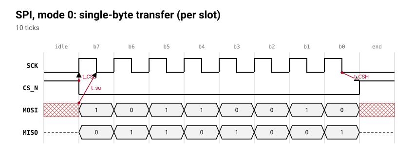

### 5.1 Architecture

The SPI controller does not run a protocol. It exchanges blocks of memory with the module and leaves everything above the byte level to the CPU and the module. The controller is a client of the system DMA: the CPU describes a job as "from where, to where, how many", and the hardware executes it.

- **From where / to where:** `SRC_ADDR` of the slot's SysDMA channel is the TX buffer, `DST_ADDR` is the RX buffer.
- **How many:** `SPI_LEN` (16 bits, in bytes).
- **What to do with CS_N:** the `FIRST` and `LAST` flags of `SPI_CMD`.

The controller owns a 16-byte FIFO for each direction on logic, not block RAM. A DMA request is raised when a FIFO is half empty (TX) or half full (RX), and one grant moves up to 8 bytes. The FIFOs connect to SysDMA through an internal port, so SPI traffic does not cross the 8-bit bus; only the memory accesses are charged to the system.

### 5.2 Transfer Modes

**Table 9 — SPI transfer modes (SPI_CMD.MODE)**

| Value | Name | Description |
| --- | --- | --- |
| 0 | **TX_ONLY** | Transmit only; received bytes are discarded (one DMA stream) |
| 1 | **RX_ONLY** | Receive only; SPI_FILL is sent on MOSI (one DMA stream) |
| 2 | **DUPLEX** | Full duplex: TX buffer out, RX buffer in (two DMA streams) |
| 3 | **reserved** | Reserved |

Full-duplex SPI is the natural mode of the pins. On the DMA side, TX_ONLY and RX_ONLY use one stream each, and DUPLEX uses two streams carried by the same DMA channel.

In RX_ONLY the controller sends the byte held in `SPI_FILL` (0xFF by default) for the whole job, so no "repeat one byte" feature is needed in DMA.

### 5.3 Packets

A packet is one or more jobs. The `FIRST` flag asserts `CS_N` before the first byte, and `LAST` releases it after the last byte. A job with neither flag continues the current packet. A short transaction is a single job with both flags.

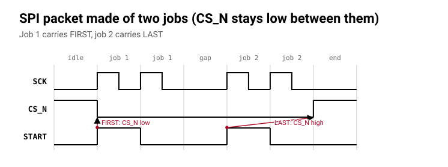

A typical register read from a module is two jobs: job 1 (`FIRST`, TX_ONLY) sends the command bytes, job 2 (`LAST`, RX_ONLY) receives the answer. The pause between jobs is harmless because the host owns SCK.

`WAIT_DREQ` makes the job wait for `GPIO0_DREQ_N = 0` before the first byte; the pin level can be read in `[`DREQ`](gen/spi_status.md#DREQ)`. The condition is evaluated once per job, not before every byte; a module that needs gaps inside a transfer should be served with several short jobs.

### 5.4 Job Controller

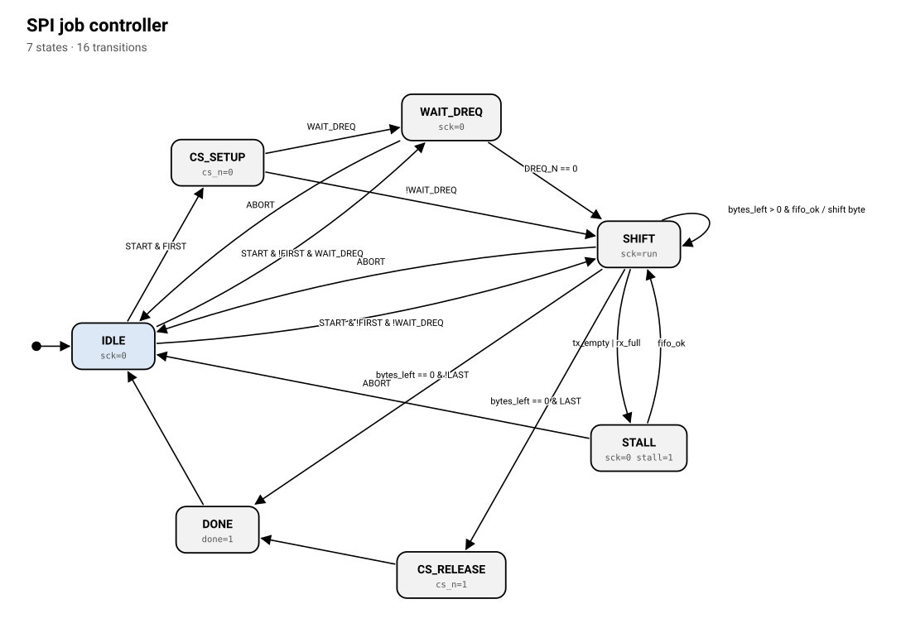

**Table 10 — SPI job controller**

| State | Output | Description |
| --- | --- | --- |
| **IDLE** (initial) | sck=0 | No job |
| **CS_SETUP** | cs_n=0 | Asserting CS_N (FIRST) |
| **WAIT_DREQ** | sck=0 | Waiting for the module |
| **SHIFT** | sck=run | Shifting one byte per 8 SCK clocks |
| **STALL** | sck=0 stall=1 | TX FIFO empty or RX FIFO full: SCK held at a byte boundary |
| **CS_RELEASE** | cs_n=1 | Releasing CS_N (LAST) |
| **DONE** | done=1 | Job complete |

| From | To | Condition | Action |
| --- | --- | --- | --- |
| IDLE | CS_SETUP | START & FIRST | — |
| IDLE | WAIT_DREQ | START & !FIRST & WAIT_DREQ | — |
| IDLE | SHIFT | START & !FIRST & !WAIT_DREQ | — |
| CS_SETUP | WAIT_DREQ | WAIT_DREQ | — |
| CS_SETUP | SHIFT | !WAIT_DREQ | — |
| WAIT_DREQ | SHIFT | DREQ_N == 0 | — |
| WAIT_DREQ | IDLE | ABORT | — |
| SHIFT | SHIFT | bytes_left > 0 & fifo_ok | shift byte |
| SHIFT | STALL | tx_empty \| rx_full | — |
| SHIFT | CS_RELEASE | bytes_left == 0 & LAST | — |
| SHIFT | DONE | bytes_left == 0 & !LAST | — |
| SHIFT | IDLE | ABORT | — |
| STALL | SHIFT | fifo_ok | — |
| STALL | IDLE | ABORT | — |
| CS_RELEASE | DONE | — | — |
| DONE | IDLE | — | — |

If DMA cannot keep up, the controller does not lose data: it stops SCK at a byte boundary (`STALL`) and resumes when the FIFOs allow. Most SPI slaves tolerate such pauses. `[`STALL`](gen/spi_status.md#STALL)` tells the driver that the bus is saturated so that it can lower the clock. Modules that cannot tolerate gaps in SCK must be listed as such in their ID data and driven with a clock that leaves enough margin.

### 5.5 Registers

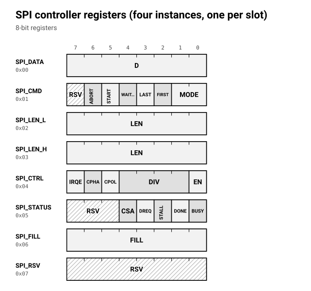

**Table 11 — SPI controller registers (four instances, one per slot)**

| Offset | Name | Access | Reset | Description |
| --- | --- | --- | --- | --- |
| `0x00` | **SPI_DATA** | rw | — | Direct CPU access: a write pushes the TX FIFO, a read pops the RX FIFO |
| `0x01` | **SPI_CMD** | wo | — | Job command |
| `0x02` | **SPI_LEN_L** | rw | — | Job length in bytes [7:0] |
| `0x03` | **SPI_LEN_H** | rw | — | Job length in bytes [15:8] |
| `0x04` | **SPI_CTRL** | rw | — | Control |
| `0x05` | **SPI_STATUS** | rw | — | Status |
| `0x06` | **SPI_FILL** | rw | 0xFF | Byte sent on MOSI in RX_ONLY mode |
| `0x07` | **SPI_RSV** | ro | — | Reserved |

**SPI_DATA** (`0x00`)

| Field | Bits | Width | Description |
| --- | --- | --- | --- |
| **D** | [7:0] | 8 | — |

**SPI_CMD** (`0x01`)

| Field | Bits | Width | Access | Reset | Description |
| --- | --- | --- | --- | --- | --- |
| **RSV** | [7] | 1 | — | — | Reserved |
| **ABORT** | [6] | 1 | wo | 0 | Abort the job and flush both FIFOs |
| **START** | [5] | 1 | wo | 0 | Start the job |
| **WAIT_DREQ** | [4] | 1 | wo | 0 | Wait for GPIO0_DREQ_N = 0 before the first byte |
| **LAST** | [3] | 1 | wo | 0 | Release CS_N after the last byte (packet end) |
| **FIRST** | [2] | 1 | wo | 0 | Assert CS_N before the first byte (packet start) |
| **MODE** | [1:0] | 2 | wo | 0x0 | Transfer mode [`alex_spi_modes`](gen/alex_spi_modes.md) |

**SPI_LEN_L** (`0x02`)

| Field | Bits | Width | Description |
| --- | --- | --- | --- |
| **LEN** | [7:0] | 8 | — |

**SPI_LEN_H** (`0x03`)

| Field | Bits | Width | Description |
| --- | --- | --- | --- |
| **LEN** | [7:0] | 8 | — |

**SPI_CTRL** (`0x04`)

| Field | Bits | Width | Access | Reset | Description |
| --- | --- | --- | --- | --- | --- |
| **IRQE** | [7] | 1 | rw | 0 | Interrupt on DONE |
| **CPHA** | [6] | 1 | rw | 0 | Clock phase |
| **CPOL** | [5] | 1 | rw | 0 | Clock polarity |
| **DIV** | [4:1] | 4 | rw | 0xF | SCK divider: f = f_sys / (2 * (DIV + 1)) |
| **EN** | [0] | 1 | rw | 0 | Enable the controller |

**SPI_STATUS** (`0x05`)

| Field | Bits | Width | Access | Reset | Description |
| --- | --- | --- | --- | --- | --- |
| **RSV** | [7:5] | 3 | — | — | Reserved |
| **CSA** | [4] | 1 | ro | 0 | CS_N is currently asserted |
| **DREQ** | [3] | 1 | ro | 0 | GPIO0_DREQ_N level (0 = module ready) |
| **STALL** | [2] | 1 | w1c | 0 | SCK was stopped at least once because DMA could not keep up |
| **DONE** | [1] | 1 | w1c | 0 | Job finished and the RX FIFO has been drained to memory |
| **BUSY** | [0] | 1 | ro | 0 | Job in progress |

**SPI_FILL** (`0x06`)

| Field | Bits | Width | Description |
| --- | --- | --- | --- |
| **FILL** | [7:0] | 8 | — |

**SPI_RSV** (`0x07`)

| Field | Bits | Width | Description |
| --- | --- | --- | --- |
| **RSV** | [7:0] | 8 | Reserved |

A job is launched by writing `[`START`](gen/spi_cmd.md#START)`; `[`ABORT`](gen/spi_cmd.md#ABORT)` stops it and flushes both FIFOs. `[`DONE`](gen/spi_status.md#DONE)` is set only after the RX FIFO has been drained to memory, so the CPU can use the buffer as soon as the flag is raised. For occasional single bytes (for example configuring a DAC) the CPU can use `SPI_DATA` directly instead of DMA.

## 6. I²C Interface

One hardware controller performs the minimal operation set: START, STOP, byte transmit, byte receive and ACK/NACK. The CPU assembles multibyte packets. This is a deliberate compromise between FPGA area and convenience.

The controller reaches the slots through a multiplexer; the slot number is set in `[`SLOT`](gen/i2c_ctrl.md#SLOT)`. This avoids address conflicts between ID EEPROMs and keeps a hung module from blocking the others. The multiplexer is built either in the FPGA (four SDA/SCL pairs) or as an external chip; the connector pinout is the same in both cases. The speed is fixed at 100 kHz.

Typical uses: ID EEPROMs, configuration memory, temperature sensors, power monitors and simple peripheral controllers.

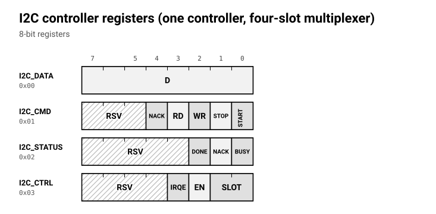

**Table 12 — I2C controller registers (one controller, four-slot multiplexer)**

| Offset | Name | Access | Description |
| --- | --- | --- | --- |
| `0x00` | **I2C_DATA** | rw | Byte to transmit / received byte |
| `0x01` | **I2C_CMD** | wo | Command: START, STOP, WR, RD, NACK |
| `0x02` | **I2C_STATUS** | rw | Status |
| `0x03` | **I2C_CTRL** | rw | Slot select and enable |

**I2C_DATA** (`0x00`)

| Field | Bits | Width | Description |
| --- | --- | --- | --- |
| **D** | [7:0] | 8 | — |

**I2C_CMD** (`0x01`)

| Field | Bits | Width | Access | Reset | Description |
| --- | --- | --- | --- | --- | --- |
| **RSV** | [7:5] | 3 | — | — | Reserved |
| **NACK** | [4] | 1 | wo | 0 | With RD: answer NACK (last byte) |
| **RD** | [3] | 1 | wo | 0 | Receive a byte into I2C_DATA |
| **WR** | [2] | 1 | wo | 0 | Transmit the byte in I2C_DATA |
| **STOP** | [1] | 1 | wo | 0 | Issue STOP |
| **START** | [0] | 1 | wo | 0 | Issue START (or repeated START) |

**I2C_STATUS** (`0x02`)

| Field | Bits | Width | Access | Reset | Description |
| --- | --- | --- | --- | --- | --- |
| **RSV** | [7:3] | 5 | — | — | Reserved |
| **DONE** | [2] | 1 | w1c | 0 | Byte completed |
| **NACK** | [1] | 1 | ro | 0 | Last answer from the module was NACK |
| **BUSY** | [0] | 1 | ro | 0 | Operation in progress |

**I2C_CTRL** (`0x03`)

| Field | Bits | Width | Access | Reset | Description |
| --- | --- | --- | --- | --- | --- |
| **RSV** | [7:4] | 4 | — | — | Reserved |
| **IRQE** | [3] | 1 | rw | 0 | Interrupt on DONE |
| **EN** | [2] | 1 | rw | 0 | Enable the controller |
| **SLOT** | [1:0] | 2 | rw | 0x0 | Slot number for the multiplexer (0..3) |

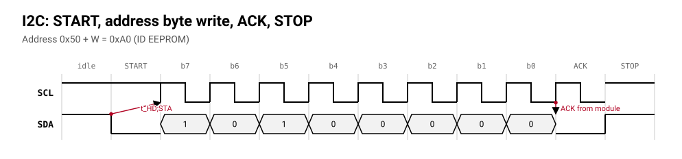

An operation is launched by a write to the command register; the commands are described in [`i2c_cmd`](gen/i2c_cmd.md). A packet starts with `[`START`](gen/i2c_cmd.md#START)` and ends with `[`STOP`](gen/i2c_cmd.md#STOP)`.

## 7. Digital Audio Interface

### 7.1 General Requirements

Digital audio is an essential part of Alex. The interface is logically independent of SPI and I²C, provides a continuous stream and does not depend on periodic SPI transactions.

### 7.2 Architecture

A synchronous serial TDM interface:

- `AUDIO_BCLK` — bit clock, 24.576 MHz;
- `AUDIO_FS` — frame sync, 48 kHz;
- `AUDIO_MCLK` — master clock, 12.288 MHz (256·fs);
- `AUDIO_DOUT` — host-to-module data;
- `AUDIO_DIN` — module-to-host data.

The clocks are common to all slots and the data lines are individual per slot. This gives common synchronization, independent streams, no electrical contention and flexible routing in the FPGA.

A frame holds 16 time slots of 32 bits, that is 512 bits. The bus runs in the 48 kHz family only; a module that needs 44.1 kHz must convert the rate on its own side (for example with the ASRC of a codec).

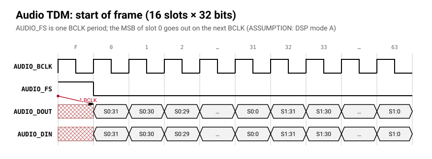

The frame format (DSP mode A, bit depth, channels per slot) is preliminary.

### 7.3 Routing

Audio never has to pass physically from one module to another. The host FPGA builds the processing chain, for example: host stream → module A → FPGA → module B → FPGA → main audio output. Modules are not connected to each other.

### 7.4 Audio Processing on Modules

A module may receive audio from the host, process it, return the result, generate sound independently or return several channels. Processing may be digital, analog or hybrid. A module with analog processing contains its own ADCs and DACs; a purely digital module needs none.

### 7.5 Clocking

All frequencies come from the 48 kHz family, so no switchable oscillator is needed. Each clock line (BCLK, FS, MCLK) sits between DGND contacts or opposite a DGND contact. If modules never need a separate MCLK, contact B18 can be given to DGND and zone 2 becomes a perfect checkerboard of signals and grounds.

## 8. System Control Signals

The signal set is shown in [`alex_connector`](gen/alex_connector.md):

- `PERIPH_RST_N` — independent reset of the module in each slot. There is no global `RESET_N`.
- `INT_N` — interrupt request; its level is visible in `[`INT`](gen/slot_stat.md#INT)`.
- `DETECT_N` — physical presence; its level is visible in `[`PRESENT`](gen/slot_stat.md#PRESENT)`. The signal works before power is applied and does not depend on I²C.
- `GPIO0_DREQ_N` — the module is ready for data exchange.
- `GPIO1` — a general-purpose line.

A separate NMI is not needed in the baseline architecture. `DETECT_N` means physical presence only: readiness is determined through the management interface and recorded in `[`READY`](gen/slot_stat.md#READY)`.

## 9. DMA Architecture

### 9.1 One Master, Eight Channels

All SPI traffic goes through the single system DMA (SysDMA). The architecture deliberately has no per-slot DMA masters and no blitter: every additional bus master brings arbitration, address counters and a risk of starvation. Rectangle copy and blend belong to the GPU, which has direct memory access and a cache.

SysDMA has 8 channels. Channel state lives in block RAM, so the number of channels barely affects logic. All register banks fit in 8-bit registers (for example one bit per channel in the interrupt mask registers).

**Table 13 — SysDMA channel allocation**

| Channel | Name | Use |
| --- | --- | --- |
| 0 | **CPU0** | Memory to memory, programmed by the CPU |
| 1 | **CPU1** | Memory to memory, programmed by the CPU |
| 2 | **CPU2** | Memory to memory, programmed by the CPU |
| 3 | **CPU3** | Memory to memory, programmed by the CPU |
| 4 | **SPI0** | Slot 0: SRC_ADDR feeds the TX FIFO, the RX FIFO drains to DST_ADDR |
| 5 | **SPI1** | Slot 1: same scheme |
| 6 | **SPI2** | Slot 2: same scheme |
| 7 | **SPI3** | Slot 3: same scheme |

**Notes:**

- An SPI channel uses the same SRC_ADDR and DST_ADDR registers as a CPU channel; the peripheral side is hard-wired.
- For SPI channels COUNT is ignored: the job length comes from SPI_LEN.
- One channel carries both directions: in DUPLEX mode it raises a TX request and an RX request, and each grant moves one burst in one direction.
- SRC_CTRL / DST_CTRL codes of the existing SysDMA are not decoded in the register map yet (see open items).

An SPI channel uses the same `SRC_ADDR` and `DST_ADDR` registers as a CPU channel; the peripheral side is hard-wired and needs no address. In TX_ONLY mode only the transmit stream runs, in RX_ONLY only the receive stream, and in DUPLEX both are carried by the same channel. The transfer length comes from `SPI_LEN`, so `COUNT` is ignored for SPI channels.

### 9.2 Arbitration

**Table 14 — SysDMA arbitration rules**

| Rule | Name | Description |
| --- | --- | --- |
| 1 | **Key** | Each requesting channel presents the key {MASK[2:0], ~CH[2:0]}; the larger key wins |
| 2 | **Elimination** | Equivalent to NuBus bitwise elimination: the key is compared from the MSB down and losers drop out; implemented as a 8-to-1 maximum tree |
| 3 | **Granularity** | One grant moves up to BURST_BYTES bytes, then the arbiter runs again |
| 4 | **Default** | All MASK = 0: the lower channel number wins, so CPU channels outrank SPI channels |
| 5 | **Override** | A driver can raise MASK of an SPI channel while it talks to a latency-sensitive module |

**Notes:**

- Masks are not merged with a bitwise OR: OR would produce a value no channel owns. The arbiter selects the winning key.
- Arbitration against the audio engine and the GPU on the shared memory path is outside this table (see open items).

Priority is programmable per channel through the extension register.

**Table 15 — SysDMA extension registers (ASSUMPTION: offset 0x50 is free)**

| Offset | Name | Access | Description |
| --- | --- | --- | --- |
| `0x50` | **PRIO[ch]** | rw | Per-channel arbitration mask, one register per channel |

**PRIO[ch]** (`0x50`)

| Field | Bits | Width | Access | Reset | Description |
| --- | --- | --- | --- | --- | --- |
| **RSV** | [7:3] | 5 | — | — | Reserved |
| **MASK** | [2:0] | 3 | rw | 0x0 | Priority mask; a larger mask wins, ties go to the lower channel number |

With all masks at zero, the lowest channel number wins, so CPU copy channels outrank SPI channels. SPI tolerates this because of the stall mechanism described in section 5.4; when a driver needs the opposite, it raises the mask of the SPI channel.

### 9.3 Bandwidth

The theoretical bandwidth of the SysDMA path is 10 MB/s; a sustained 3 MB/s is a planning estimate. The specification does not promise a fixed SPI speed: the controller transfers as much as the bus allows, and the driver chooses the clock. The load of a duplex slot is shown below.

**Table 16 — SysDMA bus load of one duplex SPI slot**

| SCK | One slot, duplex | Four slots, duplex |
| --- | --- | --- |
| 12 MHz | **3.0 MB/s** | 12 MB/s, does not fit |
| 4 MHz | **1.0 MB/s** | 4 MB/s, does not fit the sustained estimate |
| 2 MHz | **0.5 MB/s** | 2 MB/s, fits the sustained estimate |
| 1 MHz | **0.25 MB/s** | 1 MB/s |

**Notes:**

- Load = 2 memory accesses per byte (read TX buffer, write RX buffer) = SCK_MHz / 4 MB/s per duplex slot; half that in TX_ONLY or RX_ONLY.
- The SPI side does not use the 8-bit bus: FIFOs connect to SysDMA through an internal port.
- If DMA cannot keep up, SCK stops at a byte boundary (STALL) instead of losing data.

### 9.4 Not a Physical Signal

DMA is a logical function of the host FPGA; the only related line on the connector is `GPIO0_DREQ_N`, which the module uses to say that data is ready. Audio and the GPU remain separate bus masters; their arbitration against SysDMA is an open item.

## 10. General-Purpose Digital I/O

Two signals are provided: `GPIO0` (assigned as `DREQ_N`) and `GPIO1` (module specific). GPIO must not duplicate functions already provided by SPI, I²C and the standard control signals.

## 11. Local DAC and ADC Architecture

The motherboard does not need centralized banks of DACs and ADCs. For example, an analog filter module can contain a multichannel DAC controlled over SPI for cutoff frequency, resonance, gain, modulation depth or oscillator pitch. Resolution, reference voltage, calibration and update rate are determined by the module.

## 12. Analog Audio and CV Connections

The baseline connector has no analog audio inputs, audio outputs or CV connections. This avoids centralized mixing, input buffers, analog routing matrices, analog cross-slot wiring and a large number of contacts.

## 13. Module Identification and Initialization

Each module carries an ID EEPROM reachable over I²C. The data includes the module identifier and type, hardware revision, supported audio formats and sample rates, channel count, SPI requirements (including tolerance for gaps in SCK), current consumption and driver compatibility. Physical presence and readiness are separate states; the order in which they are checked is given in section 4.4.

## 14. Power Management and Safety

The motherboard manages the power of each slot: monitoring, current limiting, inrush current, short-circuit protection, temperature and a safe state during reset and start-up. Hot-plug operation is not guaranteed by the connector alone: modules are installed and removed with the power off unless hot-plug is designed and validated separately. A future hot-plug revision would need validated mating sequence, power switching and signal isolation.

## 15. Design Priorities

1. Low overall system cost.
2. Minimal motherboard component count.
3. Simple and repeatable module design.
4. Independent operation of the modules.
5. Reliable multichannel digital audio.
6. Local analog processing.
7. Efficient FPGA resource use.
8. Expandability without connector complexity.

A simple digital module stays cheap, and a sophisticated hybrid module implements any analog circuit locally, without extra analog hardware on the motherboard.

## 16. Open Items

**Table 17 — Open items**

| # | Name | To be decided |
| --- | --- | --- |
| 1 | **Connector** | Verify PCIe position assignments, current per contact and insertion cycle rating against the datasheet |
| 2 | **Power** | Real +/-12 V and +3.3 V currents per slot and the +5 V budget |
| 3 | **Audio** | TDM frame format, bit depth, channels per slot; I2S as baseline profile; whether MCLK is needed |
| 4 | **SysDMA** | Decode SRC_CTRL / DST_CTRL, Demand-mode handshake per burst, internal FIFO port width, DONE/ERROR semantics for SPI channels |
| 5 | **Arbitration** | Priority of SysDMA against the audio engine and the GPU on the shared memory path |
| 6 | **Blitter** | Removal of the blitter and compatibility with the MiSTer port |
| 7 | **I2C** | Four-pair multiplexer in the FPGA or an external one; EEPROM addresses |
| 8 | **ESD** | TVS arrays, 22-33 ohm series resistors, contact mating sequence |

---

**Architectural Summary**

Alex is a digital expansion bus on a 36-contact PCIe x1 connector. Each slot has an independent SPI controller that exchanges blocks of memory through the system DMA, a shared hardware I²C controller with a multiplexer, multichannel digital audio (24.576 MHz bit clock, 48 kHz frames) and bipolar analog power supplied by the host. Analog processing is local to the modules, while the host FPGA provides digital communication, audio routing, DMA and system coordination.