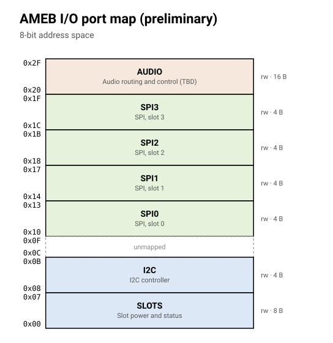
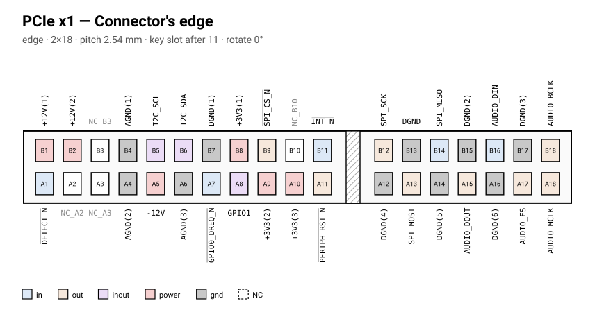
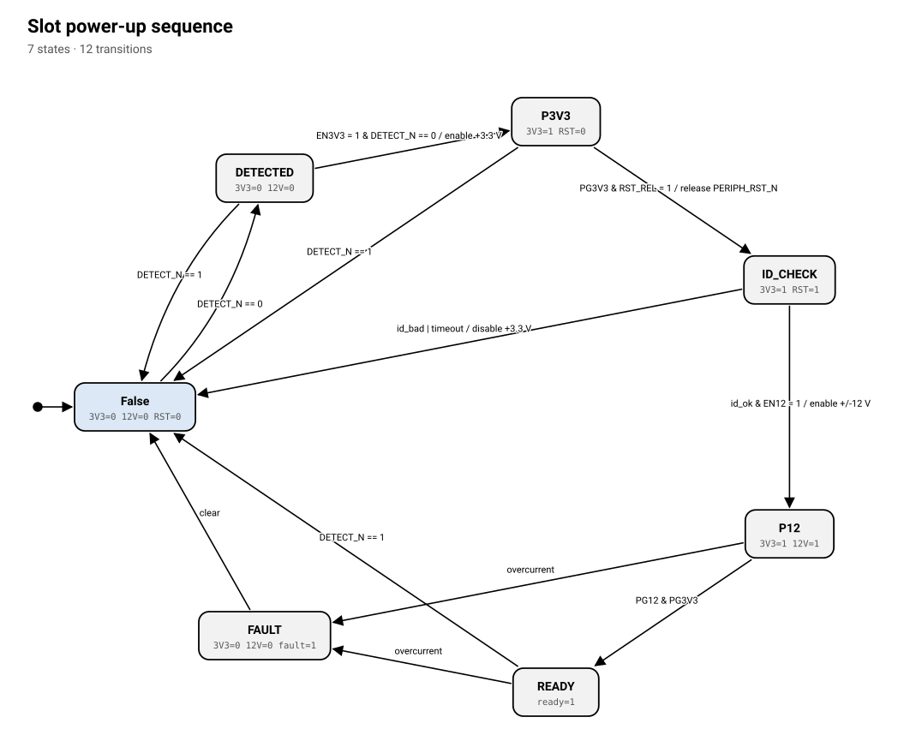
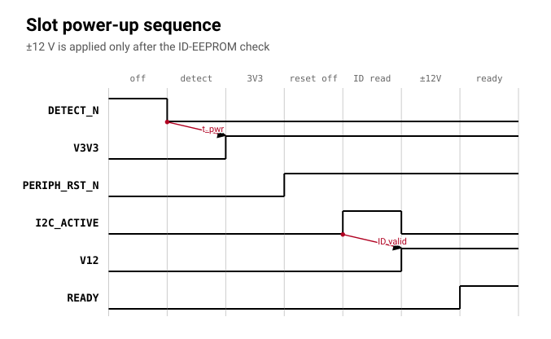
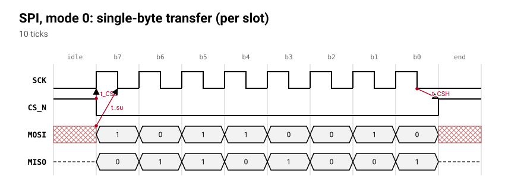
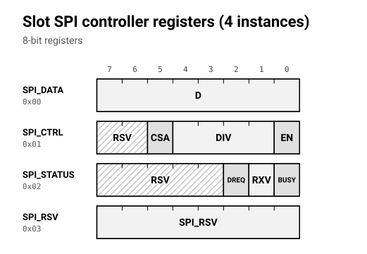
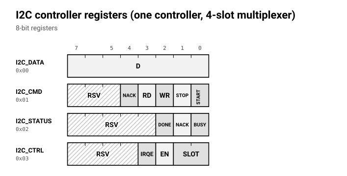
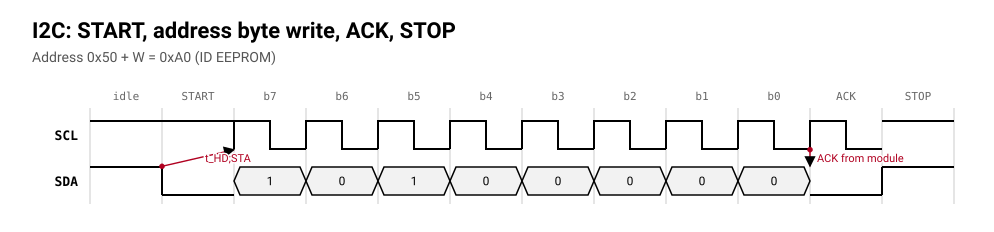
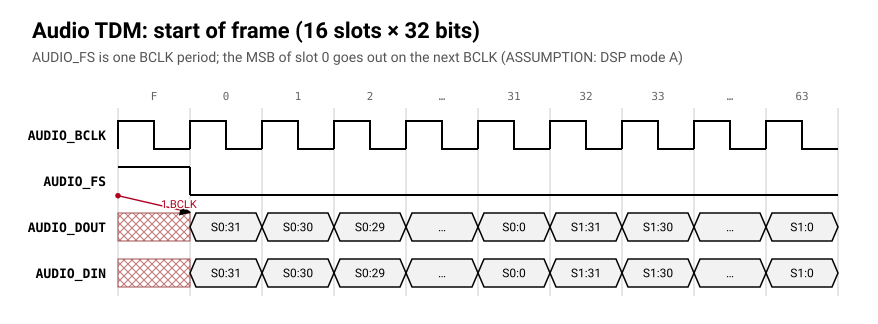

# AMEB-36 Modular Expansion Bus

## Preliminary hardware specification

## 1. Project philosophy

AMEB is a modular expansion interface for the Aleste LX computer. It is a computer expansion bus, not a synthesizer or modular synthesizer interface.

Goal: a compact, inexpensive, and universal slot that does not repeat the shortcomings of 50–60-pin retro slots (large board area, fragility, 5 V only).

The architecture rests on five principles:

1. Communication and control are handled by the host FPGA, while the Z80 processor works with slots as peripheral devices through I/O ports, without memory mapping: reads from such an area would block the processor.
2. Audio is transferred between the host and modules only in digital form.
3. Analog signal generation and processing are performed locally on the modules.
4. Analog power (±12 V) is supplied by the host. Analog signals and control voltages remain inside the module, and there are no DC/DC converters on the modules.
5. All interfaces are implemented in hardware, not by software emulation.

The design must not require extra equipment, complex connectors, or an expensive centralized analog section.

## 2. System architecture

The system consists of three subsystems.

### 2.1 Digital control plane

Communication and control between the host FPGA and the modules. Interfaces:

- SPI: one independent controller per slot (see section 5).
- I²C: one hardware byte controller with multiplexing to the slots (see section 6).
- Interrupt `INT_N` and data request `GPIO0_DREQ_N`.
- Module reset `PERIPH_RST_N` for each slot. There is no global `RESET_N`: the host resets all slots itself.
- Module detection `DETECT_N`.
- One more digital output `GPIO1`.

The control registers are accessible to the processor through I/O ports: [`ameb_io`](gen/ameb_io.md).

**Table 1 — AMEB I/O port map (preliminary)**

| Range | Name | Size | Access | Purpose |
| --- | --- | --- | --- | --- |
| `0x00`–`0x07` | **SLOTS** | 8 B | rw | Slot power and status |
| `0x08`–`0x0B` | **I2C** | 4 B | rw | I2C controller |
| `0x10`–`0x13` | **SPI0** | 4 B | rw | SPI, slot 0 |
| `0x14`–`0x17` | **SPI1** | 4 B | rw | SPI, slot 1 |
| `0x18`–`0x1B` | **SPI2** | 4 B | rw | SPI, slot 2 |
| `0x1C`–`0x1F` | **SPI3** | 4 B | rw | SPI, slot 3 |
| `0x20`–`0x2F` | **AUDIO** | 16 B | rw | Audio routing and control (TBD) |

### 2.2 Digital audio plane

Synchronous multichannel audio transfer between the host FPGA and the modules (see section 7). The host FPGA performs:

- distribution and collection of audio streams;
- channel routing;
- digital mixing;
- DMA transfers between the audio interfaces and system memory.

### 2.3 Local analog subsystem

A module may contain its own analog circuits: filters, oscillators, effects, measurement circuits, ADCs, and DACs. The module generates all control voltages itself, for example from a multichannel DAC controlled over SPI. The host does not generate control voltages.

## 3. Physical interface

Each slot uses a PCIe x1 edge connector with 36 pins. All 4 slots are electrically identical. A module is a 1.6 mm board with gold fingers and a chamfer, installed vertically. An alternative: 1.27 mm pitch headers and sockets, 2×18; the pinout carries over unchanged, but there is no physical key, so labeling and protection against incorrect orientation are needed.

The PCIe key between positions 11 and 12 divides the slot into two zones:

- **Zone 1 (positions 1–11, 22 pins):** power, analog grounds, I²C, SPI_CS_N, control, and GPIO.
- **Zone 2 (positions 12–18, 14 pins):** the high-speed digital path: SPI_SCK, SPI_MOSI, SPI_MISO, and audio.

This gives a natural separation on the motherboard and on the module: analog stays on one edge, and the 24 MHz clock lines are behind the key.

**Table 2 — PCIe x1 — Connector's edge**

*edge, 2 row(s) × 18, pitch 2.54 mm, numbering rowwise, pin 1 at top-left, key slot after position 11, drawn rotated 0°*

| Pin | Signal | Dir | Group | Description |
| --- | --- | --- | --- | --- |
| B1 | **+12V(1)** | power | power_analog | Analog power +12 V |
| B2 | **+12V(2)** | power | power_analog | Analog power +12 V |
| B3 | **NC_B3** | NC | nc | In PCIe this is +12 V; not connected |
| B4 | **AGND(1)** | gnd | ground_analog | — |
| B5 | **I2C_SCL** | inout | i2c | Matches SMCLK in PCIe |
| B6 | **I2C_SDA** | inout | i2c | Matches SMDAT in PCIe |
| B7 | **DGND(1)** | gnd | ground_digital | — |
| B8 | **+3V3(1)** | power | power_digital | Digital power +3.3 V |
| B9 | **SPI_CS_N** | out | spi | Module select |
| B10 | **NC_B10** | NC | nc | In PCIe this is +3.3 V aux; not connected |
| B11 | **INT_N** | in | control | Interrupt request from the module |
| B12 | **SPI_SCK** | out | spi | — |
| B13 | **DGND** | gnd | ground_digital | — |
| B14 | **SPI_MISO** | in | spi | — |
| B15 | **DGND(2)** | gnd | ground_digital | — |
| B16 | **AUDIO_DIN** | in | audio | Audio module → host |
| B17 | **DGND(3)** | gnd | ground_digital | — |
| B18 | **AUDIO_BCLK** | out | audio | 24.576 MHz |
| A1 | **DETECT_N** | in | control | Module is inserted (shorted to DGND on the module) |
| A2 | **NC_A2** | NC | nc | In PCIe this is +12 V; not connected |
| A3 | **NC_A3** | NC | nc | In PCIe this is +12 V; not connected |
| A4 | **AGND(2)** | gnd | ground_analog | — |
| A5 | **-12V** | power | power_analog | Analog power −12 V |
| A6 | **AGND(3)** | gnd | ground_analog | — |
| A7 | **GPIO0_DREQ_N** | in | gpio | Module is ready for data exchange (DMA request) |
| A8 | **GPIO1** | inout | gpio | Module-specific |
| A9 | **+3V3(2)** | power | power_digital | — |
| A10 | **+3V3(3)** | power | power_digital | — |
| A11 | **PERIPH_RST_N** | out | control | Module reset in the slot |
| A12 | **DGND(4)** | gnd | ground_digital | — |
| A13 | **SPI_MOSI** | out | spi | — |
| A14 | **DGND(5)** | gnd | ground_digital | — |
| A15 | **AUDIO_DOUT** | out | audio | Audio host → module |
| A16 | **DGND(6)** | gnd | ground_digital | — |
| A17 | **AUDIO_FS** | out | audio | Frame sync, 48 kHz |
| A18 | **AUDIO_MCLK** | out | audio | 12.288 MHz; next to BCLK with no ground between them |

The pin balance is described in **Table 3 — Connector pin balance**

| Count | Name | Composition |
| --- | --- | --- |
| 2 | **+12 V** | B1, B2 |
| 1 | **−12 V** | A5 |
| 3 | **AGND** | B4, A4, A6 |
| 3' | **+3.3 V** | B8, A9, A10 |
| 7 | **DGND** | B7, B13, B15, B17, A12, A14, A16 |
| 16 | **Signals** | SPI 4, I2C 2, control 3, GPIO 2, audio 5 |
| 4 | **NC** | B3, B10, A2, A3 (protection against a real PCIe card) |

**Notes:**

- 36 pins total. No free reserve: the NC positions are occupied for protection reasons.
- PCIe position assignments are from memory; verify against PCIe CEM and the connector datasheet.
. There is no free reserve: four NC positions are occupied for protection reasons.

**Table 4 — Connector pin balance**

| Count | Name | Composition |
| --- | --- | --- |
| 2 | **+12 V** | B1, B2 |
| 1 | **−12 V** | A5 |
| 3 | **AGND** | B4, A4, A6 |
| 3' | **+3.3 V** | B8, A9, A10 |
| 7 | **DGND** | B7, B13, B15, B17, A12, A14, A16 |
| 16 | **Signals** | SPI 4, I2C 2, control 3, GPIO 2, audio 5 |
| 4 | **NC** | B3, B10, A2, A3 (protection against a real PCIe card) |

**Notes:**

- 36 pins total. No free reserve: the NC positions are occupied for protection reasons.
- PCIe position assignments are from memory; verify against PCIe CEM and the connector datasheet.

### 3.1 Protection against inserting a real PCIe card

A real PCIe card can be plugged into the slot, so:

- at positions where PCIe has +12 V and +3.3 V aux, AMEB has either the same voltage or NC, but not a signal;
- the negative voltage −12 V is placed on A5, i.e. on the JTAG position, which is not connected on ordinary cards;
- where possible, functions match PCIe, so signal directions do not conflict.

**Table 5 — Correspondence to PCIe functions (protection against incorrect insertion)**

| Pos. | Name | Function in PCIe |
| --- | --- | --- |
| A1 | **DETECT_N** | PRSNT1# |
| A5 | **-12V** | TCK (JTAG), not connected on ordinary cards |
| A11 | **PERIPH_RST_N** | PERST# |
| B5 | **I2C_SCL** | SMCLK |
| B6 | **I2C_SDA** | SMDAT |
| B11 | **INT_N** | WAKE# |
| B3, A2, A3 | **NC** | +12 V in PCIe: not connected here |

**Notes:**

- Slot power-up order (see the slot_power state machine): ±12 V is applied only after the ID-EEPROM has been read successfully.

The PCIe position assignments are from memory and must be verified against PCIe CEM and the datasheet of the chosen connector.

### 3.2 Electrical and mechanical protection

TVS arrays and 22–33 Ω series resistors are installed on the signals. With an edge connector, the pin mating sequence is implemented by the module's construction: ground pads are longer, and `DETECT_N` is shorter than the others.

## 4. Power distribution

### 4.1 Digital power

The host supplies +3.3 V to three slot pins. Current guideline: 300 mA per slot (an estimate, not a calculation).

### 4.2 Analog power

The host supplies +12 V (two pins), −12 V (one pin), and AGND (three pins). Current guideline: 50 mA per slot on each rail (an estimate, not a calculation).

±12 V generation is done on the motherboard: one step-up and one inverting converter. No DC/DC is placed on the modules. Modules are recommended to use local LDOs on the analog rails. The ±12 V section can be made optionally populated (DNP) so that a board without analog modules is cheaper. Modules derive additional voltages from the available ones.

### 4.3 Grounding

DGND and AGND pins are separate, and every high-speed line has a DGND pin next to it. DGND and AGND are connected only on the motherboard, and the module does not short them, to avoid ground loops. Separate grounds do not mean galvanic isolation.

### 4.4 Protection and power-up sequence

Each slot has current limiting, short-circuit protection, and overload monitoring. For +12 V this is a current switch with an enable input from the FPGA; for −12 V it is a PTC fuse, enabled together with +12 V. Protection must not depend solely on the FPGA or software.

The slot powers up in sequence: first only +3.3 V with the module held in reset, then reading the ID-EEPROM over I²C, and only after a successful check is ±12 V applied. A real PCIe card will not respond to the EEPROM request and will not receive the analog rails.

**Table 6 — Slot power-up: power sequencing**

| State | Output | Description |
| --- | --- | --- |
| **False** (initial) | 3V3=0 12V=0 RST=0 | Slot unpowered, host outputs in Hi-Z |
| **DETECTED** | 3V3=0 12V=0 | Module detected |
| **P3V3** | 3V3=1 RST=0 | +3.3 V applied, module held in reset |
| **ID_CHECK** | 3V3=1 RST=1 | Reading ID-EEPROM over I2C |
| **P12** | 3V3=1 12V=1 | ±12 V applied |
| **READY** | ready=1 | Slot ready; signals active |
| **FAULT** | 3V3=0 12V=0 fault=1 | Hardware protection tripped |

| From | To | Condition | Action |
| --- | --- | --- | --- |
| False | DETECTED | DETECT_N == 0 | — |
| DETECTED | P3V3 | EN3V3 = 1 | enable +3.3 V |
| DETECTED | False | DETECT_N == 1 | — |
| P3V3 | ID_CHECK | PG3V3 & RST_REL = 1 | release PERIPH_RST_N |
| P3V3 | False | DETECT_N == 1 | — |
| ID_CHECK | P12 | id_ok & EN12 = 1 | enable ±12 V |
| ID_CHECK | False | id_bad \| timeout | disable +3.3 V |
| P12 | READY | PG12 & PG3V3 | — |
| P12 | FAULT | overcurrent | — |
| READY | FAULT | overcurrent | — |
| READY | False | DETECT_N == 1 | — |
| FAULT | False | clear | — |

The state `[`ID_CHECK`](gen/slot_power.md#ID_CHECK)` is the only one where the module already receives +3.3 V but does not yet receive ±12 V. The `[`EN12`](gen/slot_ctrl.md#EN12)` enable takes effect only after a successful identifier check. When protection trips, the slot transitions to `[`FAULT`](gen/slot_power.md#FAULT)`; the reset is performed by writing to `[`FAULT`](gen/slot_stat.md#FAULT)`.

**Table 7 — Slot control registers**

| Offset | Name | Access | Description |
| --- | --- | --- | --- |
| `0x00` | **SLOT0_CTRL** | rw | Slot 0 control |
| `0x01` | **SLOT1_CTRL** | rw | Slot 1 control |
| `0x02` | **SLOT2_CTRL** | rw | Slot 2 control |
| `0x03` | **SLOT3_CTRL** | rw | Slot 3 control |
| `0x04` | **SLOT0_STAT** | rw | Slot 0 status |
| `0x05` | **SLOT1_STAT** | rw | Slot 1 status |
| `0x06` | **SLOT2_STAT** | rw | Slot 2 status |
| `0x07` | **SLOT3_STAT** | rw | Slot 3 status |

**SLOT0_CTRL** (`0x00`)

| Field | Bits | Width | Access | Reset | Description |
| --- | --- | --- | --- | --- | --- |
| **RSV** | [7:3] | 5 | — | — | Reserved |
| **EN12** | [2] | 1 | rw | 0 | Enable ±12 V (allowed only after ID_CHECK) |
| **RST_REL** | [1] | 1 | rw | 0 | 1 = release PERIPH_RST_N |
| **EN3V3** | [0] | 1 | rw | 0 | Enable slot +3.3 V |

**SLOT1_CTRL** (`0x01`)

| Field | Bits | Width | Access | Reset | Description |
| --- | --- | --- | --- | --- | --- |
| **RSV** | [7:3] | 5 | — | — | Reserved |
| **EN12** | [2] | 1 | rw | 0 | Enable ±12 V (allowed only after ID_CHECK) |
| **RST_REL** | [1] | 1 | rw | 0 | 1 = release PERIPH_RST_N |
| **EN3V3** | [0] | 1 | rw | 0 | Enable slot +3.3 V |

**SLOT2_CTRL** (`0x02`)

| Field | Bits | Width | Access | Reset | Description |
| --- | --- | --- | --- | --- | --- |
| **RSV** | [7:3] | 5 | — | — | Reserved |
| **EN12** | [2] | 1 | rw | 0 | Enable ±12 V (allowed only after ID_CHECK) |
| **RST_REL** | [1] | 1 | rw | 0 | 1 = release PERIPH_RST_N |
| **EN3V3** | [0] | 1 | rw | 0 | Enable slot +3.3 V |

**SLOT3_CTRL** (`0x03`)

| Field | Bits | Width | Access | Reset | Description |
| --- | --- | --- | --- | --- | --- |
| **RSV** | [7:3] | 5 | — | — | Reserved |
| **EN12** | [2] | 1 | rw | 0 | Enable ±12 V (allowed only after ID_CHECK) |
| **RST_REL** | [1] | 1 | rw | 0 | 1 = release PERIPH_RST_N |
| **EN3V3** | [0] | 1 | rw | 0 | Enable slot +3.3 V |

**SLOT0_STAT** (`0x04`)

| Field | Bits | Width | Access | Reset | Description |
| --- | --- | --- | --- | --- | --- |
| **RSV** | [7:6] | 2 | — | — | Reserved |
| **INT** | [5] | 1 | ro | 0 | INT_N level (1 = request) |
| **READY** | [4] | 1 | rw | 0 | Software marked the module as ready |
| **FAULT** | [3] | 1 | w1c | 0 | Overcurrent protection tripped |
| **PG12** | [2] | 1 | ro | 0 | ±12 V within range |
| **PG3V3** | [1] | 1 | ro | 0 | +3.3 V within range |
| **PRESENT** | [0] | 1 | ro | 0 | DETECT_N == 0 |

**SLOT1_STAT** (`0x05`)

| Field | Bits | Width | Access | Reset | Description |
| --- | --- | --- | --- | --- | --- |
| **RSV** | [7:6] | 2 | — | — | Reserved |
| **INT** | [5] | 1 | ro | 0 | INT_N level (1 = request) |
| **READY** | [4] | 1 | rw | 0 | Software marked the module as ready |
| **FAULT** | [3] | 1 | w1c | 0 | Overcurrent protection tripped |
| **PG12** | [2] | 1 | ro | 0 | ±12 V within range |
| **PG3V3** | [1] | 1 | ro | 0 | +3.3 V within range |
| **PRESENT** | [0] | 1 | ro | 0 | DETECT_N == 0 |

**SLOT2_STAT** (`0x06`)

| Field | Bits | Width | Access | Reset | Description |
| --- | --- | --- | --- | --- | --- |
| **RSV** | [7:6] | 2 | — | — | Reserved |
| **INT** | [5] | 1 | ro | 0 | INT_N level (1 = request) |
| **READY** | [4] | 1 | rw | 0 | Software marked the module as ready |
| **FAULT** | [3] | 1 | w1c | 0 | Overcurrent protection tripped |
| **PG12** | [2] | 1 | ro | 0 | ±12 V within range |
| **PG3V3** | [1] | 1 | ro | 0 | +3.3 V within range |
| **PRESENT** | [0] | 1 | ro | 0 | DETECT_N == 0 |

**SLOT3_STAT** (`0x07`)

| Field | Bits | Width | Access | Reset | Description |
| --- | --- | --- | --- | --- | --- |
| **RSV** | [7:6] | 2 | — | — | Reserved |
| **INT** | [5] | 1 | ro | 0 | INT_N level (1 = request) |
| **READY** | [4] | 1 | rw | 0 | Software marked the module as ready |
| **FAULT** | [3] | 1 | w1c | 0 | Overcurrent protection tripped |
| **PG12** | [2] | 1 | ro | 0 | ±12 V within range |
| **PG3V3** | [1] | 1 | ro | 0 | +3.3 V within range |
| **PRESENT** | [0] | 1 | ro | 0 | DETECT_N == 0 |

## 5. SPI interface

Each slot has its own SPI controller with signals `SPI_SCK`, `SPI_MOSI`, `SPI_MISO`, `SPI_CS_N`. The physical lines are not shared between slots. Mode 0 (CPOL = 0, CPHA = 0), the speed is set by the `[`DIV`](gen/spi_ctrl.md#DIV)` divider independently for each slot.

SPI is the primary interface for module configuration, programming local DACs and ADCs, accessing registers, and controlling microcontrollers on the module. It is not intended for continuous audio.

**Table 8 — Slot SPI controller registers (4 instances)**

| Offset | Name | Access | Description |
| --- | --- | --- | --- |
| `0x00` | **SPI_DATA** | rw | A write starts a byte transfer; a read returns the received byte |
| `0x01` | **SPI_CTRL** | rw | Control |
| `0x02` | **SPI_STATUS** | ro | Status |
| `0x03` | **SPI_RSV** | ro | Reserved (DMA: address and length — TBD) |

**SPI_DATA** (`0x00`)

| Field | Bits | Width | Description |
| --- | --- | --- | --- |
| **D** | [7:0] | 8 | — |

**SPI_CTRL** (`0x01`)

| Field | Bits | Width | Access | Reset | Description |
| --- | --- | --- | --- | --- | --- |
| **RSV** | [7:6] | 2 | — | — | Reserved |
| **CSA** | [5] | 1 | rw | 0 | 1 = keep CS_N asserted |
| **DIV** | [4:1] | 4 | rw | 0xF | SCK divider: f = f_sys / (2·(DIV+1)) |
| **EN** | [0] | 1 | rw | 0 | Enable the slot controller |

**SPI_STATUS** (`0x02`)

| Field | Bits | Width | Access | Reset | Description |
| --- | --- | --- | --- | --- | --- |
| **RSV** | [7:3] | 5 | — | — | Reserved |
| **DREQ** | [2] | 1 | ro | 0 | GPIO0_DREQ_N level (0 = module ready) |
| **RXV** | [1] | 1 | ro | 0 | Received byte ready |
| **BUSY** | [0] | 1 | ro | 0 | Byte transfer in progress |

For block data transfers the controller uses DMA. The module's readiness for exchange is reported by the `GPIO0_DREQ_N` signal; its level is visible in `[`DREQ`](gen/spi_status.md#DREQ)`. Holding `SPI_CS_N` between bytes is set by the `[`CSA`](gen/spi_ctrl.md#CSA)` bit.

## 6. I²C interface

One hardware controller performs a minimal set of operations: START, STOP, byte transmit, byte receive, and ACK/NACK. Assembling multi-byte packets is done by the processor. This is a deliberate compromise between die size and convenience.

The controller connects to the slots through a multiplexer: the slot number is set in `[`SLOT`](gen/i2c_ctrl.md#SLOT)`. This avoids ID-EEPROM address conflicts, and a hung module does not block the others. The multiplexer is implemented in the FPGA (four SDA/SCL pairs) or as an external chip; the pinout on the connector is the same for both options. The speed is fixed: 100 kHz.

Typical uses: identification EEPROMs, configuration memory, temperature sensors, power monitoring, simple peripheral controllers.

**Table 9 — I2C controller registers (one controller, 4-slot multiplexer)**

| Offset | Name | Access | Description |
| --- | --- | --- | --- |
| `0x00` | **I2C_DATA** | rw | Byte to transmit / received byte |
| `0x01` | **I2C_CMD** | wo | Command: START, STOP, WR, RD, NACK |
| `0x02` | **I2C_STATUS** | rw | Status |
| `0x03` | **I2C_CTRL** | rw | Slot select, enable |

**I2C_DATA** (`0x00`)

| Field | Bits | Width | Description |
| --- | --- | --- | --- |
| **D** | [7:0] | 8 | — |

**I2C_CMD** (`0x01`)

| Field | Bits | Width | Access | Reset | Description |
| --- | --- | --- | --- | --- | --- |
| **RSV** | [7:5] | 3 | — | — | Reserved |
| **NACK** | [4] | 1 | wo | 0 | On RD, send NACK (last byte) |
| **RD** | [3] | 1 | wo | 0 | Receive a byte into I2C_DATA |
| **WR** | [2] | 1 | wo | 0 | Transmit the byte from I2C_DATA |
| **STOP** | [1] | 1 | wo | 0 | Issue STOP |
| **START** | [0] | 1 | wo | 0 | Issue START (or repeated START) |

**I2C_STATUS** (`0x02`)

| Field | Bits | Width | Access | Reset | Description |
| --- | --- | --- | --- | --- | --- |
| **RSV** | [7:3] | 5 | — | — | Reserved |
| **DONE** | [2] | 1 | w1c | 0 | Byte completed |
| **NACK** | [1] | 1 | ro | 0 | Last response from the module was NACK |
| **BUSY** | [0] | 1 | ro | 0 | Operation in progress |

**I2C_CTRL** (`0x03`)

| Field | Bits | Width | Access | Reset | Description |
| --- | --- | --- | --- | --- | --- |
| **RSV** | [7:4] | 4 | — | — | Reserved |
| **IRQE** | [3] | 1 | rw | 0 | Interrupt on DONE |
| **EN** | [2] | 1 | rw | 0 | Enable the controller |
| **SLOT** | [1:0] | 2 | rw | 0x0 | Slot number for the multiplexer (0..3) |

An operation is started by writing to the command register; the set of commands is described in [`i2c_cmd`](gen/i2c_cmd.md). The start of a packet is set by the `[`START`](gen/i2c_cmd.md#START)` flag, and the end by `[`STOP`](gen/i2c_cmd.md#STOP)`.

## 7. Digital audio interface

### 7.1 General requirements

Digital audio is a mandatory part of AMEB. The interface is logically independent of SPI and I²C, provides a continuous stream, and does not depend on periodic SPI transactions.

### 7.2 Architecture

Synchronous serial TDM interface:

- `AUDIO_BCLK` — bit clock, 24.576 MHz;
- `AUDIO_FS` — frame sync, 48 kHz;
- `AUDIO_MCLK` — master clock, 12.288 MHz (256·fs);
- `AUDIO_DOUT` — data from host to module;
- `AUDIO_DIN` — data from module to host.

The clock signals are common to all slots; the data lines are individual for each slot. This provides common synchronization, independent streams, no electrical conflicts, and flexible routing in the FPGA.

A frame contains 16 time slots of 32 bits each, i.e. 512 bits. The bus operates only in the 48 kHz family; modules that need 44.1 kHz will require rate conversion on their side (e.g., a codec ASRC).

The frame format (DSP mode A, word length, number of channels per slot) is preliminary and subject to clarification.

### 7.3 Routing

Audio must not physically pass from module to module. The processing chain is built by the host FPGA, for example: host stream → module A → FPGA → module B → FPGA → main audio output. Modules do not connect to each other.

### 7.4 Audio processing on modules

A module can receive audio from the host, process it, return the result, generate sound on its own, or return several channels. Processing can be digital, analog, or hybrid. A module with analog processing contains its own ADCs and DACs; a purely digital module does not need them.

### 7.5 Clocking

All frequencies are derived from the 48 kHz family, so a switchable oscillator is not needed. BCLK (24.576 MHz) and MCLK (12.288 MHz) are next to each other on the connector (position 18), with no ground between them. If modules do not need a separate MCLK, pin A18 can be returned to DGND, and then zone 2 becomes an alternation of signals and grounds.

## 8. Control signals

The set of signals is given in [`ameb_connector`](gen/ameb_connector.md):

- `PERIPH_RST_N` — independent module reset in each slot. There is no global `RESET_N`.
- `INT_N` — interrupt request; its level is visible in `[`INT`](gen/slot_stat.md#INT)`.
- `DETECT_N` — physical presence of the module; its level is visible in `[`PRESENT`](gen/slot_stat.md#PRESENT)`. The signal works before power is applied and does not depend on I²C.
- `GPIO0_DREQ_N` — module readiness for data exchange (DMA request).
- `GPIO1` — general-purpose output.

A separate NMI is not needed in the base architecture. `DETECT_N` means only physical presence: module readiness is determined through the control interface and recorded by the `[`READY`](gen/slot_stat.md#READY)` bit.

## 9. DMA architecture

DMA is a logical function of the host FPGA; there is no physical signal for it on the connector, except `GPIO0_DREQ_N`. It services audio streams, module data transfers, and SPI exchange. A shared internal DMA engine with sufficient bandwidth and guaranteed scheduling is acceptable. Four independent physical controllers are not required.

## 10. General-purpose digital pins

Two pins are allocated: `GPIO0` (fixed as `DREQ_N`) and `GPIO1` (module-specific). GPIO must not duplicate the functions of SPI, I²C, and the standard control signals.

## 11. Local DACs and ADCs

The motherboard does not need centralized banks of DACs and ADCs. For example, an analog filter module may contain a multichannel DAC controlled over SPI for cutoff frequency, resonance, gain, modulation depth, or pitch. The resolution, reference voltage, calibration, and update rate are determined by the module itself.

## 12. Analog audio and CV connections

The base connector contains no analog audio inputs, audio outputs, or CV outputs. This eliminates centralized mixing, input buffers, an analog routing matrix, inter-slot analog routing, and a large number of pins.

## 13. Module identification and initialization

Each module contains an ID-EEPROM accessible over I²C. Data: module identifier and type, hardware version, supported audio formats and rates, number of channels, SPI requirements, current consumption, driver compatibility. Physical presence and readiness are different states, and the order in which they are checked is defined in section 4.4.

## 14. Power management and safety

The motherboard manages the power of each slot: monitoring, current limiting, inrush current, short-circuit protection, temperature, safe state on reset and startup. "Hot" insertion is not guaranteed by the connector design alone: modules are installed and removed with power off unless otherwise provided and separately verified. Future hot-plug will require verification of the pin mating sequence, power switching, and signal isolation.

## 15. Project priorities

1. Low overall cost.
2. Minimum number of components on the motherboard.
3. Simple and repeatable module design.
4. Independent operation of modules.
5. Reliable multichannel digital audio.
6. Local analog processing.
7. Efficient use of FPGA resources.
8. Expandability without complicating the connector.

A simple digital module must remain inexpensive, and a complex hybrid module must implement any analog circuit locally, without additional analog sections on the motherboard.

## 16. Open questions

**Table 10 — Open items**

| No. | Name | What to decide |
| --- | --- | --- |
| 1 | **Connector** | Verify PCIe position assignments, current per pin and mating-cycle rating against the datasheet |
| 2 | **Power** | Actual ±12 V and +3.3 V currents per slot, 5 V rail budget |
| 3 | **Audio** | TDM frame format, word length, channels per slot, whether MCLK is needed |
| 4 | **Ports** | Final I/O addresses, DMA over SPI (address, length, DREQ_N control) |
| 5 | **I2C** | 4-pair SDA/SCL multiplexer in FPGA or external; EEPROM addresses |
| 6 | **ESD** | TVS arrays, 22–33 Ω series resistors, pin mating sequence |

---

**Architecture summary**

AMEB-36 is a digital expansion bus on a 36-pin PCIe x1 connector with independent SPI per slot, a hardware I²C controller with a multiplexer, multichannel digital audio (24.576 MHz, 48 kHz), and bipolar analog power from the host. Analog processing is fully local to the modules, while the host FPGA provides digital communication, audio routing, DMA, and system coordination.