# LX-GPU — описание архитектуры

## EXTPORT (FABF) — 520EX Extension

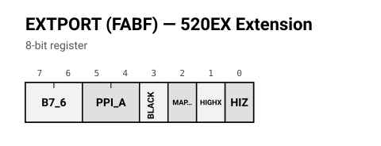

*Figure 1 — EXTPORT (FABF) — 520EX Extension*

**Table 1 — EXTPORT (FABF) — 520EX Extension**

| Field | Bits | Width | Description |
| --- | --- | --- | --- |
| **B7_6** | [7:6] | 2 | Not used |
| **PPI_A** | [5:4] | 2 | PPI Port A: 0=PSG, 1=reserved, 2=RTC, 3=8253 |
| **BLACK** | [3] | 1 | Force video to black |
| **MAPMOD** | [2] | 1 | 0=CPC-style, 1=64-colour |
| **HIGHX** | [1] | 1 | High resolution in X |
| **HIZ** | [0] | 1 | Not fully understood |

[Таблица](gen/L_520EX_EXTPORT.md)

## CRTC 6845 I/O Ports

[Таблица](gen/L_CRTC_PORTS.md)

## FDC 765 I/O Ports

[Таблица](gen/L_FDC_PORTS.md)

## Gate Array Mapper Control Ports

[Таблица](gen/L_GA_MAPPER_PORTS.md)

## Gate Array R0 — Palette Index

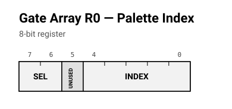

*Figure 2 — Gate Array R0 — Palette Index*

**Table 2 — Gate Array R0 — Palette Index**

| Field | Bits | Width | Description |
| --- | --- | --- | --- |
| **SEL** | [7:6] | 2 | Must be 00 |
| **UNUSED** | [5] | 1 | Not used |
| **INDEX** | [4:0] | 5 | 00h–0Fh=Ink, 10h=Border, 11h–1Fh=Border |

[Таблица](gen/L_GA_R0.md)

## Gate Array R2 — Mode, ROM Enable, LEDs

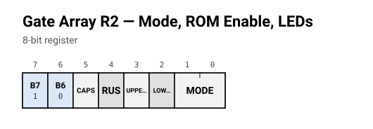

*Figure 3 — Gate Array R2 — Mode, ROM Enable, LEDs*

**Table 3 — Gate Array R2 — Mode, ROM Enable, LEDs**

| Field | Bits | Width | Fixed | Description |
| --- | --- | --- | --- | --- |
| **B7** | [7] | 1 | 1 | Must be 1 |
| **B6** | [6] | 1 | 0 | Must be 0 |
| **CAPS** | [5] | 1 | — | CAPS LED |
| **RUS** | [4] | 1 | — | RUS LED |
| **UPPER_ROM** | [3] | 1 | — | 1=disabled, 0=enabled |
| **LOWER_ROM** | [2] | 1 | — | 1=disabled, 0=enabled |
| **MODE** | [1:0] | 2 | — | 0=160x200, 1=320x200, 2=640x200 |

[Таблица](gen/L_GA_R2.md)

## Gate Array Register Select

**Table 4 — Gate Array register select (D7, D6)**

| Value | Name | Description |
| --- | --- | --- |
| 0..0 | **R0** | Palette index (D7=0, D6=0) |
| 1..1 | **R1** | Palette data (D7=0, D6=1) |
| 2..2 | **R2** | Mode, ROM enable, LEDs (D7=1, D6=0) |
| 3..3 | **R3** | RAM banking (D7=1, D6=1) |

[Таблица](gen/L_GA_REGS.md)

## MMR — RAM Memory Mapping

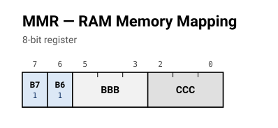

*Figure 4 — MMR — RAM Memory Mapping*

**Table 5 — MMR — RAM Memory Mapping**

| Field | Bits | Width | Fixed | Description |
| --- | --- | --- | --- | --- |
| **B7** | [7] | 1 | 1 | Must be 1 |
| **B6** | [6] | 1 | 1 | Must be 1 |
| **BBB** | [5:3] | 3 | — | Upper bank number |
| **CCC** | [2:0] | 3 | — | Configuration |

[Таблица](gen/L_MMR.md)

## Recommended PPI I/O Addresses

[Таблица](gen/L_PPI_ADDRS.md)

## PPI Manufacturer Bits

**Table 6 — PPI Manufacturer Bits (Port B bits 3–1)**

| Value | Name | Description |
| --- | --- | --- |
| 0..0 | **Isp** | Manufacturer Isp |
| 1..1 | **Triumph** | Manufacturer Triumph |
| 2..2 | **Saisho** | Manufacturer Saisho |
| 3..3 | **Solavox** | Manufacturer Solavox |
| 4..4 | **Awa** | Manufacturer Awa |
| 5..5 | **Schneider** | Manufacturer Schneider |
| 6..6 | **Orion** | Manufacturer Orion |
| 7..7 | **Amstrad** | Manufacturer Amstrad |

[Таблица](gen/L_PPI_MFG.md)

## 8255 PPI Port A — PSG Data Bus

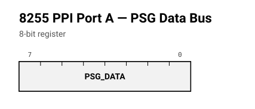

*Figure 5 — 8255 PPI Port A — PSG Data Bus*

**Table 7 — 8255 PPI Port A — PSG Data Bus**

| Field | Bits | Width | Description |
| --- | --- | --- | --- |
| **PSG_DATA** | [7:0] | 8 | PSG data bus |

[Таблица](gen/L_PPI_PORTA.md)

## 8255 PPI Port B — VSYNC, Cassette, Printer

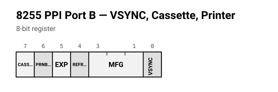

*Figure 6 — 8255 PPI Port B — VSYNC, Cassette, Printer*

**Table 8 — 8255 PPI Port B — VSYNC, Cassette, Printer**

| Field | Bits | Width | Description |
| --- | --- | --- | --- |
| **CASSETTE** | [7] | 1 | Cassette data |
| **PRNBUSY** | [6] | 1 | 1=busy, 0=ready |
| **EXP** | [5] | 1 | Expansion signal |
| **REFRESH** | [4] | 1 | 1=50Hz, 0=60Hz |
| **MFG** | [3:1] | 3 | Manufacturer code [`L_PPI_MFG`](gen/L_PPI_MFG.md) |
| **VSYNC** | [0] | 1 | 1=active |

[Таблица](gen/L_PPI_PORTB.md)

## 8255 PPI Port C — PSG Control, Cassette, Keyboard

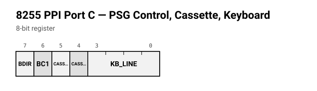

*Figure 7 — 8255 PPI Port C — PSG Control, Cassette, Keyboard*

**Table 9 — 8255 PPI Port C — PSG Control, Cassette, Keyboard**

| Field | Bits | Width | Description |
| --- | --- | --- | --- |
| **BDIR** | [7] | 1 | PSG BDIR |
| **BC1** | [6] | 1 | PSG BC1 |
| **CASS_WR** | [5] | 1 | Cassette write data |
| **CASS_MOT** | [4] | 1 | Cassette motor (1=on) |
| **KB_LINE** | [3:0] | 4 | Keyboard row select (0–15) |

[Таблица](gen/L_PPI_PORTC.md)

## PSG Function Select

**Table 10 — PSG function select (BDIR, BC1)**

| Value | Name | Description |
| --- | --- | --- |
| 0..0 | **Inactive** | No operation |
| 1..1 | **Read** | Read from selected PSG register |
| 2..2 | **Write** | Write to selected PSG register |
| 3..3 | **Select** | Select PSG register |

[Таблица](gen/L_PSG_SELECT.md)

## RMR — Control, ROM Mapping, Graphics Mode

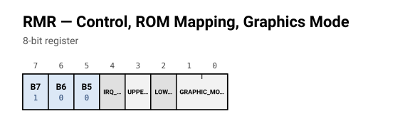

*Figure 8 — RMR — Control, ROM Mapping, Graphics Mode*

**Table 11 — RMR — Control, ROM Mapping, Graphics Mode**

| Field | Bits | Width | Fixed | Description |
| --- | --- | --- | --- | --- |
| **B7** | [7] | 1 | 1 | Must be 1 |
| **B6** | [6] | 1 | 0 | Must be 0 |
| **B5** | [5] | 1 | 0 | Must be 0 (Plus ASIC unlocked) |
| **IRQ_CTRL** | [4] | 1 | — | Interrupt control |
| **UPPER_ROM** | [3] | 1 | — | 1=disabled, 0=enabled |
| **LOWER_ROM** | [2] | 1 | — | 1=disabled, 0=enabled |
| **GRAPHIC_MODE** | [1:0] | 2 | — | Graphics mode |

[Таблица](gen/L_RMR.md)

## CPC 6128 Upper ROM Banks

[Таблица](gen/L_UPPER_ROM_BANKS.md)

## Blitter Register Map (lx_dma.sv)

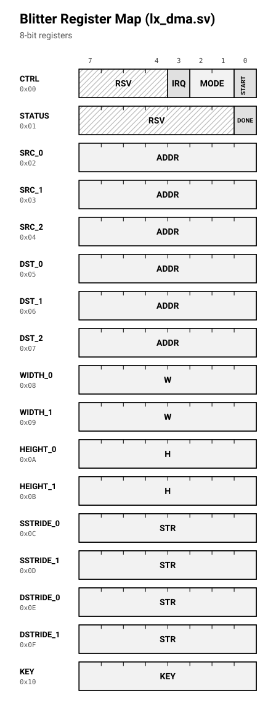

*Figure 9 — Blitter Register Map (lx_dma.sv)*

**Table 12 — Blitter Register Map (lx_dma.sv)**

| Offset | Name | Description |
| --- | --- | --- |
| `0x00` | **CTRL** | — |
| `0x01` | **STATUS** | — |
| `0x02` | **SRC_0** | — |
| `0x03` | **SRC_1** | — |
| `0x04` | **SRC_2** | — |
| `0x05` | **DST_0** | — |
| `0x06` | **DST_1** | — |
| `0x07` | **DST_2** | — |
| `0x08` | **WIDTH_0** | — |
| `0x09` | **WIDTH_1** | — |
| `0x0A` | **HEIGHT_0** | — |
| `0x0B` | **HEIGHT_1** | — |
| `0x0C` | **SSTRIDE_0** | — |
| `0x0D` | **SSTRIDE_1** | — |
| `0x0E` | **DSTRIDE_0** | — |
| `0x0F` | **DSTRIDE_1** | — |
| `0x10` | **KEY** | — |

**CTRL** (`0x00`)

| Field | Bits | Width | Description |
| --- | --- | --- | --- |
| **RSV** | [7:4] | 4 | Reserved |
| **IRQ** | [3] | 1 | IRQ on done |
| **MODE** | [2:1] | 2 | 0=copy, 1=fill, 2=copy+transp |
| **START** | [0] | 1 | Start transfer |

**STATUS** (`0x01`)

| Field | Bits | Width | Description |
| --- | --- | --- | --- |
| **RSV** | [7:1] | 7 | Reserved |
| **DONE** | [0] | 1 | Done pending (W 1 = clear) |

**SRC_0** (`0x02`)

| Field | Bits | Width | Description |
| --- | --- | --- | --- |
| **ADDR** | [7:0] | 8 | Physical source [7:0] |

**SRC_1** (`0x03`)

| Field | Bits | Width | Description |
| --- | --- | --- | --- |
| **ADDR** | [7:0] | 8 | Physical source [15:8] |

**SRC_2** (`0x04`)

| Field | Bits | Width | Description |
| --- | --- | --- | --- |
| **ADDR** | [7:0] | 8 | Physical source [23:16] |

**DST_0** (`0x05`)

| Field | Bits | Width | Description |
| --- | --- | --- | --- |
| **ADDR** | [7:0] | 8 | Physical dest [7:0] |

**DST_1** (`0x06`)

| Field | Bits | Width | Description |
| --- | --- | --- | --- |
| **ADDR** | [7:0] | 8 | Physical dest [15:8] |

**DST_2** (`0x07`)

| Field | Bits | Width | Description |
| --- | --- | --- | --- |
| **ADDR** | [7:0] | 8 | Physical dest [23:16] |

**WIDTH_0** (`0x08`)

| Field | Bits | Width | Description |
| --- | --- | --- | --- |
| **W** | [7:0] | 8 | Bytes per line [7:0] |

**WIDTH_1** (`0x09`)

| Field | Bits | Width | Description |
| --- | --- | --- | --- |
| **W** | [7:0] | 8 | Bytes per line [15:8] |

**HEIGHT_0** (`0x0A`)

| Field | Bits | Width | Description |
| --- | --- | --- | --- |
| **H** | [7:0] | 8 | Lines [7:0] |

**HEIGHT_1** (`0x0B`)

| Field | Bits | Width | Description |
| --- | --- | --- | --- |
| **H** | [7:0] | 8 | Lines [15:8] |

**SSTRIDE_0** (`0x0C`)

| Field | Bits | Width | Description |
| --- | --- | --- | --- |
| **STR** | [7:0] | 8 | Source stride (signed) [7:0] |

**SSTRIDE_1** (`0x0D`)

| Field | Bits | Width | Description |
| --- | --- | --- | --- |
| **STR** | [7:0] | 8 | Source stride (signed) [15:8] |

**DSTRIDE_0** (`0x0E`)

| Field | Bits | Width | Description |
| --- | --- | --- | --- |
| **STR** | [7:0] | 8 | Dest stride (signed) [7:0] |

**DSTRIDE_1** (`0x0F`)

| Field | Bits | Width | Description |
| --- | --- | --- | --- |
| **STR** | [7:0] | 8 | Dest stride (signed) [15:8] |

**KEY** (`0x10`)

| Field | Bits | Width | Description |
| --- | --- | --- | --- |
| **KEY** | [7:0] | 8 | Fill byte / transparent color |

[Таблица](gen/dma_blitter_map.md)

## Blitter Modes

[Таблица](gen/dma_blitter_modes.md)

## SysDMA Register Map (wb_dma.sv)

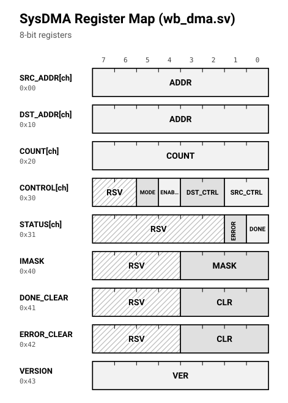

*Figure 10 — SysDMA Register Map (wb_dma.sv)*

**Table 13 — SysDMA Register Map (wb_dma.sv)**

| Offset | Name | Description |
| --- | --- | --- |
| `0x00` | **SRC_ADDR[ch]** | — |
| `0x10` | **DST_ADDR[ch]** | — |
| `0x20` | **COUNT[ch]** | — |
| `0x30` | **CONTROL[ch]** | — |
| `0x31` | **STATUS[ch]** | — |
| `0x40` | **IMASK** | — |
| `0x41` | **DONE_CLEAR** | — |
| `0x42` | **ERROR_CLEAR** | — |
| `0x43` | **VERSION** | — |

**SRC_ADDR[ch]** (`0x00`)

| Field | Bits | Width | Description |
| --- | --- | --- | --- |
| **ADDR** | [7:0] | 8 | Source address (24 bits) |

**DST_ADDR[ch]** (`0x10`)

| Field | Bits | Width | Description |
| --- | --- | --- | --- |
| **ADDR** | [7:0] | 8 | Destination address (24 bits) |

**COUNT[ch]** (`0x20`)

| Field | Bits | Width | Description |
| --- | --- | --- | --- |
| **COUNT** | [7:0] | 8 | Transfer count (24 bits) |

**CONTROL[ch]** (`0x30`)

| Field | Bits | Width | Description |
| --- | --- | --- | --- |
| **RSV** | [7:6] | 2 | Reserved |
| **MODE** | [5] | 1 | 0=Demand, 1=Block |
| **ENABLE** | [4] | 1 | Enable channel |
| **DST_CTRL** | [3:2] | 2 | Dest control |
| **SRC_CTRL** | [1:0] | 2 | Source control |

**STATUS[ch]** (`0x31`)

| Field | Bits | Width | Description |
| --- | --- | --- | --- |
| **RSV** | [7:2] | 6 | Reserved |
| **ERROR** | [1] | 1 | Transfer error |
| **DONE** | [0] | 1 | Transfer done |

**IMASK** (`0x40`)

| Field | Bits | Width | Description |
| --- | --- | --- | --- |
| **RSV** | [7:4] | 4 | Reserved |
| **MASK** | [3:0] | 4 | Interrupt mask per channel |

**DONE_CLEAR** (`0x41`)

| Field | Bits | Width | Description |
| --- | --- | --- | --- |
| **RSV** | [7:4] | 4 | Reserved |
| **CLR** | [3:0] | 4 | Clear DONE flags |

**ERROR_CLEAR** (`0x42`)

| Field | Bits | Width | Description |
| --- | --- | --- | --- |
| **RSV** | [7:4] | 4 | Reserved |
| **CLR** | [3:0] | 4 | Clear ERROR flags |

**VERSION** (`0x43`)

| Field | Bits | Width | Description |
| --- | --- | --- | --- |
| **VER** | [7:0] | 8 | Version / features |

[Таблица](gen/dma_sysdma_map.md)

## SysDMA Modes

[Таблица](gen/dma_sysdma_modes.md)

## CRTC 6845 Ports

**Table 14 — CRTC 6845 Ports**

| Value | Name | Description |
| --- | --- | --- |
| 0..0 | **BCXX** | Index register (W) |
| 1..1 | **BDXX** | Data register (W) |
| 2..2 | **BEXX** | Status register (R) |
| 3..3 | **BFXX** | Data register (R) |

[Таблица](gen/io_crtc_ports.md)

## FDC 765 Ports

**Table 15 — FDC 765 Ports**

| Value | Name | Description |
| --- | --- | --- |
| 0..0 | **FA7E** | Floppy motor control (W) |
| 1..1 | **FB7E** | FDC status register (R) |
| 2..2 | **FB7F** | FDC data register (R/W) |

[Таблица](gen/io_fdc_ports.md)

## Gate Array Register Select (7Fxx)

**Table 16 — Gate Array Register Select (7Fxx)**

| Value | Name | Description |
| --- | --- | --- |
| 0..0 | **R0** | Palette index (D7=0, D6=0) |
| 1..1 | **R1** | Palette data (D7=0, D6=1) |
| 2..2 | **R2** | Mode, ROM enable, LEDs (D7=1, D6=0) |
| 3..3 | **R3** | RAM banking (D7=1, D6=1) |

[Таблица](gen/io_ga_regs.md)

## Legacy Software CAN

**Table 17 — Legacy Software CAN**

| Value | Name | Description |
| --- | --- | --- |
| 0 | **Native CPC ports** | 7Fxx, BCXX, BDXX, DFXX, F4XX–F7XX, FA7E, FB7E, FB7F |
| 1 | **Enter Supervisor** | SYSCALL (in Legacy, the syscall port is F2xx) |
| 2 | **IPC mailbox** | via the Supervisor |

[Таблица](gen/io_legacy_can.md)

## Legacy Software CANNOT

**Table 18 — Legacy Software CANNOT**

| Value | Name | Description |
| --- | --- | --- |
| 0 | **Direct MMIO_LO access** | No D0XX/D300 window |
| 1 | **Direct access to PIC, Timer, RTC, Blitter, Sound** | Not mapped in Legacy |
| 2 | **Any modern LX device** | Only via syscall |

[Таблица](gen/io_legacy_cannot.md)

## Legacy Device Sub-registers

**Table 19 — Legacy Device Sub-registers**

| Value | Name | Description |
| --- | --- | --- |
| 0 | **Gate Array** | CPC 7Fxx (D7/D6), RTL implemented, LX Mandatory |
| 1 | **CRTC 6845** | CPC BCXX/BDXX, RTL implemented, LX Mandatory |
| 2 | **PPI 8255** | CPC F4XX–F7XX, RTL implemented, LX Mandatory |
| 3 | **FDC 765** | CPC FA7E/FB7E/FB7F, RTL implemented, LX Mandatory |
| 4 | **Upper ROM Select** | CPC DFXX, RTL implemented, LX Mandatory |
| 5 | **Printer port** | CPC EFXX (via PPI), Optional |
| 6 | **Cassette tape** | CPC (via PPI), Optional |
| 7 | **Joysticks** | CPC (via PPI/keyboard), Optional |
| 8 | **SIO/DART** | CPC FADC–FADF, RTL not implemented, Optional |
| 9 | **8253 Timer** | CPC FBDC–FBDF, RTL not implemented, Optional |

[Таблица](gen/io_legacy_devices.md)

## MMIO_LO Page Map

**Table 20 — MMIO_LO Page Map**

| Value | Name | Description |
| --- | --- | --- |
| 0 | **Page 0** | (verify against RTL) |
| 2 | **Page 2** | Legacy emulation |
| 4 | **Page 4** | (verify against RTL) |
| 6 | **Page 6** | Blitter (1 channel, 8-bit, copy/fill/transparent) |
| 8 | **Page 8** | Sound chip |

[Таблица](gen/io_mmio_pages.md)

## MMIO Regions

**Table 21 — MMIO Regions**

| Value | Name | Description |
| --- | --- | --- |
| 0 | **MMIO_LO** | New LX devices (bank-switched) |
| 1 | **MMIO_HI** | Legacy CPC devices (fixed addresses) |

[Таблица](gen/io_mmio_regions.md)

## MMU Registers (Ports E0–FF)

**Table 22 — MMU Registers (Ports E0–FF)**

| Offset | Name | Description |
| --- | --- | --- |
| `0xE0` | **MMU_EXT** | Extended mapper access (16 registers, save/restore) |
| `0xF0` | **GLOBAL_CTRL** | Mode control: bit 0 = supervisor, bit 1 = native, bit 2 = trap hook, bit 4 = mmio_userlock |
| `0xF1` | **MMIO_PAGE** | 7-bit MMIO page (0–127) |
| `0xF2` | **SYSCALL** | Supervisor entry (write-only) |
| `0xF3` | **CLOCK_CTRL** | CPU clock divider (Supervisor only) |
| `0xFA` | **SUPER_SLOT** | Supervisor slot select (4 × 2-bit page fields) |
| `0xFB` | **USER_SLOT** | User slot select (4 × 2-bit page fields) |
| `0xFC` | **BANK_0** | Bank register for current slot, page 0 |
| `0xFD` | **BANK_1** | Bank register for current slot, page 1 |
| `0xFE` | **BANK_2** | Bank register for current slot, page 2 |
| `0xFF` | **BANK_3** | Bank register for current slot, page 3 |

[Таблица](gen/io_mmu_ports.md)

## Native Mode Port Map

**Table 23 — Native Mode Port Map**

| Value | Name | Description |
| --- | --- | --- |
| 0..127 | **MMIO window** | 128 bytes: access to MMIO_LO |
| 128..223 | **External I/O** | 96 bytes: forwarded to Wishbone |
| 224..255 | **MMU registers** | 32 bytes: MMU control |

[Таблица](gen/io_native_ports.md)

## PPI 8255 Ports

**Table 24 — PPI 8255 Ports**

| Value | Name | Description |
| --- | --- | --- |
| 0..0 | **F4XX** | Port A (PSG data), RW |
| 1..1 | **F5XX** | Port B (Vsync, PrnBusy, Tape), R |
| 2..2 | **F6XX** | Port C (KeybRow, Tape, PSG Control), W |
| 3..3 | **F7XX** | Control register, W |

[Таблица](gen/io_ppi_ports.md)

## Logical Slots

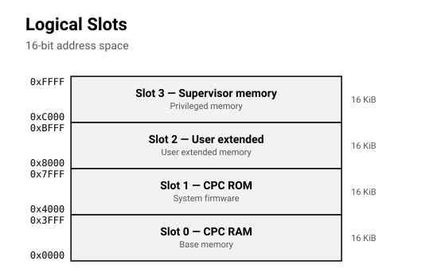

*Figure 11 — Logical Slots*

**Table 25 — Logical Slots**

| Range | Name | Size | Purpose |
| --- | --- | --- | --- |
| `0x0000`–`0x3FFF` | **Slot 0 — CPC RAM** | 16 KiB | Base memory |
| `0x4000`–`0x7FFF` | **Slot 1 — CPC ROM** | 16 KiB | System firmware |
| `0x8000`–`0xBFFF` | **Slot 2 — User extended** | 16 KiB | User extended memory |
| `0xC000`–`0xFFFF` | **Slot 3 — Supervisor memory** | 16 KiB | Privileged memory |

[Таблица](gen/io_slots.md)

## Access Security Policy

MARKDOWN_TABLE_HERE

[Таблица](gen/mmu_access_policy.md)

## GLOBAL_CTRL (F0h)

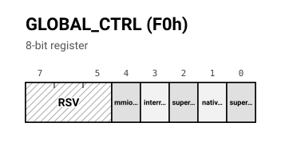

*Figure 12 — GLOBAL_CTRL (F0h)*

**Table 26 — GLOBAL_CTRL (F0h)**

| Field | Bits | Width | Description |
| --- | --- | --- | --- |
| **RSV** | [7:5] | 3 | Reserved |
| **mmio_userlock** | [4] | 1 | 0 = unlocked, 1 = locked. Blocks all MMU ports (E0–FF) in User mode. Only Supervisor can change this bit. |
| **interrupt_hold** | [3] | 1 | 1 = block INT to CPU (set on syscall entry/exit, released by kernel or on RET) |
| **supervisor_hook** | [2] | 1 | 0 = disabled, 1 = enabled. Enables hardware entry into Supervisor mode on M1 at 0038h (IM 1) or 0066h (NMI). |
| **native_mode** | [1] | 1 | 0 = Legacy (CPC 6128), 1 = Native (LX). Ignored in Supervisor mode. [`native_mode_vals`](gen/native_mode_vals.md) |
| **supervisor_mode** | [0] | 1 | 0 = User, 1 = Supervisor. Hardware trap entry on 0038h/0066h. [`supervisor_mode_vals`](gen/supervisor_mode_vals.md) |

[Таблица](gen/mmu_global_ctrl.md)

## Internal Mapper Registers (16 × 8-bit)

**Table 27 — Internal Mapper Registers (16 × 8-bit)**

| Offset | Name | Access | Reset | Description |
| --- | --- | --- | --- | --- |
| `0x00` | **MAPPER_0** | rw | 0x00 | Slot 0, page 0 |
| `0x01` | **MAPPER_1** | rw | 0x00 | Slot 0, page 1 |
| `0x02` | **MAPPER_2** | rw | 0x00 | Slot 0, page 2 |
| `0x03` | **MAPPER_3** | rw | 0x00 | Slot 0, page 3 |
| `0x04` | **MAPPER_4** | rw | 0x00 | Slot 1, page 0 |
| `0x05` | **MAPPER_5** | rw | 0x00 | Slot 1, page 1 |
| `0x06` | **MAPPER_6** | rw | 0x00 | Slot 1, page 2 |
| `0x07` | **MAPPER_7** | rw | 0x00 | Slot 1, page 3 |
| `0x08` | **MAPPER_8** | rw | 0x00 | Slot 2, page 0 |
| `0x09` | **MAPPER_9** | rw | 0x00 | Slot 2, page 1 |
| `0x0A` | **MAPPER_10** | rw | 0x00 | Slot 2, page 2 |
| `0x0B` | **MAPPER_11** | rw | 0x00 | Slot 2, page 3 |
| `0x0C` | **MAPPER_12** | rw | 0x00 | Slot 3, page 0 |
| `0x0D` | **MAPPER_13** | rw | 0x00 | Slot 3, page 1 |
| `0x0E` | **MAPPER_14** | rw | 0x00 | Slot 3, page 2 |
| `0x0F` | **MAPPER_15** | rw | 0x00 | Slot 3, page 3 |

[Таблица](gen/mmu_mapper_regs.md)

## Operating Modes

**Table 28 — supervisor_mode (GLOBAL_CTRL[0])**

| Value | Name | Description |
| --- | --- | --- |
| 0 | **User** | Application code; access to slots and I/O is restricted |
| 1 | **Supervisor** | Kernel code; full access to all resources; hardware trap entry |

**Table 29 — native_mode (GLOBAL_CTRL[1])**

| Value | Name | Description |
| --- | --- | --- |
| 0 | **Legacy** | CPC 6128 compatibility; ignored in Supervisor mode |
| 1 | **Native** | Extended LX mode with slot/bank MMU |

[Таблица](gen/mmu_modes.md)

## Control Registers (Ports F0–FF, E0–EF)

**Table 30 — Control Registers (Ports F0–FF, E0–EF)**

| Offset | Name | Access | Reset | Description |
| --- | --- | --- | --- | --- |
| `0xE0` | **MMU_EXT** | rw | — | Extended mapper access, ports E0–EF (CPU only) |
| `0xF0` | **GLOBAL_CTRL** | rw | 0x13 | Mode control (supervisor=1, native=1, lock=1) |
| `0xF1` | **MMIO_PAGE** | rw | 0x00 | 7-bit MMIO page |
| `0xF2` | **SYSCALL** | wo | — | Supervisor entry (write-only) |
| `0xF3` | **CLOCK_CTRL** | rw | 0x02 | CPU clock divider (Supervisor only), divide by 4 |
| `0xFA` | **SUPER_SLOT** | rw | 0xFF | Supervisor slot select (all pages → slot 3) |
| `0xFB` | **USER_SLOT** | rw | 0x00 | User slot select (all pages → slot 0) |
| `0xFC` | **BANK_0** | rw | 0x00 | Bank register for current slot, page 0 |
| `0xFD` | **BANK_1** | rw | 0x00 | Bank register for current slot, page 1 |
| `0xFE` | **BANK_2** | rw | 0x00 | Bank register for current slot, page 2 |
| `0xFF` | **BANK_3** | rw | 0x00 | Bank register for current slot, page 3 |

[Таблица](gen/mmu_ports.md)

## Reset State (RTL)

**Table 31 — Control Registers (Ports F0–FF, E0–EF)**

| Offset | Name | Access | Reset | Description |
| --- | --- | --- | --- | --- |
| `0xE0` | **MMU_EXT** | rw | — | Extended mapper access, ports E0–EF (CPU only) |
| `0xF0` | **GLOBAL_CTRL** | rw | 0x13 | Mode control (supervisor=1, native=1, lock=1) |
| `0xF1` | **MMIO_PAGE** | rw | 0x00 | 7-bit MMIO page |
| `0xF2` | **SYSCALL** | wo | — | Supervisor entry (write-only) |
| `0xF3` | **CLOCK_CTRL** | rw | 0x02 | CPU clock divider (Supervisor only), divide by 4 |
| `0xFA` | **SUPER_SLOT** | rw | 0xFF | Supervisor slot select (all pages → slot 3) |
| `0xFB` | **USER_SLOT** | rw | 0x00 | User slot select (all pages → slot 0) |
| `0xFC` | **BANK_0** | rw | 0x00 | Bank register for current slot, page 0 |
| `0xFD` | **BANK_1** | rw | 0x00 | Bank register for current slot, page 1 |
| `0xFE` | **BANK_2** | rw | 0x00 | Bank register for current slot, page 2 |
| `0xFF` | **BANK_3** | rw | 0x00 | Bank register for current slot, page 3 |

[Таблица](gen/mmu_reset_state.md)

## Logical Slots

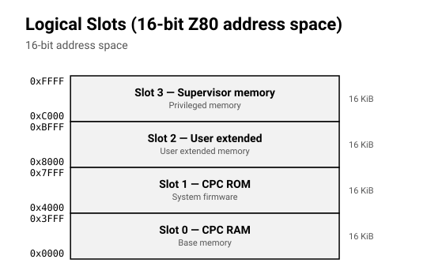

*Figure 13 — Logical Slots (16-bit Z80 address space)*

**Table 32 — Logical Slots (16-bit Z80 address space)**

| Range | Name | Size | Purpose |
| --- | --- | --- | --- |
| `0x0000`–`0x3FFF` | **Slot 0 — CPC RAM** | 16 KiB | Base memory |
| `0x4000`–`0x7FFF` | **Slot 1 — CPC ROM** | 16 KiB | System firmware |
| `0x8000`–`0xBFFF` | **Slot 2 — User extended** | 16 KiB | User extended memory |
| `0xC000`–`0xFFFF` | **Slot 3 — Supervisor memory** | 16 KiB | Privileged memory |

[Таблица](gen/mmu_slots.md)

## PIC Register Map (wb_z80_pic.sv)

**Table 33 — PIC Register Map (wb_z80_pic.sv)**

| Offset | Name | Description |
| --- | --- | --- |
| `0x00` | **MASK_L** | — |
| `0x01` | **MASK_H** | — |
| `0x02` | **VECTOR** | — |
| `0x03` | **STATUS_L** | — |
| `0x04` | **STATUS_H** | — |
| `0x05` | **PENDING_L** | — |
| `0x06` | **PENDING_H** | — |
| `0x07` | **CLEAR_L** | — |
| `0x08` | **CLEAR_H** | — |

**MASK_L** (`0x00`)

| Field | Bits | Width | Description |
| --- | --- | --- | --- |
| **IRQ_0_7** | [7:0] | 8 | Mask, lines 0–7 (1 = enabled) |

**MASK_H** (`0x01`)

| Field | Bits | Width | Description |
| --- | --- | --- | --- |
| **IRQ_8_15** | [7:0] | 8 | Mask, lines 8–15 (1 = enabled) |

**VECTOR** (`0x02`)

| Field | Bits | Width | Description |
| --- | --- | --- | --- |
| **VEC** | [7:0] | 8 | Base vector for IM 2 (default 0xFF) |

**STATUS_L** (`0x03`)

| Field | Bits | Width | Description |
| --- | --- | --- | --- |
| **IRQ_0_7** | [7:0] | 8 | Status, lines 0–7 |

**STATUS_H** (`0x04`)

| Field | Bits | Width | Description |
| --- | --- | --- | --- |
| **IRQ_8_15** | [7:0] | 8 | Status, lines 8–15 |

**PENDING_L** (`0x05`)

| Field | Bits | Width | Description |
| --- | --- | --- | --- |
| **IRQ_0_7** | [7:0] | 8 | Pending, lines 0–7 |

**PENDING_H** (`0x06`)

| Field | Bits | Width | Description |
| --- | --- | --- | --- |
| **IRQ_8_15** | [7:0] | 8 | Pending, lines 8–15 |

**CLEAR_L** (`0x07`)

| Field | Bits | Width | Description |
| --- | --- | --- | --- |
| **CLR_0_7** | [7:0] | 8 | Clear pending, lines 0–7 |

**CLEAR_H** (`0x08`)

| Field | Bits | Width | Description |
| --- | --- | --- | --- |
| **CLR_8_15** | [7:0] | 8 | Clear pending, lines 8–15 |

[Таблица](gen/pic_regmap.md)
