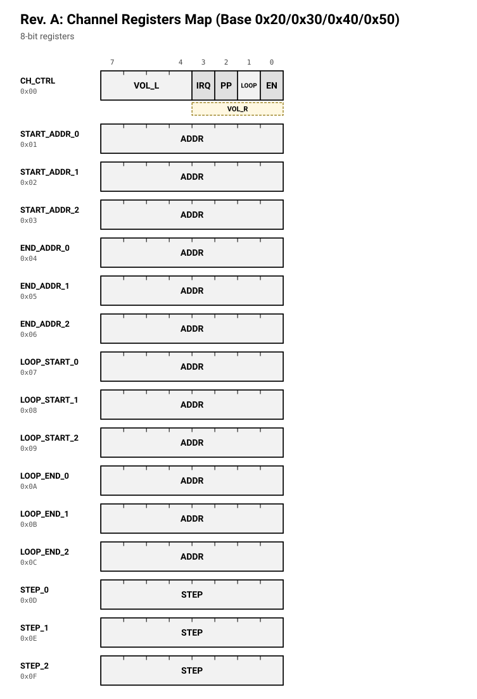
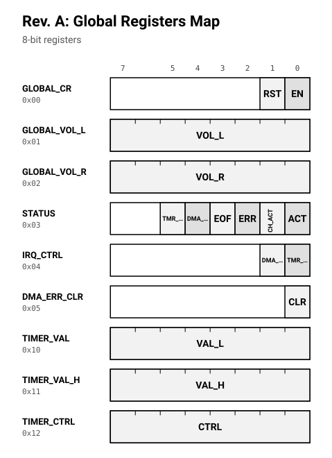
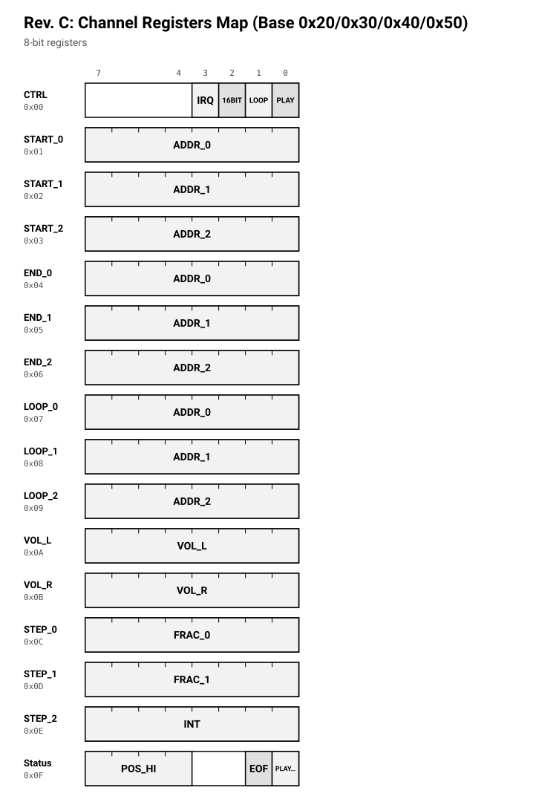
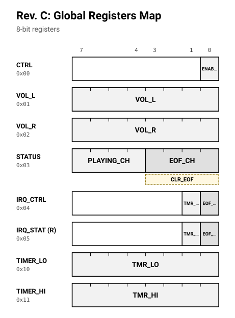

# LX-GPU — описание архитектуры

## Rev. A: Channel Registers Map (Base 0x20/0x30/0x40/0x50)

*Figure 1 — Rev. A: Channel Registers Map (Base 0x20/0x30/0x40/0x50)*

**Table 1 — Rev. A: Channel Registers Map (Base 0x20/0x30/0x40/0x50)**

| Offset | Name | Description |
| --- | --- | --- |
| `0x00` | **CH_CTRL** | — |
| `0x01` | **START_ADDR_0** | — |
| `0x02` | **START_ADDR_1** | — |
| `0x03` | **START_ADDR_2** | — |
| `0x04` | **END_ADDR_0** | — |
| `0x05` | **END_ADDR_1** | — |
| `0x06` | **END_ADDR_2** | — |
| `0x07` | **LOOP_START_0** | — |
| `0x08` | **LOOP_START_1** | — |
| `0x09` | **LOOP_START_2** | — |
| `0x0A` | **LOOP_END_0** | — |
| `0x0B` | **LOOP_END_1** | — |
| `0x0C` | **LOOP_END_2** | — |
| `0x0D` | **STEP_0** | — |
| `0x0E` | **STEP_1** | — |
| `0x0F` | **STEP_2** | — |

**CH_CTRL** (`0x00`)

| Field | Bits | Width | Description |
| --- | --- | --- | --- |
| **VOL_L** | [7:4] | 4 | Volume L (4-bit) |
| **IRQ** | [3] | 1 | IRQ on EOF |
| **VOL_R** | [3:0] | 4 | Volume R (4-bit) |
| **PP** | [2] | 1 | Ping-pong |
| **LOOP** | [1] | 1 | Loop |
| **EN** | [0] | 1 | Enable |

**START_ADDR_0** (`0x01`)

| Field | Bits | Width | Description |
| --- | --- | --- | --- |
| **ADDR** | [7:0] | 8 | Start address [7:0] |

**START_ADDR_1** (`0x02`)

| Field | Bits | Width | Description |
| --- | --- | --- | --- |
| **ADDR** | [7:0] | 8 | Start address [15:8] |

**START_ADDR_2** (`0x03`)

| Field | Bits | Width | Description |
| --- | --- | --- | --- |
| **ADDR** | [7:0] | 8 | Start address [23:16] |

**END_ADDR_0** (`0x04`)

| Field | Bits | Width | Description |
| --- | --- | --- | --- |
| **ADDR** | [7:0] | 8 | End address [7:0] |

**END_ADDR_1** (`0x05`)

| Field | Bits | Width | Description |
| --- | --- | --- | --- |
| **ADDR** | [7:0] | 8 | End address [15:8] |

**END_ADDR_2** (`0x06`)

| Field | Bits | Width | Description |
| --- | --- | --- | --- |
| **ADDR** | [7:0] | 8 | End address [23:16] |

**LOOP_START_0** (`0x07`)

| Field | Bits | Width | Description |
| --- | --- | --- | --- |
| **ADDR** | [7:0] | 8 | Loop start [7:0] |

**LOOP_START_1** (`0x08`)

| Field | Bits | Width | Description |
| --- | --- | --- | --- |
| **ADDR** | [7:0] | 8 | Loop start [15:8] |

**LOOP_START_2** (`0x09`)

| Field | Bits | Width | Description |
| --- | --- | --- | --- |
| **ADDR** | [7:0] | 8 | Loop start [23:16] |

**LOOP_END_0** (`0x0A`)

| Field | Bits | Width | Description |
| --- | --- | --- | --- |
| **ADDR** | [7:0] | 8 | Loop end [7:0] |

**LOOP_END_1** (`0x0B`)

| Field | Bits | Width | Description |
| --- | --- | --- | --- |
| **ADDR** | [7:0] | 8 | Loop end [15:8] |

**LOOP_END_2** (`0x0C`)

| Field | Bits | Width | Description |
| --- | --- | --- | --- |
| **ADDR** | [7:0] | 8 | Loop end [23:16] |

**STEP_0** (`0x0D`)

| Field | Bits | Width | Description |
| --- | --- | --- | --- |
| **STEP** | [7:0] | 8 | Step fraction [7:0] |

**STEP_1** (`0x0E`)

| Field | Bits | Width | Description |
| --- | --- | --- | --- |
| **STEP** | [7:0] | 8 | Step fraction [15:8] |

**STEP_2** (`0x0F`)

| Field | Bits | Width | Description |
| --- | --- | --- | --- |
| **STEP** | [7:0] | 8 | Step integer [23:16] |

[Таблица](gen/ms2a_channel_map.md)

## Rev. A: Global Registers Map

*Figure 2 — Rev. A: Global Registers Map*

**Table 2 — Rev. A: Global Registers Map**

| Offset | Name | Description |
| --- | --- | --- |
| `0x00` | **GLOBAL_CR** | — |
| `0x01` | **GLOBAL_VOL_L** | — |
| `0x02` | **GLOBAL_VOL_R** | — |
| `0x03` | **STATUS** | — |
| `0x04` | **IRQ_CTRL** | — |
| `0x05` | **DMA_ERR_CLR** | — |
| `0x10` | **TIMER_VAL** | — |
| `0x11` | **TIMER_VAL_H** | — |
| `0x12` | **TIMER_CTRL** | — |

**GLOBAL_CR** (`0x00`)

| Field | Bits | Width | Description |
| --- | --- | --- | --- |
| **RST** | [1] | 1 | Reset |
| **EN** | [0] | 1 | Enable |

**GLOBAL_VOL_L** (`0x01`)

| Field | Bits | Width | Description |
| --- | --- | --- | --- |
| **VOL_L** | [7:0] | 8 | Global left volume |

**GLOBAL_VOL_R** (`0x02`)

| Field | Bits | Width | Description |
| --- | --- | --- | --- |
| **VOL_R** | [7:0] | 8 | Global right volume |

**STATUS** (`0x03`)

| Field | Bits | Width | Description |
| --- | --- | --- | --- |
| **TMR_IRQ** | [5] | 1 | Timer IRQ |
| **DMA_ERR** | [4] | 1 | DMA error |
| **EOF** | [3] | 1 | Any EOF |
| **ERR** | [2] | 1 | Any error |
| **CH_ACT** | [1] | 1 | Any channel active |
| **ACT** | [0] | 1 | Global active |

**IRQ_CTRL** (`0x04`)

| Field | Bits | Width | Description |
| --- | --- | --- | --- |
| **DMA_NMI** | [1] | 1 | DMA error NMI enable |
| **TMR_EN** | [0] | 1 | Timer IRQ enable |

**DMA_ERR_CLR** (`0x05`)

| Field | Bits | Width | Description |
| --- | --- | --- | --- |
| **CLR** | [0] | 1 | Write 1 to clear |

**TIMER_VAL** (`0x10`)

| Field | Bits | Width | Description |
| --- | --- | --- | --- |
| **VAL_L** | [7:0] | 8 | Timer value low |

**TIMER_VAL_H** (`0x11`)

| Field | Bits | Width | Description |
| --- | --- | --- | --- |
| **VAL_H** | [7:0] | 8 | Timer value high |

**TIMER_CTRL** (`0x12`)

| Field | Bits | Width | Description |
| --- | --- | --- | --- |
| **CTRL** | [7:0] | 8 | Timer control |

[Таблица](gen/ms2a_global_map.md)

## Rev. C: Channel Registers Map (Base 0x20/0x30/0x40/0x50)

*Figure 3 — Rev. C: Channel Registers Map (Base 0x20/0x30/0x40/0x50)*

**Table 3 — Rev. C: Channel Registers Map (Base 0x20/0x30/0x40/0x50)**

| Offset | Name | Description |
| --- | --- | --- |
| `0x00` | **CTRL** | — |
| `0x01` | **START_0** | — |
| `0x02` | **START_1** | — |
| `0x03` | **START_2** | — |
| `0x04` | **END_0** | — |
| `0x05` | **END_1** | — |
| `0x06` | **END_2** | — |
| `0x07` | **LOOP_0** | — |
| `0x08` | **LOOP_1** | — |
| `0x09` | **LOOP_2** | — |
| `0x0A` | **VOL_L** | — |
| `0x0B` | **VOL_R** | — |
| `0x0C` | **STEP_0** | — |
| `0x0D` | **STEP_1** | — |
| `0x0E` | **STEP_2** | — |
| `0x0F` | **Status** | — |

**CTRL** (`0x00`)

| Field | Bits | Width | Description |
| --- | --- | --- | --- |
| **IRQ** | [3] | 1 | IRQ on EOF |
| **16BIT** | [2] | 1 | 16-bit samples |
| **LOOP** | [1] | 1 | Loop |
| **PLAY** | [0] | 1 | Play |

**START_0** (`0x01`)

| Field | Bits | Width | Description |
| --- | --- | --- | --- |
| **ADDR_0** | [7:0] | 8 | Start address [7:0] |

**START_1** (`0x02`)

| Field | Bits | Width | Description |
| --- | --- | --- | --- |
| **ADDR_1** | [7:0] | 8 | Start address [15:8] |

**START_2** (`0x03`)

| Field | Bits | Width | Description |
| --- | --- | --- | --- |
| **ADDR_2** | [7:0] | 8 | Start address [23:16] |

**END_0** (`0x04`)

| Field | Bits | Width | Description |
| --- | --- | --- | --- |
| **ADDR_0** | [7:0] | 8 | End address [7:0] |

**END_1** (`0x05`)

| Field | Bits | Width | Description |
| --- | --- | --- | --- |
| **ADDR_1** | [7:0] | 8 | End address [15:8] |

**END_2** (`0x06`)

| Field | Bits | Width | Description |
| --- | --- | --- | --- |
| **ADDR_2** | [7:0] | 8 | End address [23:16] |

**LOOP_0** (`0x07`)

| Field | Bits | Width | Description |
| --- | --- | --- | --- |
| **ADDR_0** | [7:0] | 8 | Loop address [7:0] |

**LOOP_1** (`0x08`)

| Field | Bits | Width | Description |
| --- | --- | --- | --- |
| **ADDR_1** | [7:0] | 8 | Loop address [15:8] |

**LOOP_2** (`0x09`)

| Field | Bits | Width | Description |
| --- | --- | --- | --- |
| **ADDR_2** | [7:0] | 8 | Loop address [23:16] |

**VOL_L** (`0x0A`)

| Field | Bits | Width | Description |
| --- | --- | --- | --- |
| **VOL_L** | [7:0] | 8 | Channel left volume |

**VOL_R** (`0x0B`)

| Field | Bits | Width | Description |
| --- | --- | --- | --- |
| **VOL_R** | [7:0] | 8 | Channel right volume |

**STEP_0** (`0x0C`)

| Field | Bits | Width | Description |
| --- | --- | --- | --- |
| **FRAC_0** | [7:0] | 8 | Step fraction [7:0] |

**STEP_1** (`0x0D`)

| Field | Bits | Width | Description |
| --- | --- | --- | --- |
| **FRAC_1** | [7:0] | 8 | Step fraction [15:8] |

**STEP_2** (`0x0E`)

| Field | Bits | Width | Description |
| --- | --- | --- | --- |
| **INT** | [7:0] | 8 | Step integer |

**Status** (`0x0F`)

| Field | Bits | Width | Description |
| --- | --- | --- | --- |
| **POS_HI** | [7:4] | 4 | Position high byte |
| **EOF** | [1] | 1 | EOF |
| **PLAYING** | [0] | 1 | Playing |

[Таблица](gen/ms2c_channel_map.md)

## Rev. C: Global Registers Map

*Figure 4 — Rev. C: Global Registers Map*

**Table 4 — Rev. C: Global Registers Map**

| Offset | Name | Description |
| --- | --- | --- |
| `0x00` | **CTRL** | — |
| `0x01` | **VOL_L** | — |
| `0x02` | **VOL_R** | — |
| `0x03` | **STATUS** | — |
| `0x04` | **IRQ_CTRL** | — |
| `0x05` | **IRQ_STAT (R)** | — |
| `0x10` | **TIMER_LO** | — |
| `0x11` | **TIMER_HI** | — |

**CTRL** (`0x00`)

| Field | Bits | Width | Description |
| --- | --- | --- | --- |
| **ENABLE** | [0] | 1 | Enable MS2 |

**VOL_L** (`0x01`)

| Field | Bits | Width | Description |
| --- | --- | --- | --- |
| **VOL_L** | [7:0] | 8 | Global left volume |

**VOL_R** (`0x02`)

| Field | Bits | Width | Description |
| --- | --- | --- | --- |
| **VOL_R** | [7:0] | 8 | Global right volume |

**STATUS** (`0x03`)

| Field | Bits | Width | Description |
| --- | --- | --- | --- |
| **PLAYING_CH** | [7:4] | 4 | Playing per channel (read) |
| **EOF_CH** | [3:0] | 4 | EOF per channel (read) |
| **CLR_EOF** | [3:0] | 4 | Clear EOF (write) |

**IRQ_CTRL** (`0x04`)

| Field | Bits | Width | Description |
| --- | --- | --- | --- |
| **TMR_IRQ** | [1] | 1 | Timer IRQ enable |
| **EOF_IRQ** | [0] | 1 | EOF IRQ enable |

**IRQ_STAT (R)** (`0x05`)

| Field | Bits | Width | Description |
| --- | --- | --- | --- |
| **TMR_PEND** | [1] | 1 | Timer pending |
| **EOF_PEND** | [0] | 1 | EOF pending |

**TIMER_LO** (`0x10`)

| Field | Bits | Width | Description |
| --- | --- | --- | --- |
| **TMR_LO** | [7:0] | 8 | Timer period low |

**TIMER_HI** (`0x11`)

| Field | Bits | Width | Description |
| --- | --- | --- | --- |
| **TMR_HI** | [7:0] | 8 | Timer period high |

[Таблица](gen/ms2c_global_map.md)
