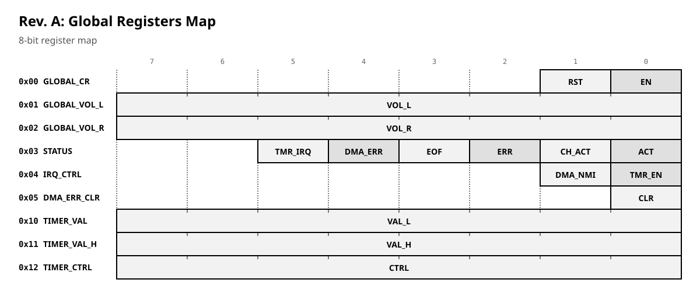
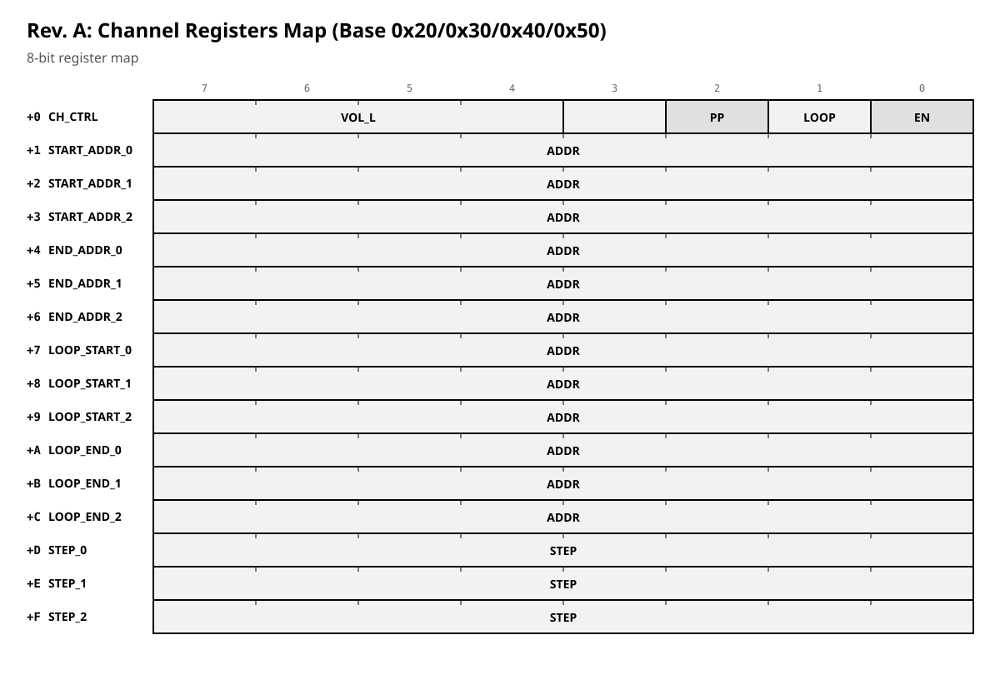

# LX Magic Sound 2 (rev. A)

**Status:** planned baseline. Tested in simulation only (FPGA toolchain, module-level tests). **Never produced sound on real hardware** — there was no code to run it on the board.
**See also:** `lx_magic_sound_rev_c.md` (working implementation), `lx_rtl_reference.md` (addresses).

**RTL:** `magic_sound_2.sv` + 6 modules (simulation only).
**Address:** page 7 (same as rev. C; see `lx_rtl_reference.md`).

---

## 0. How to read this document

This is the **planned baseline** (rev. A). It was designed and tested in simulation, but never on real hardware. It is **not** the working implementation.

The working implementation is **rev. C** (`lx_magic_sound_rev_c.md`). Where rev. A and rev. C differ, **rev. C is what exists**. Rev. A is the baseline that rev. C was measured against.

### Markers

| Marker | Meaning |
|---|---|
| **✔ By design** | An intentional decision in rev. A. |
| **⚠ Changed in rev. C** | The working implementation differs. See rev. C. |
| **⚠ Not in rev. C** | Present in rev. A, not implemented in rev. C. Desirable to return. |

---

## 1. Motivation

The original Magic Sound (1990s) had four "birth defects":

1. **Sample length limited to 64 KB.**
2. **Volume ~6 bits per channel.**
3. **No stereo.**
4. **Loop restart required the CPU.**

Magic Sound 2 (rev. A) fixes all four:

- 24-bit address space (16 MB), so samples can be arbitrarily long.
- 8-bit volume per channel (left and right), plus global volume.
- Stereo output.
- Automatic loop (`LOOP_START` / `LOOP_END`), no CPU needed.

---

## 2. Architecture

### 2.1 Channels
- **4 channels** (`NUM_CHANNELS = 4`). 8 channels would be desirable (option).

### 2.2 Sample format
- **16-bit samples** (`SW = 16`). Signed.

### 2.3 Frequency
- **96 kHz** sample rate (`SAMPLE_RATE_HZ = 96_000` in `ms2_pkg.sv`).

### 2.4 Wishbone
- **Slave:** 8-bit (CPU side).
- **Master:** **16-bit** (`SW = 16`) — for memory reads.

### 2.5 Output
- **I2S** (`ms2_i2s_tx.sv`): `i2s_bclk_o`, `i2s_lrclk_o`, `i2s_data_o`. Stereo.

### 2.6 Loop
- **Two points:** `LOOP_START` and `LOOP_END` (24 bits each).
- Automatic loop, no CPU. **Ping-pong** mode (`CH_CTRL[2]`).

### 2.7 Step
- **16.16 fixed-point** (32 bits).
- `step = (desired_frequency << 16) / sample_rate`.

### 2.8 Timer
- `TIMER_VAL` (16 bits) + `TIMER_CTRL` (8 bits). 300 Hz music timer.

### 2.9 Interrupts
- IRQ on EOF (`CH_CTRL[3]`). Timer IRQ (`IRQ_CTRL[0]`). DMA error → NMI (`IRQ_CTRL[1]`).

### 2.10 DMA error handling

When the DMA reads memory and the memory controller returns a timeout (watchdog), the sound card must:

1. Latch the error bit (`STATUS[2]` = any channel error, `STATUS[4]` = DMA error).
2. Enter an error state.
3. Signal the error (IRQ/NMI).

**✔ By design (rev. A):** error handling is part of the status and interrupt design. `DMA_ERR_CLR` (global `0x05`) clears the flags.

> **⚠ Not in rev. C:** DMA error handling is **not implemented** in rev. C. It is desirable to return it. See `lx_magic_sound_rev_c.md` §5.

---

## 3. Registers

### 3.1 Global registers


<!-- table: generated -->

### Rev. A: Global Registers

| Offset | Name | R/W | Bits |
| --- | --- | --- | --- |
| 0x00 | GLOBAL_CR | RW | [0] enable; [1] reset |
| 0x01 | GLOBAL_VOL_L | RW | [7:0] global left volume |
| 0x02 | GLOBAL_VOL_R | RW | [7:0] global right volume |
| 0x03 | STATUS | R | [0] global active; [1] any active; [2] any error; [3] any EOF; [4] DMA error; [5] timer IRQ |
| 0x04 | IRQ_CTRL | RW | [0] timer IRQ enable; [1] DMA error NMI enable |
| 0x05 | DMA_ERR_CLR | W | write 1 to clear |
| 0x10 | TIMER_VAL | RW | [7:0] timer value low |
| 0x11 | TIMER_VAL_H | RW | [7:0] timer value high |
| 0x12 | TIMER_CTRL | RW | [7:0] timer control |


### 3.2 Channel registers
Base addresses: channel 0 = `0x20`, channel 1 = `0x30`, channel 2 = `0x40`, channel 3 = `0x50`. Each channel has 16 registers.



<!-- table: generated -->

### Rev. A: Channel Registers (Base 0x20, 0x30, 0x40, 0x50)

| Offset | Name | R/W | Bits |
| --- | --- | --- | --- |
| +0 | CH_CTRL | RW | [0] enable; [1] loop; [2] ping-pong; [3] IRQ on EOF; [7:4] vol L; [3:0] vol R |
| +1 | START_ADDR_0 | RW | [7:0] |
| +2 | START_ADDR_1 | RW | [15:8] |
| +3 | START_ADDR_2 | RW | [23:16] |
| +4 | END_ADDR_0 | RW | [7:0] |
| +5 | END_ADDR_1 | RW | [15:8] |
| +6 | END_ADDR_2 | RW | [23:16] |
| +7 | LOOP_START_0 | RW | [7:0] |
| +8 | LOOP_START_1 | RW | [15:8] |
| +9 | LOOP_START_2 | RW | [23:16] |
| +A | LOOP_END_0 | RW | [7:0] |
| +B | LOOP_END_1 | RW | [15:8] |
| +C | LOOP_END_2 | RW | [23:16] |
| +D | STEP_0 | RW | [7:0] |
| +E | STEP_1 | RW | [15:8] |
| +F | STEP_2 | RW | [23:16] |


---

## 4. Programming example

```asm
; Channel 0: play a 44000 Hz sample with loop
ld a, %10010001       ; enable + loop + vol L=9, vol R=1
ld (0x20), a          ; CH_CTRL

; Start address = 0x100000
ld a, 0x00
ld (0x21), a
ld a, 0x00
ld (0x22), a
ld a, 0x10
ld (0x23), a

; End address = 0x100FFF
ld a, 0xFF
ld (0x24), a
ld a, 0x0F
ld (0x25), a
ld a, 0x10
ld (0x26), a

; Loop start = 0x100000
ld a, 0x00
ld (0x27), a
ld a, 0x00
ld (0x28), a
ld a, 0x10
ld (0x29), a

; Loop end = 0x100FFF
ld a, 0xFF
ld (0x2A), a
ld a, 0x0F
ld (0x2B), a
ld a, 0x10
ld (0x2C), a

; Step = 44000/96000 ≈ 0.45833 (16.16)
ld a, 0xA3
ld (0x2D), a
ld a, 0x70
ld (0x2E), a
ld a, 0x00
ld (0x2F), a
ld a, 0x00
ld (0x2F + 1), a
```

---

## 5. What differs from rev. C

### ⚠ Changed in rev. C
| Aspect | Rev. A | Rev. C |
|---|---|---|
| Sample format | 16-bit only | 8/16-bit selectable |
| Frequency | 96 kHz | 48 kHz |
| Wishbone master | 16-bit | 8-bit |
| Volume location | `CH_CTRL[7:4]/[3:0]` (4+4, scaled) | `+A` / `+B` (8-bit each) |
| Ping-pong | yes | no |
| Loop | `LOOP_START` + `LOOP_END` (2 points) | `LOOP` (1 point) |
| Step | 16.16 (32-bit) | 8.16 (24-bit) |
| I2S | yes | no (analog `out_l`, `out_r`) |
| Timer | `TIMER_VAL` + `TIMER_CTRL` | `TIMER_LO` / `TIMER_HI` |
| Status | error / DMA / EOF / timer | EOF / playing (per channel) |

### ⚠ Not in rev. C
| Feature | Why desirable |
|---|---|
| **DMA error handling** | When DMA reads memory and the memory controller returns a timeout (watchdog), the sound card must latch the error, enter an error state, and signal it (IRQ/NMI). This is a **stability element**. |
| `LOOP_START` / `LOOP_END` | 2-point loop is more flexible than 1-point. |
| `PINGPONG` | Ping-pong is useful for some samples. |
| `I2S` | Digital output, useful for high-quality codecs. |

---

## 6. Open questions

1. **DMA error handling** — desirable to return. This is a stability element, not a feature. *TBD.*
2. **8 channels** — option, not required. *TBD.*
3. **I2S** — option. *TBD.*
4. **Ping-pong** — option. *TBD.*
5. **`LOOP_START` / `LOOP_END`** — option. *TBD.*

---

*End of document.*
