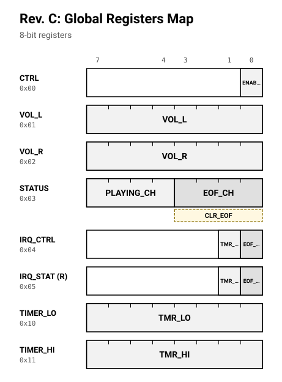
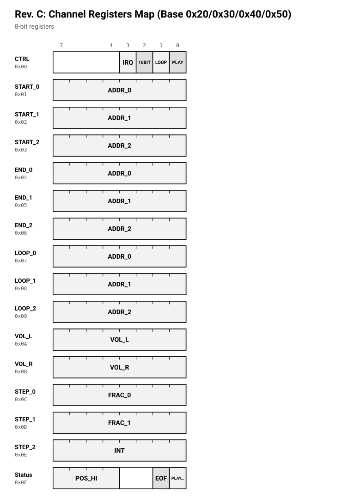

# LX Magic Sound 2 (rev. C)

**Status:** working implementation (Carlos). **Produces sound on real hardware.**
**See also:** `lx_magic_sound_rev_a.md` (planned baseline), `lx_rtl_reference.md` (addresses).

**RTL:** `lx_ms2.sv` (48 kHz, 8/16 bit, page 7).
**Address:** page 7 (`FF0380–FF03FF`). See `lx_rtl_reference.md`.

---

## 0. How to read this document

This is the **working implementation** (rev. C). It produces sound on real hardware.

It differs from the **planned baseline** (rev. A). Where rev. A and rev. C differ, **rev. C is what exists**. Rev. A is the baseline that rev. C was measured against.

### Markers

| Marker | Meaning |
|---|---|
| **✔ By design** | An intentional decision in rev. C. |
| **✔ Improved by rev. C** | Rev. C is better than rev. A. |
| **✔ Simplified by rev. C** | Rev. C is simpler than rev. A (compromise, not worse). |
| **⚠ Not in rev. C** | Present in rev. A, not implemented in rev. C. Desirable to return. |

---

## 1. Motivation

The original Magic Sound (1990s) had four "birth defects":

1. **Sample length limited to 64 KB.**
2. **Volume ~6 bits per channel.**
3. **No stereo.**
4. **Loop restart required the CPU.**

Magic Sound 2 (rev. C) fixes all four:

- 24-bit address space (16 MB).
- 8-bit volume per channel (left and right), plus global volume.
- Stereo output.
- Automatic loop (`LOOP`), no CPU.

---

## 2. Architecture

### 2.1 Channels
- **4 channels** (`c_play[4]`, `c_start[4]`, `c_end[4]`, `c_lpos[4]`, `c_step[4]`, `c_vol_l[4]`, `c_vol_r[4]`).
- 8 channels would be desirable (option, not required in rev. C).

### 2.2 Sample format
- **8 or 16 bits**, selectable per channel (`CH_CTRL[2]`).
- Signed. 16-bit samples are little-endian.

### 2.3 Frequency
- **48 kHz** sample rate (`RATE_HZ = 48_000`).

### 2.4 Wishbone
- **Slave:** 8-bit (CPU side).
- **Master:** **8-bit** (`dma_dat_i[7:0]`) — for memory reads.

### 2.5 Output
- **Analog** `out_l`, `out_r` (16-bit signed). No I2S.

### 2.6 Loop
- **One point:** `LOOP` (24 bits) — where to return when `END` is reached. Automatic loop, no CPU.

### 2.7 Step
- **8.16 fixed-point** (24 bits).
- `010000h = 48 kHz` (1.0 in 8.16).

### 2.8 Timer
- `TIMER_LO` / `TIMER_HI` (16 bits) — period in 48 kHz samples.
- `160 = 300 Hz`, `960 = 50 Hz`.

### 2.9 Interrupts
- IRQ on EOF (`CH_CTRL[3]`, `IRQ_CTRL[0]`).
- Timer IRQ (`IRQ_CTRL[1]`).
- **No DMA error NMI** (not implemented).

### 2.10 DMA error handling
> **⚠ Not in rev. C.** When the DMA reads memory and the memory controller returns a timeout (watchdog), the sound card must latch the error, enter an error state, and signal it (IRQ/NMI). This is a **stability element**. Rev. C does not implement it. It is desirable to return it in a future revision.

---

## 3. Registers

### 3.1 Global registers



**Table 1 — Rev. C: Global Registers Map**

| Offset | Name | Description |
| --- | --- | --- |
| `0x00` | <a id="CTRL"></a>**CTRL** | — |
| `0x01` | <a id="VOL_L"></a>**VOL_L** | — |
| `0x02` | <a id="VOL_R"></a>**VOL_R** | — |
| `0x03` | <a id="STATUS"></a>**STATUS** | — |
| `0x04` | <a id="IRQ_CTRL"></a>**IRQ_CTRL** | — |
| `0x05` | <a id="IRQ_STAT__R_"></a>**IRQ_STAT (R)** | — |
| `0x10` | <a id="TIMER_LO"></a>**TIMER_LO** | — |
| `0x11` | <a id="TIMER_HI"></a>**TIMER_HI** | — |

**CTRL** (`0x00`)

| Field | Bits | Width | Description |
| --- | --- | --- | --- |
| <a id="ENABLE"></a>**ENABLE** | [0] | 1 | Enable MS2 |

**VOL_L** (`0x01`)

| Field | Bits | Width | Description |
| --- | --- | --- | --- |
| <a id="VOL_L"></a>**VOL_L** | [7:0] | 8 | Global left volume |

**VOL_R** (`0x02`)

| Field | Bits | Width | Description |
| --- | --- | --- | --- |
| <a id="VOL_R"></a>**VOL_R** | [7:0] | 8 | Global right volume |

**STATUS** (`0x03`)

| Field | Bits | Width | Description |
| --- | --- | --- | --- |
| <a id="PLAYING_CH"></a>**PLAYING_CH** | [7:4] | 4 | Playing per channel (read) |
| <a id="EOF_CH"></a>**EOF_CH** | [3:0] | 4 | EOF per channel (read) |
| <a id="CLR_EOF"></a>**CLR_EOF** | [3:0] | 4 | Clear EOF (write) |

**IRQ_CTRL** (`0x04`)

| Field | Bits | Width | Description |
| --- | --- | --- | --- |
| <a id="TMR_IRQ"></a>**TMR_IRQ** | [1] | 1 | Timer IRQ enable |
| <a id="EOF_IRQ"></a>**EOF_IRQ** | [0] | 1 | EOF IRQ enable |

**IRQ_STAT (R)** (`0x05`)

| Field | Bits | Width | Description |
| --- | --- | --- | --- |
| <a id="TMR_PEND"></a>**TMR_PEND** | [1] | 1 | Timer pending |
| <a id="EOF_PEND"></a>**EOF_PEND** | [0] | 1 | EOF pending |

**TIMER_LO** (`0x10`)

| Field | Bits | Width | Description |
| --- | --- | --- | --- |
| <a id="TMR_LO"></a>**TMR_LO** | [7:0] | 8 | Timer period low |

**TIMER_HI** (`0x11`)

| Field | Bits | Width | Description |
| --- | --- | --- | --- |
| <a id="TMR_HI"></a>**TMR_HI** | [7:0] | 8 | Timer period high |


**Table 2 — Rev. C: Global Registers Map**

| Offset | Name | Description |
| --- | --- | --- |
| `0x00` | <a id="CTRL"></a>**CTRL** | — |
| `0x01` | <a id="VOL_L"></a>**VOL_L** | — |
| `0x02` | <a id="VOL_R"></a>**VOL_R** | — |
| `0x03` | <a id="STATUS"></a>**STATUS** | — |
| `0x04` | <a id="IRQ_CTRL"></a>**IRQ_CTRL** | — |
| `0x05` | <a id="IRQ_STAT__R_"></a>**IRQ_STAT (R)** | — |
| `0x10` | <a id="TIMER_LO"></a>**TIMER_LO** | — |
| `0x11` | <a id="TIMER_HI"></a>**TIMER_HI** | — |

**CTRL** (`0x00`)

| Field | Bits | Width | Description |
| --- | --- | --- | --- |
| <a id="ENABLE"></a>**ENABLE** | [0] | 1 | Enable MS2 |

**VOL_L** (`0x01`)

| Field | Bits | Width | Description |
| --- | --- | --- | --- |
| <a id="VOL_L"></a>**VOL_L** | [7:0] | 8 | Global left volume |

**VOL_R** (`0x02`)

| Field | Bits | Width | Description |
| --- | --- | --- | --- |
| <a id="VOL_R"></a>**VOL_R** | [7:0] | 8 | Global right volume |

**STATUS** (`0x03`)

| Field | Bits | Width | Description |
| --- | --- | --- | --- |
| <a id="PLAYING_CH"></a>**PLAYING_CH** | [7:4] | 4 | Playing per channel (read) |
| <a id="EOF_CH"></a>**EOF_CH** | [3:0] | 4 | EOF per channel (read) |
| <a id="CLR_EOF"></a>**CLR_EOF** | [3:0] | 4 | Clear EOF (write) |

**IRQ_CTRL** (`0x04`)

| Field | Bits | Width | Description |
| --- | --- | --- | --- |
| <a id="TMR_IRQ"></a>**TMR_IRQ** | [1] | 1 | Timer IRQ enable |
| <a id="EOF_IRQ"></a>**EOF_IRQ** | [0] | 1 | EOF IRQ enable |

**IRQ_STAT (R)** (`0x05`)

| Field | Bits | Width | Description |
| --- | --- | --- | --- |
| <a id="TMR_PEND"></a>**TMR_PEND** | [1] | 1 | Timer pending |
| <a id="EOF_PEND"></a>**EOF_PEND** | [0] | 1 | EOF pending |

**TIMER_LO** (`0x10`)

| Field | Bits | Width | Description |
| --- | --- | --- | --- |
| <a id="TMR_LO"></a>**TMR_LO** | [7:0] | 8 | Timer period low |

**TIMER_HI** (`0x11`)

| Field | Bits | Width | Description |
| --- | --- | --- | --- |
| <a id="TMR_HI"></a>**TMR_HI** | [7:0] | 8 | Timer period high |


### 3.2 Channel registers
Base addresses: channel 0 = `0x20`, channel 1 = `0x30`, channel 2 = `0x40`, channel 3 = `0x50`. Each channel has 16 registers.



**Table 3 — Rev. C: Channel Registers Map (Base 0x20/0x30/0x40/0x50)**

| Offset | Name | Description |
| --- | --- | --- |
| `0x00` | <a id="CTRL"></a>**CTRL** | — |
| `0x01` | <a id="START_0"></a>**START_0** | — |
| `0x02` | <a id="START_1"></a>**START_1** | — |
| `0x03` | <a id="START_2"></a>**START_2** | — |
| `0x04` | <a id="END_0"></a>**END_0** | — |
| `0x05` | <a id="END_1"></a>**END_1** | — |
| `0x06` | <a id="END_2"></a>**END_2** | — |
| `0x07` | <a id="LOOP_0"></a>**LOOP_0** | — |
| `0x08` | <a id="LOOP_1"></a>**LOOP_1** | — |
| `0x09` | <a id="LOOP_2"></a>**LOOP_2** | — |
| `0x0A` | <a id="VOL_L"></a>**VOL_L** | — |
| `0x0B` | <a id="VOL_R"></a>**VOL_R** | — |
| `0x0C` | <a id="STEP_0"></a>**STEP_0** | — |
| `0x0D` | <a id="STEP_1"></a>**STEP_1** | — |
| `0x0E` | <a id="STEP_2"></a>**STEP_2** | — |
| `0x0F` | <a id="Status"></a>**Status** | — |

**CTRL** (`0x00`)

| Field | Bits | Width | Description |
| --- | --- | --- | --- |
| <a id="IRQ"></a>**IRQ** | [3] | 1 | IRQ on EOF |
| <a id="16BIT"></a>**16BIT** | [2] | 1 | 16-bit samples |
| <a id="LOOP"></a>**LOOP** | [1] | 1 | Loop |
| <a id="PLAY"></a>**PLAY** | [0] | 1 | Play |

**START_0** (`0x01`)

| Field | Bits | Width | Description |
| --- | --- | --- | --- |
| <a id="ADDR_0"></a>**ADDR_0** | [7:0] | 8 | Start address [7:0] |

**START_1** (`0x02`)

| Field | Bits | Width | Description |
| --- | --- | --- | --- |
| <a id="ADDR_1"></a>**ADDR_1** | [7:0] | 8 | Start address [15:8] |

**START_2** (`0x03`)

| Field | Bits | Width | Description |
| --- | --- | --- | --- |
| <a id="ADDR_2"></a>**ADDR_2** | [7:0] | 8 | Start address [23:16] |

**END_0** (`0x04`)

| Field | Bits | Width | Description |
| --- | --- | --- | --- |
| <a id="ADDR_0"></a>**ADDR_0** | [7:0] | 8 | End address [7:0] |

**END_1** (`0x05`)

| Field | Bits | Width | Description |
| --- | --- | --- | --- |
| <a id="ADDR_1"></a>**ADDR_1** | [7:0] | 8 | End address [15:8] |

**END_2** (`0x06`)

| Field | Bits | Width | Description |
| --- | --- | --- | --- |
| <a id="ADDR_2"></a>**ADDR_2** | [7:0] | 8 | End address [23:16] |

**LOOP_0** (`0x07`)

| Field | Bits | Width | Description |
| --- | --- | --- | --- |
| <a id="ADDR_0"></a>**ADDR_0** | [7:0] | 8 | Loop address [7:0] |

**LOOP_1** (`0x08`)

| Field | Bits | Width | Description |
| --- | --- | --- | --- |
| <a id="ADDR_1"></a>**ADDR_1** | [7:0] | 8 | Loop address [15:8] |

**LOOP_2** (`0x09`)

| Field | Bits | Width | Description |
| --- | --- | --- | --- |
| <a id="ADDR_2"></a>**ADDR_2** | [7:0] | 8 | Loop address [23:16] |

**VOL_L** (`0x0A`)

| Field | Bits | Width | Description |
| --- | --- | --- | --- |
| <a id="VOL_L"></a>**VOL_L** | [7:0] | 8 | Channel left volume |

**VOL_R** (`0x0B`)

| Field | Bits | Width | Description |
| --- | --- | --- | --- |
| <a id="VOL_R"></a>**VOL_R** | [7:0] | 8 | Channel right volume |

**STEP_0** (`0x0C`)

| Field | Bits | Width | Description |
| --- | --- | --- | --- |
| <a id="FRAC_0"></a>**FRAC_0** | [7:0] | 8 | Step fraction [7:0] |

**STEP_1** (`0x0D`)

| Field | Bits | Width | Description |
| --- | --- | --- | --- |
| <a id="FRAC_1"></a>**FRAC_1** | [7:0] | 8 | Step fraction [15:8] |

**STEP_2** (`0x0E`)

| Field | Bits | Width | Description |
| --- | --- | --- | --- |
| <a id="INT"></a>**INT** | [7:0] | 8 | Step integer |

**Status** (`0x0F`)

| Field | Bits | Width | Description |
| --- | --- | --- | --- |
| <a id="POS_HI"></a>**POS_HI** | [7:4] | 4 | Position high byte |
| <a id="EOF"></a>**EOF** | [1] | 1 | EOF |
| <a id="PLAYING"></a>**PLAYING** | [0] | 1 | Playing |


**Table 4 — Rev. C: Channel Registers Map (Base 0x20/0x30/0x40/0x50)**

| Offset | Name | Description |
| --- | --- | --- |
| `0x00` | <a id="CTRL"></a>**CTRL** | — |
| `0x01` | <a id="START_0"></a>**START_0** | — |
| `0x02` | <a id="START_1"></a>**START_1** | — |
| `0x03` | <a id="START_2"></a>**START_2** | — |
| `0x04` | <a id="END_0"></a>**END_0** | — |
| `0x05` | <a id="END_1"></a>**END_1** | — |
| `0x06` | <a id="END_2"></a>**END_2** | — |
| `0x07` | <a id="LOOP_0"></a>**LOOP_0** | — |
| `0x08` | <a id="LOOP_1"></a>**LOOP_1** | — |
| `0x09` | <a id="LOOP_2"></a>**LOOP_2** | — |
| `0x0A` | <a id="VOL_L"></a>**VOL_L** | — |
| `0x0B` | <a id="VOL_R"></a>**VOL_R** | — |
| `0x0C` | <a id="STEP_0"></a>**STEP_0** | — |
| `0x0D` | <a id="STEP_1"></a>**STEP_1** | — |
| `0x0E` | <a id="STEP_2"></a>**STEP_2** | — |
| `0x0F` | <a id="Status"></a>**Status** | — |

**CTRL** (`0x00`)

| Field | Bits | Width | Description |
| --- | --- | --- | --- |
| <a id="IRQ"></a>**IRQ** | [3] | 1 | IRQ on EOF |
| <a id="16BIT"></a>**16BIT** | [2] | 1 | 16-bit samples |
| <a id="LOOP"></a>**LOOP** | [1] | 1 | Loop |
| <a id="PLAY"></a>**PLAY** | [0] | 1 | Play |

**START_0** (`0x01`)

| Field | Bits | Width | Description |
| --- | --- | --- | --- |
| <a id="ADDR_0"></a>**ADDR_0** | [7:0] | 8 | Start address [7:0] |

**START_1** (`0x02`)

| Field | Bits | Width | Description |
| --- | --- | --- | --- |
| <a id="ADDR_1"></a>**ADDR_1** | [7:0] | 8 | Start address [15:8] |

**START_2** (`0x03`)

| Field | Bits | Width | Description |
| --- | --- | --- | --- |
| <a id="ADDR_2"></a>**ADDR_2** | [7:0] | 8 | Start address [23:16] |

**END_0** (`0x04`)

| Field | Bits | Width | Description |
| --- | --- | --- | --- |
| <a id="ADDR_0"></a>**ADDR_0** | [7:0] | 8 | End address [7:0] |

**END_1** (`0x05`)

| Field | Bits | Width | Description |
| --- | --- | --- | --- |
| <a id="ADDR_1"></a>**ADDR_1** | [7:0] | 8 | End address [15:8] |

**END_2** (`0x06`)

| Field | Bits | Width | Description |
| --- | --- | --- | --- |
| <a id="ADDR_2"></a>**ADDR_2** | [7:0] | 8 | End address [23:16] |

**LOOP_0** (`0x07`)

| Field | Bits | Width | Description |
| --- | --- | --- | --- |
| <a id="ADDR_0"></a>**ADDR_0** | [7:0] | 8 | Loop address [7:0] |

**LOOP_1** (`0x08`)

| Field | Bits | Width | Description |
| --- | --- | --- | --- |
| <a id="ADDR_1"></a>**ADDR_1** | [7:0] | 8 | Loop address [15:8] |

**LOOP_2** (`0x09`)

| Field | Bits | Width | Description |
| --- | --- | --- | --- |
| <a id="ADDR_2"></a>**ADDR_2** | [7:0] | 8 | Loop address [23:16] |

**VOL_L** (`0x0A`)

| Field | Bits | Width | Description |
| --- | --- | --- | --- |
| <a id="VOL_L"></a>**VOL_L** | [7:0] | 8 | Channel left volume |

**VOL_R** (`0x0B`)

| Field | Bits | Width | Description |
| --- | --- | --- | --- |
| <a id="VOL_R"></a>**VOL_R** | [7:0] | 8 | Channel right volume |

**STEP_0** (`0x0C`)

| Field | Bits | Width | Description |
| --- | --- | --- | --- |
| <a id="FRAC_0"></a>**FRAC_0** | [7:0] | 8 | Step fraction [7:0] |

**STEP_1** (`0x0D`)

| Field | Bits | Width | Description |
| --- | --- | --- | --- |
| <a id="FRAC_1"></a>**FRAC_1** | [7:0] | 8 | Step fraction [15:8] |

**STEP_2** (`0x0E`)

| Field | Bits | Width | Description |
| --- | --- | --- | --- |
| <a id="INT"></a>**INT** | [7:0] | 8 | Step integer |

**Status** (`0x0F`)

| Field | Bits | Width | Description |
| --- | --- | --- | --- |
| <a id="POS_HI"></a>**POS_HI** | [7:4] | 4 | Position high byte |
| <a id="EOF"></a>**EOF** | [1] | 1 | EOF |
| <a id="PLAYING"></a>**PLAYING** | [0] | 1 | Playing |


---

## 4. Programming example

```asm
; Channel 0: play a 44000 Hz sample with loop
ld a, %00001011       ; play + loop + IRQ on EOF (8-bit samples)
ld (0x20), a          ; CH_CTRL

; Start address = 0x100000
ld a, 0x00
ld (0x21), a
ld a, 0x00
ld (0x22), a
ld a, 0x10
ld (0x23), a

; End address = 0x100FFF
ld a, 0xFF
ld (0x24), a
ld a, 0x0F
ld (0x25), a
ld a, 0x10
ld (0x26), a

; Loop = 0x100000
ld a, 0x00
ld (0x27), a
ld a, 0x00
ld (0x28), a
ld a, 0x10
ld (0x29), a

; Volume L / R = max
ld a, 0xFF
ld (0x2A), a
ld a, 0xFF
ld (0x2B), a

; Step = 44000/48000 ≈ 0.91667 (8.16) = 0xEAAB
ld a, 0xAB
ld (0x2C), a
ld a, 0xEA
ld (0x2D), a
ld a, 0x00
ld (0x2E), a
```

---

## 5. What differs from rev. A

### ✔ Improved by rev. C
| Aspect | Rev. A | Rev. C |
|---|---|---|
| Sample format | 16-bit only | **8/16-bit selectable** |
| Wishbone master | 16-bit | **8-bit** (for 8-bit system) |
| Volume location | `CH_CTRL[7:4]/[3:0]` (4+4, scaled) | **`+A`/`+B` (8-bit each)** |

### ✔ Simplified by rev. C
| Aspect | Rev. A | Rev. C |
|---|---|---|
| Frequency | 96 kHz | 48 kHz (neutral) |
| Ping-pong | yes | **no** |
| Loop | `LOOP_START` + `LOOP_END` | **`LOOP` (1 point)** |
| Step | 16.16 | **8.16** |
| I2S | yes | **no** (analog) |
| Timer | `TIMER_VAL` + `TIMER_CTRL` | **`TIMER_LO` / `TIMER_HI`** |
| Status | error / DMA / EOF / timer | **EOF / playing per channel** |

### ⚠ Not in rev. C
| Feature | Why desirable |
|---|---|
| **DMA error handling** | When DMA reads memory and the memory controller returns a timeout (watchdog), the sound card must latch the error, enter an error state, and signal it (IRQ/NMI). This is a **stability element**. |
| `LOOP_START` / `LOOP_END` | 2-point loop is more flexible than 1-point. |
| `PINGPONG` | Ping-pong is useful for some samples. |
| `I2S` | Digital output, useful for high-quality codecs. |
| `DMA_ERR_CLR` | Clear DMA error flags. |
| `TIMER_CTRL` | Separate timer control register. |

---

## 6. Open questions

1. **DMA error handling** — desirable to return. This is a stability element, not a feature. *TBD.*
2. **8 channels** — option, not required. *TBD.*
3. **I2S** — option. *TBD.*
4. **Ping-pong** — option. *TBD.*
5. **`LOOP_START` / `LOOP_END`** — option. *TBD.*

---

*End of document.*
