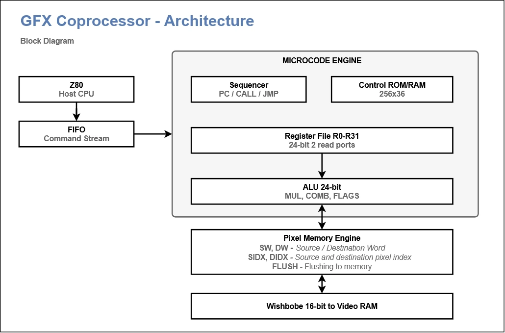
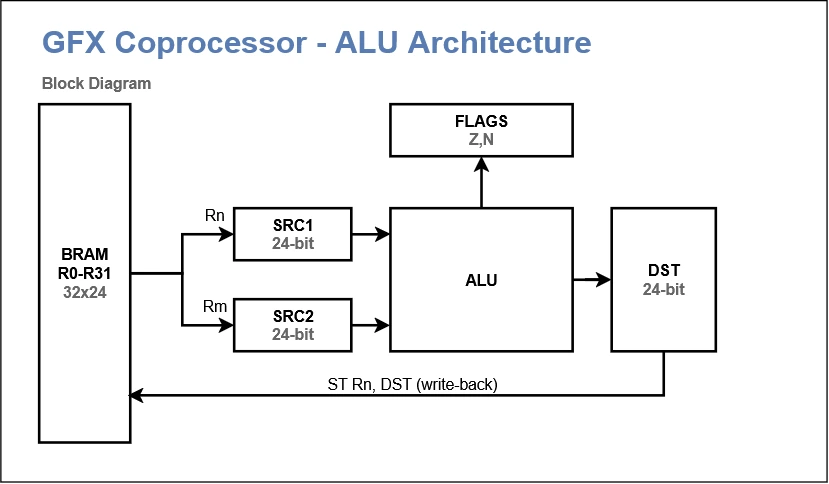

# Микроядро графического сопроцессора

Ядро — единственный «процессор» внутри сопроцессора: оно само вынимает байты команд из FIFO, разбирает их микрокодом и рисует. Отдельного декодера и отдельного пути записи регистров нет.

## 1. Главная идея

- Z80 пишет в один порт, байты попадают в FIFO. Кроме него у CPU есть только аппаратный порт статуса (FIFO заполнено, ядро простаивает, ядро в ошибке).
- **Язык команд Z80 и язык микрокоманд ROM — два разных уровня.** Входной протокол не превращается в 36-битные микрокоманды. FSM на входе распознаёт только `SET` и `EXECUTE`; всё остальное — это микрокод.
- Микрокоманда `NEXT` — единственная специальная команда sequencer’а. Она обрабатывает следующую входную команду (`SET` — запись в регистр, `EXECUTE` — переход на микропрограмму) или ждёт, если FIFO пуст.
- Пока выполняется микропрограмма (`FILL`, `COPY`, ...), FSM продолжает принимать байты в FIFO, но `NEXT` не исполняет их до возврата в `MAIN`.
- Микрокоманды простые, но в одном микрослове могут параллельно работать регистровый тракт и АЛУ.

## 2. Схема



## 3. Регистровый файл

32 регистра общего назначения по 24 бита, реализованы в BRAM: один синхронный порт чтения, один порт записи, зарегистрированный выход.

### Регистровый файл · R0–R31

| Регистр | Имя | Назначение | Группа |
| --- | --- | --- | --- |
| R0 | **DX** | Destination X coordinate | destination |
| R1 | **DY** | Destination Y coordinate | destination |
| R2 | **DW** | Destination width | destination |
| R3 | **DH** | Destination height | destination |
| R4 | **SX** | Source X coordinate | source |
| R5 | **SY** | Source Y coordinate | source |
| R6 | **SW** | Source width | source |
| R7 | **SH** | Source height | source |
| R8 | **DSTRIDE** | Destination row stride (screen width) | memory |
| R9 | **SSTRIDE** | Source row stride (screen width) | memory |
| R10 | **DBASE** | Destination base address | memory |
| R11 | **SBASE** | Source base address | memory |
| R12 | **FG** | Foreground colour | pixel |
| R13 | **BG** | Background colour | pixel |
| R14 | **MODE** | Pixel formats and combine operation | pixel |
| R15 | **CX0** | Clip window left | clipping |
| R16 | **CY0** | Clip window top | clipping |
| R17 | **CX1** | Clip window right | clipping |
| R18 | **CY1** | Clip window bottom | clipping |
| R19 | **SDX** | Source delta X (12.12) | increment |
| R20 | **SDY** | Source delta Y (12.12) | increment |
| R21 | **DDX** | Destination delta X (12.12) | increment |
| R22 | **DDY** | Destination delta Y (12.12) | increment |
| R23 | **T0** | Временный регистр | temporary |
| R24 | **T1** | Временный регистр | temporary |
| R25 | **T2** | Временный регистр | temporary |
| R26 | **T3** | Временный регистр | temporary |
| R27 | **T4** | Временный регистр | temporary |
| R28 | **T5** | Временный регистр | temporary |
| R29 | **T6** | Временный регистр | temporary |
| R30 | **T7** | Временный регистр | temporary |
| R31 | **T8** | Временный регистр | temporary |


Регистры `R17–R20` (`SDX`, `SDY`, `DDX`, `DDY`) — это соглашение микрокода, а не отдельная аппаратная фича. Они используются в аффинном режиме и при построчном сдвиге для приращений координат источника и приёмника в формате 12.12.

## 4. Внутренние регистры АЛУ

АЛУ имеет три внутренних регистра по 24 бита: `SRC1`, `SRC2`, `DST`. Они не адресуются из регистрового файла — это буферы на входах и выходе АЛУ.



- `SRC1`, `SRC2` — операнды АЛУ. Загружаются из регистрового файла (`LD SRC1, Rn`), из предыдущего результата (`LD SRC1, DST`), либо константой (`LD SRC1, IMM`).
- `DST` — результат АЛУ. Записывается в регистровый файл (`ST Rn, DST`) или читается как источник следующей операции (`LD SRCk, DST`).
- `FLAGS` (Z, N) — флаги результата, обновляются АЛУ.

Отдельного регистра `P` для умножения нет: результат умножения поступает в `DST`, как и результат любой другой операции.

## 5. Микрокоманды

Каждая микрокоманда занимает один такт, за исключением операций с переменной задержкой (см. раздел 7).

## 6. Микрослово

Ширина — 36 бит.


**MICROINSTRUCTION · 36 BIT**

| Поле | Биты | Ширина | Описание |
| --- | --- | --- | --- |
| **REG_OP** | [35:31] | 5 | Операция регистрового тракта |
| **ALU_OP** | [30:26] | 5 | Арифметическая или логическая операция |
| **CTRL_OP** | [25:23] | 3 | Управление последовательностью |
| **REG_ADDR** | [22:18] | 5 | Адрес регистра Rn (R0–R31) |
| **MASK** | [17:15] | 3 | Маска условий исполнения |
| **COND** | [14:12] | 3 | Условие перехода |
| **IMM** | [11:0] | 12 | 12-битная непосредственная константа |

### Инструкции работы с регистрами

Предназначены для загрузки и выгрузки регистров R0–R31 в регистры АЛУ или пиксельный буфер.

### Микрокоманды

| Микрокоманда | Слот | Действие | Тактов |
| --- | --- | --- | --- |
| LD SRC1, Rn | reg | SRC1 ← R[n] | 1 |
| LD SRC1, DST | reg | SRC1 ← DST (результат предыдущей АЛУ-операции) | 1 |
| LDL SRC1, IMM12 | reg | SRC1 ← X (константа из микрослова) | 1 |
| LDH SRC1, IMM12 | reg | SRC1 ← X (константа из микрослова) | 1 |
| LD SRC2, Rn | reg | SRC2 ← R[n] | 1 |
| LD SRC2, DST12 | reg | SRC2 ← DST | 1 |
| LDL SRC2, IMM12 | reg | SRC2 ← X | 1 |
| LDH SRC2, IMM12 | reg | SRC2 ← X | 1 |
| ST Rn, DST | reg | R[n] ← DST | 1 |
| SIDX Rn | io | Задать индекс источника | 1 |
| DIDX Rn | io | Задать индекс приёмника | 1 |
| READ SRCk, IDXk | io | Читать пиксель источника в SRCk | зависит |
| READ SRCk, IDXk | io | Записать пиксель приёмника из SRCk | 1 |
| WRITE IDXk, DST | io | Читать пиксель источника в SRCk | зависит |
| WRITE IDXk, DST | io | Записать пиксель приёмника из SRCk | 1 |
| SYNC | io | Сброс DW в память | зависит |


### Инструкции АЛУ

Предназначены для вычислительных операций АЛУ.

### ALU · Арифметические и логические операции

| Микрокоманда | Действие | Тактов |
| --- | --- | --- |
| ALU <op> | DST ← op(SRC1, SRC2); обновляет FLAGS | 1 (MUL — зависит от FPGA) |


### Инструкции ветвления

Управляют счётчиком команд процессора в момент исполнения.

### CTRL · Управление последовательностью

| Микрокоманда | Действие | Тактов |
| --- | --- | --- |
| NOP | Увеличить PC+1 | 1 |
| JMP X | Безусловный переход | 1 |
| CALL X | Вызов подпрограммы | 1 |
| RET | Возврат из подпрограммы | 1 |
| HALT | Остановка исполнения | 1 |
| NEXT | Обработать следующую команду FIFO или ждать | 1 |


### Условия исполнения

Вычисляют результат флагового регистра. Например, если произошло переполнение в результате предыдущей команды.

### CONDITION · 3 BIT

| Код | Условие | Описание |
| --- | --- | --- |
| 0 | **ALWAYS** | Безусловное выполнение перехода |
| 1 | **Z** | Переход, если Zero = 1 |
| 2 | **NZ** | Переход, если Zero = 0 |
| 3 | **C** | Переход, если Carry = 1 |
| 4 | **NC** | Переход, если Carry = 0 |
| 5 | **N** | Переход, если Negative = 1 |
| 6 | **NN** | Переход, если Negative = 0 |
| 7 | **NEVER** | Переход никогда не выполняется |


### Маска условий исполнения

Позволяет сделать всё поле инструкции условным согласно выбранному флагу.

### CONDITION MASK · 3 BIT

| Код | Маска условий | Описание |
| --- | --- | --- |
| 0 | **REG** | Условное исполнение регистровой операции |
| 1 | **ALU** | Условное исполнение операции ALU |
| 2 | **CTRL** | Условное исполнение операции ветвления |


## 7. Параллельное исполнение

В одном микрослове разрешается выполнять **одну операцию регистрового тракта** и **одну операцию АЛУ**. Формула: одна операция с BRAM и одна операция АЛУ на такт.

```
LD SRC1, R1
LD SRC2, R2
ALU ADD
LD SRC2, R4 + ALU ADD
ST R3, DST + ALU ADD
```

Семантика параллельной микрокоманды: АЛУ использует **старые** `SRC1`/`SRC2`, результат кладёт в `DST`, а регистровый тракт в это же время либо загружает новое значение в `SRCk`, либо пишет предыдущий `DST` в регистр.

## 8. Длительные операции

Количество тактов для умножения не фиксируется: оно определяется реализацией умножителя на конкретной FPGA. Исполнительный блок использует сигналы `BUSY` и `READY`. Микрокод может ожидать готовности через `BUSY`/`READY`, либо вставлять `NOP`.

## 9. Главный цикл и `NEXT`

```
MAIN:
    NEXT
    JP MAIN

FILL:
    ; ... микропрограмма заливки ...
    JP MAIN

COPY:
    ; ... микропрограмма копирования ...
    JP MAIN
```

`NEXT` — операция sequencer’а, а не АЛУ. Она не пишет в `DST`, не обновляет `FLAGS`, не трогает `SRC1`/`SRC2`. Её поведение зависит от состояния входного потока:

- **FIFO пуст** — PC остаётся на `NEXT`, ядро ждёт. По этому простою выставляются флаг готовности и прерывание.
- **FIFO содержит `SET Rn, value`** — значение записывается в `Rn` через порт записи регистрового файла. PC остаётся на `NEXT`: следующая команда обработается на следующем такте.
- **FIFO содержит `EXECUTE ID`** — PC переходит на адрес микропрограммы `ID`.

Каждая микропрограмма заканчивается `JP MAIN`, после чего `NEXT` снова готов принимать команды.

Пока выполняется микропрограмма (например, `FILL`), входная FSM продолжает принимать байты в FIFO, но не исполняет их: `NEXT` находится не на пути исполнения. Это гарантирует, что следующая `EXECUTE` не начнётся, пока текущая микропрограмма не завершилась.

## 10. Команды входного протокола

Центральный процессор может лишь обновлять значения регистров и вызывать микпопрограмму внутри GPU.

### Входной протокол: команды от Z80

| Опкод | Имя | Длина (байт) | Payload | Описание |
| --- | --- | --- | --- | --- |
| 0x00–0x1F | **SET Rn** | 3 | 16-бит значение | Записать значение в регистр Rn |
| 0x40 | **EXECUTE** | 2 | 8-бит ID микропрограммы | Запустить микропрограмму |


## 11. Примеры

Примеры микрокода вынесены в отдельные документы:

- [03_draw_sprite.md](03_draw_sprite.md) — рисование спрайта под углом 45° (аффинный режим)
- [04_fill_rect.md](04_fill_rect.md) — заливка прямоугольника с клиппингом
- [05_copy_transparent.md](05_copy_transparent.md) — копирование с прозрачностью

## 12. Специальные окна памяти

Пиксельная память и палитра доступны через «окна» — адреса операндов, которые выглядят как регистры, но управляют аппаратурой:

- `SIDX` — задать индекс пикселя источника;
- `DIDX` — задать индекс пикселя приёмника;
- `SPIX` — прочитать пиксель источника (используется внутри `COMB`);
- `DPIX` — записать пиксель приёмника (используется внутри `COMB`);
- `SYNC` — записать грязное слово в память;
- `PALI`, `PALD` — индекс и цвет палитры;
- `STAT` — статус; запись — запрос прерывания.

## 13. Узкие места и роль FIFO

FIFO нужен не для корректности, а для параллелизма. Без него каждая запись Z80 ждала бы, пока ядро закончит рисование. С ним CPU кладёт в очередь десятки команд и занимается своими делами.

Для мелких объектов узким местом оказывается подача команд, а не ядро. Отсюда практика: менять только изменившиеся регистры, держать часто повторяющиеся параметры в регистрах, а для больших партий спрайтов позже добавить команду, читающую параметры из списка в видеопамяти.

Исключение из принципа «один интерфейс» неизбежно одно: **загрузка микрокода**. Ядро не может исполнять программу, которой у него ещё нет, поэтому BRAM инициализируется из прошивки, а для замены есть аппаратный порт: ядро останавливается, процессор записывает по 5 байт на слово, ядро запускается.

## 14. Открытые вопросы

1. **Точная раскладка 36-битного микрослова** — будет определена после того, как все управляющие сигналы выписаны.
2. **Задержка `MUL`** — определяется целевой FPGA; микрокод должен опираться на `BUSY`/`READY`.
3. **Автоинкремент `SIDX`/`DIDX`** — делает ли железо `idx++` само, или микрокод делает `ALU ADD`.
4. **Ширина тракта.** 24 бита нужны для аффинных шагов (12.12). Для остальных операций хватило бы 16, но разделять тракт нет смысла.
5. **Палитра:** запись из ядра пересекает границу тактовых доменов, если видеоконтроллер работает на другой частоте.
6. **Быстрая заливка по слову** (4 пикселя за раз): отдельная подпрограмма, нужна ли в первой версии.
7. **Список в видеопамяти:** нужна ли возможность читать команды не только из FIFO, но и из ОЗУ.

---
