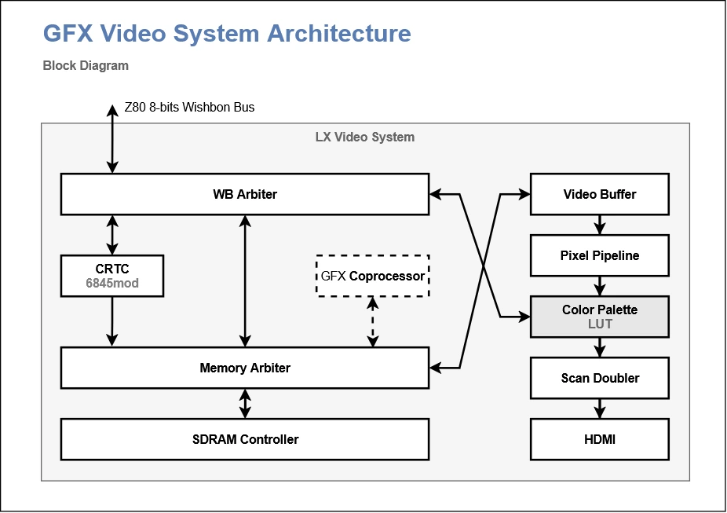

# 01 — System Overview

## Purpose

The Aleste LX video subsystem is a CPC-compatible video generator extended with modern display features and HDMI output. From a programmer's point of view it behaves like an Amstrad CPC (MC6845 CRTC + Gate Array + palette), while exposing a set of native control registers that allow linear framebuffers, higher pixel depths, and alternative color modes.

Everything is reached through a single byte-wide Wishbone bus. Legacy (CPC) I/O at `BCxx` and native I/O at `FF00xx` share the same physical registers — the difference is only the bus decode and a few behaviour switches.

## Top-level composition (from `aleste_video.sv`, `video_ctrl.sv`)

## Major blocks (software-relevant summary)

| Block | File | What it does for the programmer |
|-------|------|----------------------------------|
| `mc6845mod` | `mc6845mod.sv` | MC6845 CRTC. Generates display enable, HSYNC/VSYNC, cursor, and the memory address stream. Also owns the extended address/pixel-rate registers (R18–R21). |
| `video_buffer` | video buffer | Fetches 16-bit words from SDRAM and presents a continuous 8-bit stream to the pixel pipeline at the rate defined by `cfg_rate` (= CRTC R21). |
| `pixel_pipeline` | video mode controller | Expands the byte stream into pixels according to bpp and CPC/linear packing. Outputs an 8-bit palette index + DE. |
| `color_palette` | palette | Maps 8-bit pixel index to 12-bit RGB. Four color modes (CPC, 12-bit, MSX, YJK), palette index modifiers (OR/XOR), auto-increment. |
| `memory_arbiter` | arbiter | Shares SDRAM between the video fetch engine and system Wishbone masters. |
| `address_decoder` | decoder | Decides whether an access belongs to palette, CRTC, memory, or legacy space. |
| `wb_arbiter` | bus fan-out | Routes Wishbone to palette/CRTC/memory and muxes the ACK/DAT. |
| `hdmi_scaler`, `llhdmi` | output | Doubles the 240-line logical image into the 720×480 HDMI frame. Transparent to software except for timing. |

## What software can observe

1. **Bus access**: native vs legacy decoding, tags, ACK semantics.
2. **CRTC registers R0–R21**: horizontal/vertical timing, start/cursor address, extended video mode.
3. **Video mode register** (native, at `0x0140` via TAG=01) and the CRTC R18/R21 settings: which pixels come out, and at what rate they are fetched.
4. **Palette registers**: 16+1 CPC colors, or 256 entries in native modes, plus modifier logic.
5. **Memory contents**: the framebuffer/VRAM as seen by the DMA engine. Address depends on `cfg_addr_mode_o` and `cfg_linear_pixel_o`.

## Clock domains (informational)

| Clock | Frequency | Function |
|-------|-----------|----------|
| `clk_bus` | 54 MHz | Wishbone register accesses |
| `clk_pixel` | 27 MHz | CRTC counters, pixel pipeline, palette |
| `clk_system` | 108 MHz | SDRAM controller, memory arbiter |
| `clk_270m` | 270 MHz | TMDS serialiser |

Only `clk_bus` matters for I/O timing from software. Everything else is transparent — you always see a byte-wide register interface.

## Default mode after reset

* CRTC `STANDARD = "cpc"` defaults → classic CPC timings (R0=63, R1=40, R4=38, R6=25, R9=7…).
* `cfg_legacy` is tied to `1'b0` in `aleste_video.sv` at build time, but the module still responds to legacy-address-space transactions if the address decoder routes them (see §07).
* Video mode register reset state = `use_cpc_modes = 1`, `bpp_mode = 01` — effectively CPC Mode 1 bpp source until overwritten.
* Palette control = 12-bit write mode, auto-increment off.
* CRTC R20 (address mode) = `0x00` in CPC build → legacy MA/RA address composition.

> **Practical implication:** a freshly booted system will behave like a CPC. Any native-mode code must first program R18/R19/R20/R21 and the video mode register at `0x0140` before expecting linear addressing or >2 bpp.

## What is *not* modelled

* Light pen inputs (R16/R17 accepted but ignored).
* Vertical adjust (R5 accepted but ignored).
* Real CRT interlace (HDMI timing is progressive; R8[1:0] is latched but has no observable effect on the HDMI output).
* The CPC Gate Array as a separate device — only its bpp source and palette conversions are emulated (bpp via `cfg_cpc_bpp_i`; in the current `video_ctrl.sv` this input is tied to `'0`, so gate-array bpp selection is effectively disabled on this build).

## How to use this documentation set

* **Porting CPC software?** Read §03 and §06 — everything legacy lives there.
* **Writing new native software?** Read §02 (memory map), §04 (video mode register), §03 §4–§7 (extended CRTC regs), §05 (palette), §09 (init sequence).
* **Debugging display DMA?** Read §08.

---