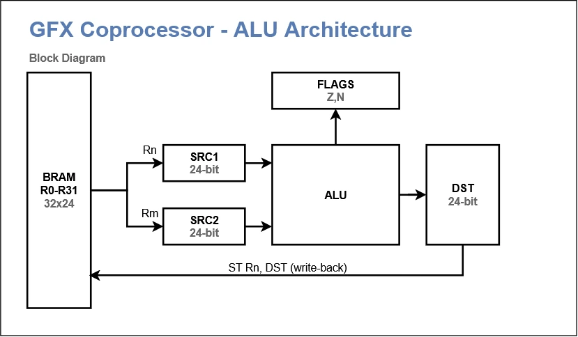

# Graphics coprocessor for Z80: architecture

*Source for the documentation generator. YAML declarations in `gen/` produce SVG and MD tables; `[include]` inserts them here. Numbers are approximate; details are refined on the simulator.*

## 1. Principles

1. **Simplicity over peak speed.** The bottleneck is memory, so the core can be simple.
2. **Programmable core, not a hardwired state machine.** Microcode lives in BRAM; a new algorithm means new microcode, not new logic.
3. **Only the hot path goes into hardware:** word buffers, address generators, pixel packing.
4. **Screen coordinates inside, addresses outside are invisible.** The CPU says "draw at (x, y)".
5. **Two pixel formats: 4 and 8 bpp.** 1 bpp is source only (fonts, masks). 16 bpp via `PASS16` (word pass-through).
6. **No hardware scrolling.** Replaced by fast block copying.
7. **Commands are a consequence of the microcode layout.** Fields first, commands follow.
8. **`REG_ADDR` — resource select.** The field has no single meaning: `LDR`/`STR` — a register; `LDX`/`STX` — a device; `PACKER_*`/`SETPAGE`/`SETMODE`/`ADDR` — a channel.
9. **`IMM` — universal argument.** Consumers: `LDI`/`LDH`/`LDL` (constant), `JMP`/`CALL`/`LOOP` (address), `HALT` (error code). In one word — one consumer, enforced by the assembler.
10. **Stack A/B/C.** Three registers, push/pop. A is the only write port; B and C are stack-internal. C is zeroed on pop.

## 2. Overall picture


*Domain boundary: command and register logic in the 8-bit domain; the core, word buffers, and video controller on 16-bit memory. They meet at the core's registers.*

GPU → Wishbone → VideoMemoryArbiter. The arbiter is out of scope; raster scan has top priority.

## 3. Microinstruction


[include](gen/microinstruction-table.md)

**Execution order.** The three blocks (`REG_OP`, `ALU_OP`, `CTRL_OP`) run in parallel: all read A/B/C at the start of the cycle, writes happen at the end. ALU computes on the old operands; `REG_OP` loads the next value; `STR` saves A after the previous word.

**Condition and mask.** Flags Z, N, C come from the previous word. `COND` (3 bits) selects the condition; if it holds, `MASK` (3 bits) blocks the marked blocks (bit 0 — `REG_OP`, bit 1 — `ALU_OP`, bit 2 — `CTRL_OP`). `MASK = 0` — unconditional.

[include](gen/microops_cond-table.md)

[include](gen/microops_mask-table.md)

**`IMM` — 12-bit universal argument.** Its meaning depends on the command:

| Command | `IMM` contents |
|---|---|
| `LDI`/`LDH`/`LDL` | constant (12 bits) |
| `JMP`/`CALL`/`LOOP` | address (12 bits) |
| `HALT X` | error code (12 bits) |
| everything else | not used |

**Rule:** one consumer of `IMM` per micro-word. `LDI` + `JMP` — OK. `LDI` + another `IMM` consumer — forbidden. Enforced by the assembler.

## 4. Stack A/B/C and the ALU



**A inputs (4:1):** result R (ALU), B (pop/swap), IN_ (external stage), IMM (constant).
**B inputs:** A (push/swap) or C (pop). **C input:** B (push) or zero (pop).
**ALU** has no input muxes: operands are always A and B (plus C for `BLEND`, currently not implemented).
**C is zeroed on pop** — 100% by design.

**External (slow) devices** all go through `IN_` (a pipeline stage register in hardware; a single register in the model). A device read always lands in A — never B, never C. A device write takes A (some devices may also read B or C).

**AddrPacker** — a separate class. `ADDR ch` pops A (x, 12.12) and B (y, 12.12), passes them to `AddrPacker` (DSP inside: `y_int × stride`), which produces `addr24` + `pos` into a dedicated `ADDR_` register inside the GPU. `PACKER_RD/WR` then use `ADDR_` (and A as data). `CH_DATA` bypasses `AddrPacker` and uses `DPTR` directly, with `fmt` from `ch_mode_[DATA]` (`PASS16`/`PASS_LO8`/`PASS_HI8`).

**No MUL in the ALU.** Multiplication lives in `AddrPacker` (DSP). Pixel blending is done with shifts (power-of-two alpha).

## 5. Micro-commands

[include](gen/microops_reg-table.md)

[include](gen/microops_alu-table.md)

[include](gen/microops_ctrl-table.md)

**REG_OP** — stack A/B/C and data (5 bits, 32 codes): `NOP`, `LDR`, `LDR_PUSH`, `STR`, `STR_POP`, `CLR_A`, `CLR_AB`, `CLR_C`, `LDD`, `LDD_PUSH`, `LDDS`, `LDDS_PUSH`, `SETS`, `SETD`, `SETP`, `LDCNT`, `FLUSH`, `LDX`, `LDX_PUSH`, `STX`, `STX_POP`, `LDI`, `LDI_PUSH`, `LDH`, `LDL`, `PACKER_RD`, `PACKER_RD_PUSH`, `PACKER_WR`, `PACKER_WR_POP`, `SETMODE`, `SETPAGE`, `ADDR`, `IRQ`.

**ALU_OP** — 32 codes (5 bits): 0..15 — 16 `LOGIC` LUT functions (AND=8, OR=14, XOR=6, PASS A=12, PASS B=10, NOT A=3, NOT B=5, ZERO=0, ONE=15); 16 — `ADD`; 17 — `SUB`; 18 — `CMP` (SUB without writing A, flags only); 19 — `SHL`; 20 — `SHR`; 21 — `SAR`; 22..31 reserved.

**CTRL_OP** — 3 bits, 8 commands: `NOP`, `JMP`, `CALL`, `RET`, `LOOP`, `JMPA`, `HALT X`, `WAIT_FLAG`.

## 6. Operand / device map


[include](gen/device_map-table.md)

`R0..R31` are separate from `DeviceMap`: `LDR`/`STR` address the register file via `REG_ADDR` (0..31); `LDX`/`STX`/`WAIT_FLAG` address devices via `REG_ADDR` (0..31).

`SPIX`/`DPIX` are accessed through `PACKER_RD/WR`, not `LDX`/`STX`.

Device flags (`FLAG_BUSY`, `FLAG_IRQ`, `FLAG_DMA`, `FLAG_CNT_ZERO`) and their inverses (`FLAG_*_NOT`) are one-bit devices. `WAIT_FLAG` waits until the chosen device reads as 1; the inverse device is used for "wait until 0".

## 7. Register file


[include](gen/registers-table.md)

`SDX`, `SDY`, `DDX`, `DDY` are a microcode convention (affine mode, 12.12), not a hardware feature.

## 8. Pixel formats and MODE


[include](gen/channel_mode-table.md)

**`MODE` (R14) — only `TR` bit** (bit 0). Channel format lives in `ch_mode_[4]` (3-bit `fmt` per channel), set by `SETMODE` (`REG_ADDR[1:0]` = channel, `A[2:0]` = fmt). `COP` removed (no combiner).

[include](gen/channel_mode-table.md)

**Pixel order:** for 4 bpp `pos=0` — high nibble, `pos=3` — low nibble; for 8 bpp `pos=0` — high byte, `pos=1` — low byte; for 1 bpp `pos=0` — bit 15, `pos=15` — bit 0.

## 9. Loader and packets

**The loader is a full replacement for the old exchange protocol.** BRAM 0–31 holds the loader; writing there → `HALT 1`. "Microcode loading" and "protected area" are new concepts; this is a new architecture, not a retrofit.

Three address channels: `S` (`SIDX → SPIX`), `D` (`DIDX → DPIX`), `DATA` (`DPTR → data word`).

**Packet format:** sequence of blocks, each starts with a 16-bit header `{kind[15:12], arg[11:0]}`:

[include](gen/commands-table.md)

`CODE`: arg = number of micro-words; next word is the microcode address; then 3 words per micro-word (36 bits in three 16-bit words: `w0[15:0]`, `w1[31:16]`, `w2[35:32]`, `w2[15:4]` reserved). `RUN`: arg = entry point. `JUMP`: next 2 words = new `DPTR`.

The end of a packet is assembled from commands:

```
END:   FLUSH               ; REG_OP: memory is coherent
       IRQ                 ; REG_OP: A = 1 → IRQ code
       HALT 0              ; CTRL_OP: IDLE (success)
```

Order matters: an interrupt before `FLUSH` would announce a picture not yet in memory. `FLUSH` is synchronous. `END` (no IRQ) and `ENDI` (with IRQ) are distinct header kinds.

## 10. System commands

| Command | Single function | What it does not do |
|---|---|---|
| `JMP`, `CALL`, `RET`, `LOOP`, `JMPA` | control flow | |
| `LDI`, `LDH`, `LDL` | load constant from `IMM` into A | |
| `WAIT_FLAG` | wait until the device selected by `REG_ADDR` reads 1 | does not wait for cycles, only for flags |
| `FLUSH` | make memory coherent | does not interrupt the CPU, does not stop the core |
| `IRQ` | raise an event | does not flush memory, does not stop the core |
| `HALT X` | `X=0` → IDLE (success); `X!=0` → ERROR | does not interrupt the CPU |

`SYNC` removed: its three functions split into `FLUSH` / `IRQ` / `HALT`. `STOP`/`CONTINUE` are CPU commands through a port. `ERROR` is cleared only by a new `START` (or `reset()`).

**`LDH` and `LDL`:** `LDI` loads a sign-extended 12-bit constant into A (replaces A entirely). `LDH` writes `IMM` into `A[23:12]` without touching the lower 12 bits. `LDL` writes `IMM` into `A[11:0]` without touching the upper 12 bits. To build a 24-bit address: `LDL low12; LDH high12`.

## 11. Reference loops

**Solid fill** (before the loop `DIDX` is set via `SETD`, the counter is loaded via `LDCNT`):

```
;        REG_OP          ALU        CTRL
PIX:     PACKER_RD DEST  -          -           ; A = destination pixel
         LDR FG          -          -           ; A = FG
         -               AND/OR/XOR/...          ; A = A op B (B = dest pixel)
         PACKER_WR DEST  -          LOOP PIX
```

**Sprite copy:**

```
PIX:     PACKER_RD SRC   -          -
         STR T0          -          -           ; T0 = source pixel
         PACKER_RD DEST  -          -
         LDR_PUSH T0     -          -           ; push A(dest); A = T0 (src)
         -               AND/OR/XOR/...          ; A = A op B
         PACKER_WR DEST  -          LOOP PIX
```

**Affine mode** — source sampled per pixel:

```
    ; A = (SY >> 12) << 12 | (SX >> 12)
    LDX SX
    STR T0
    LDX SY
    SHR 12
    LDH (no — LDH takes IMM) ...
```

See `03_draw_sprite.md` for a complete affine example.

## 12. Clipping and affine mode

Clipping registers (`CX0`, `CY0`, `CX1`, `CY1`) and affine increments (`SDX`, `SDY`, `DDX`, `DDY`) are specified. **Microcode is not written yet** — it is a microcode convention, not a hardware feature.

## 13. Deliberately not done

- Hardware scrolling and page flip.
- Color × color LUT.
- 2 and 3 bpp formats (`fmt=1`, reserved).
- Third source (replaced by two passes through a hidden page).
- Fast whole-word fill (solved in software).
- Palette (not part of the processor).
- **Combiner (`COMB`)** — removed; logic via ALU (`LOGIC` LUT).
- **`SKIP_IF_Z`** — removed; transparency via `COND Z` + `MASK CTRL` on `PACKER_WR`.
- **`LDSP`/`LDDP`/`STDP`** — removed (replaced by `PACKER_RD/WR`).
- **`FAULT`** — removed (`HALT X` with `X != 0`).
- **Saturation (`ADDS`, `SUBS`), `MIN`, `MAX`, `MUL`, `COMB`** — removed from ALU.
- **`SETMASK` / pixel mask / bit-plane layers** — removed. Layers and partial updates are done by the microcode (per-pixel writes, `COND`/`MASK`).

## 14. Open questions

1. **`WAIT_FLAG`** — implemented.
2. **Exact microinstruction packing** — 36 bits, `MicroWord::pack/unpack`.
3. **`FLUSH`** — in `REG_OP` (`R_FLUSH`).
4. **Hardware detectors for `HALT 1`** — open.
5. **`kind` 4 bits** — sufficient.
6. **36 bits vs 16** — chosen: 36 bits, 3×16.
7. **Affine mode** — `SDX`/`SDY` (12.12), microcode not written.
8. **Clipping** — `CX0..CY1`, microcode not written.
9. **Blending** — shift-based (`SHR`/`ADD`), not a dedicated command.
10. **Integration with `machine.cpp`** — `gpu_mmio` (page 3), `set_line(5)`, `tick(t)` — in progress.
