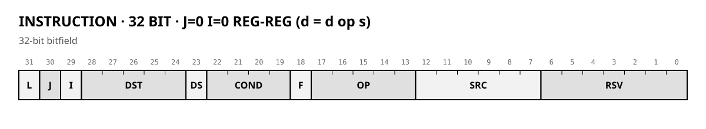
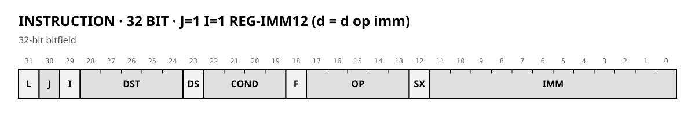
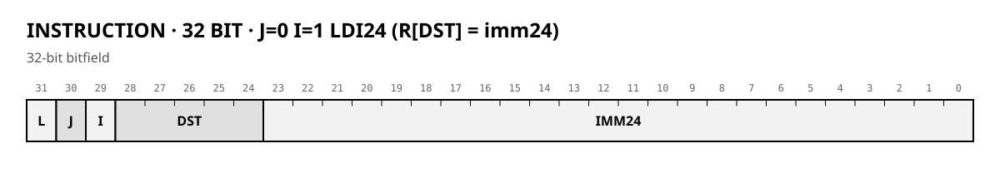
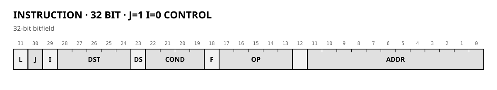

# Graphics coprocessor for Z80: architecture

*Source for the documentation generator. YAML declarations in `spec/` produce SVG and MD tables; `[include]` inserts them here. Numbers are approximate; details are refined on the simulator.*

## 1. Principles

1. **Simplicity over peak speed.** The bottleneck is memory, so the core can be simple.
2. **Programmable core, not a hardwired state machine.** Microcode lives in BRAM; a new algorithm means new microcode, not new logic.
3. **Only the hot path goes into hardware:** word buffers, pixel packing, address computation inside ports.
4. **Screen coordinates inside, addresses outside are invisible.** The CPU says "draw at (x, y)"; the port turns a pixel index into a word address.
5. **Pixel formats: 1, 4, 8, 16 bpp; pass-through modes LO8/HI8/16.**
6. **No hardware scrolling.** Replaced by fast block copying.
7. **One instruction format, four classes** (`J`, `I`): reg-reg, reg-imm12, LDI24, control.
8. **Flags Z, N, C, V.** ARM-style conditions. `CMP`/`TST` always write flags; others by `F=1`.
9. **`SHADOW` — return address + flags**; `CALL` writes it, `RET` uses PC only, `JMPR` for indirect return.
10. **`LOOP` register** — count + target, `L` bit drives it.
11. **Ports stall the sequencer in hardware**; the model does not simulate cycle counts (mathematical model, execution order identical).
12. **Three channels: SRC, DST, STM.** `STM` is read-only (microcode loader).

## 2. Overall picture


*Domain boundary: command and register logic in the 8-bit domain; the core, word buffers, and video controller on 16-bit memory. They meet at the core's registers.*

GPU → Wishbone → VideoMemoryArbiter. The arbiter is out of scope; raster scan has top priority.

## 3. Microinstruction (32 bit)



[include](insn_reg-table.md)



[include](insn_imm12-table.md)



[include](insn_ldi24-table.md)



[include](insn_ctrl-table.md)

**Classes (J, I):**

| J | I | Class | Layout of low bits |
|---|---|---|---|
| 0 | 0 | reg-reg | `SRC[5:0]` in [12:7], `RSV[6:0]` in [6:0] |
| 1 | 1 | reg-imm12 | `SX` in [12], `IMM[11:0]` in [11:0] |
| 0 | 1 | LDI24 | `IMM24[23:0]` in [23:0]; only R0..R31; no COND/F; unconditional |
| 1 | 0 | control | `REG[5:0]` in [12:7], `ADDR[11:0]` in [11:0]; `OP` = CTRL |

**Execution order.** One instruction per cycle (model). ALU reads A/B/C at start, writes at end. Flags from the previous instruction.

**Condition and flags.** Z, N, C, V from the previous flag-writing instruction. `COND` selects; false = no register write, no port access.

[include](conditions-table.md)

## 4. ALU

[include](alu_ops-table.md)

**Notes:**
- Writing to ZERO discards the result. NOP = MOV ZERO, ZERO.
- Flags are written only if F=1 (CMP/TST always).
- `ROR`/`SHR`/`SAR` do not update C.
- `MUL`/`MULH` are multi-cycle in RTL (DSP); 1 cycle in the model.

## 5. Control

[include](ctrl_ops-table.md)

**Notes:**
- `CALL` writes SHADOW. Nested calls: save SHADOW to a register first.
- `L` bit: after the word, if count > 1 then count--, PC = loop target; else fall through. Runs even if COND is false. `L` with control words is forbidden.

## 6. Operand map

[include](operand_map-table.md)

**Notes:**
- Ports that are not readable/writable are rejected by the assembler.
- Source advances on read, destination on write. Transparency: write the old pixel back.
- `STM` is read-only.

## 7. Register file

[include](registers-table.md)

`SDX`, `SDY`, `DDX`, `DDY` are a microcode convention (affine mode, 12.12), not a hardware feature.

## 8. Pixel formats and channel mode

[include](channel_mode-table.md)

`MODE` is set via `MOV x.MODE, R`; read via `MOV R, x.MODE`. No `COP` bit.

## 9. Loader and packets

BRAM 0–31 holds the loader; writing there → `HALT 1`.

**Packet format:** sequence of blocks, each starts with a 16-bit header `{kind[15:12], arg[11:0]}`:

[include](commands-table.md)

`CODE`: 32-bit microinstruction = 2 words. `RUN`: entry point. `JUMP`: new `STM.PTR`.

End of a task:
```
MOV FLUSH, ZERO     ; flush all dirty words
MOV IRQ, Rcode      ; optional: raise IRQ with code
HALT 0              ; IDLE
```

## 10. System commands

| Command | Single function | What it does not do |
|---|---|---|
| `JMP`, `CALL`, `RET`, `JMPR` | control flow | |
| `LDI24` | load 24-bit constant into R0..R31 | does not touch flags |
| `FLUSH` (via MOV) | make memory coherent | does not interrupt CPU |
| `IRQ` | raise an event | does not flush memory, does not stop the core |
| `HALT X` | `X=0` → IDLE; `X!=0` → ERROR(code) | does not interrupt CPU |

`ERROR` is cleared only by a new `START` (or `reset()`).

## 11. Reference loops

**Solid fill:**
```
; setup: DST.PAGE, DST.MODE, DST.STEP, DST.IDX, LOOP=(N<<12)|PIX
PIX:  MOV DST.PIX, FG      ; write pixel; IDX += STEP; L=1
```

**Sprite copy:**
```
PIX:  MOV T0, SRC.PIX      ; read source pixel
      MOV DST.PIX, T0      ; write destination pixel; IDX += STEP
```

**Affine mode** — source sampled per pixel:
```
      LDI24 T0, sidx
      MOV SRC.IDX, T0
      MOV T0, SRC.PIX
      LDI24 T1, didx
      MOV DST.IDX, T1
      MOV DST.PIX, T0
```

## 12. Clipping and affine mode

Clipping registers (`CX0`, `CY0`, `CX1`, `CY1`) and affine increments (`SDX`, `SDY`, `DDX`, `DDY`) are specified. **Microcode is not written yet** — it is a microcode convention, not a hardware feature.

## 13. Deliberately not done

- Hardware scrolling and page flip.
- Color × color LUT.
- 2 and 3 bpp formats (`fmt=1`, reserved).
- Third source (replaced by two passes through a hidden page).
- Fast whole-word fill (solved in software).
- Palette (not part of the processor).
- Combiner (`COMB`) — removed; logic via ALU.
- `SKIP_IF_Z` — removed; transparency via `COND Z` + `MASK` on write.
- `LDSP`/`LDDP`/`STDP` — replaced by `SRC.PIX`/`DST.PIX`/`STM.W16`.
- `FAULT` — removed (`HALT X` with `X != 0`).
- Saturation, `MIN`, `MAX` — removed from ALU.
- `SETMASK` / pixel mask / bit-plane layers — removed. Layers and partial updates are done by microcode.

## 14. Open questions

1. **`WAIT_FLAG`** — removed; ports stall in hardware.
2. **Exact microinstruction packing** — 32 bits, `MicroWord::pack/unpack`.
3. **`FLUSH`** — via `MOV FLUSH, ZERO`.
4. **Hardware detectors for `HALT 1`** — open.
5. **`kind` 4 bits** — sufficient.
6. **32 bits vs 36** — chosen: 32 bits.
7. **Affine mode** — `SDX`/`SDY` (12.12), microcode not written.
8. **Clipping** — `CX0..CY1`, microcode not written.
9. **Blending** — shift-based (`SHR`/`ADD`), not a dedicated command.
10. **Integration with `machine.cpp`** — `gpu_mmio` (page 3), `set_line(5)`, `tick(t)` — in progress.
11. **`PAGE`** — 8 bits; low 16 bits of `base` optional (FPGA: 8 bits, simulator: 24 bits).
12. **`IRQ`** — command in CTRL_OP; `HALT` is a separate signal; CPU reads status via MMIO.
