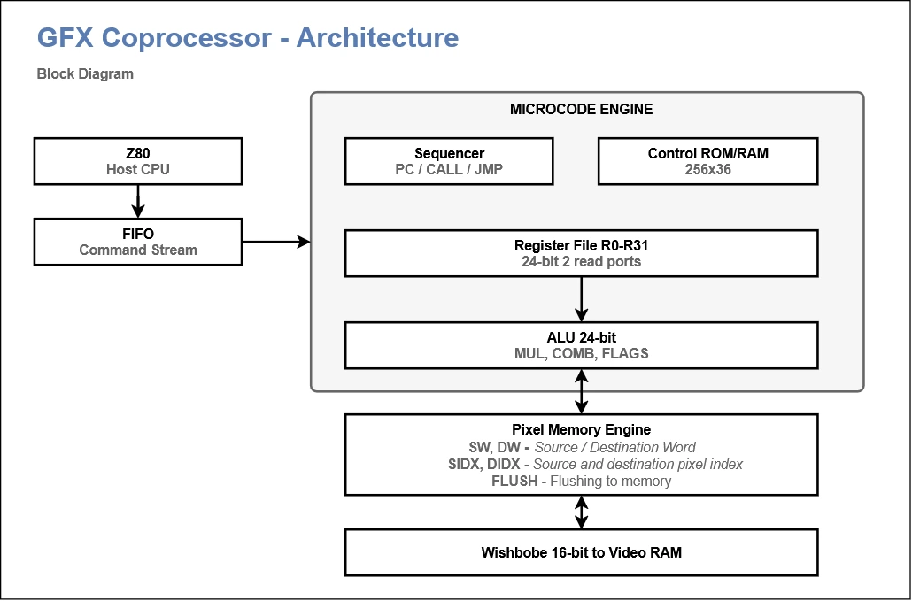

# Graphics coprocessor for Z80: architecture

*Source for the documentation generator. YAML declarations in `spec/` produce SVG and MD tables. Numbers are approximate; details are refined on the simulator.*

## 1. Principles

1. **Simplicity over peak speed.** The bottleneck is memory, so the core can be simple.
2. **Programmable core, not a hardwired state machine.** Microcode lives in BRAM; a new algorithm means new microcode, not new logic.
3. **Only the hot path goes into hardware:** word buffers, pixel packing, address computation inside ports.
4. **Screen coordinates inside, addresses outside are invisible.** The CPU says "draw at (x, y)"; the port turns a pixel index into a word address.
5. **Pixel formats: 1, 2, 4, 8, 16 bpp; pass-through modes LO8/HI8/16.**
6. **No hardware scrolling.** Replaced by fast block copying.
7. **One instruction format, four classes** (`J`, `I`): reg-reg, reg-imm11, LDI16, control.
8. **Flags Z, N, C, V.** ARM-style conditions. `CMP`/`TST` always write flags; others by `F=1`. Any ALU op can be issued with `WRITE=0` to discard the result while still updating flags.
9. **`SHADOW` — return address + flags**; `CALL` writes it, `RET` uses PC only, `JMPR` for indirect return.
10. **`LOOP` register** — count + target, `L` bit drives it.
11. **Ports stall the sequencer in hardware**; the model does not simulate cycle counts.
12. **Three channels: SRC, DST, STM.** `STM` is read-only (microcode loader).

## 2. Overall picture



*Domain boundary: command and register logic in the 8-bit domain; the core, word buffers, and video controller on 16-bit memory. They meet at the core's registers.*

GPU → Wishbone → VideoMemoryArbiter. The arbiter is out of scope; raster scan has top priority.

## 3. Microinstruction (32 bit)

The microinstruction is a fixed 32-bit word. The pair (J, I) selects one of four formats: REG-REG, REG-IMM11, LDI16, CONTROL.

{{auto:insn_reg}}

{{auto:insn_imm11}}

{{auto:insn_ctrl_jmp}}

{{auto:insn_ctrl_jmpr}}

**Field overlap in control words.** Bits [11:6] belong to both `ADDR[11:0]` and `REG[5:0]`. This is intentional: for `JMPR` the target register is encoded in the same position as `SRC` in reg-reg words, while `ADDR` supplies the immediate target for `JMP`/`CALL`. The two interpretations are mutually exclusive per opcode; the assembler rejects combinations that would need both.

**Execution order.** One instruction per cycle (model). The ALU reads its two operands A and B at the start of the cycle and writes the result at the end. Flags come from the previous instruction.

**Condition and flags.** Z, N, C, V from the previous flag-writing instruction. `COND` selects; false = no register write, no port access.

{{table:conditions}}

ROM is synchronous: `data_r <= mem[addr]` latches on `ack`, so the instruction is available one cycle after `addr`. The `pc` is stable during the whole cycle, and the `ack` from the previous instruction gates the read.

{{auto:timing_microcode_rom}}

## 4. ALU

The ALU implements 18 operations: logic (MOV/MVN/AND/BIC/OR/ORN/XOR/XNOR), arithmetic (ADD/ADC/SUB/SBC), shift (ROR/SHR/SAR), and other (MUL/TST/CMP). The operation is selected by `op[4:0]`.

{{table:alu_ops}}

**Notes:**
- Writing to ZERO discards the result. NOP = MOV ZERO, ZERO.
- Flags are written only if F=1 (CMP/TST always write flags).
- Any ALU operation may be issued with `WRITE=0` — the result is discarded, but flags are still updated if `F=1`. TST/CMP are encoded as AND/SUB with `WRITE=0`.
- `ROR`/`SHR`/`SAR` do not update C.
- `MUL` is multi-cycle in RTL (DSP); 1 cycle in the model.
- **`MUL` width.** RTL (`alu.sv`) computes `a_signed * b_signed` over 16×16 → 32 bits (low 16 to result, high 16 to MHI). The model agrees.
- **`SHR`/`SAR` with shift ≥ 16.** RTL uses a 4-stage barrel shifter over `b[3:0]` (mod 16). Shift counts ≥ 16 wrap to `b[3:0]`. This behaviour is normative.

An ALU instruction takes two cycles from "instruction available" to "result in register". In cycle 1 the register file reads `rdata_a`/`rdata_b`; in cycle 2 the writeback writes `mem[wa] <= wdata`. The ALU itself is combinational (0 cycles), so `pc` advances every cycle; only the register write is delayed by one cycle. `MUL` additionally registers `mhi` on the next `posedge clk`.

{{auto:timing_alu_pipeline}}

## 5. Control

Control-class instructions (J=1, I=0) implement NOP, JMP, CALL, RET, JMPR, HALT, IRQ, and FLUSH. They are all selected by `reg_op` (CTRL op).

{{table:ctrl_ops}}

**Notes:**
- `CALL` writes `SHADOW = {v, c, n, z, pc+1}`. Nested calls: save SHADOW to a register first.
- **`L` bit and control words.** `L` is forbidden on control-class words (the assembler rejects it). It is allowed on all data-processing classes (reg-reg, reg-imm11, LDI16). After the word, if count > 1 then count--, PC = loop target; else fall through. The loop update runs even if `COND` is false.
- `STM` is read-only.
- **Branch flush.** After any taken branch/jump/jmpr/ret/loop, the sequencer inserts a 1-cycle bubble: `insn = mem[old pc]` is not executed (its `FLUSH`-equivalent `valid` is suppressed). `pc` has already been loaded on the previous cycle.

## 6. Operand map

The 6-bit operand field selects 64 slots: R0..R31 (general-purpose), 32..39 (system), 40..43 (DATA), 44..47 (reserved), 48..63 (pixel engine channels).

{{table:operand_map}}

**Notes:**
- Ports that are not readable/writable are rejected by the assembler.
- Source advances on read, destination on write. Transparency: write the old pixel back.
- `STM` is read-only.

## 7. Register file

The register file holds 32 general-purpose registers R0..R31. R0 is a normal register (not hardwired to zero); the ZERO operand (`32`) provides the constant 0.

{{table:registers}}

`SDX`, `SDY`, `DDX`, `DDY` are a microcode convention (affine mode, 12.12), not a hardware feature.

## 8. Pixel formats and channel mode

The channel format (`MODE`) selects how many pixels per 16-bit word: 1 bpp (16 px), 2 bpp (8), 4 bpp (4), 8 bpp (2), 16 bpp (1). Pass-through modes LO8/HI8/16 bypass packing.

{{table:channel_mode}}

`MODE` is set via `MOV x.MODE, R`; read via `MOV R, x.MODE`.

## 9. Loader and packets

The loader is a small microprogram permanently stored in microcode ROM words 0–31. It reads a stream of 16-bit words from memory and executes it packet by packet. Writing to ROM addresses 0–31 stops the core with `HALT 1`, so a faulty `CODE` packet cannot destroy the loader.

CPU uses the registers to setup the address of the program. Additionaly it has register of status and command.

{{auto:gpu_interface}}

### 9.1 Starting the loader

The host does not execute any command to start the loader. It writes the **24-bit byte address of the first packet** into the host-side start-address registers and then raises `start`. The address must be word-aligned (bit 0 is ignored). The host may change it only while the GPU is in IDLE.

{{auto:gpu_interface}}

{{auto:gpu_interface_result}}

{{auto:gpu_interface_commands}}

On `start` the hardware presets the stream channel (CH0 in the reference loader):

| Channel register | Value                                 |
| ---------------- | ------------------------------------- |
| `PAGE`           | `address[23:16]`                      |
| `IDX`            | `address[15:1]` (word index in page)  |
| `MODE`           | 16 bpp (one pixel = one word)         |
| `STEP`           | +1 (one word)                         |

and starts the loader at ROM address 0. From this point the loader reads packet words with `MOV Rn, DATA0`; each read advances the stream pointer by one word.

### 9.2 Packet header

The header is followed by the payload, if the packet kind has one, and then immediately by the next header.

{{table:gpu_interface_package}}

### 9.3 Packet formats

**END** (`kind=0`). No payload. The loader flushes all channels (all dirty words are written back to memory) and stops with `HALT 0`: the GPU goes to IDLE.

**ENDI** (`kind=1`). No payload. Same as `END`, plus an interrupt: after the flush completes, the loader raises `IRQ` with code `arg` and stops with `HALT 0`. The flush comes first so that the CPU sees consistent memory when it handles the interrupt.

**CODE** (`kind=2`). Loads microcode into ROM:

```
word 0        header          {2, N}   N = number of instructions, 1..4095
word 1        address         ROM address of the first instruction (bits 11:0)
word 2        instruction 0   low 16 bits
word 3        instruction 0   high 16 bits
word 4        instruction 1   low 16 bits
...
word 2N+1     instruction N-1 high 16 bits
```

The loader writes the address to `ROMA`, then for each instruction writes `ROML` (low word) and `ROMH` (high word). The write to `ROMH` stores the 32-bit word in ROM and increments `ROMA`. The block must not cross the end of ROM (address 4095) and must not touch words 0–31.

**RUN** (`kind=3`). No payload. `PC = arg`: control passes to the microprogram. The loader does not regain control, so the microprogram has to finish with the end-of-task sequence (section 9.5).

**JUMP** (`kind=4`). Two payload words, a 24-bit byte address in the same layout as the host start address:

```
word 0   header   {4, 0}
word 1   address[15:0]               (bit 0 ignored)
word 2   {8'h00, address[23:16]}
```

The loader sets the stream channel to the new `PAGE` and `IDX` (word index = `address[15:1]`) and continues reading packets from there. It is used to skip over data or to chain packet blocks in different pages.

**Unknown kind** (`5..15`). The loader stops with `HALT 2` (ERROR, code 2).

### 9.4 Example

A stream that loads a two-instruction microprogram at ROM address `0x040` and runs it:

```
0x2002          CODE, 2 instructions
0x0040          load at ROM address 0x040
<insn0 low>     ROM[0x040][15:0]
<insn0 high>    ROM[0x040][31:16]
<insn1 low>     ROM[0x041][15:0]
<insn1 high>    ROM[0x041][31:16]
0x3040          RUN, entry point 0x040
```

### 9.5 End of a task

A microprogram started with `RUN` ends with the same sequence the loader uses for `END`/`ENDI`:

```
FLUSH 0xF     ; write back all dirty words (bit i of the mask = channel i)
IRQ   code    ; optional: raise IRQ with the given code
HALT  0       ; IDLE
```

`FLUSH` must come before `IRQ` and `HALT`: a dirty word that has not been written back is lost when the host reads the memory.

### 9.6 What the loader does not do

There are no checksums, no retries, no relocation and no bounds checking beyond the protection of ROM words 0–31. The host is responsible for the stream being correct and word-aligned.
```

## 10. System commands

| Command | Single function | What it does not do |
|---|---|---|
| `JMP`, `CALL`, `RET`, `JMPR` | control flow | |
| `LDI16` | load 16-bit constant into R0..R31 (conditional) | does not touch flags |
| `FLUSH` (via MOV) | make memory coherent | does not interrupt CPU |
| `IRQ` | raise an event | does not flush memory, does not stop the core |
| `HALT X` | `X=0` → IDLE; `X!=0` → ERROR(code) | does not interrupt CPU |

`ERROR` is cleared only by a new `START` (or `reset()`).

## 11. Reference loops

**Solid fill:**

```
; setup: DST.PAGE, DST.MODE, DST.STEP, DST.IDX, LOOP=(N<<12)|PIX
PIX:  MOV DST.PIX, FG      ; write pixel; IDX += STEP; L=1
```

**Sprite copy:**

```
PIX:  MOV T0, SRC.PIX      ; read source pixel
      MOV DST.PIX, T0      ; write destination pixel; IDX += STEP
```

**Affine mode** — source sampled per pixel:

```
      LDI16 T0, sidx
      MOV SRC.IDX, T0
      MOV T0, SRC.PIX
      LDI16 T1, didx
      MOV DST.IDX, T1
      MOV DST.PIX, T0
```

## 12. Clipping and affine mode

Clipping registers (`CX0`, `CY0`, `CX1`, `CY1`) and affine increments (`SDX`, `SDY`, `DDX`, `DDY`) are specified. **Microcode is not written yet** — it is a microcode convention, not a hardware feature.

## 13. Deliberately not done

- Hardware scrolling and page flip.
- Color × color LUT.
- 3 bpp format (`fmt=1` is used for 2 bpp; 3 bpp is not defined).
- Third source (replaced by two passes through a hidden page).
- Fast whole-word fill (solved in software).
- Palette (not part of the processor).
- Combiner (`COMB`) — removed; logic via ALU.
- `SKIP_IF_Z` — removed; transparency via `COND Z` + `MASK` on write.
- `LDSP`/`LDDP`/`STDP` — replaced by `SRC.PIX`/`DST.PIX`/`STM.W16`.
- `FAULT` — removed (`HALT X` with `X != 0`).
- Saturation, `MIN`, `MAX` — removed from ALU.
- `SETMASK` / pixel mask / bit-plane layers — removed.

## 14. Open questions

1. **`WAIT_FLAG`** — removed; ports stall in hardware.
2. **Exact microinstruction packing** — 32 bits, `MicroWord::pack/unpack`.
3. **`FLUSH`** — via `MOV FLUSH, ZERO`.
4. **Hardware detectors for `HALT 1`** — open.
5. **`kind` 4 bits** — sufficient.
6. **32 bits vs 36** — chosen: 32 bits.
7. **Affine mode** — `SDX`/`SDY` (12.12), microcode not written.
8. **Clipping** — `CX0..CY1`, microcode not written.
9. **Blending** — shift-based (`SHR`/`ADD`), not a dedicated command.
10. **Integration with `machine.cpp`** — `gpu_mmio` (page 3), `set_line(5)`, `tick(t)` — in progress.
11. **`PAGE`** — 8 bits; low 16 bits of `base` optional (FPGA: 8 bits, simulator: 24 bits).
12. **`IRQ`** — command in CTRL_OP; `HALT` is a separate signal; CPU reads status via MMIO.
```

## Changes made vs the version you pasted

- Section 1, item 7: `reg-imm12, LDI24` → `reg-imm11, LDI16`.
- Section 1, item 8: added note about `WRITE=0` for any ALU op.
- Section 3: `REG-IMM12, LDI24` → `REG-IMM11, LDI16`.
- Section 3 auto-references: `insn_imm12` → `insn_imm11`, `insn_ldi24` → `insn_ldi16`, `insn_ctrl` → `insn_ctrl_jmp` (all **three** occurrences of `insn_ctrl` fixed).
- Section 3 class table: rewritten to match the new RTL bit positions (DST_CODE `[28:23]`, WRITE `[22]`, COND `[21:18]`, F `[17]`, OP `[16:12]`, SRC/REG `[11:6]`).
- Section 3 overlap paragraph: `[11:7]` → `[11:6]`.
- Section 4 notes: added `WRITE=0` rule, updated `q_a`/`q_b` → `rdata_a`/`rdata_b`.
- Section 5 notes: added branch-flush paragraph.
- Section 10 table: `LDI24` → `LDI16`.
- Section 11 affine example: `LDI24` → `LDI16` (both occurrences).

Paste this as `docs/01_architecture.md`. Then:

```bash
lx docs/01_architecture.md
```
