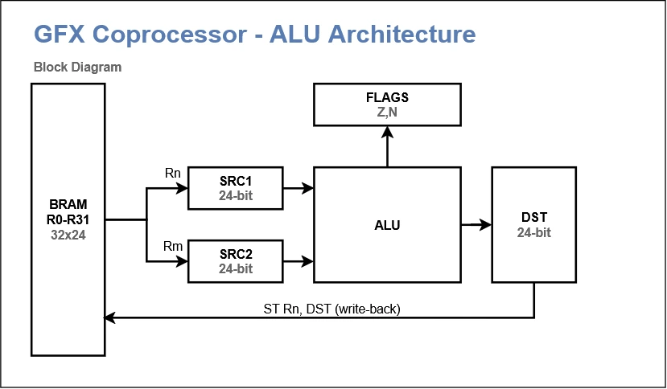

# Микроядро графического сопроцессора

Ядро — единственный «процессор» внутри сопроцессора: оно само вынимает байты команд из FIFO, разбирает их микрокодом и рисует. Отдельного декодера и отдельного пути записи регистров нет.

## 1. Главная идея

- Z80 пишет в один порт, байты попадают в FIFO. Кроме него у CPU есть только аппаратный порт статуса (FIFO заполнено, ядро простаивает, ядро в ошибке).
- **Язык команд Z80 и язык микрокоманд ROM — два разных уровня.** Входной протокол не превращается в 36-битные микрокоманды. FSM на входе распознаёт только `SET` и `EXECUTE`; всё остальное — это микрокод.
- Микрокоманда `NEXT` — единственная специальная команда sequencer’а. Она обрабатывает следующую входную команду (`SET` — запись в регистр, `EXECUTE` — переход на микропрограмму) или ждёт, если FIFO пуст.
- Пока выполняется микропрограмма (`FILL`, `COPY`, ...), FSM продолжает принимать байты в FIFO, но `NEXT` не исполняет их до возврата в `MAIN`.
- Микрокоманды простые, но в одном микрослове могут параллельно работать регистровый тракт и АЛУ.

## 2. Схема


## 3. Регистровый файл

32 регистра общего назначения по 24 бита, реализованы в BRAM: один синхронный порт чтения, один порт записи, зарегистрированный выход.

[include](./gen/registers-table.md)

Регистры `R17–R20` (`SDX`, `SDY`, `DDX`, `DDY`) — это соглашение микрокода, а не отдельная аппаратная фича. Они используются в аффинном режиме и при построчном сдвиге для приращений координат источника и приёмника в формате 12.12.

## 4. Внутренние регистры АЛУ

АЛУ имеет три внутренних регистра по 24 бита: `SRC1`, `SRC2`, `DST`. Они не адресуются из регистрового файла — это буферы на входах и выходе АЛУ.



- `SRC1`, `SRC2` — операнды АЛУ. Загружаются из регистрового файла (`LD SRC1, Rn`), из предыдущего результата (`LD SRC1, DST`), либо константой (`LD SRC1, IMM`).
- `DST` — результат АЛУ. Записывается в регистровый файл (`ST Rn, DST`) или читается как источник следующей операции (`LD SRCk, DST`).
- `FLAGS` (Z, N) — флаги результата, обновляются АЛУ.

Отдельного регистра `P` для умножения нет: результат умножения поступает в `DST`, как и результат любой другой операции.

## 5. Микрокоманды

[include](./gen/microops_reg-table.md)

[include](./gen/microops_alu-table.md)

[include](./gen/microops_cond-table.md)

[include](./gen/microops_ctrl-table.md)


Каждая микрокоманда занимает один такт, за исключением операций с переменной задержкой (см. раздел 7).

## 6. Параллельное исполнение

В одном микрослове разрешается выполнять **одну операцию регистрового тракта** и **одну операцию АЛУ**. Формула: одна операция с BRAM и одна операция АЛУ на такт.

```
LD SRC1, R1
LD SRC2, R2
ALU ADD
LD SRC2, R4 + ALU ADD
ST R3, DST + ALU ADD
```

Семантика параллельной микрокоманды: АЛУ использует **старые** `SRC1`/`SRC2`, результат кладёт в `DST`, а регистровый тракт в это же время либо загружает новое значение в `SRCk`, либо пишет предыдущий `DST` в регистр.

## 7. Длительные операции

Количество тактов для умножения не фиксируется: оно определяется реализацией умножителя на конкретной FPGA. Исполнительный блок использует сигналы `BUSY` и `READY`. Микрокод может ожидать готовности через `BUSY`/`READY`, либо вставлять `NOP`.

## 8. Главный цикл и `NEXT`

```
MAIN:
    NEXT
    JP MAIN

FILL:
    ; ... микропрограмма заливки ...
    JP MAIN

COPY:
    ; ... микропрограмма копирования ...
    JP MAIN
```

`NEXT` — операция sequencer’а, а не АЛУ. Она не пишет в `DST`, не обновляет `FLAGS`, не трогает `SRC1`/`SRC2`. Её поведение зависит от состояния входного потока:

- **FIFO пуст** — PC остаётся на `NEXT`, ядро ждёт. По этому простою выставляются флаг готовности и прерывание.
- **FIFO содержит `SET Rn, value`** — значение записывается в `Rn` через порт записи регистрового файла. PC остаётся на `NEXT`: следующая команда обработается на следующем такте.
- **FIFO содержит `EXECUTE ID`** — PC переходит на адрес микропрограммы `ID`.

Каждая микропрограмма заканчивается `JP MAIN`, после чего `NEXT` снова готов принимать команды.

Пока выполняется микропрограмма (например, `FILL`), входная FSM продолжает принимать байты в FIFO, но не исполняет их: `NEXT` находится не на пути исполнения. Это гарантирует, что следующая `EXECUTE` не начнётся, пока текущая микропрограмма не завершилась.

## 9. Микрослово

Предварительная ширина — 36 бит. Конкретная раскладка полей будет определена после проектирования всех управляющих сигналов.


[include](./gen/microinstruction-table.md)

## 10. Команды входного протокола

[include](./gen/commands-table.md)

## 11. Примеры

**Заливка прямоугольника** (X-клиппинг; Y-клиппинг аналогичен через `MIN`/`MAX`):

```
FILL:
    LD SRC1, DX
    LD SRC2, CX0
    ALU MAX
    ST T3, DST                 ; T3 = x0 = MAX(DX, CX0)

    LD SRC1, DX
    LD SRC2, W
    ALU ADD
    LD SRC2, CX1
    ALU MIN
    ST T4, DST                 ; T4 = x1 = MIN(DX + W, CX1)

    LD SRC1, T4
    LD SRC2, T3
    ALU SUB
    ST T4, DST                 ; W' = x1 - x0
    Jcond Z DONE

    LD SRC1, H
    ST T2, DST                 ; T2 = H
ROW:
    LD SRC1, DY
    LD SRC2, DSTRIDE
    ALU MUL
    LD SRC2, T3
    ALU ADD
    ST T0, DST                 ; T0 = DY * DSTRIDE + x0

    LD SRC1, T4
    ST T1, DST                 ; T1 = W'
PIX:
    ST DIDX, T0
    ALU COMB                   ; DPIX = COMB(FG, DPIX)
    LD SRC1, T0
    LD SRC2, IMM 1
    ALU ADD
    ST T0, DST                 ; T0++

    LD SRC1, T1
    LD SRC2, IMM 1
    ALU SUB
    ST T1, DST                 ; T1--
    Jcond NZ PIX

    LD SRC1, DY
    LD SRC2, IMM 1
    ALU ADD
    ST DY, DST                 ; DY++
    LD SRC1, T2
    LD SRC2, IMM 1
    ALU SUB
    ST T2, DST                 ; T2--
    Jcond NZ ROW

DONE:
    FLUSH
    JP MAIN
```

**Копирование с прозрачностью.** Внутренний цикл:

```
PIX:
    ST SIDX, T6
    ST DIDX, T0
    ALU COMB                   ; DPIX = COMB(SPIX, DPIX)

    LD SRC1, T6
    LD SRC2, IMM 1
    ALU ADD
    ST T6, DST

    LD SRC1, T0
    LD SRC2, IMM 1
    ALU ADD
    ST T0, DST

    LD SRC1, T1
    LD SRC2, IMM 1
    ALU SUB
    ST T1, DST
    Jcond NZ PIX
```

Число тактов на пиксель зависит от плотности параллельных микрокоманд (сколько `LD`/`ST` удалось совместить с `ALU`) и от задержек BRAM и пиксельной памяти. Точная оценка будет получена после первой реализации микрокода.

**Аффинный режим.** Источник считается на каждый пиксель:

```
    LD SRC1, SX
    LD SRC2, SDX
    ALU ADD
    ST SX, DST                 ; SX += SDX

    LD SRC1, SY
    LD SRC2, SDY
    ALU ADD
    ST SY, DST                 ; SY += SDY

    ; sidx = (SY >> 12) * SSTRIDE + (SX >> 12)
    LD SRC1, SY
    LD SRC2, IMM 12
    ALU SHR
    LD SRC2, SSTRIDE
    ALU MUL
    ST T6, DST                 ; T6 = (SY >> 12) * SSTRIDE
    LD SRC1, SX
    LD SRC2, IMM 12
    ALU SHR
    LD SRC2, T6
    ALU ADD
    ST T6, DST                 ; T6 = sidx
```

## 12. Специальные окна памяти

Пиксельная память и палитра доступны через «окна» — адреса операндов, которые выглядят как регистры, но управляют аппаратурой:

- `SIDX` — задать индекс пикселя источника;
- `DIDX` — задать индекс пикселя приёмника;
- `SPIX` — прочитать пиксель источника (используется внутри `COMB`);
- `DPIX` — записать пиксель приёмника (используется внутри `COMB`);
- `FLUSH` — записать грязное слово в память;
- `PALI`, `PALD` — индекс и цвет палитры;
- `STAT` — статус; запись — запрос прерывания.

## 13. Узкие места и роль FIFO

FIFO нужен не для корректности, а для параллелизма. Без него каждая запись Z80 ждала бы, пока ядро закончит рисование. С ним CPU кладёт в очередь десятки команд и занимается своими делами.

Для мелких объектов узким местом оказывается подача команд, а не ядро. Отсюда практика: менять только изменившиеся регистры, держать часто повторяющиеся параметры в регистрах, а для больших партий спрайтов позже добавить команду, читающую параметры из списка в видеопамяти.

Исключение из принципа «один интерфейс» неизбежно одно: **загрузка микрокода**. Ядро не может исполнять программу, которой у него ещё нет, поэтому BRAM инициализируется из прошивки, а для замены есть аппаратный порт: ядро останавливается, процессор записывает по 5 байт на слово, ядро запускается.

## 14. Открытые вопросы

1. **Точная раскладка 36-битного микрослова** — будет определена после того, как все управляющие сигналы выписаны.
2. **Задержка `MUL`** — определяется целевой FPGA; микрокод должен опираться на `BUSY`/`READY`.
3. **Автоинкремент `SIDX`/`DIDX`** — делает ли железо `idx++` само, или микрокод делает `ALU ADD`.
4. **Ширина тракта.** 24 бита нужны для аффинных шагов (12.12). Для остальных операций хватило бы 16, но разделять тракт нет смысла.
5. **Палитра:** запись из ядра пересекает границу тактовых доменов, если видеоконтроллер работает на другой частоте.
6. **Быстрая заливка по слову** (4 пикселя за раз): отдельная подпрограмма, нужна ли в первой версии.
7. **Список в видеопамяти:** нужна ли возможность читать команды не только из FIFO, но и из ОЗУ.


