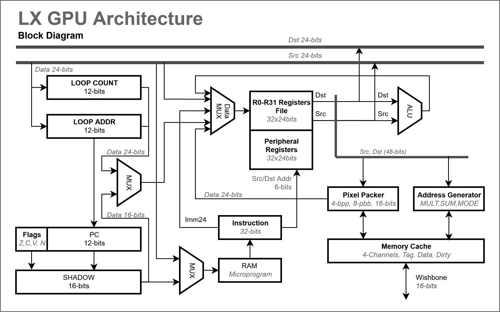

# FPGA Top Overview

LX-GPU is a 16-bit-data processor (32-bit instructions) with a pixel engine, a cache, and a Wishbone interface for external memory. The core is a 3-stage pipeline F → D → X; it stalls in X while a device has not acknowledged, and in D while an X-stage hazard resolves.

## Block Diagram

The processor consists of several interconnected blocks: `core_fetch` (PC, hardware loop, SHADOW), `core_rom`, `core_regfile`, `core_alu` + `core_cond` (X-stage execute), and `ch_top` (containing `ch_addr_gen`, `ch_blender`, `ch_cache`). Decode and writeback live in the X stage of `gpu_top`; there are no separate Decode / Writeback modules. The architecture is modular: blocks know nothing about each other, only the protocol.

*Fig. 1. LX-GPU block diagram.*

## Execution Protocol

The pipeline advances when `adv = ~halted & ~x_busy & ~fu_hold`. An X-stage instruction that issues a device request (`ch_data_req`, `rom_req`, `ch_flush_req`) holds `x_busy` until the device acknowledges (`x_dev_ack`); `pc`, the IR, the regfile outputs and `x_ins_r` all hold. One device per instruction. The cache `ack_o` is a one-cycle hit strobe; on a miss the cache fills in the background and the requester must hold/re-issue. The consumer-side data ack in `ch_top` is `blend_ack` from the blender, not the cache `ack_o`.

## Registers and Operands

Processor registers are split into four groups: general (R0..R31), system (32..41, with 42..43 reserved), DATA[0..3] (44..47), and pixel engine channels (48..63). The register map is shown below.

{{auto:registers}}

*Fig. 2. General-purpose registers.*

{{auto:sysregs}}

*Fig. 3. System registers.*

## Instruction Format

All instructions are 32-bit. Fields are fixed: `L[31]`, class `[30:29]`, `COND[28:25]`, `WRITE[24]`, `F[23]`, `DST[22:17]`, `ALU_OP[16:12]`, `SRC[11:6]`, `SX`/`IMM11[10:0]`, `ADDR[11:0]`, `IMM16[15:0]`. See the ISA section for details.

{{auto:insn_ctrl_jmp}}

*Fig. 4. Instruction format.*