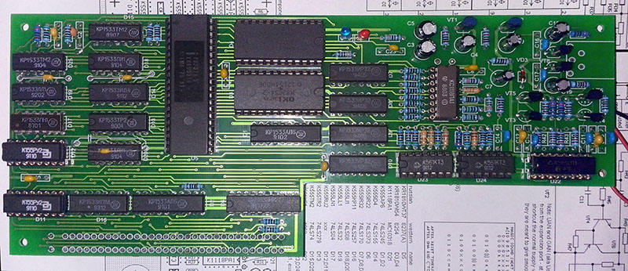
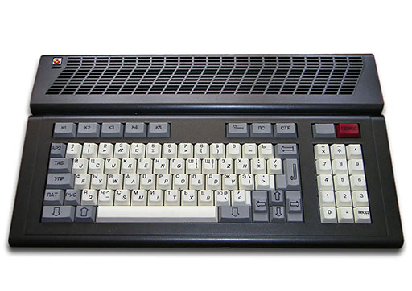
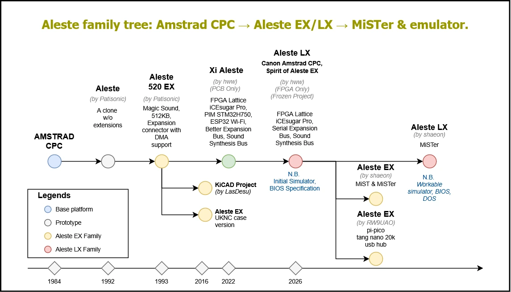
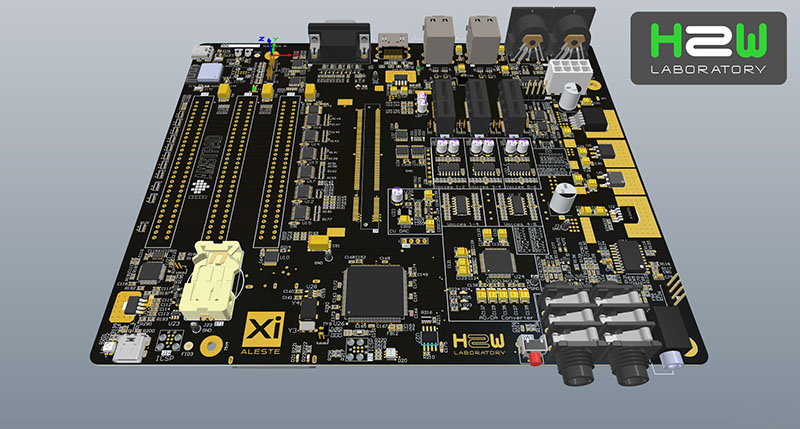
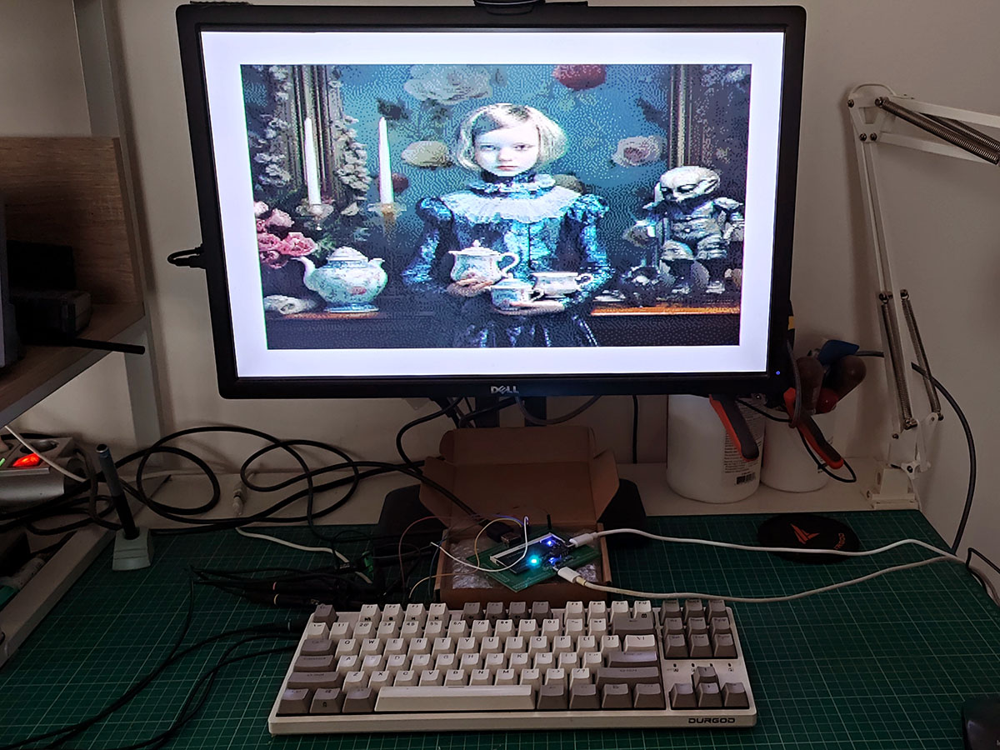

# The Aleste Story

### From the Aleste 520 EX to Xi and LX

## The Beginning: Aleste 520 EX

The story of Aleste began with a fascination for the Amstrad CPC.

At a time when the ZX Spectrum seemed to be everywhere, the Amstrad CPC felt like something a little different: more colorful, more versatile, and perhaps a little more interesting. We wanted to have our own version of this computer, built with the components available to us at the time.

And so, Aleste was born: an Amstrad CPC-compatible computer implemented using Soviet electronic components.

The name *Aleste* came from the world of MSX. One of our team's favorite games was Aleste, a fast-paced shooting game that left a lasting impression on us. We also liked the name itself: short, distinctive, and with the character of a proper name. It had something of the same appeal as Amiga. We decided it was a perfect name for our computer.

The original machine evolved beyond a straightforward CPC clone.

Inspired by the music of the demoscene and Scream Tracker, we developed **Magic Sound**, an expansion sound card capable of using DMA (Direct Memory Access) to transfer audio data directly from system memory.

The musical side of the project continued with **Magic Sound**, an affordable sound expansion designed to bring Amiga-class module playback to Aleste. It could play MOD and STM music files, delivering a music experience comparable to that of the Amiga 500.

This was another example of the Aleste philosophy: bringing capabilities from more powerful and expensive platforms into an accessible home computer.

Supporting this new hardware required architectural changes. We expanded the memory capacity and extended the original Amstrad expansion bus with additional signals, making direct memory access possible for external devices.

This was the origin of the **EX** designation and the Aleste 520 EX architecture. The number **520** referred to its 520 KB of memory.

Alongside the development of the original Aleste architecture, we also explored compatibility with other popular computer platforms. The Aleste 520 EX could run MSX-DOS and even execute some MSX games through software emulation, using its own processor to simulate the MSX environment.

This gave Aleste an unusual versatility: it was rooted in the Amstrad CPC architecture, yet it could reach beyond that world and explore software originally written for another computer family.

Aleste was never just about reproducing an existing computer. Even in its earliest form, it was about taking an existing architecture and making it more capable.

## Aleste Xi: The Uncompromised Vision

The original Aleste was, inevitably, a product of its time. Its architecture was shaped by the limitations of available components, manufacturing costs, and the practical realities of building complex digital hardware without programmable logic devices such as modern FPGAs.

Almost every design decision involved a compromise: how many chips would it take, how much would they cost, and could we achieve the desired functionality with the resources available?

Years later, we decided to revisit the idea of Aleste from a completely different perspective.

What if we could design the computer we would have wanted to build back in 1990, if the technology of today had been available?

What if we could finally implement the original vision without the compromises imposed by the limitations of that era?

This became **Aleste Xi**.

The name Xi (Ξ, ξ) comes from the Greek alphabet. We chose it simply because it is a beautiful, distinctive, and memorable letter. It is not an abbreviation. It is the name of the computer.

Xi represented an uncompromising approach to the Aleste architecture: expanded capabilities, greater flexibility, and the freedom to implement ideas that would have been impractical or prohibitively complex in the original design.

This philosophy also extended to sound generation. The design included expansion possibilities for analog audio filters, bringing more sophisticated approaches to sound synthesis into the system.

Xi was an attempt to realize the Aleste of our imagination, without the technological restrictions of the past.

But this freedom came at a price. The extensive hardware, numerous connectors, and specialized expansion options made the board increasingly complex and expensive to manufacture.

We needed another approach.

## Aleste LX: A New Architectural Direction

The next step was not simply to make Xi cheaper. It was to rethink the relationship between the computer's internal architecture and its external hardware.

We started with a different assumption: modern programmable logic gives us enormous freedom inside the FPGA. There is no reason to impose the old hardware limitations on the internal architecture.

At the same time, everything outside the FPGA should be as small, simple, and affordable as possible.

This became the guiding principle of **Aleste LX**.

The letter **L** originally stood for *Lightweight*: a reminder to keep the physical hardware compact and economical.

The **X** represents the experimental freedom and extensibility of programmable logic.

Together, they form the name **LX — Lean eXtreme FPGA Architecture**.

LX introduced a new approach to expansion. Instead of relying on large, traditional parallel expansion connectors, the design moved towards compact, high-speed serial interfaces. Legacy connectors and peripheral interfaces that were no longer essential could be eliminated.

The objective was not to reduce the capabilities of the computer, but to move complexity away from the physical board and into the FPGA, where it could be implemented without the cost and limitations of additional discrete hardware.

This distinction is fundamental:

**Inside the FPGA: no compromises.  
Outside the FPGA: only what is necessary.**

Aleste LX is therefore more than a cost-reduced version of Xi. It is a new hardware architecture and a different way of thinking about how a retrocomputer should be built.

*Image: Aleste LX 8 Bits per Pixel Mode*

## The Names and Their Meaning

The Aleste family has evolved through several generations, each reflecting the possibilities and priorities of its time.

- **Aleste** — the name of the computer family, inspired by the MSX game that became a favorite of the original development team.
- **520** — the memory capacity of the original Aleste.
- **EX** — the designation of the expanded original architecture, developed to support additional memory and DMA-based expansion hardware.
- **Xi** — the name of the uncompromising Aleste computer, inspired by the Greek letter Xi.
- **LX** — Lean eXtreme FPGA Architecture: the programmable hardware platform that provides the foundation for Aleste Xi and future implementations.

## The Philosophy

From the beginning, Aleste has been driven by the same idea: take the spirit of a classic computer architecture and explore what it could become with the technology available today.

The original Aleste pushed the limits of the components available to us.

Xi explored what the architecture could be without the technological compromises of the past.

LX takes the next step: uncompromising complexity inside programmable logic, combined with deliberately minimal and affordable hardware outside it.

**Maximum freedom inside. Minimum hardware outside.**

That is the philosophy of Aleste LX.