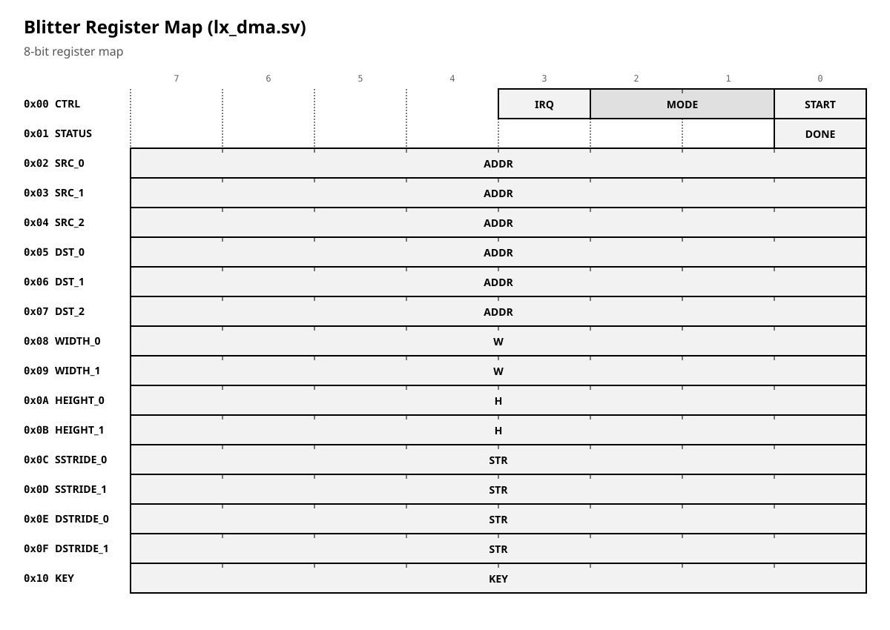
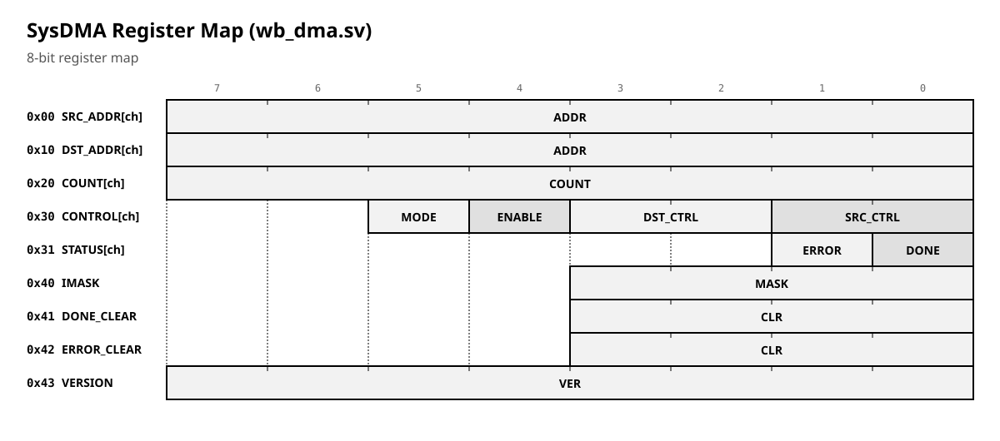

# LX DMA / Blitter

## 0. How to read this document

LX has **two** DMA-related devices:

1. **Blitter** (`lx_dma.sv`) — 1 channel, 8-bit, copy/fill/transparent.
2. **SysDMA** (`wb_dma.sv`) — 4 channels, 16-bit, DRQ/DACK.

This document describes **both**, separately. It does **not** contain
addresses; addresses are in `lx_rtl_reference.md` §2.

### Markers

| Marker | Meaning |
|---|---|
| **✔ By design** | An intentional RTL decision. |
| **⚠ Spec:** | The old specification differs from the RTL. RTL is authoritative. |
| **⚠ Outdated:** | The old document may be stale. |

---

## 1. Blitter (`lx_dma.sv`)

### 1.1 Purpose

The blitter copies and fills **2D rectangles** (width, height, source
and destination strides), byte by byte, through the second bus master.
It supports **copy**, **fill** and **copy with transparent colour**.

**✔ By design (RTL):** the blitter yields the bus for one cycle after
each byte (`gap`), so the sound chip (which shares the second master)
does not run out of samples during a long copy.

### 1.2 Registers

The blitter has **17 registers**, 8 bits each, at offsets `0x00`–`0x10`
from the base address.

**✔ By design (RTL):** the register layout matches `lx_dma.sv`.

### 1.3 Modes

[include](gen/dma_blitter_modes-table.md)

### 1.4 Interrupt

`irq_o = done` — the blitter asserts an interrupt when a transfer
completes and `CTRL[3]` (IRQ on done) was set.

**✔ By design (RTL):** `irq_o = done`.

### 1.5 Bus behaviour

The blitter asserts `dma_cyc_o` and `dma_we_o` for each byte, then
deasserts for one cycle (`gap`) so that the sound chip can use the bus.

**✔ By design (RTL):** `dma_cyc_o = ((st == T_RD) || (st == T_WR)) && !gap`.

### 1.6 Physical addresses

The blitter uses **physical** 24-bit addresses. In LX mode, the memory
the CPU sees at `C00000–C0FFFF` is at `410000–41FFFF`.

**✔ By design (RTL):** comment in `lx_dma.sv`.

---

## 2. SysDMA (`wb_dma.sv`)

### 2.1 Purpose

SysDMA is a **4-channel** DMA controller with **DRQ/DACK** handshake,
**16-bit** data path, and **demand** / **block** modes. It is on the
**memory / video side** of the 16→8 bridge.

> **⚠ Spec:** Old `lx_dma.md` described SysDMA with 4 channels,
> 16-bit data, DRQ/DACK. That description matches `wb_dma.sv`, but the
> **address** and the **width** in the old document were not consistent
> with the RTL. **RTL is authoritative.**

### 2.2 Registers

SysDMA has per-channel registers and common registers. The layout is in
`wb_dma.sv`; the exact byte offsets are `TBD: verify against RTL`.

**✔ By design (RTL):** `wb_dma.sv` implements these registers.

### 2.3 Modes

[include](gen/dma_sysdma_modes-table.md)

### 2.4 Arbitration

Fixed priority: channel 0 > channel 1 > channel 2 > channel 3.

**✔ By design (RTL):** `for (i = 0; i < CHANNELS; i++)` in `wb_dma.sv`.

### 2.5 Bus width

SysDMA uses a **16-bit** data path. It is on the memory / video side of
the bridge.

**✔ By design (RTL):** `DATA_WIDTH = 16` in `wb_dma.sv`.

---

## 3. Which DMA is used where

| Device | Location | Width | Use |
|---|---|---|---|
| Blitter (`lx_dma.sv`) | CPU side (after bridge) | 8-bit | Rectangle copy/fill, transparent copy |
| SysDMA (`wb_dma.sv`) | Memory/video side (before bridge) | 16-bit | Block transfers, DRQ/DACK peripherals |

**✔ By design:** the two DMAs are on **different sides** of the 16→8
bridge. They are not alternatives; they serve different parts of the
system.

> **⚠ Spec:** Old `lx_dma.md` treated them as one device. They are
> **two**. **RTL is authoritative.**

---

## 4. Relation to other documents

- **Addresses:** `lx_rtl_reference.md` §2.
- **Bus widths:** `lx_rtl_reference.md` §6.
- **MMU / privileges:** `lx_mmu.md`.
- **Legacy:** `lx_io.md` §3.

---

## 5. Status

- **Reference.** Registers, bits and modes are as in the RTL
  (`lx_dma.sv`, `wb_dma.sv`).
- **Addresses** are in `lx_rtl_reference.md`.
- **⚠ Spec:** the old `lx_dma.md` treated the two DMAs as one and did
  not match the RTL. RTL is authoritative.

---

*End of document.*